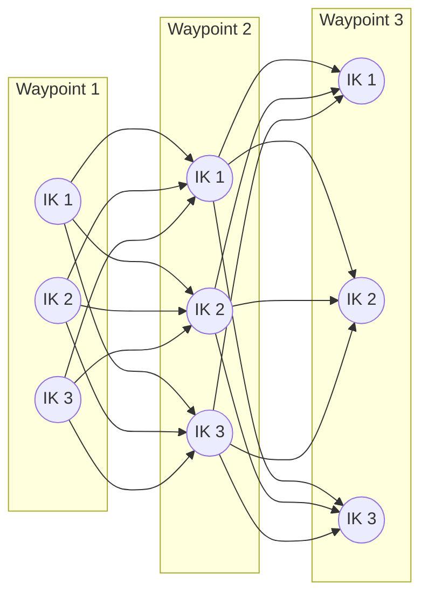

# tesseract_robotics.motion_planners_descartes

<!-- snippet: ambient
from tesseract_robotics.command_language import ProfileDictionary
from tests.docs.doc_assets import joint_program

program = joint_program(robot)
profiles = ProfileDictionary()
profile_dict = profiles
from tesseract_robotics.common import Isometry3d
from tesseract_robotics.planning import TaskComposer

composer = TaskComposer.from_config()
tool_pose = Isometry3d.Identity()
move = program[0].asMoveInstruction()
manip_info = program.getManipulatorInfo()
-->

Descartes graph-based Cartesian planner.

## Overview

Descartes solves dense Cartesian paths by building a graph of IK solutions
and finding the optimal path through it. Best for industrial toolpaths
(welding, milling) where every waypoint must be reached.

```python
from tesseract_robotics.motion_planners_descartes import (
    DescartesMotionPlannerD,
    DescartesDefaultMoveProfileD,
    DescartesLadderGraphSolverProfileD,
)
```

## Scalar types: `D` and `F`

Every type here is bound twice from one template: `...D` on `double` states and `...F` on `float`
states (`DescartesStateF.values` is a `float32` array). A Descartes node looks its profiles up by
the `createKey()` of its own type, and plans with the library defaults when it finds none:

| Pipeline | Planner | Profiles it reads |
|---|---|---|
| `CartesianPipeline`, `DescartesFPipeline`, `DescartesFNPCPipeline`, every `Raster*` pipeline | `DescartesMotionPlannerF` | `DescartesMoveProfileF`, `DescartesSolverProfileF` |
| `DescartesDPipeline`, `DescartesDNPCPipeline` (the `plan_cartesian` default) | `DescartesMotionPlannerD` | `DescartesMoveProfileD`, `DescartesSolverProfileD` |

The `planning` profile helpers (`create_descartes_default_profiles` and the pipeline helpers built
on it) register both types from the same settings; a `move_profile=` override is registered with a
twin of the other type. `TaskComposer.plan` raises `ProfileTypeMismatchError` when a profile name
in a Descartes node's namespace holds only the other type, instead of letting the node plan with
the defaults:

```python
from tesseract_robotics.command_language import ProfileDictionary
from tesseract_robotics.motion_planners_descartes import DescartesDefaultMoveProfileD
from tesseract_robotics.planning import ProfileTypeMismatchError

profiles = ProfileDictionary()
profiles.addProfile("DescartesMotionPlannerTask", "DEFAULT", DescartesDefaultMoveProfileD())
try:
    composer.plan(robot, program, pipeline="CartesianPipeline", profiles=profiles)
except ProfileTypeMismatchError as error:
    print(error)
# ProfileTypeMismatchError: Pipeline 'CartesianPipeline' would never find these profiles ...
#   node 'CartesianPipeline/MotionPlanningTask/DescartesMotionPlannerTask' reads
#   'DescartesMoveProfileF' in namespace 'DescartesMotionPlannerTask', but profile 'DEFAULT'
#   there is registered only as 'DescartesMoveProfileD'
```

`tesseract_robotics.planning.profile_types.descartes_nodes(factory, pipeline, node)` lists the
Descartes nodes a pipeline runs, with the namespace and task factory of each, including the ones a
raster task builds when it runs.

## DescartesMotionPlannerD

```python
from tesseract_robotics.motion_planners_descartes import DescartesMotionPlannerD
from tesseract_robotics.motion_planners import PlannerRequest

planner = DescartesMotionPlannerD("DescartesMotionPlannerTask")

request = PlannerRequest()
request.env = env
request.instructions = program
request.profiles = profiles

response = planner.solve(request)
```

`DescartesMotionPlannerD` is a `motion_planners.MotionPlanner`: `getName`, `solve`,
`terminate`, `clear` and `clone` are the base class's, and `solve` releases the GIL.
`DescartesMotionPlannerF` is the same planner on `float` states; it reads the `F` profiles.

## Profiles

### DescartesDefaultMoveProfileD

Per-waypoint configuration.

```python
from tesseract_robotics.motion_planners_descartes import DescartesDefaultMoveProfileD

profile = DescartesDefaultMoveProfileD()

# Target pose sampler settings
# Configure how many IK solutions to sample per waypoint
```

### DescartesLadderGraphSolverProfileD

Solver configuration for the ladder graph.

```python
from tesseract_robotics.motion_planners_descartes import DescartesLadderGraphSolverProfileD

profile = DescartesLadderGraphSolverProfileD()

# Graph construction and search settings
```

Both profiles compare by value (`==` compares every field, as the C++ `operator==` does) and
are unhashable. `DescartesMoveProfileD.createKey()` and `DescartesSolverProfileD.createKey()`
return the key every profile of that kind carries, the key `ProfileDictionary` looks up:

```python
assert DescartesDefaultMoveProfileD.createKey() == DescartesDefaultMoveProfileD().getKey()
```

## Inspecting the samplers

The move profile's `create*` hooks return what the planner builds for one waypoint. `str()` on
the waypoint sampler shows its working frame, TCP frame, target pose and TCP offset:

```python
sampler = DescartesDefaultMoveProfileD().createWaypointSampler(move, manip_info, env)
print(sampler)          # Working Frame: base_link, TCP Frame: tool0 ...
samples = sampler.sample()   # list[DescartesStateSampleD], one per IK solution
```

`DescartesStateSampleD(state)` builds a sample with cost 0, as `DescartesStateSampleD(state, 0.0)`.

## Tool-pose samplers

The functions behind `DescartesDefaultMoveProfileD.target_pose_sample_*` turn one tool pose into
candidate poses, returned as a `list[Isometry3d]`:

| Function | Samples |
|---|---|
| `sampleFixed(tool_pose)` | the pose itself |
| `sampleToolAxis(tool_pose, axis, resolution, minimum, maximum)` | rotations of the pose about `axis` |
| `sampleToolXAxis` / `sampleToolYAxis` / `sampleToolZAxis(tool_pose, resolution, minimum, maximum)` | rotations about the tool's X / Y / Z axis |

The angles run from `minimum` in steps of `resolution` while they do not exceed `maximum`
(equal within tolerance counts), so both ends are included when the range is a whole number of
steps:

```python
import numpy as np
from tesseract_robotics.motion_planners_descartes import sampleToolZAxis

poses = sampleToolZAxis(tool_pose, resolution=np.pi / 2, minimum=-np.pi, maximum=np.pi / 2)
len(poses)  # 4: -pi, -pi/2, 0, pi/2
```

They are useful without the planner, for example to seed IK over a tool axis the process is
indifferent to.

## How It Works

1. **Sample waypoints**: For each Cartesian waypoint, compute all IK solutions
2. **Build graph**: Create nodes for each solution, edges between consecutive waypoints
3. **Edge costs**: Based on joint motion between solutions
4. **Find path**: Dijkstra's algorithm finds minimum-cost path

Each column is a waypoint and each node one of its IK solutions; an edge joins every
solution of a waypoint to every solution of the next, weighted by the joint motion between them.



## Use Cases

- **Welding**: Dense linear paths with tool orientation constraints
- **Milling**: Toolpaths from CAM software
- **Painting**: Spray patterns with coverage requirements
- **Inspection**: Camera positioning paths

## Limitations

- **Computationally expensive**: O(n × k²) where n=waypoints, k=IK solutions
- **Requires IK solutions**: Won't work if waypoints are unreachable
- **No obstacle avoidance**: Use with collision checking post-filter

## Tips

1. **Use for dense Cartesian paths** where every point matters
2. **Combine with TrajOpt** for smoothing afterward
3. **Reduce waypoint density** if planning is too slow
4. **Check reachability** before planning - Descartes fails if any waypoint is unreachable

## Reference

::: tesseract_robotics.motion_planners_descartes._motion_planners_descartes
