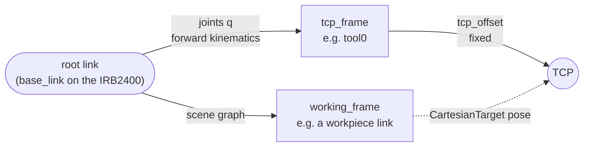

# Frames and poses

Every number in a Cartesian target is a pose of the **TCP** relative to the **working frame**.
The planner solves for joint values `q` such that

$$
T_\text{root}^\text{tcp\_frame}(q) \cdot T_\text{tcp\_offset}
= T_\text{root}^\text{working\_frame} \cdot T_\text{target}
$$

where `tcp_frame` is the link the tool is mounted on and `tcp_offset` is the fixed transform from
that link to the tool point. Lengths are in metres, angles in radians, and quaternions are
scalar-last, `[qx, qy, qz, qw]`.



<figure markdown>


<figcaption markdown="span">The TCP is `tool0 · tcp_offset`, and a Cartesian target is a pose in the `working_frame`: the planner puts the first on the second. Here a workpiece frame sits on a plate corner, the target is 30 cm × 7 cm into it with the tool pointing down, and `tcp_offset` is 10 cm along tool0's z (the orange body is drawn only, the planner sees the offset). The arm is in the IK solution for `target · tcp_offset⁻¹`; every frame is drawn from forward kinematics, and the TCP lands on the target to 5e-12 m. On the IRB2400, the URDF's `base` frame coincides with `base_link`. Axes: x red, y green, z blue. Reproduce: `pixi run docs-figures frames`.</figcaption>
</figure>

## The frames a program names

| Frame | Set by | Meaning | IRB2400 example |
| --- | --- | --- | --- |
| root | URDF | the scene graph's root link; every link pose is ultimately relative to it | `base_link` |
| `tcp_frame` | `MotionProgram(tcp_frame=...)` | the link the tool is attached to | `tool0` (the flange) |
| `tcp_offset` | `MotionProgram(tcp_offset=...)` | transform from `tcp_frame` to the TCP: an `Isometry3d`, or the name of an SRDF `group_tcps` entry | 10 cm along `tool0`'s z axis |
| TCP | `tcp_frame` · `tcp_offset` | the point and orientation the target pose places | the tool tip |
| `working_frame` | `MotionProgram(working_frame=...)` | the frame Cartesian targets are expressed in | `base_link`, or a workpiece link |

The planning API never picks a frame for you: `tcp_frame` and `working_frame` are required. A
working frame that is a link of the scene (a workpiece, a positioner's table) makes the targets
move with it: change the link's pose and the same program follows it.

## Checking the relation

Forward kinematics gives `tcp_frame` in the group's base frame; composing with the offset gives
the TCP. Inverse kinematics solves for a *link*, so a target for the TCP is first moved back onto
the flange:

```python
import numpy as np
from tesseract_robotics import get_tesseract_resource_path
from tesseract_robotics.common import GeneralResourceLocator
from tesseract_robotics.planning import Pose, Robot

locator = GeneralResourceLocator(paths=[get_tesseract_resource_path()])
robot = Robot.from_tesseract_support("abb_irb2400", locator)

q = np.array([0.0, 0.3, 0.2, 0.0, -0.5, 0.0])     # rad
tcp_offset = Pose.from_xyz(0.0, 0.0, 0.10)        # tool tip 10 cm along tool0's z axis

flange = robot.fk("manipulator", q, "tool0")      # tool0 in base_link
tcp = flange @ tcp_offset                         # the TCP in base_link

# IK for the TCP: strip the offset, solve for tool0, recover the same TCP
solution = robot.ik("manipulator", tcp @ tcp_offset.inverse(), "tool0", seed=q)
recovered = robot.fk("manipulator", solution, "tool0") @ tcp_offset
assert np.allclose(recovered.matrix, tcp.matrix, atol=1e-6)
```

In a program, the offset is part of the `MotionProgram` and the planner applies it:

```python
from tesseract_robotics.planning import CartesianTarget, MotionProgram

program = MotionProgram(
    "manipulator", tcp_frame="tool0", working_frame="base_link", tcp_offset=tcp_offset
).move_to(CartesianTarget(tcp))
```

A named TCP (`tcp_offset="laser"`) is looked up when the plan runs: first in the SRDF
`<group_tcps>` of the program's group, then in the environment's find-TCP callbacks.
[TCP offsets](../api/environment.md#tcp-offsets) has the full rule and
[Named TCPs](../api/srdf.md#named-tcps-group_tcps) the SRDF side.

## Poses

`Pose` (from `tesseract_robotics.planning`) is an `Isometry3d` with factories and the `@`
operator for composition. Every factory takes either scalars or one array per quantity:

```python
from tesseract_robotics.planning import Pose

a = Pose.from_xyz(0.8, -0.2, 0.8)                              # m
b = Pose.from_xyz_quat(0.8, -0.2, 0.8, 0.0, 1.0, 0.0, 0.0)     # m, [qx, qy, qz, qw]
c = Pose.from_xyz_rpy([0.8, -0.2, 0.8], [3.14159, 0.0, 0.0])   # m, rad

assert np.allclose(b.translation, [0.8, -0.2, 0.8])
assert np.allclose((a @ Pose.from_xyz(0.0, 0.0, 0.1)).translation, [0.8, -0.2, 0.9])
```

### Quaternions

Every Python surface of this package orders quaternions scalar-last, `[qx, qy, qz, qw]`, the
order of ROS `geometry_msgs/Quaternion`, SciPy's `Rotation.as_quat()` and the planning examples.
Eigen's C++ constructor is scalar-first, `Quaterniond(w, x, y, z)`, and is not bound: build one
with `Quaterniond.from_xyzw(x, y, z, w)` and reorder the components when porting C++ code. `Pose.quaternion` returns a `Quaterniond`; read its components by name
(`.x`, `.y`, `.z`, `.w`).

`q` and `−q` are the same rotation, so compare rotations (`rotation_matrix`), not quaternion
components: `Pose.from_xyz_quat(0.8, -0.2, 0.8, 0.0, -1.0, 0.0, 0.0)` prints its quaternion as
`[0, 1, 0, 0]`.

### Roll, pitch, yaw

`Pose.from_xyz_rpy` composes `R = Rz(yaw) · Ry(pitch) · Rx(roll)`: intrinsic Z-Y-X, the same
rotation as fixed-axis rotations about x, then y, then z. `Pose.roll`, `.pitch` and `.yaw` read
it back with the same convention.
