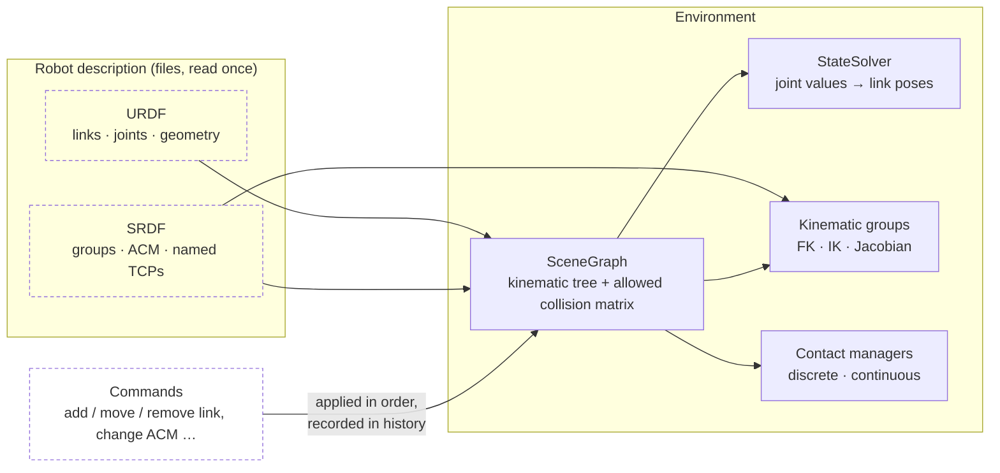
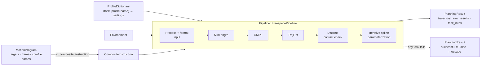

# Concepts

Tesseract keeps three things apart: the **environment** (what the world is), the **program**
(what the robot should do) and the **pipeline** (how a plan is found). A planner never owns the
world: it reads a snapshot of the environment, plans the program's instructions with the
settings its **profiles** give it, and returns a trajectory. Each term in bold is defined once in
the [glossary](glossary.md); [Frames and poses](frames.md) covers the coordinate conventions.

## The environment



The `Environment` is the single source of truth for one robot cell. It holds:

- the **scene graph**: links (geometry for display and collision) joined by joints into a tree,
  plus the **allowed collision matrix** (ACM), the link pairs a collision check skips;
- the **state solver**, which turns joint values into the pose of every link in the root frame;
- the **kinematic groups**, one per SRDF group, each with its forward and inverse kinematics
  solver;
- the **contact managers**: discrete (one state) and continuous (the motion between two
  states).

The environment changes only through commands (`AddLinkCommand`, `MoveLinkCommand`,
`ModifyAllowedCollisionsCommand`, …). It records every command it applies, so a planner, a
clone or a [serialized](../user-guide/serialization.md) copy can replay the same world.

```python
from tesseract_robotics import get_tesseract_resource_path
from tesseract_robotics.common import GeneralResourceLocator
from tesseract_robotics.planning import Robot

locator = GeneralResourceLocator(paths=[get_tesseract_resource_path()])
robot = Robot.from_tesseract_support("abb_irb2400", locator)
env = robot.env

scene_graph = env.getSceneGraph()                  # links, joints, ACM
state = env.getState()                             # joint values and every link's pose
manipulator = env.getKinematicGroup("manipulator")  # FK and IK of the SRDF group
discrete = env.getDiscreteContactManager()         # a copy: checks one state
continuous = env.getContinuousContactManager()     # a copy: checks a swept motion

print(len(scene_graph.getLinks()), "links;", manipulator.numJoints(), "joints in the group")
print(state.link_transforms["tool0"].translation)  # tool0 in the root frame, metres
```

`Robot` is the high-level wrapper around one `Environment`: `robot.env` is the environment
itself, and `robot.fk`, `robot.ik` and `robot.set_joints` call into it. A contact manager or a
kinematic group returned by the environment is a copy built from its current state; fetch a new
one after the environment changes.

[Environment and scene graph](../user-guide/environment.md),
[Kinematics](../user-guide/kinematics.md) and [Collision](../user-guide/collision.md) cover each
piece.

## From program to trajectory



A **program** is a `CompositeInstruction`: an ordered list of **move instructions**, each with a
**waypoint** (a joint state or a Cartesian pose), a **move type** (`FREESPACE`, `LINEAR`,
`CIRCULAR`) and a **profile** name. The program also carries the `ManipulatorInfo`: which
kinematic group moves, which link the tool hangs from, and which frame Cartesian poses are given
in. `MotionProgram` builds one without the wrapper types:

```python
from tesseract_robotics.planning import CartesianTarget, JointTarget, MotionProgram, Pose

program = (
    MotionProgram("manipulator", tcp_frame="tool0", working_frame="base_link")
    .move_to(JointTarget([0.0] * 6))                                          # rad
    .move_to(CartesianTarget(Pose.from_xyz_quat(0.8, -0.2, 0.8, 0.0, -1.0, 0.0, 0.0)))
    .linear_to(CartesianTarget(Pose.from_xyz_quat(0.8, 0.2, 0.8, 0.0, -1.0, 0.0, 0.0)))
)
composite = program.set_joint_names(robot.get_joint_names("manipulator")).to_composite_instruction()
print(len(composite), "move instructions")
```

A **pipeline** is a graph of **tasks** run by the `TaskComposer`. The tasks are planners,
checks and post-processing steps; the graph above is the one `FreespacePipeline` runs. Each
pipeline is defined in YAML and loaded as a plugin, so the set is open: `TaskComposer`
lists the [pipelines it can load](../user-guide/task-composer.md#available-pipelines). The
`plan_*` functions name the pipeline for you:

| Call | Pipeline | What it runs |
| --- | --- | --- |
| `plan_freespace` | `TrajOptPipeline` | TrajOpt, discrete contact check, time parameterization |
| `plan_ompl` | `FreespacePipeline` | OMPL, TrajOpt smoothing, discrete contact check, time parameterization |
| `plan_cartesian` | `DescartesDPipeline` | Descartes graph search over IK solutions of each waypoint, contact check, time parameterization |
| `TaskComposer.plan(..., pipeline=...)` | any | the named pipeline |

The [Motion planning guide](../user-guide/planning.md#choosing-a-planner) compares the planners.

## Profiles

A **profile** is a named block of planner settings. Each task looks its profiles up in the
`ProfileDictionary` under a key of two names: its own task name (the **namespace**, such as
`"TrajOptMotionPlannerTask"`) and the profile name the instruction carries (such as `"DEFAULT"`
or `"RASTER"`). One program can therefore move fast through free space and slowly along a
weld seam, and the same program runs under different planners without edits.

```python
from tesseract_robotics.command_language import ProfileDictionary
from tesseract_robotics.motion_planners_ompl import OMPLRealVectorMoveProfile

ompl = OMPLRealVectorMoveProfile()
ompl.solver_config.planning_time = 5.0  # s, upper bound per OMPL solve

profiles = ProfileDictionary()
profiles.addProfile("OMPLMotionPlannerTask", "DEFAULT", ompl)
```

The `planning` module ships default profile sets for each pipeline
(`create_trajopt_default_profiles`, …); [Task composer](../user-guide/task-composer.md#profiles)
shows how to pass your own and how to load them from YAML.

## Where to go next

- [Frames and poses](frames.md): the frames a Cartesian target names, and the quaternion order.
- [Python and C++](bindings.md): how the bindings map C++ types, containers and ownership.
- [Motion planning](../user-guide/planning.md): planners, costs and constraints, failures.
