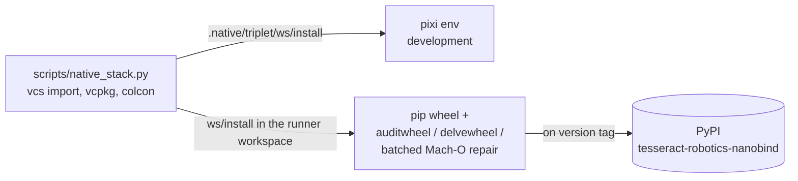
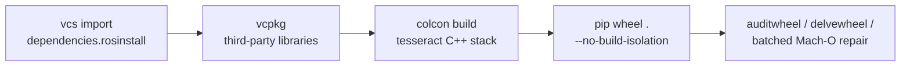

# How the binaries are built

This repository compiles only the nanobind modules. The tesseract C++ stack (tesseract, trajopt,
tesseract_planning and their plugins) is built one way, by `scripts/native_stack.py`: `vcs import`
of `dependencies.rosinstall`, vcpkg for the third-party libraries, colcon for the stack. The wheel
workflow and the pixi dev env both call it, see [The native stack build](native-stack.md).

## pixi environments

| Environment | Python | C++ stack comes from | Used for |
|---|---|---|---|
| `default` | 3.14 (unpinned, `>=3.12`) | `.native/<triplet>` (`pixi run native-build`) | local development |
| `py312` | 3.12 | same | CI wheel builds (abi3) |
| `py315` | 3.15 | same; `viser` from PyPI, because its `websockets <17` cap has no conda-forge py315 build | builds the bindings and runs the suite on the newest Python |

The default envs carry the toolchain only (cmake, ninja, ccache, the autotools the vcpkg ports
need, colcon, vcs2l, libomp on macOS); there are no conda tesseract packages.

## Building a wheel

The PyPI wheels contain no conda packages. `.github/workflows/wheels.yml` builds them
the way [tesseract_python](https://github.com/tesseract-robotics/tesseract_python)
builds its SWIG wheels:

1. `native_stack.py sources` checks out `dependencies.rosinstall`: tesseract, tesseract_planning,
   trajopt, boost_plugin_loader, descartes_light, opw_kinematics, ruckig.
2. `native_stack.py vcpkg` builds the third-party libraries (Boost, Eigen, OMPL,
   Bullet, FCL, PCL, spdlog, …) as shared libraries, with the overlay triplets in
   `.github/workflows/vcpkg_triplets` on Linux and macOS.
3. `native_stack.py colcon` runs `colcon build --merge-install` and builds the tesseract stack against them into
   `ws/install`. trajopt_ext builds OSQP, qpOASES and PIQP.
4. `pip wheel . --no-build-isolation` runs scikit-build-core against `ws/install` and
   the vcpkg prefix (`CMAKE_PREFIX_PATH`), compiling each `_tesseract_*` module as
   `STABLE_ABI NB_STATIC`. The CMake install step copies the task composer
   configuration into `tesseract_robotics/data/`.
5. The platform's repair tool bundles the dependency closure.
6. The Linux x86_64 job also builds `tesseract-robotics-nanobind-support`, a `py3-none-any`
   wheel of tesseract's robot models and meshes (`packaging/tesseract-robotics-nanobind-support`),
   copied from `ws/install/share/tesseract`. The bindings install it with the `[support]` extra.
   It declares `Apache-2.0 AND BSD-3-Clause`, tesseract's `package.xml` licenses, and ships
   upstream's `LICENSE.Apache-2.0` and `LICENSE.BSD-3-Clause` (`licenses/`) as `License-File`s (#368).

### Plugin anchors

The contact manager, kinematics and task composer factories are loaded at runtime by
boost_plugin_loader, so no linker would see them. `CMakeLists.txt` creates imported
targets for the nine factory libraries (`tesseract_nb_find_plugin_target`), and the
collision, kinematics and task composer modules link them. Each module's init calls
`boost_plugin_loader::addSymbolLibraryToSearchLibrariesEnv` with the factory library's
anchor symbol, which appends that library's resolved path to
`TESSERACT_CONTACT_MANAGERS_PLUGINS`, `TESSERACT_KINEMATICS_PLUGINS` or
`TESSERACT_TASK_COMPOSER_PLUGINS`. The link makes the repair tools bundle the factories
like any other dependency, and the anchor makes the plugin loaders open the bundled
copies by path. No plugin directory is configured and no YAML is patched.

| | Linux | macOS | Windows |
|---|---|---|---|
| Runner | `ubuntu-24.04` (x86_64), `ubuntu-24.04-arm` (aarch64) | `macos-15-intel` (x86_64), `macos-15` (arm64) | `windows-2022` (x64) |
| vcpkg triplet | `x64-linux-dynamic-release`, `arm64-linux-dynamic-release` | `x64-osx-dynamic-release`, `arm64-osx-dynamic-release` | `x64-windows-release` |
| Repair | `auditwheel repair --plat manylinux_2_39_*` | `repair_macos_wheel.py --lib-dir ...` | `delvewheel repair` |
| Never bundled | `libstdc++`, `libgcc_s`, glibc (manylinux policy) | system libraries | `msvcp140.dll`, `vcomp140.dll` |
| Platform gotchas | [Linux wheels](linux-wheels.md) | [macOS wheels](macos-wheels.md) | [Windows wheels](windows-wheels.md) |

### Wheel tags

`wheel.py-api = "cp312"` makes the Python 3.12 build an abi3 wheel
(`cp312-abi3-<platform>`), which installs on 3.12 and every later CPython. Linux wheels
are `manylinux_2_39`: Ubuntu 24.04's glibc, and its gcc 13 libstdc++, which auditwheel
leaves to the host. On macOS the C++ stack is built for 12.0, but Homebrew's `libomp`
is built for the runner's macOS. Repair reads the native closure's minimum OS
versions and updates both the wheel filename and its WHEEL tags.

### Tests before publishing

- **Stub drift gate.** Each build job installs the wheel it just built and runs
  `scripts/generate_stubs.py --check`; Linux x86_64 also runs pyright.
- **`test-wheel` job.** A fresh venv on each platform installs the wheel with pip and
  runs the test suite (without `tests/audit` and `tests/benchmarks`). Pull requests
  test the abi3 wheel on 3.12; pushes, tags and manual runs test it on 3.12, 3.13,
  3.14 and 3.15. Linux also checks that the wheel bundles no libstdc++.

### Publishing

`wheels.yml` runs on pull requests, on pushes to `main` and `dev*` branches, and on
tags matching `X.Y.Z.W`. On a tag, the `publish` job (after every `test-wheel` row)
checks that every wheel's version equals the tag and uploads all platforms at once
with PyPI trusted publishing from the `pypi` environment. The version is the tag:
`SETUPTOOLS_SCM_PRETEND_VERSION_FOR_TESSERACT_ROBOTICS_NANOBIND` is set from the tag
name.

## At import time

Importing `tesseract_robotics` changes nothing in the process environment and adds no resource
search paths. Data is found through functions the caller uses explicitly:

- **Task composer config.** `get_task_composer_config_path()`:
  `TESSERACT_TASK_COMPOSER_CONFIG_FILE` when set, else the config the wheel bundles in
  `tesseract_robotics/data/`, else `share/` of `TESSERACT_CPP_PREFIX` (the pixi dev env sets it) for an editable install.
- **Support data.** tesseract's robot models and meshes are a separate wheel,
  `tesseract-robotics-nanobind-support` (the `[support]` extra), built from the same prefix by
  `packaging/tesseract-robotics-nanobind-support`. `get_tesseract_resource_path()` returns its
  directory (or `TESSERACT_CPP_PREFIX`'s `share/`), to pass to
  `GeneralResourceLocator(paths=[...])` or `addPath()`; `get_tesseract_support_path()` is its
  `tesseract/support/`. Without either it raises `SupportDataNotFoundError`.
- **Windows DLLs.** A wheel needs nothing: delvewheel adds its bundled DLL directory. For a
  build whose tesseract DLLs live elsewhere, `TESSERACT_PYTHON_DLL_PATH` (as in the
  tesseract_python bindings) lists directories the import passes to `os.add_dll_directory`.
- **Plugins.** Nothing to configure: importing the collision, kinematics or task composer
  module registers its factories through the anchors. These are the one environment change, made
  by boost_plugin_loader in C++ (`TESSERACT_*_PLUGINS`), which its loaders read.

An editable install (`pixi run install`) bakes `.native/<triplet>/ws/install/lib` and the vcpkg
`lib/` into the modules' RPATH. It runs only inside the pixi env it was built in; use a wheel
to move the bindings to another environment.

## Platform runtime behavior

- **libomp under conda (macOS).** The repair bundles Homebrew's `libomp` and
  configures consumers to prefer the Python environment's runtime, then the bundled
  copy. Fresh-wheel and pixi tests verify one runtime in both import orders (#136).
- **macOS minimum version.** The macOS tag follows Homebrew's `libomp`, so it rises when
  the runner image does.
