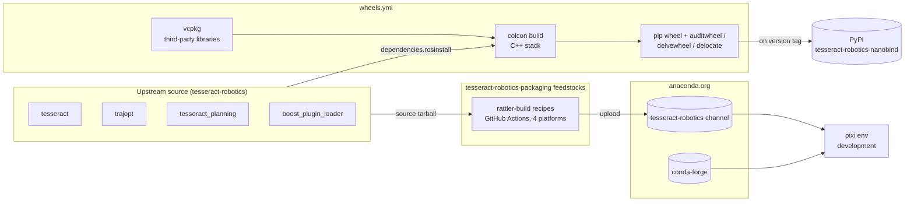
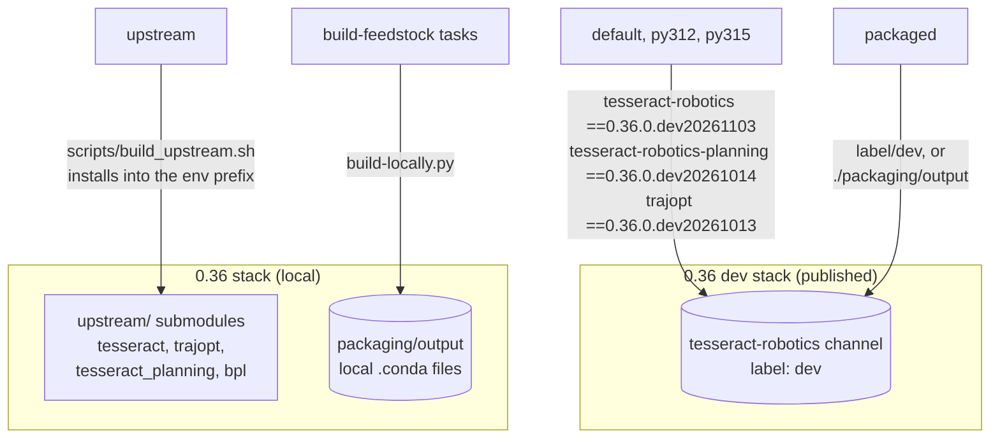
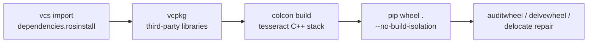

# How the binaries are built

This repository compiles only the nanobind modules, and gets the tesseract C++ stack
(tesseract, trajopt, tesseract_planning and their plugins) two ways:

- **Development** (pixi): the stack comes as conda packages, built by the
  [tesseract-robotics-packaging](https://github.com/tesseract-robotics-packaging)
  feedstocks and published to the `tesseract-robotics` channel on anaconda.org. The
  `default` env pins the `0.36.0.dev` packages on the channel's `dev` label (see
  [Building against upstream main](upstream-main.md#status)).
- **PyPI wheels** (no conda): `.github/workflows/wheels.yml` builds the same upstream
  commits from source with colcon against vcpkg dependencies, and the platform's repair
  tool bundles them into the wheel. See [Building a wheel](#building-a-wheel).

## Layers and who owns them

| Layer | What it produces | Where it lives | Built by |
|---|---|---|---|
| Upstream C++ | source at a release tag | `tesseract-robotics/{tesseract,trajopt,tesseract_planning,boost_plugin_loader}` | nothing here; the feedstocks fetch the tag archive |
| C++ packages | `tesseract-robotics`, `trajopt`, `tesseract-robotics-planning`, `boost-plugin-loader`, `descartes-light`, `opw-kinematics`, `libruckig`, … | `tesseract-robotics` channel, label `main` | feedstock CI in `tesseract-robotics-packaging` |
| Third-party C++ | boost, eigen, fcl, osqp, taskflow, … | `conda-forge` | conda-forge |
| Forked third-party C++ | `pcl` without VTK, Qt or OpenGL; `bullet-cpp` and `ompl` without a Python pin | `tesseract-robotics` channel, label `dev` | CI on the `dev` branches of the `jf---` forks of the conda-forge feedstocks |
| Bindings | `_tesseract_*` nanobind extension modules | this repository | scikit-build-core + CMake, inside a pixi env |
| Wheels | self-contained wheels with the C++ closure bundled | PyPI, `tesseract-robotics-nanobind` | `.github/workflows/wheels.yml` (vcpkg + colcon, no conda) |

The SWIG bindings follow the same pattern one level up:
[tesseract-robotics-python-feedstock](https://github.com/tesseract-robotics-packaging/tesseract-robotics-python-feedstock)
builds `tesseract_python` as a conda package against the same channel. This
repository ships wheels to PyPI instead and has no feedstock of its own yet.

## C++ packages: the feedstocks

Each upstream library has a conda-forge-style feedstock in the
`tesseract-robotics-packaging` GitHub organisation:

| Feedstock | Package | On the channel | Notes |
|---|---|---|---|
| `boost-plugin-loader-feedstock` | `boost-plugin-loader` | 0.4.3 | `dev` label: 0.5.0 (tesseract `master` needs ≥ 0.4.5) |
| `tesseract-robotics-feedstock` | `tesseract-robotics` | 0.35.0 | `dev` label: 0.36.0.dev20261103 |
| `trajopt-feedstock` | `trajopt` | 0.35.0 | `dev` label: 0.36.0.dev20261013, with PIQP 0.6.4 built in |
| `tesseract-robotics-planning-feedstock` | `tesseract-robotics-planning` | 0.35.0 | `dev` label: 0.36.0.dev20261014 |
| `descartes-light-feedstock` | `descartes-light` | 0.4.10 | |
| `opw-kinematics-feedstock`, `ruckig-feedstock`, `ros-industrial-cmake-boilerplate-feedstock` | supporting packages | | |
| `tesseract-robotics-python-feedstock` | `tesseract-robotics-python` (SWIG) | 0.35.0 | not used by this repository |
| `pcl-feedstock` (`jf---` fork) | `pcl` | | `dev` label: 1.15.1 build 16. No VTK, Qt or OpenGL; `pcl_io` kept |
| `bullet-feedstock` (`jf---` fork) | `bullet-cpp` | | `dev` label: 3.25 build 7. C++ only: no `python`, `python_abi` or `numpy` |
| `ompl-feedstock` (`jf---` fork) | `ompl` | | `dev` label: 1.7.0 build 7. No `python` or `numpy` |

How a feedstock builds:

- The recipe is `recipe/recipe.yaml`, built with rattler-build
  (`conda_build_tool: rattler-build` in `conda-forge.yml`). The CI files are
  generated by conda-smithy.
- The source is the upstream release tarball
  (`archive/refs/tags/<version>.tar.gz`), and `recipe/build.sh` / `build.bat`
  runs a plain CMake + Ninja build with shared libraries and no tests or
  examples.
- GitHub Actions builds linux-64, linux-aarch64, osx-arm64 and win-64
  on every push and pull request. Every build that is not a pull request
  uploads, with the organisation's `BINSTAR_TOKEN` (`.scripts/build_steps.sh`).
- `recipe/conda_build_config.yaml` sets `channel_sources: tesseract-robotics,conda-forge`
  (so each feedstock links the stack packages published before it) and
  `channel_targets: tesseract-robotics main` (so uploads land on the `main`
  label). The `dev` branches of the forks use
  `channel_sources: tesseract-robotics/label/dev,tesseract-robotics,conda-forge`
  and `channel_targets: tesseract-robotics dev`, so a stage links what the stage
  before it uploaded to the `dev` label, and uploads go there too.
- Each package carries `run_exports` pinned to `x.x`, so anything built
  against `tesseract-robotics 0.35.0` requires `0.35.*` at run time.

The `packaging/*-feedstock` directories in this repository are submodules
pointing at forks of these feedstocks. They exist for the 0.36 outer loop
below.

The `pcl`, `bullet-cpp` and `ompl` forks build the same package names as
conda-forge, and the `dev` label's channel priority makes them win. conda-forge's
builds pin a Python version (`bullet-cpp`, `ompl`) or pull in `vtk-base`, which
does (`pcl`), and none of them had a Python 3.15 build in the version ranges the
stack needs (#223). Dropping VTK also removes most of the wheel's bundled
payload (#106).

What each fork changes on its `dev` branch:

| Fork | Build flags | Other changes |
|---|---|---|
| `pcl` | `WITH_VTK=OFF`, `WITH_QT=OFF`, `WITH_OPENGL=OFF`, `BUILD_visualization=OFF`, `BUILD_tools=OFF` | pins `libboost_devel: '1.88'` and `eigen_abi_devel: '5.0.1'` to match the stack |
| `bullet` | `BUILD_PYBULLET=OFF` | one output, `bullet-cpp`; the `pybullet` and `bullet` outputs are gone |
| `ompl` | `OMPL_BUILD_PYBINDINGS=OFF` | same two pins as `pcl`; `keep-portable-shebang.patch` |

`keep-portable-shebang.patch` exists because, with `python` out of host, OMPL's
`install_python` macro writes the build tool's Python into its script shebangs. The
patch keeps `#!/usr/bin/env python3`.

## pixi environments: where each one gets its C++

| Environment | Python | C++ stack comes from | Used for |
|---|---|---|---|
| `default` | 3.14 (unpinned, `>=3.12`) | `tesseract-robotics/label/dev`: `tesseract-robotics ==0.36.0.dev20261103`, `tesseract-robotics-planning ==0.36.0.dev20261014`, `trajopt ==0.36.0.dev20261013`; descartes-light, opw-kinematics and every third-party library arrive transitively | local development |
| `py312` | 3.12 | same as `default` | CI wheel builds (abi3) |
| `py315` | 3.15 | same as `default`; `viser` from PyPI, because its `websockets <17` cap has no conda-forge py315 build | builds the bindings and runs the suite on the newest Python |
| `upstream` | 3.12 | the `upstream/` submodules, compiled by `pixi run -e upstream build-upstream-cpp` and installed into the env prefix; other third-party libraries as in `default` | 0.36 inner loop |
| `packaged` (osx-arm64) | 3.12 | the `0.36.0.dev` packages in `packaging/output`, read as a local channel ahead of `conda-forge` / `tesseract-robotics`; `taskflow` pinned to the 3.11 that planning was built with | publish gate for the dev packages (#162) |

`upstream` and `packaged` share the `bindings-dev` feature (Python 3.12,
conda's clang 19 / gcc 14, scikit-build-core, nanobind, pytest), so they
differ only in where the C++ stack comes from. Each builds the bindings into
its own `SKBUILD_BUILD_DIR` (`build/upstream-*`, `build/packaged-*`).

The pins are in `pyproject.toml` under `[tool.pixi.dependencies]`: the three
0.36 dev stack packages and `taskflow 3.11.*` (header-only, matched to the planning
build). Pinning eigen or the other third-party libraries as well deadlocks the
solve; the stack packages' `run_exports` drive the rest.

## Building a wheel

The PyPI wheels contain no conda packages. `.github/workflows/wheels.yml` builds them
the way [tesseract_python](https://github.com/tesseract-robotics/tesseract_python)
builds its SWIG wheels:

1. `vcs import` checks out `dependencies.rosinstall`: tesseract, tesseract_planning and
   trajopt at the commits the 0.36 dev conda packages were built from (the `upstream/`
   submodules), boost_plugin_loader 0.5.0, descartes_light, opw_kinematics, ruckig.
2. `johnwason/vcpkg-action` builds the third-party libraries (Boost, Eigen, OMPL,
   Bullet, FCL, PCL, spdlog, …) as shared libraries, with the overlay triplets in
   `.github/workflows/vcpkg_triplets` on Linux and macOS.
3. `colcon build --merge-install` builds the tesseract stack against them into
   `ws/install`. trajopt_ext builds OSQP, qpOASES and PIQP.
4. `pip wheel . --no-build-isolation` runs scikit-build-core against `ws/install` and
   the vcpkg prefix (`CMAKE_PREFIX_PATH`), compiling each `_tesseract_*` module as
   `STABLE_ABI NB_STATIC`. The CMake install step copies the task composer
   configuration into `tesseract_robotics/data/`.
5. The platform's repair tool bundles the dependency closure.
6. The Linux x86_64 job also builds `tesseract-robotics-nanobind-support`, a `py3-none-any`
   wheel of tesseract's robot models and meshes (`packaging/tesseract-robotics-nanobind-support`),
   copied from `ws/install/share/tesseract`. The bindings install it with the `[support]` extra.

### Plugin anchors

The contact manager, kinematics and task composer factories are loaded at runtime by
boost_plugin_loader, so no linker would see them. `CMakeLists.txt` creates imported
targets for the nine factory libraries (`tesseract_nb_find_plugin_target`), and the
collision, kinematics and task composer modules link them. Each module's init calls
`boost_plugin_loader::addSymbolLibraryToSearchLibrariesEnv` with the factory library's
anchor symbol, which appends that library's resolved path to
`TESSERACT_CONTACT_MANAGERS_PLUGINS`, `TESSERACT_KINEMATICS_PLUGINS` or
`TESSERACT_TASK_COMPOSER_PLUGINS`. The link makes the repair tools bundle the factories
like any other dependency, and the anchor makes the plugin loaders open the bundled
copies by path. No plugin directory is configured and no YAML is patched.

| | Linux | macOS | Windows |
|---|---|---|---|
| Runner | `ubuntu-24.04` (x86_64), `ubuntu-24.04-arm` (aarch64) | `macos-15-intel` (x86_64), `macos-15` (arm64) | `windows-2022` (x64) |
| vcpkg triplet | `x64-linux-dynamic-release`, `arm64-linux-dynamic-release` | `x64-osx-dynamic-release`, `arm64-osx-dynamic-release` | `x64-windows-release` |
| Repair | `auditwheel repair --plat manylinux_2_39_*` | `delocate-wheel --sanitize-rpaths` | `delvewheel repair` |
| Never bundled | `libstdc++`, `libgcc_s`, glibc (manylinux policy) | system libraries | `msvcp140.dll`, `vcomp140.dll` |
| Platform gotchas | [Linux wheels](linux-wheels.md) | [macOS wheels](macos-wheels.md) | [Windows wheels](windows-wheels.md) |

### Wheel tags

`wheel.py-api = "cp312"` makes the Python 3.12 build an abi3 wheel
(`cp312-abi3-<platform>`), which installs on 3.12 and every later CPython. Linux wheels
are `manylinux_2_39`: Ubuntu 24.04's glibc, and its gcc 13 libstdc++, which auditwheel
leaves to the host. On macOS the C++ stack is built for 12.0, but Homebrew's `libomp`
is built for the runner's macOS; `MACOSX_DEPLOYMENT_TARGET` is left unset so delocate
raises the wheel tag to the bundled libraries' minimum.

### Tests before publishing

- **Stub drift gate.** Each build job installs the wheel it just built and runs
  `scripts/generate_stubs.py --check`; Linux x86_64 also runs pyright.
- **`test-wheel` job.** A fresh venv on each platform installs the wheel with pip and
  runs the test suite (without `tests/audit` and `tests/benchmarks`). Pull requests
  test the abi3 wheel on 3.12; pushes, tags and manual runs test it on 3.12, 3.13,
  3.14 and 3.15. Linux also checks that the wheel bundles no libstdc++.

### Publishing

`wheels.yml` runs on pull requests, on pushes to `main` and `dev*` branches, and on
tags matching `X.Y.Z.W`. On a tag, the `publish` job (after every `test-wheel` row)
checks that every wheel's version equals the tag and uploads all platforms at once
with PyPI trusted publishing from the `pypi` environment. The version is the tag:
`SETUPTOOLS_SCM_PRETEND_VERSION_FOR_TESSERACT_ROBOTICS_NANOBIND` is set from the tag
name.

## At import time

Importing `tesseract_robotics` changes nothing in the process environment and adds no resource
search paths. Data is found through functions the caller uses explicitly:

- **Task composer config.** `get_task_composer_config_path()`:
  `TESSERACT_TASK_COMPOSER_CONFIG_FILE` when set, else the config the wheel bundles in
  `tesseract_robotics/data/`, else the pixi env's `share/` for an editable install.
- **Support data.** tesseract's robot models and meshes are a separate wheel,
  `tesseract-robotics-nanobind-support` (the `[support]` extra), built from the same prefix by
  `packaging/tesseract-robotics-nanobind-support`. `get_tesseract_resource_path()` returns its
  directory (or the pixi env's `share/`), to pass to
  `GeneralResourceLocator(paths=[...])` or `addPath()`; `get_tesseract_support_path()` is its
  `tesseract/support/`. Without either it raises `SupportDataNotFoundError`.
- **Windows DLLs.** A wheel needs nothing: delvewheel adds its bundled DLL directory. For a
  build whose tesseract DLLs live elsewhere, `TESSERACT_PYTHON_DLL_PATH` (as in the
  tesseract_python bindings) lists directories the import passes to `os.add_dll_directory`.
- **Plugins.** Nothing to configure: importing the collision, kinematics or task composer
  module registers its factories through the anchors. These are the one environment change, made
  by boost_plugin_loader in C++ (`TESSERACT_*_PLUGINS`), which its loaders read.

An editable install (`pixi run install`) bakes the env's `lib/` into the
modules' RPATH. It runs only inside the pixi env it was built in; use a wheel
to move the bindings to another environment.

## The 0.36 track

`upstream-main` binds tesseract, trajopt and tesseract_planning `master` ahead
of 0.36. The feedstocks' `dev` branches build that stack on CI and upload it to the
channel's `dev` label, which the `default` env reads:

| Package | Label `main` | Label `dev` (built from) |
|---|---|---|
| boost-plugin-loader | 0.4.3 | 0.5.0 |
| tesseract-robotics | 0.35.0 | 0.36.0.dev20261103 (`master` @ `2b79e91`) |
| trajopt | 0.35.0 | 0.36.0.dev20261013 (`master` @ `a504b22`, PIQP 0.6.4 built in) |
| tesseract-robotics-planning | 0.35.0 | 0.36.0.dev20261014 (`master` @ `a648382`) |

Two local loops also exist, described in [Building against upstream main](upstream-main.md):

- **Inner loop**: the `upstream` env compiles the `upstream/` submodules from
  source. This is what the branch's tests run against.
- **Outer loop**: `pixi run build-feedstock` runs each forked feedstock's
  `build-locally.py` in dependency order and writes `0.36.0.dev<date>` packages
  to `packaging/output`.

!!! warning "Status of the 0.36 packages"
    - **Confirmed:** the dev recipes pin the same SHAs as the `upstream/`
      submodules, and replace `console_bridge` with `spdlog`.
    - **Confirmed:** the dev recipes live on the feedstock forks' `dev`
      branches; feedstock CI builds them on linux-64, linux-aarch64, osx-arm64
      and win-64 and uploads to `tesseract-robotics/label/dev`.
    - **Confirmed:** the bindings build against the dev-label packages on
      osx-arm64 in the `default` env, and the tests #363 changes pass there. The
      last full suite (3087 passed) was at the previous pins. See
      [Status](upstream-main.md#status).
    - **Confirmed and fixed:** the tesseract feedstock has to strip
      `-fvisibility-inlines-hidden` on macOS, as upstream's own conda recipe
      does. Without it every cereal registry singleton in the packaged dylibs
      is non-external and serialization fails with "unregistered polymorphic
      type". The strip is in the dev `recipe/build.sh` (build `_1`).
    - **Refuted:** tesseract_planning needs no strip. On macOS it registers
      its cereal types in headers, so its dylibs carry no registry singletons.

The `dev` track uploads to its own label, so the `main` label keeps serving the
0.35.0 packages the released wheels are built from.

## Known gaps

- **libomp under conda (macOS).** delocate bundles Homebrew's `libomp`. A wheel installed
  into a conda or pixi environment that has its own `llvm-openmp` loads two OpenMP
  runtimes, the failure described in [macOS wheels](macos-wheels.md) (#136).
- **macOS minimum version.** The macOS tag follows Homebrew's `libomp`, so it rises when
  the runner image does.
