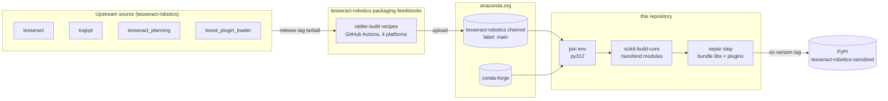
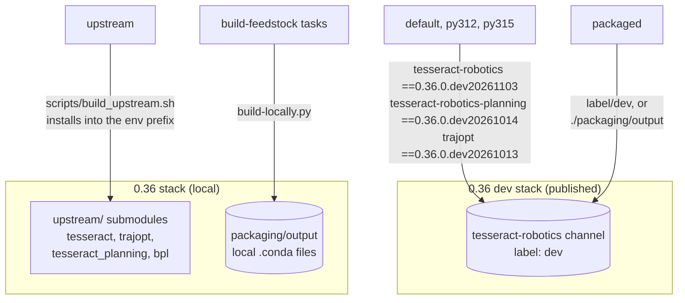
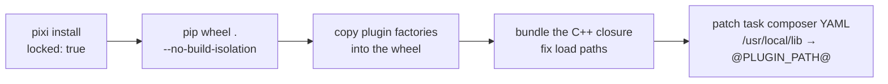
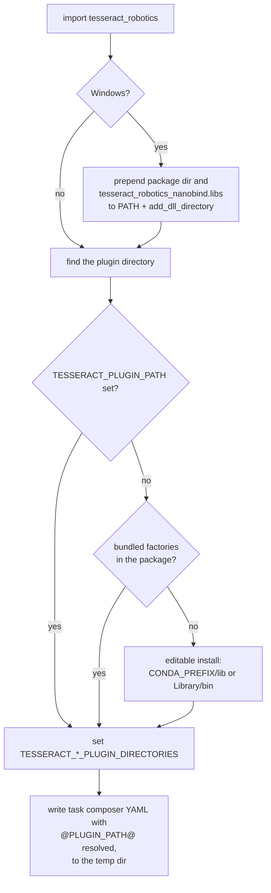

# How the binaries are built

This repository compiles only the nanobind modules. The tesseract C++ stack
(tesseract, trajopt, tesseract_planning and their plugins) is built as conda
packages by the [tesseract-robotics-packaging](https://github.com/tesseract-robotics-packaging)
feedstocks and published to the `tesseract-robotics` channel on anaconda.org.
pixi installs those packages, scikit-build-core compiles the bindings against
them, and a per-platform repair step copies the C++ libraries and plugin
factories into the wheel. Each platform's workflow then publishes its wheels to
PyPI when a version tag is pushed.

Released wheels are built against tesseract 0.35.0. The 0.36 stack that
`upstream-main` (#161) binds is published as `0.36.0.dev` packages on the
channel's `dev` label (`tesseract-robotics/label/dev`), built by the feedstocks'
`dev` branches on CI for all four platforms; the `default` env pins them (see
[Building against upstream main](upstream-main.md#status)).

## Layers and who owns them

| Layer | What it produces | Where it lives | Built by |
|---|---|---|---|
| Upstream C++ | source at a release tag | `tesseract-robotics/{tesseract,trajopt,tesseract_planning,boost_plugin_loader}` | nothing here; the feedstocks fetch the tag archive |
| C++ packages | `tesseract-robotics`, `trajopt`, `tesseract-robotics-planning`, `boost-plugin-loader`, `descartes-light`, `opw-kinematics`, `libruckig`, … | `tesseract-robotics` channel, label `main` | feedstock CI in `tesseract-robotics-packaging` |
| Third-party C++ | boost, eigen, fcl, osqp, taskflow, … | `conda-forge` | conda-forge |
| Forked third-party C++ | `pcl` without VTK, Qt or OpenGL; `bullet-cpp` and `ompl` without a Python pin | `tesseract-robotics` channel, label `dev` | CI on the `dev` branches of the `jf---` forks of the conda-forge feedstocks |
| Bindings | `_tesseract_*` nanobind extension modules | this repository | scikit-build-core + CMake, inside a pixi env |
| Wheels | self-contained wheels with the C++ closure bundled | PyPI, `tesseract-robotics-nanobind` | `.github/workflows/wheels-{linux,macos,windows}.yml` |

The SWIG bindings follow the same pattern one level up:
[tesseract-robotics-python-feedstock](https://github.com/tesseract-robotics-packaging/tesseract-robotics-python-feedstock)
builds `tesseract_python` as a conda package against the same channel. This
repository ships wheels to PyPI, and its own feedstock is being set up (see
[Conda package](#conda-package-tesseract-robotics-nanobind)).

## C++ packages: the feedstocks

Each upstream library has a conda-forge-style feedstock in the
`tesseract-robotics-packaging` GitHub organisation:

| Feedstock | Package | On the channel | Notes |
|---|---|---|---|
| `boost-plugin-loader-feedstock` | `boost-plugin-loader` | 0.4.3 | `dev` label: 0.5.0 (tesseract `master` needs ≥ 0.4.5) |
| `tesseract-robotics-feedstock` | `tesseract-robotics` | 0.35.0 | `dev` label: 0.36.0.dev20261103 |
| `trajopt-feedstock` | `trajopt` | 0.35.0 | `dev` label: 0.36.0.dev20261013, with PIQP 0.6.4 built in |
| `tesseract-robotics-planning-feedstock` | `tesseract-robotics-planning` | 0.35.0 | `dev` label: 0.36.0.dev20261014 |
| `descartes-light-feedstock` | `descartes-light` | 0.4.10 | |
| `opw-kinematics-feedstock`, `ruckig-feedstock`, `ros-industrial-cmake-boilerplate-feedstock` | supporting packages | | |
| `tesseract-robotics-python-feedstock` | `tesseract-robotics-python` (SWIG) | 0.35.0 | not used by this repository |
| `pcl-feedstock` (`jf---` fork) | `pcl` | | `dev` label: 1.15.1 build 16. No VTK, Qt or OpenGL; `pcl_io` kept |
| `bullet-feedstock` (`jf---` fork) | `bullet-cpp` | | `dev` label: 3.25 build 7. C++ only: no `python`, `python_abi` or `numpy` |
| `ompl-feedstock` (`jf---` fork) | `ompl` | | `dev` label: 1.7.0 build 7. No `python` or `numpy` |

How a feedstock builds:

- The recipe is `recipe/recipe.yaml`, built with rattler-build
  (`conda_build_tool: rattler-build` in `conda-forge.yml`). The CI files are
  generated by conda-smithy.
- The source is the upstream release tarball
  (`archive/refs/tags/<version>.tar.gz`), and `recipe/build.sh` / `build.bat`
  runs a plain CMake + Ninja build with shared libraries and no tests or
  examples.
- GitHub Actions builds linux-64, linux-aarch64, osx-arm64 and win-64
  on every push and pull request. Every build that is not a pull request
  uploads, with the organisation's `BINSTAR_TOKEN` (`.scripts/build_steps.sh`).
- `recipe/conda_build_config.yaml` sets `channel_sources: tesseract-robotics,conda-forge`
  (so each feedstock links the stack packages published before it) and
  `channel_targets: tesseract-robotics main` (so uploads land on the `main`
  label). The `dev` branches of the forks use
  `channel_sources: tesseract-robotics/label/dev,tesseract-robotics,conda-forge`
  and `channel_targets: tesseract-robotics dev`, so a stage links what the stage
  before it uploaded to the `dev` label, and uploads go there too.
- Each package carries `run_exports` pinned to `x.x`, so anything built
  against `tesseract-robotics 0.35.0` requires `0.35.*` at run time.

The `packaging/*-feedstock` directories in this repository are submodules
pointing at forks of these feedstocks. They exist for the 0.36 outer loop
below.

The `pcl`, `bullet-cpp` and `ompl` forks build the same package names as
conda-forge, and the `dev` label's channel priority makes them win. conda-forge's
builds pin a Python version (`bullet-cpp`, `ompl`) or pull in `vtk-base`, which
does (`pcl`), and none of them had a Python 3.15 build in the version ranges the
stack needs (#223). Dropping VTK also removes most of the wheel's bundled
payload (#106).

What each fork changes on its `dev` branch:

| Fork | Build flags | Other changes |
|---|---|---|
| `pcl` | `WITH_VTK=OFF`, `WITH_QT=OFF`, `WITH_OPENGL=OFF`, `BUILD_visualization=OFF`, `BUILD_tools=OFF` | pins `libboost_devel: '1.88'` and `eigen_abi_devel: '5.0.1'` to match the stack |
| `bullet` | `BUILD_PYBULLET=OFF` | one output, `bullet-cpp`; the `pybullet` and `bullet` outputs are gone |
| `ompl` | `OMPL_BUILD_PYBINDINGS=OFF` | same two pins as `pcl`; `keep-portable-shebang.patch` |

`keep-portable-shebang.patch` exists because, with `python` out of host, OMPL's
`install_python` macro writes the build tool's Python into its script shebangs. The
patch keeps `#!/usr/bin/env python3`.

## Conda package: tesseract-robotics-nanobind

The bindings get a feedstock of their own, `tesseract-robotics-nanobind-feedstock`,
laid out like `tesseract-robotics-python-feedstock`: rattler-build, conda-smithy,
GitHub Actions on linux-64, linux-aarch64, osx-64, osx-arm64 and win-64, Python
3.12 to 3.14 (#162 step 2). It turns this repository into the conda package
`tesseract-robotics-nanobind`, built the same way as the C++ stack under it.

!!! warning "Status"
    - **Incomplete:** the feedstock repository does not exist yet, so neither
      does the `packaging/tesseract-robotics-nanobind-feedstock` submodule the
      `build-feedstock-nanobind` task runs in. Its CI and the upload to
      `label/dev` (by the holder of the channel's `BINSTAR_TOKEN`) follow.
    - **Under verification:** the osx-arm64 build of the recipe, Python 3.12.

The recipe (`recipe/recipe.yaml`):

| Section | Contents | Why |
|---|---|---|
| `source` | `archive/<sha>.tar.gz` of this repository on the `dev` branch; the release tag on `master` | the dev track pins the merge SHA of the license PR (#368) or later: earlier commits have no `LICENSE` / `NOTICE` |
| `build` | `pip install . --no-deps --no-build-isolation`, `SETUPTOOLS_SCM_PRETEND_VERSION` = the recipe version, `CONDA_PREFIX` = the host prefix | the archive has no `.git` for setuptools-scm; `CMakeLists.txt` finds the C++ stack and its data through `$CONDA_PREFIX` |
| `host` | `python`, `pip`, `scikit-build-core >=0.11`, `setuptools-scm`, `nanobind ==2.12.0`, `tesseract-robotics`, `tesseract-robotics-planning`, `trajopt`, `descartes-light`, `libboost-devel`, `eigen-abi-devel`, `taskflow 3.11.*` | every `find_package` in `CMakeLists.txt` resolves from these and their run deps |
| `run` | `numpy >=2.0`, `scipy >=1.17.1`, `loguru`, `pyyaml >=6.0`, `viser >=1.1.1`, `trimesh >=4`, `pillow`, `taskflow 3.11.*`, plus the C++ packages' `run_exports` | the `[project] dependencies`, so `pip check` passes |
| `run_constraints` | `tesseract-robotics-python <0.0a0` | both packages install `tesseract_robotics` |
| `tests` | imports + `pip check`; `pytest tests/tesseract_collision tests/tesseract_kinematics` from the source tree | the two suites load the contact-manager and kinematics plugins and need no planner. `tesseract_nanobind_selftest` is not used: it runs tests bundled under `tesseract_robotics/tests`, which no build installs |
| `about` | `license: Apache-2.0`, `license_file: [LICENSE, NOTICE]` | #368 |

`recipe/conda_build_config.yaml` uses the dev-track channels of the C++
feedstocks: `channel_sources: tesseract-robotics/label/dev,tesseract-robotics,conda-forge`,
`channel_targets: tesseract-robotics dev`, and the same `libboost_devel`,
`eigen_abi_devel` and `jsoncpp` pins. The extension modules are `cp312-abi3`, but
like any conda Python package they are built once per interpreter; the recipe
skips Python below 3.12.

Locally, `pixi run build-feedstock-nanobind` builds the stack feedstocks first,
then this checkout (`TESSERACT_NANOBIND_SRC_DIR` points the recipe at it instead
of the pinned archive) into `packaging/output`, for Python 3.12 on the host
platform.

## pixi environments: where each one gets its C++

| Environment | Python | C++ stack comes from | Used for |
|---|---|---|---|
| `default` | 3.14 (unpinned, `>=3.12`) | `tesseract-robotics/label/dev`: `tesseract-robotics ==0.36.0.dev20261103`, `tesseract-robotics-planning ==0.36.0.dev20261014`, `trajopt ==0.36.0.dev20261013`; descartes-light, opw-kinematics and every third-party library arrive transitively | local development |
| `py312` | 3.12 | same as `default` | CI wheel builds (abi3) |
| `py315` | 3.15 | same as `default`; `viser` from PyPI, because its `websockets <17` cap has no conda-forge py315 build | builds the bindings and runs the suite on the newest Python |
| `upstream` | 3.12 | the `upstream/` submodules, compiled by `pixi run -e upstream build-upstream-cpp` and installed into the env prefix; other third-party libraries as in `default` | 0.36 inner loop |
| `packaged` (osx-arm64) | 3.12 | the `0.36.0.dev` packages in `packaging/output`, read as a local channel ahead of `conda-forge` / `tesseract-robotics`; `taskflow` pinned to the 3.11 that planning was built with | publish gate for the dev packages (#162) |

`upstream` and `packaged` share the `bindings-dev` feature (Python 3.12,
conda's clang 19 / gcc 14, scikit-build-core, nanobind, pytest), so they
differ only in where the C++ stack comes from. Each builds the bindings into
its own `SKBUILD_BUILD_DIR` (`build/upstream-*`, `build/packaged-*`).

The pins are in `pyproject.toml` under `[tool.pixi.dependencies]`: the three
0.36 dev stack packages and `taskflow 3.11.*` (header-only, matched to the planning
build). Pinning eigen or the other third-party libraries as well deadlocks the
solve; the stack packages' `run_exports` drive the rest.

`TESSERACT_CPP_PREFIX` takes precedence over `CONDA_PREFIX` in `CMakeLists.txt`
(the RPATH, `CMAKE_PREFIX_PATH`, link directories and the data that gets
installed into the wheel), in `scripts/build_macos_wheel.sh`, and in the Windows
workflow.

## Building a wheel

Every platform follows the same five steps:

1. `prefix-dev/setup-pixi` installs the platform's env from `pixi.lock` with
   `locked: true`, so CI fails if the lock drifts from `pyproject.toml`.
2. `pip wheel . --no-build-isolation` runs scikit-build-core, which configures
   `CMakeLists.txt` against the env and compiles each `_tesseract_*` module as
   `STABLE_ABI NB_STATIC`. The CMake install step also copies data into the
   wheel: `share/tesseract/support` (robot models) and the task composer
   configuration from `share/tesseract_planning/task_composer/config`.
3. The plugin factories are loaded with `dlopen`, so no linker-based tool finds
   them. Each script copies the nine factory libraries explicitly (contact
   managers, kinematics including KDL/OPW/UR, task composer).
4. A repair step bundles the remaining dependency closure and fixes load paths
   (table below).
5. The task composer YAML hard-codes `/usr/local/lib` as the plugin directory.
   The build replaces it with the placeholder `@PLUGIN_PATH@`, which the
   package resolves at import time.

| | Linux | macOS | Windows |
|---|---|---|---|
| Workflow | `wheels-linux.yml` | `wheels-macos.yml` | `wheels-windows.yml` |
| Runner | `ubuntu-22.04` (x86_64), `ubuntu-22.04-arm` (aarch64) | `macos-14` (arm64) | `windows-2022` (x64) |
| Python builds | 3.12 (x86_64, aarch64) | 3.12 | 3.12 |
| Entry point | `pixi run build-wheel` → `scripts/build_linux_wheel.sh` | `pixi run build-wheel` → `scripts/build_macos_wheel.sh` | inline workflow steps with MSVC v143 |
| Repair | `ldd` closure copied next to the package, `patchelf --set-rpath '$ORIGIN'` | `scripts/repair_macos_wheel.py`: walks the closure from the extension modules and plugins, rewrites references to `@loader_path/`, re-signs, and refuses anything left outside the wheel except `libomp` | `delvewheel repair --analyze-existing` |
| Bundled libraries | `tesseract_robotics/` | `tesseract_robotics/.dylibs/` | `tesseract_robotics/` (plugins), `tesseract_robotics_nanobind.libs/` (dependencies) |
| Never bundled | `libstdc++`, `libgcc_s`, system libraries, `libpython` | | |
| Platform gotchas | [Linux wheels](linux-wheels.md) | [macOS wheels](macos-wheels.md) | [Windows wheels](windows-wheels.md) |

### Wheel tags

`wheel.py-api = "cp312"` makes the Python 3.12 build an abi3 wheel
(`cp312-abi3-<platform>`), which installs on 3.12 and every later CPython. The Linux script
renames the wheel from `linux_*` to `manylinux_2_35_*`. libstdc++ is
deliberately left to the host, so the real floor is the host's gcc runtime;
[Linux wheels](linux-wheels.md) explains why.

### Tests before publishing

- **ABI canary.** Each build job installs the wheel it just built into the
  pixi env and runs `tests/tesseract_kinematics`.
- **`test-wheel` job.** A lean pixi env on a fresh runner (Python and `uv` from
  conda, no C++ stack) installs the wheel with `uv pip install` and runs the full
  test suite. Pull requests test the abi3 wheel on 3.12; pushes to `main`, tags and
  manual runs test it on 3.12, 3.13, 3.14 and 3.15. macOS also checks that one
  `libomp` loads, and the full matrix adds `wheel-openmp`, where the env provides
  it. Linux
  also checks that no library is "not found" and that only one libstdc++ is
  mapped.

### Publishing

The wheel workflows run on pull requests, on pushes to `main`, and on tags
matching `X.Y.Z` or `X.Y.Z.W`. On a tag, each workflow's `publish` job (after
`build` and `test-wheel`) checks that every wheel's version equals the tag and
uploads with PyPI trusted publishing (`id-token: write`, no stored token). The
three platforms publish independently, so one platform's wheels can reach PyPI
while another's job is still failing. The version is the tag:
`SETUPTOOLS_SCM_PRETEND_VERSION_FOR_TESSERACT_ROBOTICS_NANOBIND` is set from the
tag name.

## At import time

`src/tesseract_robotics/__init__.py` makes an installed wheel self-contained:

- **Plugins.** The first match wins: `TESSERACT_PLUGIN_PATH`, then the bundled
  factories (`tesseract_robotics/` on Linux and Windows, `.dylibs/` on macOS),
  then `$CONDA_PREFIX/lib` (`Library/bin` on Windows) for an editable install.
  The result is exported as `TESSERACT_CONTACT_MANAGERS_PLUGIN_DIRECTORIES`,
  `TESSERACT_KINEMATICS_PLUGIN_DIRECTORIES` and
  `TESSERACT_TASK_COMPOSER_PLUGIN_DIRECTORIES`. Variables that are already set
  are left alone.
- **Data.** A wheel reads robot models and task composer configs from
  `tesseract_robotics/data/`; an editable install reads them from the pixi
  env's `share/`.
- **Windows.** `boost::dll` loads plugins with plain `LoadLibrary`, which
  ignores `os.add_dll_directory`, so the package directory and the `.libs`
  directory are also prepended to `PATH`.

An editable install (`pixi run install`) bakes the env's `lib/` into the
modules' RPATH. It runs only inside the pixi env it was built in; use a wheel
to move the bindings to another environment.

## The 0.36 track

`upstream-main` binds tesseract, trajopt and tesseract_planning `master` ahead
of 0.36. The feedstocks' `dev` branches build that stack on CI and upload it to the
channel's `dev` label, which the `default` env reads:

| Package | Label `main` | Label `dev` (built from) |
|---|---|---|
| boost-plugin-loader | 0.4.3 | 0.5.0 |
| tesseract-robotics | 0.35.0 | 0.36.0.dev20261103 (`master` @ `2b79e91`) |
| trajopt | 0.35.0 | 0.36.0.dev20261013 (`master` @ `a504b22`, PIQP 0.6.4 built in) |
| tesseract-robotics-planning | 0.35.0 | 0.36.0.dev20261014 (`master` @ `a648382`) |

Two local loops also exist, described in [Building against upstream main](upstream-main.md):

- **Inner loop**: the `upstream` env compiles the `upstream/` submodules from
  source. This is what the branch's tests run against.
- **Outer loop**: `pixi run build-feedstock` runs each forked feedstock's
  `build-locally.py` in dependency order and writes `0.36.0.dev<date>` packages
  to `packaging/output`.

!!! warning "Status of the 0.36 packages"
    - **Confirmed:** the dev recipes pin the same SHAs as the `upstream/`
      submodules, and replace `console_bridge` with `spdlog`.
    - **Confirmed:** the dev recipes live on the feedstock forks' `dev`
      branches; feedstock CI builds them on linux-64, linux-aarch64, osx-arm64
      and win-64 and uploads to `tesseract-robotics/label/dev`.
    - **Confirmed:** the bindings build against the dev-label packages on
      osx-arm64 in the `default` env, and the tests #363 changes pass there. The
      last full suite (3087 passed) was at the previous pins. See
      [Status](upstream-main.md#status).
    - **Confirmed and fixed:** the tesseract feedstock has to strip
      `-fvisibility-inlines-hidden` on macOS, as upstream's own conda recipe
      does. Without it every cereal registry singleton in the packaged dylibs
      is non-external and serialization fails with "unregistered polymorphic
      type". The strip is in the dev `recipe/build.sh` (build `_1`).
    - **Refuted:** tesseract_planning needs no strip. On macOS it registers
      its cereal types in headers, so its dylibs carry no registry singletons.

The `dev` track uploads to its own label, so the `main` label keeps serving the
0.35.0 packages the released wheels are built from.

## Known gaps

!!! note "Under verification"
    These come from reading the scripts; no wheel has been inspected to
    confirm them.

    - **`manylinux` tag.** The Linux script renames the file but does not run
      auditwheel or rewrite `Tag:` in `.dist-info/WHEEL`.
    - **`RECORD`.** On Linux, plugins and patched YAMLs are added after
      `pip wheel`, and the wheel is re-zipped without regenerating `RECORD`.
      macOS rewrites it last in `repair_macos_wheel.py`; Windows runs
      `delvewheel` last, which rewrites it.
    - **OPW plugin name.** `abb_irb2400_plugins.yaml` asks for
      `tesseract_kinematics_opw_factories`, but the library is
      `libtesseract_kinematics_opw_factory`. The Windows workflow ships aliases
      under the plural name; Linux and macOS don't.
    - **Silent copies.** A plugin factory missing from the env is skipped
      (Linux, macOS) or only logged (Windows), and several `patchelf` /
      `install_name_tool` calls end in `|| true`.
