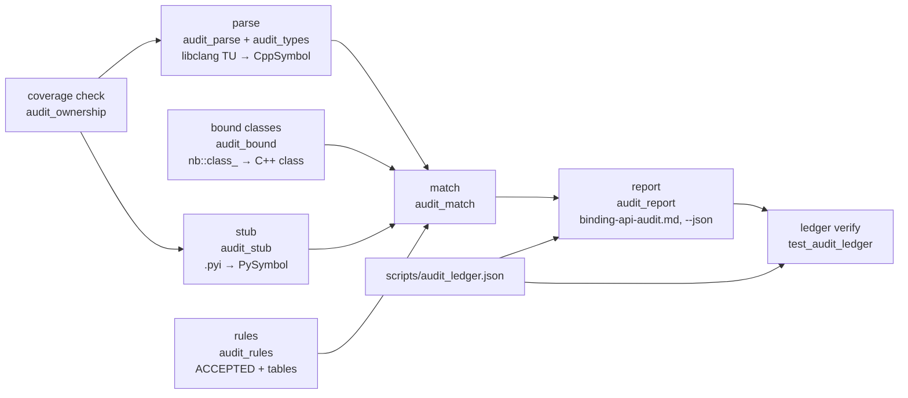

# Binding audit coverage and ownership

22 of the 23 binding modules are audited: the 10 core modules and the 12 planning and trajopt modules (#256). The only unaudited module is `ompl_base`, which binds OMPL rather than tesseract and is to be removed (#258). Every open row of the [Binding API Audit](binding-api-audit.md) (a gap, a deviation or a quoted C++ name) has a recorded outcome in `scripts/audit_ledger.json`: an open issue or a won't-fix reason. `tests/audit/test_audit_ledger.py` checks this in both directions on every PR. Every other difference between a header and its stub is accepted under one of the 54 named rules below, and each rule's text is printed in the report.

A binding module that is in neither module table fails the run before anything is parsed. A rule-table entry whose rule has no text fails at import. A ledger entry whose row is gone fails the ledger test. Nothing is accepted silently.

!!! note "Status"
    Confirmed: coverage (22 of 23 modules), the 54 rules and their contract tests, the ledger mechanism with its four tests, and the per-module counts below (copied from the committed report). The ledger holds 168 entries, one per open row: 95 gaps and 73 deviations; 76 cite an issue, 92 record a won't-fix reason.

## Pipeline



1. **Coverage** (`audit_ownership.check_coverage`): every `src/<m>/<m>_bindings.cpp` is in exactly one module table. Each header is assigned its owning module.
2. **Parse** (`audit_parse.parse_tu`, `cpp_api`): libclang parses the binding TU, plus one synthetic TU per owned header that the binding does not include, and builds the C++ API. Each symbol is keyed by its dotted name and carries its overloads, its arity, its qualified class and any structural `absent_ok` rule.
3. **Stub** (`audit_stub.py_api`): reads the committed `.pyi`, including `@overload`s, `@staticmethod`s and base classes.
4. **Match** (`audit_match.match`): compares the two APIs symbol by symbol and overload by overload. Each difference becomes a covered row, an accepted row (with its rule), a gap or a deviation.
5. **Report** (`audit_report.render_markdown`, `to_json`): writes `docs/developer/binding-api-audit.md` with provenance, coverage and per-module tables. Each open row gets an `issue` column read from the ledger.
6. **Ledger verify** (`test_audit_ledger`): one fresh audit of every audited module. It finds no open row without an outcome and no ledger entry without a row.

Regenerate with `pixi run -e audit audit-bindings` and test with `pixi run -e audit audit-test`. CI runs both on every PR and fails if the regenerated report differs from the committed one (provenance line excepted).

## Audited modules

| module | owned prefixes | group | gaps | deviations | accepted | ledger: issue | ledger: won't fix |
|---|---|---|---|---|---|---|---|
| tesseract_collision | `tesseract/collision/` | core | 4 | 1 | 14 | 0 | 5 |
| tesseract_common | `tesseract/common/` | core | 46 | 3 | 50 | 2 | 47 |
| tesseract_environment | `tesseract/environment/` | core | 9 | 6 | 55 | 0 | 15 |
| tesseract_geometry | `tesseract/geometry/` | core | 3 | 1 | 23 | 0 | 4 |
| tesseract_kinematics | `tesseract/kinematics/` | core | 3 | 2 | 16 | 0 | 5 |
| tesseract_scene_graph | `tesseract/scene_graph/` | core | 4 | 0 | 22 | 0 | 4 |
| tesseract_serialization | `tesseract/serialization/` | core | 1 | 0 | 24 | 0 | 1 |
| tesseract_srdf | `tesseract/srdf/` | core | 2 | 0 | 1 | 0 | 2 |
| tesseract_state_solver | `tesseract/state_solver/` | core | 1 | 2 | 7 | 0 | 3 |
| tesseract_urdf | `tesseract/urdf/` | core | 5 | 0 | 0 | 0 | 5 |
| tesseract_command_language | `tesseract/command_language/` | 1 | 1 | 25 | 128 | 26 | 0 |
| tesseract_time_parameterization | `tesseract/time_parameterization/` | 1 | 0 | 4 | 10 | 4 | 0 |
| trajopt_ifopt | `trajopt_ifopt/`, `trajopt_common/` | 2 | 5 | 0 | 41 | 4 | 1 |
| trajopt_sqp | `trajopt_sqp/` | 2 | 6 | 6 | 21 | 12 | 0 |
| tesseract_motion_planners | `tesseract/motion_planners/` | 3 | 3 | 0 | 6 | 3 | 0 |
| tesseract_motion_planners_simple | `tesseract/motion_planners/simple/` | 3 | 0 | 0 | 29 | 0 | 0 |
| tesseract_motion_planners_ompl | `tesseract/motion_planners/ompl/` | 3 | 2 | 6 | 25 | 8 | 0 |
| tesseract_motion_planners_trajopt | `tesseract/motion_planners/trajopt/`, `trajopt_sco/`, `trajopt/` | 3 | 0 | 6 | 34 | 6 | 0 |
| tesseract_motion_planners_trajopt_ifopt | `tesseract/motion_planners/trajopt_ifopt/` | 3 | 0 | 6 | 17 | 6 | 0 |
| tesseract_motion_planners_descartes | `tesseract/motion_planners/descartes/`, `descartes_light/` | 3 | 0 | 5 | 24 | 5 | 0 |
| tesseract_task_composer | `tesseract/task_composer/` | 4 | 0 | 0 | 45 | 0 | 0 |
| tesseract_task_composer_planning | `tesseract/task_composer/planning/` | 4 | 0 | 0 | 21 | 0 | 0 |

The report is the source of these numbers. This table is copied from it once per regeneration that changes a count.

## Module layout

The scripts import in one direction, top to bottom. Each file has one job.

| file | job |
|---|---|
| `scripts/audit_types.py` | C++ type → comparable key; `qualified_path`, `public_bases` |
| `scripts/audit_ownership.py` | module tables, header ownership (longest prefix), not-API and third-party header patterns, coverage errors |
| `scripts/audit_parse.py` | libclang TUs → `CppSymbol`/`CppOverload`; structural `absent_ok` predicates; `bound_classes` from `nb::class_`/`nb::enum_` |
| `scripts/audit_bound.py` | what a binding TU binds: `bound_classes` reads the `nb::class_`/`nb::enum_` constructions in the `NB_MODULE` body (Python name → qualified C++ class); `audit_match` builds its per-module `bound_index` from it |
| `scripts/audit_stub.py` | `.pyi` → `PySymbol`/`PyOverload`; deviations and quoted names |
| `scripts/audit_rules.py` | `ACCEPTED` rule texts and every rule table; checks at import that each table entry names a rule |
| `scripts/audit_match.py` | the comparison: cover, accept, gap, deviation; base rows; header rows |
| `scripts/audit_report.py` | Markdown and JSON output; the ledger loader and the `issue` column |
| `scripts/audit_bindings.py` | thin CLI (`pixi run -e audit audit-bindings`) |

Tests import the scripts through `tests/audit/_load.py` (`from tests.audit._load import audit`). To monkeypatch a function, patch the module that calls it.

## What "audited" means

A module's audited API is every header it owns:

- A header that the binding `#include`s directly is parsed with the binding and compared against the committed stub.
- A header that the module owns but its binding never includes is parsed in a synthetic TU (the binding plus that header) and shows as one `header` row. If the header does not compile on its own, it shows as an `unparseable header` row at its first error, and its API is not checked. Headers that compile alone but not together (two definitions of one name) fail the run with the combined error, and no rows are reported for them.
- A header that the module owns and another module's binding includes is audited with that other module (`header_auditor`). The owner's section lists it under "Headers audited with another module".
- `UNAUDITED_HEADERS` (not API) and `THIRD_PARTY_HEADERS` (vendored libraries) are skipped. Each pattern is printed with its reason in the report.

Every other declaration in the TU is used only to resolve Python names.

## Ownership

| table | maps | meaning |
|---|---|---|
| `AUDITED_HEADER_PREFIX` | module → prefixes | audited |
| `UNAUDITED_MODULES` | module → (reason, prefixes) | not audited; listed in the report with the reason. Holds only `ompl_base` |

Every prefix ends with `/`. A module may own several prefixes. `trajopt_ifopt` also owns `trajopt_common/`, because it registers `TrajOptCollisionConfig`. `tesseract_motion_planners_trajopt` owns classic TrajOpt's `trajopt_sco/` and `trajopt/`, and `tesseract_motion_planners_descartes` owns `descartes_light/`: Python reaches each of these libraries only through that planner.

Only the tesseract-robotics libraries are owned: `tesseract/`, `trajopt*/` and `descartes_light/`. Third-party roots (`ompl-<version>/ompl/`, `OsqpEigen/`, `osqp/`, `octomap/`, `cereal/`, `yaml-cpp/`, `boost/`) belong to no module and are never audited.

**Longest prefix wins.** `tesseract/motion_planners/planner.h` belongs to `tesseract_motion_planners`, while `tesseract/motion_planners/simple/simple_motion_planner.h` belongs to `tesseract_motion_planners_simple`. This applies everywhere a header's owner matters: the header walk, direct includes, delegation and not-API patterns.

**Not-API headers are scoped to their prefix.** `UNAUDITED_HEADERS` maps an owning prefix to `{pattern below that prefix: reason}`. A header is checked only against the patterns of the longest prefix that holds it, plus the `ANY_PREFIX` (`*`) patterns (`test_suite/*`, `*_impl.hpp`). Because of this scoping, a broad pattern such as `trajopt_sco/` → `*` hides classic TrajOpt's SQP layer without reaching any other module. A key that is no module's prefix raises `UnknownPrefixError`. The report prints each pattern as `<prefix><pattern>`.

## Identity, inheritance and bases

- **Classes are identified by qualified C++ name.** `audit_bound.bound_classes` reads the binding TU's `nb::class_`/`nb::enum_` constructions and maps each Python class name to the qualified C++ class it binds. As a result, a class bound under another Python name (`DescartesStateD` → `descartes_light::State<double>`) keeps its members audited, and `sco::Var` is no longer confused with `trajopt_ifopt::Var`. A parameter typed by a renamed class is compared under its C++ name.
- **Inherited members.** A bound class whose public base is unbound but owned gets that base's members audited on it (`CppSymbol.inherited_from`), with C++ name hiding respected.
- **Bases.** Each stub base is resolved through the bound index of its module and compared with the C++ direct public bases (`Kind.BASE`). A missing base is a gap and an extra base is a deviation. A name that the index does not know falls back to the leaf comparison.
- **Exceptions.** An `nb::exception<T>(m, "Name")` registration binds `Name` (`audit_bound.bound_exceptions`). The planners' error types (`SimplePlannerEmptyGenerateError` → `EmptyGenerateError`, `TrajOptIfopt…Error`) are declared in the binding's own anonymous namespace, not in a header, so their Python names are neither rows nor deviations.
- **Not API by construction.** A specialisation of a class template declared in an owned not-API header (`TESSERACT_CLASS_EXTENSION`'s `extension<TaskComposerLog>`, from `tesseract/common/serialization_extensions.h`) is not reported. A specialisation of a third-party template (Boost's `property_kind`) stays a row.
- **Never rows:** `operator=` (assignment has no Python form), and a class template's constructor template counts as a constructor.

## How a row is decided

For each C++ symbol:

1. **Covered**: a Python overload fits it (arity, parameter keys, out-params, byte buffers).
2. **Uncovered overload of a bound symbol**, in order: a Poly alternative covers it; its structural `absent_ok` holds (for `yaml-node`, only when its premise holds); `ACCEPTED_CPP_OVERLOADS`; a reference-wrapper view beside a covered sibling; a derived-element container sibling. Otherwise it is a gap with the missing arity.
3. **Unbound symbol**, in order: every `TEMPLATE_INSTANCES` instance is bound; `ACCEPTED_SYMBOLS`; a whole-symbol `absent_ok` (`WHOLE_SYMBOL_ABSENT_OK`); an operator of an `EIGEN_VALUE_WRAPPERS` class; a free predicate bound as a method; a vector-forwarder member. Otherwise it is a gap.

For each Python name, in order: a `TEMPLATE_INSTANCES` instance; a `kCamelCase` rename (`k-prefix-enumerator`); `__hash__ = None` beside `__eq__`; a protocol dunder (`PROTOCOL_RULES`). If no C++ name matches after that, it is accepted by `ACCEPTED_SYMBOLS` or as a `from_yaml` that stands for a `yaml-node` constructor; otherwise it is a deviation. A Python overload that matches no C++ overload is accepted when it is typed by a Poly alternative or listed in `ACCEPTED_PY_OVERLOADS`; otherwise it is an overload deviation.

Structural `absent_ok` rules are set while parsing, and the later rule wins: `type-index`, then `unbound-dependency-type`, then `template-instance-name` (forwarding constructor templates), then `yaml-node`. `serialization-default-ctor` applies only to a nullary constructor that none of the others claims.

## Rule catalogue

Each rule is listed with what it accepts and why. "Structural" means a predicate decides it from the TU or the stub. "Table" means an explicit entry in `audit_rules.py`.

### Core (before #256)

| rule | accepts | why | how |
|---|---|---|---|
| `out-param` | a non-const lvalue-ref out-param returned in a tuple (or alone for `void`) | Python has no out-params | structural |
| `stringstream` | a `std::stringstream&` the C++ writes into, returned as `str` | same | structural |
| `byte-buffer` | a `(const uint8_t*, size_t)` pair bound as one `bytes` | Python passes one buffer | structural |
| `scalar-last-quaternion` | `Quaterniond(x, y, z, w)`, `from_xyzw` | project-wide scalar-last order | table |
| `container-protocol` | `size`/`operator[]` as `__len__`/`__getitem__`/`__setitem__` | Python container protocol | structural |
| `iterator-pair` | `begin`/`end` (`cbegin`/`cend`) as `__iter__` | Python iteration protocol | structural |
| `stream-insertion` | free `operator<<(ostream&, const T&)` as `T.__str__` | Python presentation | structural |
| `presentation-dunder` | `__repr__`, `__str__` | presentation needs no C++ counterpart | structural |
| `serialization-default-ctor` | the default ctor of a cereal-serialisable class (a befriended `serialize`, or a free one in its library's `cereal_serialization.h`) with another public ctor | exists for deserialisation only | structural; overload table for `TaskComposerNodeInfo` |
| `value-equality-unhashable` | `__hash__ = None` beside a bound `__eq__` | Python's rule for mutable value types | structural |
| `eigen-template-instance` | `Hyperplane3d`, `ParametrizedLine3d` | no Eigen typedef; Eigen's `…3d` naming | table |
| `quaternion-rpy` | `Quaterniond.from_rpy`/`to_rpy` | ROS/tf2 RPY convention | table |
| `eigen-default-precision` | `EIGEN_DEFAULT_PREC` | Eigen's own default tolerance, not a duplicated literal | table |
| `template-instance-name` | one Python name per template instance, including a library prefix for generic names (`DescartesStateD`) and forwarding ctor templates (`AnyPoly_wrap_*`) | Python cannot spell a template argument | structural and table |
| `copied-vector-field-mutator` | `add…`/`clear…` beside a `std::vector` field | the field converts to a copy | table |
| `boost-graph-property-tag` | `vertex_link_t`, `edge_joint_t`, … | reached through `SceneGraph` methods | table |
| `bound-in-other-module` | a class bound once in another extension module | one Python type per class; members compared there | structural |
| `yaml-node` | an overload taking `YAML::Node`, only beside a bound path/YAML-text sibling or the class's static `from_yaml(text)` | no Python type converts to a `YAML::Node` | structural, premise-checked |
| `derived-element-container` | a container-of-derived overload beside its base-element sibling | C++ only upcasts | structural |
| `module-getattr` | a PEP 562 module `__getattr__` | lazy re-export, not API | structural |

### Core modules, new with #256

| rule | accepts | why | how |
|---|---|---|---|
| `reference-wrapper-out-param` | `ContactResultMap.flattenWrapperResults` | it fills references into the map, which have no Python form; `flattenCopyResults`/`flattenMoveResults` return the same results (C12) | table |

### Group 1: command language, time parameterization

| rule | accepts | why | how |
|---|---|---|---|
| `reference-wrapper-view` | a `vector<reference_wrapper<T>>` overload beside a covered sibling | Python passes the owner; the sibling builds the view | structural |
| `profile-key-template` | `ProfileDictionary.getProfile<ProfileType>` | Python passes the key to the bound `getProfile(key, ns, name)` | overload table |
| `free-function-as-method` | a free `f(const T&)` predicate bound as `T.f()` | sits beside `T`'s member predicates | structural |
| `type-index` | `getType()` returning `std::type_index` | no Python form; `is…()`/`as…()` answer by name, and `AnyPoly.getTypeName()` returns the demangled name | structural, whole symbol; table for `getTypeName` |
| `type-erasure-interface` | the `…Interface` classes of each Poly, and `AnyInterface`/`AnyWrapper`/`AnyPoly.get` | the C++ extension point; Python holds the concrete classes | table |
| `algorithm-internal-namespace` | `totg::{Path, PathSegment, PathData, Trajectory}` | implementation of the bound `TimeOptimalTrajectoryGeneration` | table |
| `reference-setter` | `MoveInstruction(Poly).setWaypoint` | Python cannot assign to a returned reference | table |
| `vector-forwarding-no-python-form` | `data`, `emplace*`, `swap`, reverse iterators of a vector forwarder | no Python form; `push_back`/`insert`/`reversed()` cover them | structural |
| `clone-as-copy` | `__copy__`/`__deepcopy__`; `clone()` covered by `__deepcopy__` | binds the C++ copy constructor | structural |
| `poly-alternative-overloads` | a Poly-typed parameter also bound once per alternative (`POLY_ALTERNATIVES`) | the stub names what callers pass | structural |

### Group 2: trajopt_ifopt, trajopt_sqp

| rule | accepts | why | how |
|---|---|---|---|
| `k-prefix-enumerator` | `kCamelCase` enumerators bound as mechanical `UPPER_SNAKE` | the Python enum convention; any other name stays a gap and a deviation | structural |
| `unbound-dependency-type` | a parameter, return or field typed by an unbound third-party library (`OsqpEigen::`, `ompl::`) or by a type declared only in a not-API header (`trajopt::TermInfo`); never a type some module binds | no Python form; the owner exposes fields or `set…` forwarders | structural, whole symbol; table where the type walk stops at an aggregate |
| `stdout-printer` | `Component.print` | writes to `std::cout`, bypasses `sys.stdout` | table |
| `unimplemented-observer` | `NodesVariables.addObserver` | trajopt 0.35.0 has no `NodesObserver` implementation | table |
| `split-var-pair` | `ContinuousCollisionConstraint(…, position_var0, position_var1, …)` | the `std::array` pair as two named parameters | overload tables |
| `ifopt-problem-only` | `calcNumericalCostGradient` | serves the `IfoptQPProblem` path, which is not Python API | table |
| `nodes-variables-factory` | `createNodesVariables` | fills the `vector<unique_ptr<Node>>` constructor | table |
| `sized-double-array` | `QPProblem.setVariables(const double*)`, `TrajOptQPProblem.setVariables` | the pointer is read for `getNumNLPVars()` doubles; Python passes one float array, checked against that size (`VariablesSizeError`) | overload table |

### Group 3: motion planners

| rule | accepts | why | how |
|---|---|---|---|
| `type-erased-data` | `PlannerRequest.data`, `PlannerResponse.data` | `shared_ptr<void>` | table |
| `third-party-global` | `RNG_setSeed`, `RNG_getSeed` | OMPL's process-global RNG; needed for reproducible planning (#103, #109) | table |
| `solver-behind-profile` | `sco::Optimizer`, `BasicTrustRegionSQP*`, `OptResults`, `OptStatus`, `toString` | run by `TrajOptMotionPlanner.solve`; configured through `opt_params` | table |
| `eigen-value-wrapper` | the operators of `descartes_light::State` | they forward to the bound `values` array | structural (`EIGEN_VALUE_WRAPPERS`) |
| `reason-out-param` | `MotionPlanner.checkRequest(request, std::string& reason)` as `checkRequestReason(request) -> str` | an `out-param` tuple is truthy, so `if checkRequest(req):` would pass an invalid request (C2) | table and overload table |
| `hook-override-guard` | `__init_subclass__` on a concrete profile, installed by `refuse_hook_overrides` | the profile has no trampoline; a subclass that overrides a hook the planner never calls is refused at class definition | structural (`OVERRIDE_GUARD`) |
| `declared-never-defined` | `JointGroupInstructionInfo.getWorkingFrame` (simple planner), `validateSeedStructure` (command language) | declared in the header, but the 0.35.0 library defines no such symbol (`nm`): a binding cannot link it | table |

### Group 4: task composer

| rule | accepts | why | how |
|---|---|---|---|
| `plugin-author-factory-interface` | abstract `…Factory` plugin interfaces, including core's `FwdKinFactory`, `InvKinFactory`, `Discrete/ContinuousContactManagerFactory` | Python cannot implement a C++ plugin | table |
| `plugin-config-ctor` | a `(…, const YAML::Node& config)` constructor: `TaskflowTaskComposerExecutor(name, config)`, `TaskComposerGraph`/`TaskComposerPipeline(name, config, plugin_factory)` | only the plugin factory calls it | overload table |
| `std-library-enum` | `FutureStatus` | a standard-library enum, bound because a member returns it | table |
| `clock-deadline` | `TaskComposerFuture.waitUntil` | the clock has no epoch Python can name; `waitFor` is its form | table |
| `context-from-data-storage` | `TaskComposerExecutor.run(node, data_storage, dotgraph)` | the shape of upstream's `TaskComposerServer::run` | overload table |
| `dot-dump-hook` | `TaskComposerNode.dump` and its overrides (`TaskComposerGraph.dump`) | the hook behind `getDotgraph`/`saveDotgraph` | table |
| `python-hook-method` | `TaskComposerGraph.addNodePython`, `TaskComposerServer.addTaskPython` bound as `addNode`, `addTask` | upstream documents them as the Python form; the `std::unique_ptr` sibling has none | table |
| `to-string-as-str` | `TaskComposerNodePorts.toString` as `__str__` | Python presentation | table |

The report's "Accepted deviation rules" note gives the full text of every rule.

## Ledger

`scripts/audit_ledger.json` records the outcome of every open row:

```json
{
  "tesseract_common": {
    "JointTrajectory.insert": {"issue": "#269"}
  },
  "tesseract_kinematics": {
    "dampedPInv": {"wont_fix": "numpy covers it."}
  }
}
```

- The key is the report's row key: the C++ symbol for a gap, the Python name for a deviation, the quoted annotation for a quoted name, or the header path for a header row. One entry covers every overload row of a symbol.
- Each entry has exactly one field: `issue` (`#NNN`) or `wont_fix` (a non-empty reason without `|`). `load_ledger` raises `MalformedLedgerError` on any other shape, including duplicate keys.
- The report shows the outcome in the last column (`issue`) of the Gaps, Deviations and quoted-name tables: `#NNN`, `won't fix: <reason>`, or `—` when there is none. The `--json` rows carry `issue` and `wont_fix`.

`tests/audit/test_audit_ledger.py`:

| test | checks |
|---|---|
| `test_every_open_row_has_an_outcome_and_every_entry_a_row` | one fresh audit: no `—` row in an audited module, and no stale entry |
| `test_ledger_entries_are_well_formed` | each malformed shape raises `MalformedLedgerError` |
| `test_committed_ledger_entries_are_well_formed` | the committed file loads, and each entry has exactly one outcome |
| `test_issue_column_renders_each_outcome` | Markdown and JSON render `#NNN`, `won't fix:` and `—` |

**A PR that fixes a row removes the row's ledger entry in the same PR.** Once the row is gone, the entry is stale and the first test fails. A PR that adds a row (a new header, a new binding module, an upstream bump) adds the row's outcome in the same PR: file the issue first, or record the won't-fix reason.

## Adding a rule

A rule exists only when a real row needs it. Leaving the row as a gap or deviation is the default.

1. **Write the failing test first.** Add a fixture in `tests/audit/fixtures/` (its own stub root, and class names unique across fixture stubs) and a contract test that asserts the row is accepted under the new rule. Add a real-row test that pins the module row. Also test the negative case: the nearest shape the rule must not accept stays a gap.
2. **Write the text** in `ACCEPTED` (`scripts/audit_rules.py`). The text states the premise, the Python form that replaces the C++ one, and why. The report prints it verbatim.
3. **Pick the narrowest mechanism:**
    - a symbol, by name: `ACCEPTED_SYMBOLS[(module, dotted name)]`;
    - one C++ overload of a bound symbol: `ACCEPTED_CPP_OVERLOADS[(module, name, str(arity))]`;
    - one Python-only overload: `ACCEPTED_PY_OVERLOADS[(module, name, params)]`;
    - a member template bound per instance: `TEMPLATE_INSTANCES`;
    - a premise that can be checked from the TU or stub: a predicate in `audit_parse` (sets `absent_ok`) or `audit_match`, plus `WHOLE_SYMBOL_ABSENT_OK` if it also accepts a symbol that is entirely unbound.

    Prefer an explicit entry. Use a structural predicate only when it decides from evidence in the source and has a test for the shape it must reject.
4. **Import check:** `_check_rule_keys` raises `UnknownAcceptedRuleError` at import if a table entry names a rule without text.
5. **Add the entry** to the group's "every table entry fires" test (`test_every_g<n>_table_entry_fires`), so a dead entry fails.
6. **Regenerate** with `pixi run -e audit audit-bindings`. Remove the ledger entries of the rows that are now accepted (the ledger test names them), and commit the report.
7. **Gates:** `pixi run -e audit audit-test`, `pixi run -e audit audit-typecheck`, and ruff.

## Moving a module from unaudited to audited

1. Move its entry from `UNAUDITED_MODULES` to `AUDITED_HEADER_PREFIX`, with the prefixes unchanged.
2. Regenerate the report.
3. Give every new row one outcome: a binding-fix issue in the ledger, an accepted rule (above), a tool fix (an audit false positive, fixed with a failing test first), a not-API pattern (`UNAUDITED_HEADERS` under the owning prefix, with its reason), or a won't-fix entry in the ledger.
4. Gates: `pixi run -e audit audit-test`, and a regenerated report with no diff.

## Fail-loud checks

| exception | raised when | where |
|---|---|---|
| `UnclassifiedModuleError` | a binding module is in neither table | `check_coverage`, first thing in `main` |
| `ConflictingCoverageError` | a module is in both tables | `check_coverage`, `owner_prefixes` |
| `UnknownModuleError` | a table entry is not a binding module, or the CLI names one | `check_coverage`, `resolve_module` |
| `UnauditedModuleError` | the CLI names an unaudited module | `resolve_module` |
| `DuplicatePrefixError` | two modules claim one prefix | `owner_prefixes` |
| `MalformedPrefixError` | a prefix does not end with `/` | import of `audit_ownership`, `owner_prefixes` |
| `UnknownPrefixError` | an `UNAUDITED_HEADERS` key is no module's prefix | `check_unaudited_keys` |
| `PrefixMismatchError` | `audit_tu` gets a prefix that disagrees with the module's entry | `audit_tu` |
| `HeaderParseError` | a binding TU does not compile, or unincluded headers conflict | `parse_tu`, `unincluded_header_gaps` |
| `SkippedBodiesError` | `bound_classes` gets a TU parsed without function bodies | `audit_bound.bound_classes` |
| `IncludeDirError` | `include/ompl-<version>` is missing or ambiguous | import of `audit_parse` |
| `StubMissingError` | the module has no committed stub | `audit_stub` |
| `UnknownAcceptedRuleError` | a rule-table entry names a rule without text | import of `audit_rules` |
| `MalformedLedgerError` | the ledger has the wrong shape | `load_ledger` |

The JSON output (`--json PATH`) carries the coverage as a top-level `coverage` key, `{"audited": [...], "unaudited": {module: reason}}`, and each open row carries `issue` and `wont_fix`.
