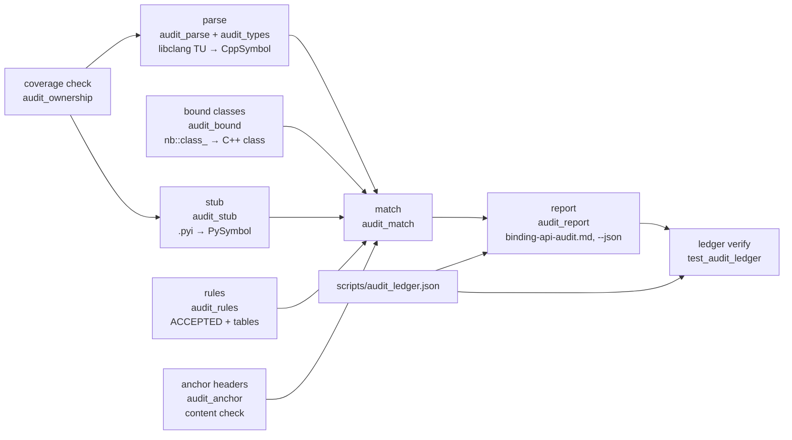

# Binding audit coverage and ownership

All 22 binding modules are audited: the 10 core modules and the 12 planning and trajopt modules (#256). Every open row of the [Binding API Audit](binding-api-audit.md) (a gap, a deviation or a quoted C++ name) has a recorded outcome in `scripts/audit_ledger.json`: an open issue or a won't-fix reason. `tests/audit/test_audit_ledger.py` checks this in both directions on every merge into main, on tags and when the workflow is run by hand. It does not run on pull requests. Every other difference between a header and its stub is accepted under one of the 54 named rules below, and each rule's text is printed in the report.

A binding module that is in neither module table fails the run before anything is parsed. A rule-table entry whose rule has no text fails at import. A ledger entry whose row is gone fails the ledger test. Nothing is accepted silently.

!!! note "Status"
    Confirmed: coverage (22 of 23 modules), the 54 rules and their contract tests, the ledger mechanism with its four tests, and the per-module counts below (copied from the committed report). The ledger holds 168 entries, one per open row: 95 gaps and 73 deviations; 76 cite an issue, 92 record a won't-fix reason.

## Pipeline



1. **Coverage** (`audit_ownership.check_coverage`): every `src/bindings/<m>.cpp` (except the helper sources linked into a module) is in exactly one module table. Each header is assigned its owning module.
2. **Parse** (`audit_parse.parse_tu`, `cpp_api`): libclang parses the binding TU, plus one synthetic TU per owned header that the binding does not include, and builds the C++ API. Each symbol is keyed by its dotted name and carries its overloads, its arity, its qualified class and any structural `absent_ok` rule.
3. **Stub** (`audit_stub.py_api`): reads the committed `.pyi`, including `@overload`s, `@staticmethod`s and base classes. A module that is itself the compiled extension has its stub at `src/tesseract_robotics/<m>.pyi`; a wrapped package (`common`, `scene_graph`, `motion_planners`, `motion_planners_simple`, `motion_planners_descartes`, `motion_planners_trajopt_ifopt`) keeps `<m>/_<m>.pyi` beside its `__init__.py`, which the audit also reads.
4. **Match** (`audit_match.match`): compares the two APIs symbol by symbol and overload by overload. Each difference becomes a covered row, an accepted row (with its rule), a gap or a deviation.
5. **Report** (`audit_report.render_markdown`, `to_json`): writes `docs/developer/binding-api-audit.md` with provenance, coverage and per-module tables. Each open row gets an `issue` column read from the ledger.
6. **Ledger verify** (`test_audit_ledger`): one audit of every audited module, in CI the findings of `audit-bindings --json`, run on its own a fresh audit. It finds no open row without an outcome and no ledger entry without a row.

Regenerate with `pixi run -e audit audit-bindings` and test with `pixi run -e audit audit-test`. CI runs both on every merge into main and on tags, and fails if the regenerated report differs from the committed one (provenance line excepted). `.github/workflows/audit.yml` computes the full audit once, last: the contract tests without the ledger row test, the GIL list, then `audit-bindings --json`, whose findings the ledger test below reads (`BINDING_AUDIT_JSON`), then the report check. Nothing runs on a pull request, so nothing here is enforced before merge: a PR's unledgered rows or stale report show up on main after it lands. `workflow_dispatch` runs the audit on a branch by hand.

A stub row names its file, not its line, and a header row keeps its line. Line numbers in the header rows move only when the headers change, which is only on a tesseract bump through `dependencies.rosinstall`. The report therefore changes only when a row is added, removed or reclassified, and needs regenerating only after one of these changes:

- a tesseract bump (`dependencies.rosinstall`, the native stack's headers);
- a binding added, removed or given another signature;
- a change to `scripts/audit_*.py` or `scripts/audit_ledger.json`.

Other changes (rebases, tests, CI, a stub edit that only moves lines) leave it current; CI's "Report is current" step says when it is not. The JSON report (`--json`) keeps every line number.

### Header source

libclang parses the bindings against the native stack the wheels link against, not against conda headers: `ws/install/include` (tesseract, trajopt, tesseract_planning) and `vcpkg/installed/<triplet>/include` (Eigen, OMPL, Boost, ...), from `audit_parse.native_include_dirs`. `$AUDIT_NATIVE_ROOT` names the stack root; unset, it is the one `.native/<triplet>` that `pixi run native-build` made. The vcpkg prefix is the triplet the stack's vcpkg stage recorded in `vcpkg/installed/.native-stack-identity.json`: `vcpkg/installed` also holds the host triplet (`x64-linux` beside `x64-linux-dynamic-release`), so the directory listing cannot name it. A missing stack or identity file raises `NativeStackMissingError`. In CI, `.github/actions/native-linux` restores the wheel workflow's native-stack artifact or builds the stack with `scripts/native_stack.py`. The libclang resource dir (`stdarg.h`, ...) still comes from the audit env's `clang-22`.

## Audited modules

| module | owned prefixes | group | gaps | deviations | accepted | ledger: issue | ledger: won't fix |
|---|---|---|---|---|---|---|---|
| collision | `tesseract/collision/` | core | 4 | 1 | 14 | 0 | 5 |
| common | `tesseract/common/` | core | 46 | 3 | 50 | 2 | 47 |
| environment | `tesseract/environment/` | core | 9 | 6 | 55 | 0 | 15 |
| geometry | `tesseract/geometry/` | core | 3 | 1 | 23 | 0 | 4 |
| kinematics | `tesseract/kinematics/` | core | 3 | 2 | 16 | 0 | 5 |
| scene_graph | `tesseract/scene_graph/` | core | 4 | 0 | 22 | 0 | 4 |
| serialization | `tesseract/serialization/` | core | 1 | 0 | 24 | 0 | 1 |
| srdf | `tesseract/srdf/` | core | 2 | 0 | 1 | 0 | 2 |
| state_solver | `tesseract/state_solver/` | core | 1 | 2 | 7 | 0 | 3 |
| urdf | `tesseract/urdf/` | core | 5 | 0 | 0 | 0 | 5 |
| command_language | `tesseract/command_language/` | 1 | 1 | 25 | 128 | 26 | 0 |
| time_parameterization | `tesseract/time_parameterization/` | 1 | 0 | 4 | 10 | 4 | 0 |
| trajopt_ifopt | `trajopt_ifopt/`, `trajopt_common/` | 2 | 5 | 0 | 41 | 4 | 1 |
| trajopt_sqp | `trajopt_sqp/` | 2 | 6 | 6 | 21 | 12 | 0 |
| motion_planners | `tesseract/motion_planners/` | 3 | 3 | 0 | 6 | 3 | 0 |
| motion_planners_simple | `tesseract/motion_planners/simple/` | 3 | 0 | 0 | 29 | 0 | 0 |
| motion_planners_ompl | `tesseract/motion_planners/ompl/` | 3 | 2 | 6 | 25 | 8 | 0 |
| motion_planners_trajopt | `tesseract/motion_planners/trajopt/`, `trajopt_sco/`, `trajopt/` | 3 | 0 | 6 | 34 | 6 | 0 |
| motion_planners_trajopt_ifopt | `tesseract/motion_planners/trajopt_ifopt/` | 3 | 0 | 6 | 17 | 6 | 0 |
| motion_planners_descartes | `tesseract/motion_planners/descartes/`, `descartes_light/` | 3 | 0 | 5 | 24 | 5 | 0 |
| task_composer | `tesseract/task_composer/` | 4 | 0 | 0 | 45 | 0 | 0 |
| task_composer_planning | `tesseract/task_composer/planning/` | 4 | 0 | 0 | 21 | 0 | 0 |

The report is the source of these numbers. This table is copied from it once per regeneration that changes a count.

## Fact cache

Only the part of the audit that libclang computes is cached, and only per translation unit: a binding re-parses when a file its parse read changes, and no other binding does. Every rule still runs on every audit. Status: **confirmed** for correctness and the timings below; the typed key, the listing rule and the telemetry ran green cold and warm at 06c5ff2a. The cost that was left then (§ Telemetry: the synthetic TUs of unincluded headers, `cpp_api`, the declarations parse) is now cached too (§ Include structure and API).

!!! note "Status"
    Confirmed on a cold cache ([run](https://github.com/tesseract-robotics/tesseract_nanobind/actions/runs/43035541479), 47a5133f): 1073 contract tests passed, "Report is current" green, and the audit step, which reads what the contract tests stored, took 0:13 with no miss. Confirmed on a warm cache ([run](https://github.com/tesseract-robotics/tesseract_nanobind/actions/runs/43038657462), da0f6bac): the same, and the contract tests took 1:54.

| step | main, no cache ([run](https://github.com/tesseract-robotics/tesseract_nanobind/actions/runs/42889787253)) | cold cache ([run](https://github.com/tesseract-robotics/tesseract_nanobind/actions/runs/42937052432)) | warm cache ([run](https://github.com/tesseract-robotics/tesseract_nanobind/actions/runs/42946926141)) | warm cache, main at 16a89e46 ([run](https://github.com/tesseract-robotics/tesseract_nanobind/actions/runs/43003311837)) |
|---|---|---|---|---|
| contract tests | 26:12 | 12:52 | 10:40 | 7:01 |
| GIL list | 11:03 | 8:26 | < 0:01 | < 0:01 |
| audit | 12:35 | 3:36 | 3:55 | 2:52 |
| job | ~50 min | ~25 min | ~15 min | ~10 min |

Step times of two runs do not compare to better than a factor of two: the two runs measured below ran the same commit, and every uncached phase took 1.7 to 2.2 times longer in the second. That is enough to explain why the second warm run above is faster than the first; no code change is shown to be the cause.

The cold run gains because the per-entry lock lets one xdist worker parse each binding with bodies while the others wait for its entry, and the audit step then reads what the contract tests computed. The warm run's regenerated report differs from the committed one in exactly the 28 rows that main's uncached run reported (2026-11-11): the cached path changes no row.

The audit's cost is libclang: two parses of each binding (one with function bodies), a third for the GIL list, and whole-TU walks from Python (std, Eigen and boost included). The 2026-11-10 run on main took 50 min: contract tests 26 min, GIL list 11 min, audit 12.5 min. In the contract tests, each xdist worker parsed every binding with bodies on its first real-module test: the four workers stalled together for 9 min.

`scripts/audit_facts.py` caches five facts, each one extractor's output on one parse:

| fact | parse | replaces |
|---|---|---|
| `include_facts` | declarations (`PARSE_OPTIONS`), binding TU and synthetic TU | the inclusion directives and `get_includes()` that header ownership and the `api` key read |
| `api_facts` | the same parse, per `Selection` | the `cpp_api` walk, minus the rule that reads other modules |
| `bound_facts` | bodies (`BODY_PARSE_OPTIONS`) | `bound_classes` + `bound_exceptions`; every module's `bound_index` |
| `decl_facts` | declarations (`PARSE_OPTIONS`) | the three whole-TU walks `decl_names`, `class_ancestors`, `public_bases` |
| `gil_releases` | the GIL audit's own bodies parse | `audit_gil.Scanner.scan` |

`scripts/audit_cache.py` stores each fact as one JSON entry under `.cache/binding-audit/<fact>/<digest>.json`, together with the SHA-256 of every file the parse read (the main file plus `get_includes()`). An entry is used only when every one of those files is byte-identical. The digest covers everything else the fact depends on, as one typed value: `audit_toolchain.Toolchain`. `Toolchain.build` sorts its two mappings, and `Toolchain.canonical()` is the only serialisation, so two keys built in another order are the same key and a field added to the class is part of the digest without further code. Its fields:

- the parse arguments, in order (argument order is search order), and the options;
- the audit env's package set (`conda-meta` records and `dist-info` names): libclang, nanobind. The C++ headers are not in it: they come from the native stack the wheels build (below), and each header a parse read is hashed in its entry;
- `CPATH`, `C_INCLUDE_PATH` and `CPLUS_INCLUDE_PATH`;
- the file listing of each include dir inside the repo (`repo_dir_listing`), because a new file there can shadow a header found later on the search path;
- the source of the scripts that run during extraction (`*_EXTRACTORS`).

The listing names every file a parse could include: everything except the suffixes in `NOT_INCLUDED_SUFFIXES` (`.py`, `.pyi`, `.md`, `.typed`, `.cpp`) and `__pycache__`. The include dirs inside the repo are the package tree, so without this rule every stub or Python edit changed every key. The rule rests on one premise, that no parse includes such a file, and `require_listed` checks it on every parse whose facts are stored: a TU that includes a file of a skipped kind raises `UnlistedIncludeError` instead of being cached. No include in the binding sources is of a skipped kind today: of the 647 `#include` lines under `src/` and `tests/audit/fixtures/`, 523 name a `.h`, 18 a `.hpp` and 106 a file with no suffix (at 71f965f5).

### Include structure and API

`cpp_api` is two steps. `audit_parse.extract_api` walks the TU and is stored; `audit_symbols.resolve_bound` then applies the one rule that depends on other modules, on every audit. A hit is sound because everything the walk reads besides the parse is in the key:

| input of the walk | where it is |
|---|---|
| the audited headers (ownership tables, `UNAUDITED_HEADERS`, `PLUGIN_ANCHOR_INCLUDES`, other bindings' includes) | `Selection.audited` |
| the owned not-API headers the TU includes | computed from `include_facts` and the tables on every audit, then `Selection.not_api` |
| `UNBOUND_DEPENDENCY_ROOTS`, `UNBOUND_DEPENDENCY_NAMESPACES` | `Selection.dependency_roots`, `.dependency_namespaces`, read by `audit_parse.api_selection` from the globals a test may patch |
| what any module binds (`is_bound`) | not read by the walk: each overload and field stores a `Dependency`, decided after the fetch |
| a synthetic TU's text | `FactKey.unsaved`; the main file is not on disk and is no dependency |

`Dependency` is exact. For one type, the old walk answered "some flagged type is a template instance or unnamed, or is not bound". With the not-API headers fixed by the key, the flagged types are fixed, so the answer is `always or any(not is_bound(q) for q in unless_bound)`, and a signature's answer is the union over its types. The rule order is kept: a stored overload carries the `absent_ok` that applies when the dependency does not hold, and a `Dependency` only where `yaml-node` and `template-instance-name` did not match.

A synthetic TU includes its binding source, a `.cpp`, which the listing skips. `require_listed` exempts it as a sibling: a quoted include is searched first in the main file's own directory, so no listed dir can shadow it, and it is a recorded dependency. A sibling in another directory raises `NotASiblingError`.

A contract test that patches a table and audits builds another `Selection` or another synthetic text, so another entry. Nothing that a test patches on `audit_match` runs inside a fetch: `api_facts` calls `extract_api` directly, and the test that rewrites an overload wraps `resolve_bound`, after the cache. A parse that fails stores nothing.

Measured at 47a5133f on a cold cache (`ENTRY_FORMAT` 3 matched no stored entry), same job as the tables in § Telemetry, which are the "before":

| step | before, cold (06c5ff2a) | before, warm (06c5ff2a) | after, cold (47a5133f) | after, warm (da0f6bac) |
|---|---|---|---|---|
| contract tests | 9:56 | 14:15 | 9:00 | 1:54 |
| GIL list | 6:13 | 0:01 | 8:37 | < 0:01 |
| audit | 2:52 | 5:03 | 0:13 | 0:13 |
| job | 19:18 | 21:08 | 18:16 | 2:43 |

| audit step, 22 modules | before, cold s | before, warm s | after s |
|---|---|---|---|
| `unincluded-headers` | 75.5 | 133.8 | 1.5 |
| `cpp-api` | 67.3 | 112.1 | 0.4 |
| `decl-parse` | 17.3 (22 calls) | 37.8 (22 calls) | 4.3 (3 calls) |
| `match` | 0.6 | 1.1 | 0.8 |

In the audit step every fetch hit: `api` 41, `includes` 41, `bound` 22, `decl` 22. The contract tests computed them: `api` 75 misses (235.0 s), `includes` 67 (138.5 s), over 120 `audit_tu` calls in 7 processes, with `cpp-api` at 205.0 s and `unincluded-headers` at 245.7 s against 422.1 s and 465.7 s before. The GIL list was all-cold (22 misses, 516.4 s) and is unchanged by this work; warm it takes a second. 
Warm, the contract tests' timed phases fall from 2337 s to 56 s over 7 processes (`unincluded-headers` 1072.7 → 10.8, `cpp-api` 960.9 → 4.2, `decl-parse` 295.1 → 32.5 in 16 parses, `match` 8.2 → 8.7), and the audit step is unchanged from the cold run's. The misses left there (`api` 13, `includes` 7, `decl` 21, `bound` 5, `gil` 1; 47 s of compute) are all tests of the cache itself: the miss-sources table names only `tests/audit/fixtures/` TUs audited against a fresh cache and files under pytest's temp directory. No real module misses.

`cpp-api` times the fetch and `resolve_bound`. When `include_facts` hits and `api_facts` misses (a table edit that changes a `Selection` and no header), the parse runs inside that fetch and its seconds count under `decl-parse` as well.

Still parsed on every audit: the binding TU of the three modules with `PLUGIN_ANCHOR_INCLUDES` headers (collision, kinematics, task composer), because `check_anchor_headers` reads cursors. That is about 3/22 of the `decl-parse` row below.

Item 4 of #397 (one bodies parse per binding for `bound` and `gil`) is dropped. Warm, neither misses. All-cold it would save at most the `bound` compute (214.1 s below), about 10 s per edited binding, and one merged fact would put `audit_gil.py` into the key of every binding's bound classes.

`audit_ownership.py` is not part of the digest. The parse reads only its path constants, which the arguments already cover, and its `header_rel`, which only formats errors. Binding PRs edit its tables constantly.

A per-entry `flock` makes xdist workers that ask for one fact compute it once. In CI, `audit.yml` restores the newest earlier cache, stamps the run start, and after a run that reached every step drops the entries nothing used since the stamp (`audit-cache-prune`). It then saves the cache, also after a failed step.

### Telemetry

`scripts/audit_telemetry.py` records what a run spent its time on. Each audit step in `audit.yml` sets `BINDING_AUDIT_EVENTS` to its own JSONL file under `$RUNNER_TEMP/audit-events`; with the variable unset (local runs, tests) nothing is written. Every process of the step appends to that file, one `write` on an `O_APPEND` descriptor per event, so xdist workers leave whole lines. The log may not live in the cache directory (`EventsInCacheError`): CI saves that directory, and a log in it would be restored into later runs.

| event | written by | fields |
|---|---|---|
| `fetch` | `FactCache.fetch`, once per answered fetch (none when `compute` raises) | `kind`, `source` (the TU's main file), `hit`, `compute_s` (extraction only, 0 on a hit), `wait_s` (time until the entry lock was held), `pid` |
| `phase` | `audit_tu`, through `EVENTS.timed` | `name` (`decl-parse`, `cpp-api`, `match`, `unincluded-headers`), `seconds`, `pid` |

The step "Fact cache use" (`pixi run -e audit audit-telemetry DIR`) prints the fetches per kind and the phases per step, and a third table with each miss's kind and source (which TU a residual miss parsed). It runs last, after the cache is saved, and only when the stamp step created the directory, so a log it cannot read fails the job without costing the prune or the save, and a job that failed before the audit started shows one red step, not two:

```text
3-audit: 204 events from 1 process
kind   hits  misses  compute  wait
bound    34       0      0.0   0.0
decl     34       0      0.0   0.0
phase               calls  seconds
cpp-api                34     61.2
decl-parse             34     88.4
match                  34      9.7
unincluded-headers     34     12.3
```

The numbers above only show the layout; the measurement follows. Reading it: a warm run has 0 misses for `bound` and `gil`; `wait` is time workers spent blocked on another worker's parse of the same binding; `decl-parse` and `cpp-api` seconds are the uncached cost that the last paragraph of this section is about, summed over the processes that paid it. `match` is not rule time alone: it includes reading the stub (`py_api`) and, on a miss, the bodies parse behind `bound_facts`.

Measured at 06c5ff2a, cold ([run](https://github.com/tesseract-robotics/tesseract_nanobind/actions/runs/43009174175): `ENTRY_FORMAT` 2 matched no stored entry) and then warm ([run](https://github.com/tesseract-robotics/tesseract_nanobind/actions/runs/43012075700), restored from the cold run's cache). All steps green in both, "Report is current" included.

| step | cold | warm |
|---|---|---|
| contract tests | 9:56 | 14:15 |
| GIL list | 6:13 | 0:01 |
| audit | 2:52 | 5:03 |
| job | 19:18 | 21:08 |

| step | fact | cold hits | cold misses | cold compute s | cold wait s | warm hits | warm misses | warm compute s | warm wait s |
|---|---|---|---|---|---|---|---|---|---|
| contract tests (7 processes) | `bound` | 70 | 37 | 214.1 | 371.4 | 103 | 4 | 16.4 | 0.0 |
| | `decl` | 90 | 53 | 213.6 | 56.8 | 126 | 20 | 6.1 | 0.9 |
| | `gil` | 1 | 1 | 4.6 | 0.0 | 1 | 1 | 11.3 | 0.0 |
| GIL list | `gil` | 0 | 22 | 372.7 | 0.0 | 22 | 0 | 0.0 | 0.0 |
| audit | `bound` | 22 | 0 | 0.0 | 0.0 | 22 | 0 | 0.0 | 0.0 |
| | `decl` | 22 | 0 | 0.0 | 0.0 | 22 | 0 | 0.0 | 0.0 |

| phase | contract tests: calls (cold / warm) | cold s | warm s | audit: calls | cold s | warm s |
|---|---|---|---|---|---|---|
| `decl-parse` | 116 / 119 | 122.3 | 295.1 | 22 | 17.3 | 37.8 |
| `cpp-api` | 114 / 117 | 422.1 | 960.9 | 22 | 67.3 | 112.1 |
| `match` | 114 / 117 | 522.8 | 8.2 | 22 | 0.6 | 1.1 |
| `unincluded-headers` | 114 / 117 | 465.7 | 1072.7 | 22 | 75.5 | 133.8 |

What the numbers say:

- **The cache works where it applies.** Warm, the GIL list and the audit step miss nothing, and the GIL list drops from 6:13 to 0:01. The misses left in the warm contract tests (4 `bound`, 20 `decl`, 1 `gil`) cost 34 s together; which tests cause them is not established (an event does not name its source file).
- **The warm run was slower than the cold one, and not because of the cache.** Every uncached phase took 1.7 to 2.2 times longer on the warm run's runner (`setup pixi` alone 1:47 against 0:14). Compare phases within a run, not step times across runs.
- **The uncached cost is three phases, in a stable ratio.** In the audit step, `unincluded-headers` is 47% of the timed seconds in both runs, `cpp-api` 39 to 42%, `decl-parse` 11 to 13%, the rules (`match`) under 1%. The timed phases are 93% of the step.
- **"The remaining cost is the declarations parse plus `cpp_api`" is refuted as stated.** The largest phase is the synthetic TUs of headers a binding does not include, which that hypothesis left out; the declarations parse is the smallest of the three.
- **The contract tests pay the audit step's phases about five times.** They run `audit_tu` 117 times in 7 processes against 22 modules; warm, `match` falls from 522.8 s to 8.2 s because the bodies parse behind a `bound` miss is gone, and what remains is the same three phases.

Rejected alternatives:

- **Caching whole module reports.** Contract tests patch the rule tables (`ACCEPTED`, `UNAUDITED_HEADERS`, …) and then audit, so a report keyed on files would return stale rows. Every module's report also reads every other binding through `bound_index`, so any binding edit would invalidate all of them.
- **Caching libclang ASTs** (`TranslationUnit.save` / `from_ast_file`). This removes the parse but not the Python walks. Loading also validates every input file's mtime, and a fresh checkout changes every mtime.
- **Listing only header suffixes (`.h`, `.hpp`).** Unsound: a parse also reads headers with no suffix (`<vector>`, `<Eigen/Core>`) and `.tcc` / `.ipp` files, and the fixture include dir is searched first. A new file named `vector` there would shadow the standard header with no listed file and no recorded file changing. Listing everything except what no parse reads, and checking that per parse, has no such hole.
- **The toolchain as a JSON string assembled in `fact_key`** (the first version). Any caller could build a key with other fields or another order; the type now owns both.

Rejected for the `includes` and `api` facts:

- **A table-independent superset extraction** (store every declaration of every owned header, replay the walk in Python for any header set). It needs no `Selection`, but it re-implements the walk's first-declaration-wins ordering outside libclang, and a divergence changes rows silently.
- **`is_bound` answers as validated dependencies** of an entry. Sound, but a second validation path in `FactCache.fetch`; `Dependency` needs none.
- **A digest of the ownership tables in the key.** Any `UNAUDITED_HEADERS` edit would re-parse every TU; a `Selection` re-parses only the TUs whose header set changed.
- **Session fixtures for the contract tests.** They run `audit_module` on real modules from nine files (59 audits if each module fixture is built once, `tesseract_common` seven times), and xdist rebuilds a module fixture in every worker. A fixture cannot cross workers, and the tests that patch a table need a fresh audit. The cache serves both.

Caching the three whole-TU walks alone saved nothing measurable (first warm run: audit 3:55 against 3:36 cold): the parse still ran. With `include_facts` and `api_facts` it no longer does.

Tests: `tests/audit/test_audit_cache.py` covers hit and miss, edits that keep size and mtime, removed files, the key parts, concurrent workers, pruning and corrupt entries. `tests/audit/test_audit_toolchain.py` covers the key's serialisation (mapping order, every field, unset against empty variables) and the listing rule in both directions. `tests/audit/test_audit_telemetry.py` covers one event per fetch, none on a failed compute or without a log, whole lines under three concurrent writers, and the tables. `tests/audit/test_audit_symbols.py` covers the stored API: order and key types across the JSON round trip, and `resolve_bound` against every case of the rule. These four need no libclang and run in the default env:

```bash
python -m pytest -o addopts='' --noconftest -p no:cacheprovider -n 2 tests/audit/test_audit_cache.py tests/audit/test_audit_telemetry.py tests/audit/test_audit_toolchain.py tests/audit/test_audit_symbols.py
```

`tests/audit/test_audit_facts.py` (libclang, CI only) checks that a cached fact equals the fresh extraction and that a hit does not parse, and that an edit to an included fixture header re-parses.

## Module layout

The scripts import in one direction, top to bottom. Each file has one job.

| file | job |
|---|---|
| `scripts/audit_types.py` | C++ type → comparable key; `qualified_path`, `public_bases` |
| `scripts/audit_ownership.py` | module tables, header ownership (longest prefix), not-API and third-party header patterns, coverage errors |
| `scripts/audit_parse.py` | libclang TUs → `CppSymbol`/`CppOverload`; structural `absent_ok` predicates; `bound_classes` from `nb::class_`/`nb::enum_` |
| `scripts/audit_symbols.py` | the C++ API as plain data (`CppSymbol`, `CppOverload`, `Dependency`), its JSON form and `resolve_bound`; needs no libclang |
| `scripts/audit_bound.py` | what a binding TU binds: `bound_classes` reads the `nb::class_`/`nb::enum_` constructions in the `NB_MODULE` body (Python name → qualified C++ class); `audit_match` builds its per-module `bound_index` from it |
| `scripts/audit_telemetry.py` | event log of fetches and timed phases (`BINDING_AUDIT_EVENTS`), and its totals; imports no audit script |
| `scripts/audit_toolchain.py` | `Toolchain` and `Selection`, the typed parts of a fact's key; the include-dir listing and `require_listed` |
| `scripts/audit_cache.py` | content-addressed fact cache: entries keyed on every file a parse read, per-entry lock, prune (`audit-cache-prune`) |
| `scripts/audit_facts.py` | the cached facts of a TU (`include_facts`, `api_facts`, `bound_facts`, `decl_facts`, `gil_releases`); assembles their key |
| `scripts/audit_cache_prune.py` | thin CLI (`pixi run -e audit audit-cache-prune`): drop the entries a run did not use |
| `scripts/audit_telemetry_report.py` | thin CLI (`pixi run -e audit audit-telemetry`): the per-step tables |
| `scripts/audit_stub.py` | `.pyi` → `PySymbol`/`PyOverload`; deviations and quoted names |
| `scripts/audit_rules.py` | `ACCEPTED` rule texts and every rule table; checks at import that each table entry names a rule |
| `scripts/audit_anchor.py` | holds each `PLUGIN_ANCHOR_INCLUDES` header to its claim: raises when one declares more than its plugin anchor and plugin factory classes, or when its binding no longer includes it |
| `scripts/audit_match.py` | the comparison: cover, accept, gap, deviation; base rows; header rows |
| `scripts/audit_report.py` | Markdown and JSON output; the ledger loader and the `issue` column |
| `scripts/audit_bindings.py` | thin CLI (`pixi run -e audit audit-bindings`) |

Tests import the scripts through `tests/audit/_load.py` (`from tests.audit._load import audit`); the tests of the four libclang-free scripts use `tests/audit/_free.py` instead. To monkeypatch a function, patch the module that calls it.

## What "audited" means

A module's audited API is every header it owns:

- A header that the binding `#include`s directly is parsed with the binding and compared against the committed stub.
- A header that the module owns but its binding never includes is parsed in a synthetic TU (the binding plus that header) and shows as one `header` row. If the header does not compile on its own, it shows as an `unparseable header` row at its first error, and its API is not checked. Headers that compile alone but not together (two definitions of one name) fail the run with the combined error, and no rows are reported for them.
- A header that the module owns and another module's binding includes is audited with that other module (`header_auditor`). The owner's section lists it under "Headers audited with another module".
- `UNAUDITED_HEADERS` (not API) and `THIRD_PARTY_HEADERS` (vendored libraries) are skipped. Each pattern is printed with its reason in the report.
- `PLUGIN_ANCHOR_INCLUDES` lists headers a binding `#include`s only to call the plugin anchor they declare (`PLUGIN_ANCHOR_DECL`), which puts the plugin library linked into the module on the plugin search path. They are skipped although the binding includes them directly, and printed with their reason. `audit_anchor.check_anchor_headers` checks each one at class granularity: a function must have the anchor signature `const void* f()`, and a class must derive only from plugin factory interfaces (the `plugin-author-factory-interface` classes); a class's members are not inspected. Any other declaration fails the run, so the list cannot hide a new function or class. Entries are exact include spellings, never patterns. The content check runs for the owning module's binding include; a listed header reached only through another module's include path is skipped without the content check.

Every other declaration in the TU is used only to resolve Python names.

## Ownership

| table | maps | meaning |
|---|---|---|
| `AUDITED_HEADER_PREFIX` | module → prefixes | audited |
| `UNAUDITED_MODULES` | module → (reason, prefixes) | not audited; listed in the report with the reason. Empty since #258 removed `ompl_base` |

Every prefix ends with `/`. A module may own several prefixes. `trajopt_ifopt` also owns `trajopt_common/`, because it registers `TrajOptCollisionConfig`. `motion_planners_trajopt` owns classic TrajOpt's `trajopt_sco/` and `trajopt/`, and `motion_planners_descartes` owns `descartes_light/`: Python reaches each of these libraries only through that planner.

Only the tesseract-robotics libraries are owned: `tesseract/`, `trajopt*/` and `descartes_light/`. Third-party roots (`ompl-<version>/ompl/`, `OsqpEigen/`, `osqp/`, `octomap/`, `cereal/`, `yaml-cpp/`, `boost/`) belong to no module and are never audited.

**Longest prefix wins.** `tesseract/motion_planners/planner.h` belongs to `motion_planners`, while `tesseract/motion_planners/simple/simple_motion_planner.h` belongs to `motion_planners_simple`. This applies everywhere a header's owner matters: the header walk, direct includes, delegation and not-API patterns.

**Not-API headers are scoped to their prefix.** `UNAUDITED_HEADERS` maps an owning prefix to `{pattern below that prefix: reason}`. A header is checked only against the patterns of the longest prefix that holds it, plus the `ANY_PREFIX` (`*`) patterns (`test_suite/*`, `*_impl.hpp`). Because of this scoping, a broad pattern such as `trajopt_sco/` → `*` hides classic TrajOpt's SQP layer without reaching any other module. A key that is no module's prefix raises `UnknownPrefixError`. The report prints each pattern as `<prefix><pattern>`.

## Identity, inheritance and bases

- **Classes are identified by qualified C++ name.** `audit_bound.bound_classes` reads the binding TU's `nb::class_`/`nb::enum_` constructions and maps each Python class name to the qualified C++ class it binds. As a result, a class bound under another Python name (`DescartesStateD` → `descartes_light::State<double>`) keeps its members audited, and `sco::Var` is no longer confused with `trajopt_ifopt::Var`. A parameter typed by a renamed class is compared under its C++ name.
- **Inherited members.** A bound class whose public base is unbound but owned gets that base's members audited on it (`CppSymbol.inherited_from`), with C++ name hiding respected.
- **Bases.** Each stub base is resolved through the bound index of its module and compared with the C++ direct public bases (`Kind.BASE`). A missing base is a gap and an extra base is a deviation. A name that the index does not know falls back to the leaf comparison.
- **Exceptions.** An `nb::exception<T>(m, "Name")` registration binds `Name` (`audit_bound.bound_exceptions`). The planners' error types (`SimplePlannerEmptyGenerateError` → `EmptyGenerateError`, `TrajOptIfopt…Error`) are declared in the binding's own anonymous namespace, not in a header, so their Python names are neither rows nor deviations.
- **Not API by construction.** A specialisation of a class template declared in an owned not-API header (`TESSERACT_CLASS_EXTENSION`'s `extension<TaskComposerLog>`, from `tesseract/common/serialization_extensions.h`) is not reported. A specialisation of a third-party template (Boost's `property_kind`) stays a row.
- **Never rows:** `operator=` (assignment has no Python form), and a class template's constructor template counts as a constructor.

## How a row is decided

For each C++ symbol:

1. **Covered**: a Python overload fits it (arity, parameter keys, out-params, byte buffers).
2. **Uncovered overload of a bound symbol**, in order: a Poly alternative covers it; its structural `absent_ok` holds (for `yaml-node`, only when its premise holds); `ACCEPTED_CPP_OVERLOADS`; a reference-wrapper view beside a covered sibling; a derived-element container sibling. Otherwise it is a gap with the missing arity.
3. **Unbound symbol**, in order: every `TEMPLATE_INSTANCES` instance is bound; `ACCEPTED_SYMBOLS`; a whole-symbol `absent_ok` (`WHOLE_SYMBOL_ABSENT_OK`); an operator of an `EIGEN_VALUE_WRAPPERS` class; a free predicate bound as a method; a vector-forwarder member. Otherwise it is a gap.

For each Python name, in order: a `TEMPLATE_INSTANCES` instance; a `kCamelCase` rename (`k-prefix-enumerator`); `__hash__ = None` beside `__eq__`; a protocol dunder (`PROTOCOL_RULES`). If no C++ name matches after that, it is accepted by `ACCEPTED_SYMBOLS` or as a `from_yaml` that stands for a `yaml-node` constructor; otherwise it is a deviation. A Python overload that matches no C++ overload is accepted when it is typed by a Poly alternative or listed in `ACCEPTED_PY_OVERLOADS`; otherwise it is an overload deviation.

Structural `absent_ok` rules are set while parsing, and the later rule wins: `type-index`, then `unbound-dependency-type`, then `template-instance-name` (forwarding constructor templates), then `yaml-node`. `serialization-default-ctor` applies only to a nullary constructor that none of the others claims.

A parameter key comes from the canonical C++ type, so it has to be the same under libc++ (the committed report, macOS) and libstdc++ (CI, Linux). Records in `std` that the audit has no mapping for get no key, so they are neither a match nor a mismatch. libstdc++ declares `std::vector<T>::iterator` as `__gnu_cxx::__normal_iterator`, outside `std`, so `audit_types.STD_NAMESPACES` also holds `__gnu_cxx`. Without it, libc++'s `std::__wrap_iter` has no key but the libstdc++ iterator is a class key, and on Linux every `CompositeInstruction.insert(pos, …)` became a gap and a deviation.

## Rule catalogue

Each rule is listed with what it accepts and why. "Structural" means a predicate decides it from the TU or the stub. "Table" means an explicit entry in `audit_rules.py`.

### Core (before #256)

| rule | accepts | why | how |
|---|---|---|---|
| `out-param` | a non-const lvalue-ref out-param returned in a tuple (or alone for `void`) | Python has no out-params | structural |
| `stringstream` | a `std::stringstream&` the C++ writes into, returned as `str` | same | structural |
| `byte-buffer` | a `(const uint8_t*, size_t)` pair bound as one `bytes` | Python passes one buffer | structural |
| `scalar-last-quaternion` | `Quaterniond(x, y, z, w)`, `from_xyzw` | project-wide scalar-last order | table |
| `container-protocol` | `size`/`operator[]` as `__len__`/`__getitem__`/`__setitem__` | Python container protocol | structural |
| `iterator-pair` | `begin`/`end` (`cbegin`/`cend`) as `__iter__` | Python iteration protocol | structural |
| `stream-insertion` | free `operator<<(ostream&, const T&)` as `T.__str__` | Python presentation | structural |
| `presentation-dunder` | `__repr__`, `__str__` | presentation needs no C++ counterpart | structural |
| `serialization-default-ctor` | the default ctor of a cereal-serialisable class (a befriended `serialize`, or a free one in its library's `cereal_serialization.h`) with another public ctor | exists for deserialisation only | structural; overload table for `TaskComposerNodeInfo` |
| `value-equality-unhashable` | `__hash__ = None` beside a bound `__eq__` | Python's rule for mutable value types | structural |
| `eigen-template-instance` | `Hyperplane3d`, `ParametrizedLine3d` | no Eigen typedef; Eigen's `…3d` naming | table |
| `quaternion-rpy` | `Quaterniond.from_rpy`/`to_rpy` | ROS/tf2 RPY convention | table |
| `eigen-default-precision` | `EIGEN_DEFAULT_PREC` | Eigen's own default tolerance, not a duplicated literal | table |
| `template-instance-name` | one Python name per template instance, including a library prefix for generic names (`DescartesStateD`) and forwarding ctor templates (`AnyPoly_wrap_*`) | Python cannot spell a template argument | structural and table |
| `copied-vector-field-mutator` | `add…`/`clear…` beside a `std::vector` field | the field converts to a copy | table |
| `boost-graph-property-tag` | `vertex_link_t`, `edge_joint_t`, … | reached through `SceneGraph` methods | table |
| `bound-in-other-module` | a class bound once in another extension module | one Python type per class; members compared there | structural |
| `yaml-node` | an overload taking `YAML::Node`, only beside a bound path/YAML-text sibling or the class's static `from_yaml(text)` | no Python type converts to a `YAML::Node` | structural, premise-checked |
| `derived-element-container` | a container-of-derived overload beside its base-element sibling | C++ only upcasts | structural |
| `module-getattr` | a PEP 562 module `__getattr__` | lazy re-export, not API | structural |

### Core modules, new with #256

| rule | accepts | why | how |
|---|---|---|---|
| `reference-wrapper-out-param` | `ContactResultMap.flattenWrapperResults` | it fills references into the map, which have no Python form; `flattenCopyResults`/`flattenMoveResults` return the same results (C12) | table |

### Group 1: command language, time parameterization

| rule | accepts | why | how |
|---|---|---|---|
| `reference-wrapper-view` | a `vector<reference_wrapper<T>>` overload beside a covered sibling | Python passes the owner; the sibling builds the view | structural |
| `profile-key-template` | `ProfileDictionary.getProfile<ProfileType>` | Python passes the key to the bound `getProfile(key, ns, name)` | overload table |
| `free-function-as-method` | a free `f(const T&)` predicate bound as `T.f()` | sits beside `T`'s member predicates | structural |
| `type-index` | `getType()` returning `std::type_index` | no Python form; `is…()`/`as…()` answer by name, and `AnyPoly.getTypeName()` returns the demangled name | structural, whole symbol; table for `getTypeName` |
| `type-erasure-interface` | the `…Interface` classes of each Poly, and `AnyInterface`/`AnyWrapper`/`AnyPoly.get` | the C++ extension point; Python holds the concrete classes | table |
| `algorithm-internal-namespace` | `totg::{Path, PathSegment, PathData, Trajectory}` | implementation of the bound `TimeOptimalTrajectoryGeneration` | table |
| `reference-setter` | `MoveInstruction(Poly).setWaypoint` | Python cannot assign to a returned reference | table |
| `vector-forwarding-no-python-form` | `data`, `emplace*`, `swap`, reverse iterators of a vector forwarder | no Python form; `push_back`/`insert`/`reversed()` cover them | structural |
| `clone-as-copy` | `__copy__`/`__deepcopy__`; `clone()` covered by `__deepcopy__` | binds the C++ copy constructor | structural |
| `poly-alternative-overloads` | a Poly-typed parameter also bound once per alternative (`POLY_ALTERNATIVES`) | the stub names what callers pass | structural |

### Group 2: trajopt_ifopt, trajopt_sqp

| rule | accepts | why | how |
|---|---|---|---|
| `k-prefix-enumerator` | `kCamelCase` enumerators bound as mechanical `UPPER_SNAKE` | the Python enum convention; any other name stays a gap and a deviation | structural |
| `unbound-dependency-type` | a parameter, return or field typed by an unbound third-party library (`OsqpEigen::`, `ompl::`) or by a type declared only in a not-API header (`trajopt::TermInfo`); never a type some module binds | no Python form; the owner exposes fields or `set…` forwarders | structural, whole symbol; table where the type walk stops at an aggregate |
| `stdout-printer` | `Component.print` | writes to `std::cout`, bypasses `sys.stdout` | table |
| `unimplemented-observer` | `NodesVariables.addObserver` | trajopt 0.35.0 has no `NodesObserver` implementation | table |
| `split-var-pair` | `ContinuousCollisionConstraint(…, position_var0, position_var1, …)` | the `std::array` pair as two named parameters | overload tables |
| `ifopt-problem-only` | `calcNumericalCostGradient` | serves the `IfoptQPProblem` path, which is not Python API | table |
| `nodes-variables-factory` | `createNodesVariables` | fills the `vector<unique_ptr<Node>>` constructor | table |
| `sized-double-array` | `QPProblem.setVariables(const double*)`, `TrajOptQPProblem.setVariables` | the pointer is read for `getNumNLPVars()` doubles; Python passes one float array, checked against that size (`VariablesSizeError`) | overload table |

### Group 3: motion planners

| rule | accepts | why | how |
|---|---|---|---|
| `type-erased-data` | `PlannerRequest.data`, `PlannerResponse.data` | `shared_ptr<void>` | table |
| `third-party-global` | `RNG_setSeed`, `RNG_getSeed` | OMPL's process-global RNG; needed for reproducible planning (#103, #109) | table |
| `solver-behind-profile` | `sco::Optimizer`, `BasicTrustRegionSQP*`, `OptResults`, `OptStatus`, `toString` | run by `TrajOptMotionPlanner.solve`; configured through `opt_params` | table |
| `eigen-value-wrapper` | the operators of `descartes_light::State` | they forward to the bound `values` array | structural (`EIGEN_VALUE_WRAPPERS`) |
| `reason-out-param` | `MotionPlanner.checkRequest(request, std::string& reason)` as `checkRequestReason(request) -> str` | an `out-param` tuple is truthy, so `if checkRequest(req):` would pass an invalid request (C2) | table and overload table |
| `hook-override-guard` | `__init_subclass__` on a concrete profile, installed by `refuse_hook_overrides` | the profile has no trampoline; a subclass that overrides a hook the planner never calls is refused at class definition | structural (`OVERRIDE_GUARD`) |
| `declared-never-defined` | `JointGroupInstructionInfo.getWorkingFrame` (simple planner), `validateSeedStructure` (command language) | declared in the header, but the 0.35.0 library defines no such symbol (`nm`): a binding cannot link it | table |

### Group 4: task composer

| rule | accepts | why | how |
|---|---|---|---|
| `plugin-author-factory-interface` | abstract `…Factory` plugin interfaces, including core's `FwdKinFactory`, `InvKinFactory`, `Discrete/ContinuousContactManagerFactory` | Python cannot implement a C++ plugin | table |
| `plugin-config-ctor` | a `(…, const YAML::Node& config)` constructor: `TaskflowTaskComposerExecutor(name, config)`, `TaskComposerGraph`/`TaskComposerPipeline(name, config, plugin_factory)` | only the plugin factory calls it | overload table |
| `std-library-enum` | `FutureStatus` | a standard-library enum, bound because a member returns it | table |
| `clock-deadline` | `TaskComposerFuture.waitUntil` | the clock has no epoch Python can name; `waitFor` is its form | table |
| `context-from-data-storage` | `TaskComposerExecutor.run(node, data_storage, dotgraph)` | the shape of upstream's `TaskComposerServer::run` | overload table |
| `dot-dump-hook` | `TaskComposerNode.dump` and its overrides (`TaskComposerGraph.dump`) | the hook behind `getDotgraph`/`saveDotgraph` | table |
| `python-hook-method` | `TaskComposerGraph.addNodePython`, `TaskComposerServer.addTaskPython` bound as `addNode`, `addTask` | upstream documents them as the Python form; the `std::unique_ptr` sibling has none | table |
| `to-string-as-str` | `TaskComposerNodePorts.toString` as `__str__` | Python presentation | table |

The report's "Accepted deviation rules" note gives the full text of every rule.

## Ledger

`scripts/audit_ledger.json` records the outcome of every open row:

```json
{
  "common": {
    "JointTrajectory.insert": {"issue": "#269"}
  },
  "kinematics": {
    "dampedPInv": {"wont_fix": "numpy covers it."}
  }
}
```

- The key is the report's row key: the C++ symbol for a gap, the Python name for a deviation, the quoted annotation for a quoted name, or the header path for a header row. One entry covers every overload row of a symbol.
- Each entry has exactly one field: `issue` (`#NNN`) or `wont_fix` (a non-empty reason without `|`). `load_ledger` raises `MalformedLedgerError` on any other shape, including duplicate keys.
- The report shows the outcome in the last column (`issue`) of the Gaps, Deviations and quoted-name tables: `#NNN`, `won't fix: <reason>`, or `—` when there is none. The `--json` rows carry `issue` and `wont_fix`.

`tests/audit/test_audit_ledger.py`:

| test | checks |
|---|---|
| `test_every_open_row_has_an_outcome_and_every_entry_a_row` | one fresh audit, or the findings named by `BINDING_AUDIT_JSON`: no `—` row in an audited module, and no stale entry; one failure message lists both |
| `test_ledger_test_reads_the_findings_it_is_pointed_at` | with `BINDING_AUDIT_JSON` set, the findings come from that file and nothing is audited; a missing file raises |
| `test_ledger_debt_names_missing_and_stale_rows_together` | the message names missing and stale rows together |
| `test_ledger_entries_are_well_formed` | each malformed shape raises `MalformedLedgerError` |
| `test_committed_ledger_entries_are_well_formed` | the committed file loads, and each entry has exactly one outcome |
| `test_issue_column_renders_each_outcome` | Markdown and JSON render `#NNN`, `won't fix:` and `—` |

**A PR that fixes a row removes the row's ledger entry in the same PR.** Once the row is gone, the entry is stale and the first test fails. A PR that adds a row (a new header, a new binding module, an upstream bump) adds the row's outcome in the same PR: file the issue first, or record the won't-fix reason. Nothing checks either rule before merge, because no audit runs on a pull request. A PR that breaks one turns main's audit red after it lands, as rows added without an outcome did (#373); run the workflow on the branch by hand to find out first.

## Adding a rule

A rule exists only when a real row needs it. Leaving the row as a gap or deviation is the default.

1. **Write the failing test first.** Add a fixture in `tests/audit/fixtures/` (its own stub root, and class names unique across fixture stubs) and a contract test that asserts the row is accepted under the new rule. Add a real-row test that pins the module row. Also test the negative case: the nearest shape the rule must not accept stays a gap.
2. **Write the text** in `ACCEPTED` (`scripts/audit_rules.py`). The text states the premise, the Python form that replaces the C++ one, and why. The report prints it verbatim.
3. **Pick the narrowest mechanism:**
    - a symbol, by name: `ACCEPTED_SYMBOLS[(module, dotted name)]`;
    - one C++ overload of a bound symbol: `ACCEPTED_CPP_OVERLOADS[(module, name, str(arity))]`;
    - one Python-only overload: `ACCEPTED_PY_OVERLOADS[(module, name, params)]`;
    - a member template bound per instance: `TEMPLATE_INSTANCES`;
    - a premise that can be checked from the TU or stub: a predicate in `audit_parse` (sets `absent_ok`) or `audit_match`, plus `WHOLE_SYMBOL_ABSENT_OK` if it also accepts a symbol that is entirely unbound.

    Prefer an explicit entry. Use a structural predicate only when it decides from evidence in the source and has a test for the shape it must reject.
4. **Import check:** `_check_rule_keys` raises `UnknownAcceptedRuleError` at import if a table entry names a rule without text.
5. **Add the entry** to the group's "every table entry fires" test (`test_every_g<n>_table_entry_fires`), so a dead entry fails.
6. **Regenerate** with `pixi run -e audit audit-bindings`. Remove the ledger entries of the rows that are now accepted (the ledger test names them), and commit the report.
7. **Gates:** `pixi run -e audit audit-test`, `pixi run -e audit audit-typecheck`, and ruff.

## Moving a module from unaudited to audited

1. Move its entry from `UNAUDITED_MODULES` to `AUDITED_HEADER_PREFIX`, with the prefixes unchanged.
2. Regenerate the report.
3. Give every new row one outcome: a binding-fix issue in the ledger, an accepted rule (above), a tool fix (an audit false positive, fixed with a failing test first), a not-API pattern (`UNAUDITED_HEADERS` under the owning prefix, with its reason), or a won't-fix entry in the ledger.
4. Gates: `pixi run -e audit audit-test`, and a regenerated report with no diff.

## Fail-loud checks

| exception | raised when | where |
|---|---|---|
| `UnclassifiedModuleError` | a binding module is in neither table | `check_coverage`, first thing in `main` |
| `ConflictingCoverageError` | a module is in both tables | `check_coverage`, `owner_prefixes` |
| `UnknownModuleError` | a table entry is not a binding module, or the CLI names one | `check_coverage`, `resolve_module` |
| `UnauditedModuleError` | the CLI names an unaudited module | `resolve_module` |
| `DuplicatePrefixError` | two modules claim one prefix | `owner_prefixes` |
| `MalformedPrefixError` | a prefix does not end with `/` | import of `audit_ownership`, `owner_prefixes` |
| `UnknownPrefixError` | an `UNAUDITED_HEADERS` key is no module's prefix | `check_unaudited_keys` |
| `PrefixMismatchError` | `audit_tu` gets a prefix that disagrees with the module's entry | `audit_tu` |
| `AnchorHeaderApiError` | a `PLUGIN_ANCHOR_INCLUDES` header declares more than its anchor and plugin factories | `check_anchor_headers`, from `audit_tu` |
| `StaleAnchorIncludeError` | a `PLUGIN_ANCHOR_INCLUDES` header that its owning module's binding does not `#include` | `check_anchor_includes_current`, from `audit_tu` |
| `HeaderParseError` | a binding TU does not compile, or unincluded headers conflict | `parse_tu`, `unincluded_header_gaps` |
| `SkippedBodiesError` | `bound_classes` gets a TU parsed without function bodies | `audit_bound.bound_classes` |
| `IncludeDirError` | `include/ompl-<version>` is missing or ambiguous | import of `audit_parse` |
| `StubMissingError` | the module has no committed stub | `audit_stub` |
| `UnknownAcceptedRuleError` | a rule-table entry names a rule without text | import of `audit_rules` |
| `MalformedLedgerError` | the ledger has the wrong shape | `load_ledger` |

The JSON output (`--json PATH`) carries the coverage as a top-level `coverage` key, `{"audited": [...], "unaudited": {module: reason}}`, and each open row carries `issue` and `wont_fix`.
