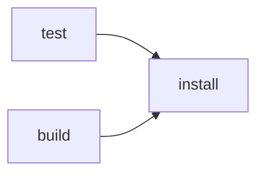
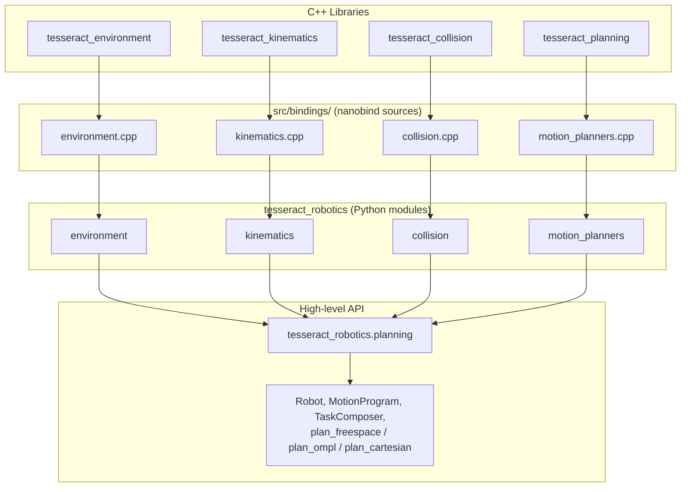
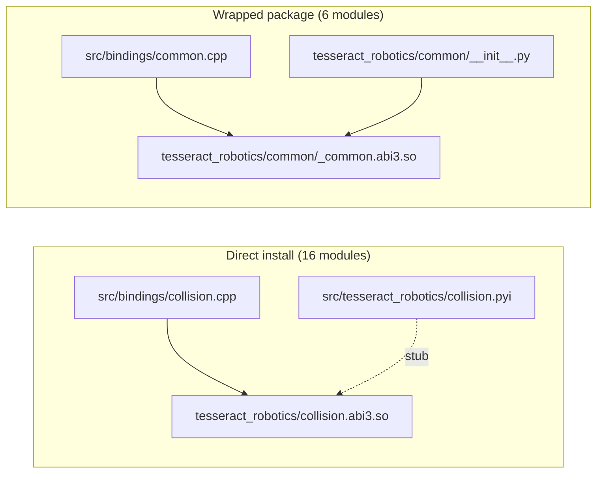
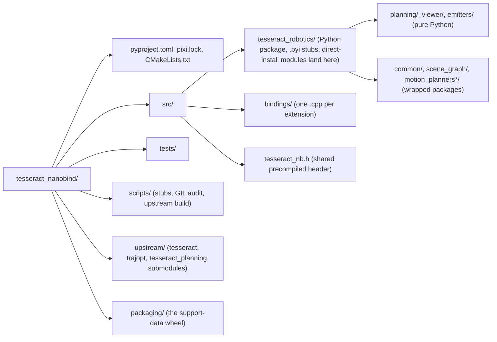

# Developer Guide

## Pixi Workspace

This project uses [pixi](https://pixi.sh) exclusively for package management. Pixi manages all C++ libraries, Python packages, build tools, and platform-specific dependencies through a single lockfile (`pixi.lock`). No pip, conda, poetry, or venv.

The tesseract C++ libraries are not built here: they are prebuilt conda packages from the `tesseract-robotics` channel. [How the binaries are built](binaries.md) traces every binary from the upstream source to the PyPI wheel.

### First-Time Setup

Install pixi ([docs](https://pixi.sh/latest/#installation)), then clone and build:

```bash
curl -fsSL https://pixi.sh/install.sh | bash

git clone --recurse-submodules https://github.com/tesseract-robotics/tesseract_nanobind.git
cd tesseract_nanobind
pixi run build
```

`pixi run build` resolves the environment, which pulls the prebuilt C++ libraries, and compiles only the nanobind extensions.

### Available Tasks

```bash
pixi task list
```

| Task | Description | What it does |
|------|-------------|--------------|
| `build` | Build bindings | alias for `install` |
| `install` | Install bindings | editable `pip install -e . --no-build-isolation` against the conda tesseract libs |
| `test` | Run tests | pytest with xdist parallel, excluding benchmarks (depends on `install`) |
| `test-benchmark` | Run benchmarks | benchmark tests, serial |
| `typecheck` | Type check | pyright on `src/tesseract_robotics/` |
| `lint` | Lint | ruff check |
| `fmt` | Format | ruff format |
| `stubs` | Regenerate stubs | the committed `.pyi` stubs; see [Stub Generation](#stub-generation) |
| `stubs-check` | Check stubs | fails if committed stubs differ from the built modules |
| `docs` | Live docs | mkdocs serve with auto-reload |
| `docs-build` | Build docs | Static site to `site/` |
| `demo-record`, `demo-posters`, `demo-check` | Demo recordings | see [Demo Recordings](#demo-recordings) |
| `demo-players`, `demo-fetch`, `demo-check-site` (`-e docs`) | Demo files in the docs | see [Demo Recordings](#demo-recordings) |
| `docs-dotgraphs` | Pipeline graphs | regenerates the pipeline DOT graph SVGs (requires graphviz) |
| `check-changelog` | Check changelog | `CHANGELOG.md` release structure (the Docs workflow runs it too) |
| `audit-gil` (`-e audit`) | GIL audit | Every GIL release in the bindings against `scripts/nogil_entry_points.yaml`; see [Threading and the GIL](threading.md) |
| `audit-test` (`-e audit`) | Audit contract tests | `tests/audit`, which needs libclang |
| `gil-hotspots` | GIL hotspots | Records benchmarks and tests with `py-spy --gil`, ranks the bindings that hold the GIL ([Finding candidates](threading.md#finding-candidates)) |

### Running Tests

```bash
pixi run test                              # full suite, parallel
pixi shell && pytest tests -x --testmon    # incremental (only changed)
```

### Daily Workflow

```bash
# First time setup (installs the conda C++ libs, compiles the bindings)
pixi run build

# Run tests
pixi run test

# Run a single test file
pixi run python -m pytest tests/trajopt_sqp/test_trajopt_sqp_bindings.py -v

# Run only tests affected by recent changes
pixi run python -m pytest --testmon

# Run an example
pixi run tesseract_freespace_ompl_example
# or
pixi run python -m tesseract_robotics.examples.freespace_ompl_example

# Interactive shell (all env vars set)
pixi shell
python -c "from tesseract_robotics.planning import Robot; print('ok')"
```

### Rebuild After C++ Changes

If you modify a C++ binding file (`src/bindings/<module>.cpp`):

```bash
# Reinstall bindings only (fast, ~30s)
pixi run install
```

To work against another upstream C++ commit, change `dependencies.rosinstall` and run
`pixi run build` ([The native stack build](native-stack.md)).

### Task Dependency Chain

Tasks use `depends-on` for ordered execution:



Running `pixi run test` reinstalls the bindings first, since it depends on `install`.

### Environments

The default environment is for local development; `py312` is the one CI builds wheels in:

```bash
# Default environment (Python from pixi.lock)
pixi run test

# The wheel build environment
pixi run -e py312 test
```

Environments defined in `pyproject.toml`:

| Environment | Python | Usage |
|-------------|--------|-------|
| `default` | from lockfile | Local development |
| `py312` | 3.12.x | CI wheels (abi3) |
| `py315` | 3.15.x | Suite on the newest Python |
| `upstream` | 3.12.x | 0.36 inner loop, C++ built from `upstream/` |

[How the binaries are built](binaries.md#pixi-environments-where-each-one-gets-its-c) lists where each environment gets its C++.

### Dependency Management

All dependencies live in `pyproject.toml` under `[tool.pixi.dependencies]` (conda packages) and `[tool.pixi.pypi-dependencies]` (PyPI packages).

```bash
# Add a conda dependency
pixi add some-package

# Add a PyPI dependency
pixi add --pypi some-package

# Update lockfile after editing pyproject.toml manually
pixi install

# See what's installed
pixi list
```

The C++ stack is not pinned here: `dependencies.rosinstall` and `scripts/native_stack.toml` declare it (see [The native stack build](native-stack.md)).

### CONDA_PREFIX and Worktrees

When working in a git worktree, the `CONDA_PREFIX` env var may point to the main repo's `.pixi/envs/default` instead of the worktree's. This causes build failures (e.g. missing `cereal`). Override when building manually:

```bash
CONDA_PREFIX=$(pwd)/.pixi/envs/default pip install -e . --no-build-isolation
```

Using `pixi run` handles this automatically.

### Building Portable Wheels

Editable installs bake absolute paths, so they aren't portable. The PyPI wheels are
built without conda by `.github/workflows/wheels.yml`: the tesseract C++ stack is built
from source with colcon against vcpkg dependencies, and auditwheel, delvewheel or
delocate bundles it. See [binaries](binaries.md#building-a-wheel).

---

## Architecture



The C++ libraries keep their upstream names (`tesseract_collision`); the Python modules drop the
`tesseract_` prefix (`tesseract_robotics.collision`, issue #42). The old names are gone; there are
no aliases ([module names](../breaking-changes.md#036-module-names)).

### Module Layout

Each `src/bindings/<module>.cpp` builds one nanobind extension. Two install shapes:



- **Direct install:** `collision`, `command_language`, `environment`, `geometry`, `kinematics`,
  `motion_planners_ompl`, `motion_planners_trajopt`, `serialization`, `srdf`, `state_solver`,
  `task_composer`, `task_composer_planning`, `time_parameterization`, `urdf`, `trajopt_ifopt`,
  `trajopt_sqp`. The extension is the module; `<module>.pyi` beside it is its stub. There is no
  `__init__.py` re-export wrapper.
- **Wrapped package:** a Python `__init__.py` around a compiled `_<module>`, because the module
  holds Python code. `common` (axis constants), `scene_graph` (lazy `SceneState` re-export) and
  `motion_planners`, `motion_planners_simple`, `motion_planners_descartes`,
  `motion_planners_trajopt_ifopt` (profile-override guards).
- Sources that belong to a module but are not its entry point sit beside it in `src/bindings/`,
  prefixed with the module name (`serialization_planner_cereal_registration.cpp`).

### Project Layout



---

## Cross-Module Type Resolution

nanobind maintains separate type registries per module. When a function returns a type from another module, that module must be imported first:

```cpp
NB_MODULE(_my_module, m) {
    // Import module that defines the type BEFORE using it
    nb::module_::import_("tesseract_robotics.collision");

    // Now can return DiscreteContactManager from functions
    .def("getContactManager", [...] { return self.getDiscreteContactManager(); })
}
```

See [Migration Notes](migration.md#cross-module-type-resolution) for details.

---

## Type Checking

```bash
pixi run typecheck
```

Uses pyright configured via `pyrightconfig.json`. Key design decisions:

- **Python code is type-checked** — the `planning/` module and other pure Python code
- **Auto-generated stubs are excluded** — nanobind generates `.pyi` stubs with C++ type artifacts

When adding new bindings, declare inheritance in nanobind to get correct stubs:

```cpp
// Good - generates: class Derived(Base)
nb::class_<Derived, Base>(m, "Derived")

// Bad - generates: class Derived (no inheritance)
nb::class_<Derived>(m, "Derived")
```

---

## Stub Generation

After modifying C++ bindings, regenerate the `.pyi` stubs:

```bash
pixi run stubs
```

This finds every nanobind extension module in the installed package and writes each
stub to `src/tesseract_robotics/<module>.pyi` (`<module>/_<module>.pyi` for the wrapped packages). Each module is rendered by
`nanobind.stubgen` in a fresh interpreter, because which cross-module types resolve
depends on what is already imported. Stubs are committed for IDE support and type
checking.

Stubs are generated, never hand-edited. Edits made by hand are lost at the next
regeneration. Put documentation in the binding's docstring instead.

**Drift gate (gh-159).** `pixi run stubs-check` exits 1 when a committed stub differs
from what the build renders. CI runs it in every build job, on all platforms. Stubgen output depends on the nanobind version, so nanobind is pinned
exactly in `pyproject.toml`. Bumping nanobind means regenerating the stubs in the same
commit.

**No `std::` in stubs.** stubgen writes a C++ type it can't map to Python as a quoted
C++ name. Such a type has no binding or converter, so it also fails at runtime. Spellings
of `std::` types differ by platform (libc++ `std::__1::`, libstdc++ `std::__cxx11::`),
so such a leak also makes the stub platform-dependent. `tests/scripts/test_generate_stubs.py`
rejects them. Quoted `tesseract::…` names are the same kind of gap but
platform-independent. Each one means the type isn't bound, or the module doesn't
`nb::module_::import_()` the module that binds it.

nanobind's `std::unordered_map` caster matches default-allocator maps only.
`src/tesseract_nb.h` adds a caster for Tesseract's `Eigen::aligned_allocator` maps
(`TransformMap` and friends).

---

## Pre-commit Hooks

```bash
pre-commit install
pre-commit install --hook-type pre-push
```

| Hook | Stage | What it does |
|------|-------|-------------|
| ruff check --fix | pre-commit | Auto-fix lint issues |
| ruff format | pre-commit | Format code |
| stage-formatted | pre-commit | Auto-stage ruff changes |
| typecheck (`pixi run typecheck`, pyright) | pre-push | Type check |

Skip when needed: `git commit --no-verify` / `git push --no-verify`

---

## Demo Recordings

The players on the example pages are static files, with no Python server behind them. `car_seat` leads the README and the docs home. Status: local playback, scrubbing and orbiting are `confirmed` by `demo-check` in headless Chrome on a Mac; the deployed site is `under verification` until `demo-check --url` has run against it. Phones and other browsers are untested.

`scripts/demos/manifest.toml` holds one entry per viewer example, published or excluded with a reason. `published` means a person looked at the recording; a test fails when a viewer example has no entry.

```bash
pixi run demo-record --only MODULE    # docs/demos/{recordings,client}; updates the lock, drops that poster
pixi run demo-posters                 # a poster for each recording without one; --only MODULE re-captures
pixi run -e docs demo-players --preview
env PYTHONPATH=src pixi run -e docs zensical build --strict
pixi run demo-check --preview         # drive every player in Chrome
```

To add a demo: give it a camera in the manifest and a builder in `scripts/demos/scenes.py`, record it, capture its poster, and add `--8<-- "docs/demos/players/MODULE.html"` under its heading on its page. After review, set `status = "published"` and delete `reason`.

**Hosting.** Recordings stay out of git, since each re-record would add its full size to history. The `demo-assets` release holds each file named by its SHA-256, and `scripts/demos/demos.lock.json` pins the hashes, so a re-record adds assets and older commits still build. To publish: `pixi run demo-fetch --stage DIR`, `gh release upload demo-assets DIR/* --clobber`, which is safe because the names are hashes. The tag has no digits on purpose: the wheel workflows and `setuptools_scm` act only on numeric tags. Upload before pushing, or the Docs workflow fails at its fetch step. Pages serves its own copies, which the build places in the site; nothing links to the release.

Things that are not obvious:

- A re-record is a new recording, because the planners are randomized. It needs a new review.
- A floor's position and size are baked in at record time. A camera is only a query parameter, so tuning one needs a new poster and no re-record.
- The docs builder rewrites `` relative to the source `.md` and leaves `data-src` alone, which is why `players.py` keeps two prefixes. Neither is checked at build time; `demo-check-site` is the guard.
- `demo-check` serves from an in-process server with a large listen backlog. `http.server`'s default of 5 dropped 12 requests in 30 loads of `planning.md`, which asks for 10 posters at once.
- glTF draws a material opaque whatever its alpha, unless `alphaMode` says `BLEND`. The viewer sets it for any alpha below 1.
- Once a player is open, the scroll wheel zooms the scene and the page stays put. A reader scrolling past a closed player is unaffected.

---

## Changelog at Release Time

`CHANGELOG.md` follows [Keep a Changelog](https://keepachangelog.com/) and is
published on the docs site. `scripts/check_changelog.py` checks its release
structure; the Docs workflow runs it before building, so a mis-cut release fails
CI instead of publishing a wrong changelog (0.35.0.7 and 0.35.0.8 were both cut
by hand, and both broke it). To cut `<version>`:

1. Rename `## [Unreleased]` to `## [<version>] - <YYYY-MM-DD>` and add a new,
   empty `## [Unreleased]` above it.
2. Add `[<version>]: https://github.com/tesseract-robotics/tesseract_nanobind/compare/<previous>...<version>`
   above the previous release's link.
3. Point `[Unreleased]:` at `compare/<version>...HEAD`.
4. Run `pixi run check-changelog` before committing.

Anything merged after the tag goes under `## [Unreleased]`, not into the
release's section.

---

## Contributing

1. Fork the repository
2. Create a feature branch (or use a [git worktree](https://git-scm.com/docs/git-worktree))
3. `pixi run build` (first time)
4. Make changes
5. `pixi run test`
6. `pixi run typecheck`
7. Submit a pull request
