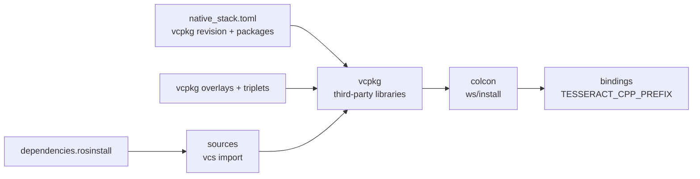

# The native stack: one build for CI and development

The C++ stack the bindings link against (tesseract, trajopt, tesseract_planning, descartes_light,
opw_kinematics, ruckig, boost_plugin_loader, on vcpkg's third-party libraries) is built by one
script, `scripts/native_stack.py`. The wheel workflow calls it per step, and `pixi run
native-build` calls it for local development, so a dev build and a wheel build compile the same
sources with the same flags.



## Use

```bash
pixi run native-build   # sources, vcpkg, colcon into .native/<triplet>; no-op when unchanged
pixi run build          # native-build, then the bindings (editable) and the support data
```

`.native/<triplet>/` (gitignored) holds `ws/src` (the sources), `ws/install` (the colcon install,
`TESSERACT_CPP_PREFIX`), `vcpkg/` and `vcpkg_cache/`. `pixi run install` points the bindings build
at it; `python scripts/native_stack.py exec -- <command>` runs any command with the same
environment (`TESSERACT_CPP_PREFIX`, `CMAKE_PREFIX_PATH`, the library search path).

The pixi env provides the toolchain only (cmake, ninja, ccache, the autotools the vcpkg ports
need, colcon, vcs2l, libomp on macOS). The compiler is the system's: Apple clang, gcc/g++, MSVC.

## Stages and identity

| Stage | Does | Output |
|---|---|---|
| `sources` | `vcs import` of `dependencies.rosinstall` | `ws/src` |
| `vcpkg` | clone and bootstrap vcpkg at the declared release, install the declared packages with `.github/workflows/vcpkg_*` overlays | `vcpkg/installed/<triplet>` |
| `colcon` | `colcon build --merge-install` with the platform's flags | `ws/install` |

`vcpkg` and `colcon` record an identity next to their output (`.native-stack-identity.json`): the
SHA-256 of the rosinstall, `scripts/native_stack.toml`, the overlays and triplets and the script,
the compiler and cmake versions, and for `colcon` the identity of the `vcpkg` stage. A stage whose
recorded identity equals the current one is skipped; any input change rebuilds it.

## CI

`wheels.yml` runs `sources`, `vcpkg` and `colcon` as separate steps (the vcpkg binary archives are
published between `vcpkg` and `colcon`, and Windows verifies the OMPL RNG state between `vcpkg` and
`colcon`). The artifact-based reuse of a finished native install (`.github/actions/native-cache`)
is unchanged: when it restores one, the steps are skipped. `scripts/native_stack.toml` is the one
place the vcpkg revision and package list are declared.

## Changing the stack

- A different upstream commit: edit `dependencies.rosinstall`.
- A vcpkg package or revision: edit `scripts/native_stack.toml`.
- Compiler flags and per-platform colcon arguments: `colcon_command` in `scripts/native_stack.py`.
