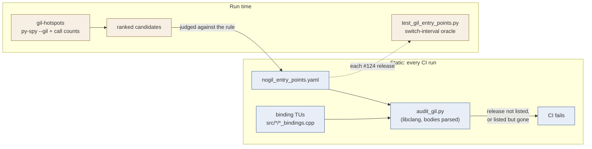

# Threading and the GIL

47 bindings release the GIL, each one listed with its reason in
[`scripts/nogil_entry_points.yaml`](https://github.com/tesseract-robotics/tesseract_nanobind/blob/main/scripts/nogil_entry_points.yaml)
(#124). Every other binding holds the GIL for the whole call. The list is checked, not trusted:
`pixi run -e audit audit-gil` parses every binding TU and fails CI when a binding and the list
disagree, in either direction. Run-time tests check that each release added by #124 really drops
the GIL. New candidates come from measurement: `pixi run gil-hotspots` ranks the bindings that hold
the GIL longest in the benchmarks and the test suite.

Two caveats. First, `Environment` stays mostly GIL-held, because one deadlock is known (see
[Known limitation](#known-limitation-environment-event-callbacks)) and its fix is a separate change.
Second, the plugin factories are slow but can't release the GIL until upstream synchronises their
caches (see [Upstream](#upstream-plugin-factory-caches)).

!!! success "Confirmed"
    `audit-gil`: 47 releases, all listed. The audit's contract tests (`pixi run -e audit
    audit-test`), the run-time release tests and the full test suite pass (macOS arm64,
    Python 3.14, 2026-10-24).

!!! warning "Incomplete"
    The `Environment` deadlock fix and the plugin-factory releases are remaining work: see
    [Remaining work](#remaining-work).

## The rule

Release the GIL around a call only when all three hold:

1. **It is expensive or blocking.** Roughly above 50 µs, or it can wait: planning, IK, collision
   checks over a trajectory, time parameterization, URDF and mesh loading, waiting on a task
   composer future. A call that blocks on a C++ lock which a thread waiting for the GIL may hold
   counts too (`Environment.getState`, `clone`, `==`).
2. **It runs pure C++.** No Python object is created, copied or dropped in the released region.
   Python callbacks stay safe: nanobind trampolines (`NB_OVERRIDE`) and the `std::function`
   caster re-acquire the GIL themselves, as do the bindings' own callback wrappers and
   nanobind's `shared_ptr` deleter for a Python-owned object.
3. **It does not mutate state Python code typically shares across threads.** Releasing the GIL
   lets other Python threads run. A C++ object that is not thread-safe was protected by the GIL
   while the call held it; after the release, two threads can race on it.

Value types, getters, setters and constructors never qualify.

## How to release it

nanobind has no global switch like SWIG's `-threads`. Per binding there are two forms:

```cpp
// The whole native call: arguments are converted before the release,
// the result is converted after the GIL is re-acquired.
.def("solve", &tp::MotionPlanner::solve, "request"_a, nb::call_guard<nb::gil_scoped_release>())

// Part of a lambda: validate (and raise Python errors) with the GIL held, then release.
.def("checkTrajectoryState", [](Manager& manager, const tc::TransformMap& state, ...) {
    require_active_link_transforms(manager, state, "checkTrajectoryState", "state");
    nb::gil_scoped_release release;
    ...
})
```

Use the in-body form when the lambda has to raise or touch Python objects before or after the
native call. Under `call_guard`, by-value arguments are destroyed without the GIL, so a binding
that takes `nb::object`, `nb::handle`, `nb::callable`, `nb::bytes` or `nb::args` must not use it.

## How the list is enforced



Adding or removing a release means editing the list in the same change. An entry names the
Python module, the Python class (`module` for module-level functions) and the Python name, and
covers every overload of that name that releases the GIL.

`scripts/audit_gil.py` finds a release in these forms:

| Form | Example in the bindings |
|---|---|
| `nb::call_guard<nb::gil_scoped_release>()` on a `.def` / `m.def` | `MotionPlanner.solve` |
| `nb::gil_scoped_release` in the bound lambda | `checkTrajectoryState` |
| a release in a main-file function, function template or local lambda the binding calls or binds | `checkTrajectory`, `KinematicGroup.calcInvKin` (list overload) |
| a helper call given the guard; counts under the helper's name | `bind_value_equality(cls, guard)` |
| a helper template that binds a releasing `.def` under the name its caller passes; counts under each name passed | `def_create_mesh_from_path<T>(m, "createMeshFromPath", ...)` |

It fails loudly rather than guess. A libclang error diagnostic fails the run (`ParseError`), because
a partial AST would miss releases. A releasing `.def` whose Python class can't be named, such as a
literal name on a template-parameter receiver, also fails the run (`UnresolvedScopeError`). It maps
C++ classes to Python names through the `nb::class_<T>(scope, "Name")` constructors in the same TU.

```yaml
--8<-- "scripts/nogil_entry_points.yaml"
```

## Measured candidates

`pixi run gil-hotspots` recorded the benchmarks and the full test suite on 2026-10-24 (macOS
arm64, Python 3.14, 100 Hz, recorded at commit `903fedc`, before the releases below). The table
shows every unlisted binding above roughly 50 µs per call that had at least 10 GIL-held samples
(100 ms) in either run, plus the decision. Below 10 samples the per-call mean is noise:
one sample is 10 ms.

| Binding | Mean per call | Calls | Run | Decision |
|---|---:|---:|---|---|
| `tesseract_serialization: environment_from_file` | 3.6 s | 1 | tests | released: replays commands into a new `Environment`, which has no callbacks yet |
| `tesseract_serialization: environment_to_file` | 2.2 s | 1 | tests | released: reads under the shared lock, as `clone()` does |
| `tesseract_serialization: environment_{to,from}_{xml,binary}` | 12.2 s together | - | tests | released: same reasons (to and from share a test line, so no per-call mean) |
| `tesseract_motion_planners_simple: generateInterpolatedProgram` | 106 ms | 37 | tests | released: interpolation and a state solve per step; only reads `env` |
| `tesseract_geometry: createMeshFromResource` | 2.5 ms | 69 | tests | released, with the `Path` loaders and the `ConvexMesh` / `SDFMesh` variants: file IO plus assimp, like `parseURDFFile` |
| `tesseract_environment: Environment.init` | 0.85 s / 0.93 s | 303 / 438 | bench / tests | GIL-held: `Environment` method, see the deadlock below |
| `tesseract_environment: Environment.getKinematicGroup` | 0.83 s / 0.54 s | 35 / 146 | bench / tests | GIL-held: `Environment` method |
| `tesseract_task_composer: TaskComposerPluginFactory.createTaskComposerNode` | 26 ms / 1.6 s | 570 / 338 | bench / tests | GIL-held: unsynchronised factory cache |
| `tesseract_task_composer: TaskComposerPluginFactory.createTaskComposerExecutor` | 0.73 s / 0.99 s | 2 / 48 | bench / tests | GIL-held: unsynchronised factory cache |
| `tesseract_kinematics: KinematicsPluginFactory.createFwdKin` / `createInvKin` | 0.92 s / 0.46 s | 19 / 12 | tests | GIL-held: unsynchronised factory cache |
| `tesseract_collision: ContactManagersPluginFactory.createDiscreteContactManager` / `createContinuousContactManager` | 0.50 s / 0.56 s | 22 / 17 | tests | GIL-held: unsynchronised factory cache |
| `tesseract_motion_planners_descartes: DescartesMoveProfileD.createKinematicGroup` | 0.96 s | 3 | tests | GIL-held: its cost is `Environment.getKinematicGroup`; decide with it |
| `tesseract_motion_planners_trajopt_ifopt: TrajOptIfoptCompositeProfile.create` | 84 ms | 5 | tests | GIL-held: the binding runs Python-side contract checks around a trampoline |
| `tesseract_task_composer: TaskComposerPluginFactory.getAvailableTaskComposerNodePlugins` | 410 ms | 2 | tests | GIL-held: a getter |
| `tesseract_geometry: PolygonMesh.getVertices` / `getFaces` | 80 µs | 1257 | tests | GIL-held: getters (the cost is copying to NumPy) |

In the benchmarks, 90% of GIL-held samples fall in unlisted bindings, and over 99% of those are
`Environment.init`, `Environment.getKinematicGroup` and the task composer factory. In real
workloads, the remaining GIL-bound time is the `Environment` follow-up and the factory caches.

## Finding candidates

The list was compiled by reading code. To measure instead, `pixi run gil-hotspots`
(`scripts/gil_hotspots.py`) records the benchmarks, then the test suite, with
`py-spy record --gil` and prints the bindings ranked by the time they hold the GIL. `--gil`
keeps only samples of the thread holding it, so a binding that already releases it drops out.
Benchmarks come first: test timings are dominated by setup.

py-spy samples time but can't count calls or name a nanobind function. So the same run loads
`scripts/gil_call_counts.py`, a pytest plugin that counts every binding call by the Python line
it comes from (`sys.monitoring` CALL events). A sample whose innermost Python frame is such a line
is time inside that binding: the binding runs below the line, and a Python callback it calls has
its own frame. Native frames (`--native`, Linux x86_64 and Windows only) aren't needed, so it
runs on macOS too. py-spy attaches to the pytest process and asks for `sudo` on macOS, and on
Linux unless `kernel.yama.ptrace_scope=0`. Failing tests still yield a complete profile: the task
reports every run, then exits non-zero and names the runs that had failures.

Limits, all visible in the table:

- Two bindings called on one line share a row, with no per-call mean.
- Python work on a binding's line (building its arguments) counts toward that binding.
- A subprocess started without the plugin (`python -c ...` in a test) is sampled but unnamed.
- py-spy pauses the process for each sample, so timeout-bound tests can fail under it
  (`test_constraint_not_linked` did, once).

Read the calling line before acting on a row, then judge each candidate above roughly 50 µs per
call against [the rule](#the-rule). `python scripts/gil_hotspots.py report build/gil-hotspots/*.txt`
re-ranks a recording, for instance after the list changed.

## Tests

- `tests/audit/test_audit_gil.py`: the audit's contract, on a fixture TU with one binding per
  release form and per non-release that must not count.
- `tests/test_gil_entry_points.py`: run-time checks of the releases #124 added. The oracle sets a
  switch interval far above the test's run time, so the main thread can only run while a worker
  is inside the call if the call dropped the GIL. The worker repeats the call until the main
  thread has run, so a fast call is still caught. A call that holds the GIL fails
  deterministically.
- `tests/devtools/test_gil_hotspots.py` (`pixi run devtools-test`, Python >= 3.12): the hotspot
  report's attribution rules on py-spy's raw format, and the call counter on a real binding.
- `tests/tesseract_motion_planners/test_trajopt_ifopt_planner.py` (`_TASK_COMPOSER_RELEASE`): a
  Python composite profile and a Python cost run on the task composer's worker threads while the
  main thread waits on the future. Without the release in `TaskComposerFuture.wait` this deadlocks.

## Known limitation: Environment event callbacks

`Environment` fires its event callbacks under a shared lock on its mutex, after dropping the
unique lock it applied the change under. `applyCommand` (three overloads) and `applyCommands`
release the GIL, so a Python callback waits for the GIL while that shared lock is held. If another
Python thread meanwhile calls an `Environment` method that takes the unique lock without releasing
the GIL (`setState`, the other `applyCommand` overloads, `setName`, ...), each thread waits for
the other. On platforms whose shared mutex favours waiting writers, the same holds for a reader
queued behind a writer.

This needs a registered Python event callback *and* concurrent mutation from Python. A single
writer thread is safe. Until every `Environment` binding that takes its mutex releases the GIL,
`Environment.init` doesn't release it either, so the window doesn't widen. This also keeps
`Environment.getKinematicGroup`, the second-largest GIL holder measured above, GIL-held.

## C++ threads that call Python at interpreter exit

A thread CPython didn't start, such as the `OutputHandler` delivery thread
(`src/tesseract_common/python_output_handler.h`), can be inside Python when the interpreter
finalizes. Every call that takes the GIL then ends it: `PyGILState_Ensure`, `PyEval_RestoreThread`,
and any Python code, since the eval loop gives the GIL away and takes it back. What "ends" means
depends on the version and platform:

| | 3.9–3.13 | 3.14+ |
|---|---|---|
| Linux (glibc) | `pthread_exit`: forced unwinding runs the thread's C++ destructors and `catch (...)` blocks | the thread hangs |
| macOS | `pthread_exit`, no C++ destructors run | the thread hangs |
| Windows | `_endthreadex`, no C++ destructors run | the thread hangs |

So on Linux before 3.14, a RAII guard on such a thread runs during that unwind, after CPython
took its thread state away. `nb::gil_scoped_acquire` (and the `PyGILState_Release` in a nanobind
override ticket) then aborts with `PyGILState_Release: thread state ... must be current when
releasing`; a `noexcept` frame on the way terminates the process. CI hit this on Linux 3.12 only:
macOS, Windows and 3.14 never run the destructors; the 3.13 jobs did not hit it in that run.

The rule for such a thread: while it is inside a call that may take the GIL, none of its frames
owns a Python reference, a GIL guard or an override ticket, and none is `noexcept`. Call Python
through the C API from plain functions (`PyGILState_Ensure` / `PyGILState_Release` by hand,
`PyObject_CallMethodObjArgs`, raw references), and never drop a Python reference in a destructor:
the delivery thread's `HandlerRef` retires its reference to a list that a plain function drops
with the GIL held. A thread ended mid-call leaves what it held allocated; Python is going away.

## Log handlers and the task-composer server gate

A Python log handler runs on the delivery thread, never inside console_bridge's lock, so it calls
a `TaskComposerServer` like any other thread: while another thread reloads the server
(`loadConfig`, `addTask`, `addExecutor`), the handler waits on the server gate with the GIL
released. That wait ends only if the reload never waits for the delivery thread. The one call
that does is `flushOutputHandlers()`, which a Python `ResourceLocator` can make mid-load.

So the invariant is enforced on the waiting side, not the handler side. `tesseract_common` keeps
a per-thread *flush barrier* and exports it as the `_log_flush_barrier` capsule
(`src/tesseract_common/log_flush_barrier.h`: `enter(holder)` / `leave()`). The server gate
(`ServerMutation`) enters it around every mutation, and `flushOutputHandlers()` on a thread
inside a barrier raises `OutputHandlerFlushForbiddenError`, naming the holder, instead of
waiting. The dependency points the way the modules already do (task composer → common): common
knows nothing about servers, only that some caller marked this thread as one a handler may wait
for. The earlier design inverted it: common exported a "handler running here" depth, and the
gate raised `TaskComposerServerBusyError` for any server call from a handler during a reload,
which rejected every handler to forbid one flush.

Tests: `tests/tesseract_task_composer/test_output_handler_deadlocks.py`
(`TestServerReloadAgainstLogHandlers`).

## Upstream: plugin factory caches

`TaskComposerPluginFactory`, `KinematicsPluginFactory` and `ContactManagersPluginFactory` each
cache the plugin factories they load in a `mutable std::map` that their `const` `create*` methods
fill without a mutex (`task_composer_plugin_factory.cpp`, `kinematics_plugin_factory.h`,
`contact_managers_plugin_factory.h` at 0.35.0). Today the GIL serialises Python callers. Releasing
it would let two threads that share a factory race on the map, which breaks rule 3. Their
`create*` calls cost 0.03–1.6 s each, mostly plugin loading.

## Remaining work

| Item | Status | Blocked on |
|---|---|---|
| Release the GIL in every `Environment` binding that takes its mutex, then in `Environment.init` and `getKinematicGroup`, with a GIL-safe `PyEventCallbackFn` and a deadlock regression test | incomplete | a separate PR |
| Release the GIL in the plugin factories' `create*` methods | incomplete | a mutex around the factory caches upstream |

## Free-threaded builds

The same annotations serve a free-threaded interpreter (#260): there, `gil_scoped_release` only
detaches the thread state. In both builds, the real constraint on a binding is concurrent use of
shared C++ objects.
