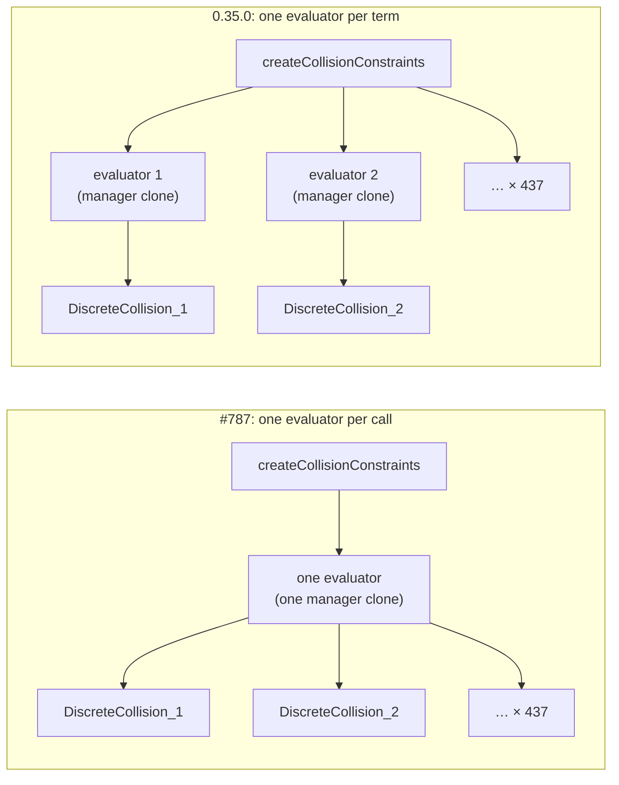

# TrajOpt collision memory

Both TrajOpt planners in tesseract 0.35 build one collision evaluator per waypoint (DISCRETE) or
per segment (LVS / CONTINUOUS), and each evaluator clones the environment's whole Bullet contact
manager. On the 437-waypoint puzzle aux-axes example that is 437 clones of about 7 MiB each
((3223 − 104) MiB over 436 fewer clones, from the evidence table): a 3.2 GiB peak, held for the whole solve. Nothing leaks; the peak is the clones.

For `TrajOptIfoptPipeline` the fix is upstream in tesseract_planning's `createCollisionConstraints`:
one evaluator per call, shared by every collision term of that call
([tesseract_planning#787](https://github.com/tesseract-robotics/tesseract_planning/issues/787)).
Measured on a patched 0.35.0 build, it cuts the puzzle's peak about 28×, produces a bitwise-identical
trajectory, and cuts the planning time from 24–29 s to 15 s. On car_seat (LVS_CONTINUOUS) it cuts 40 clones to 4, again
with a bitwise-identical trajectory. Legacy `TrajOptPipeline` builds its evaluators in trajopt
itself and waits on [trajopt#625](https://github.com/tesseract-robotics/trajopt/issues/625).

!!! success "Confirmed"
    ifopt, DISCRETE: 437 → 1 trajopt clone, bitwise-identical trajectory, two plans through one
    composer succeed (macOS arm64, conda tesseract 0.35.0 + patched
    `libtesseract_motion_planners_trajopt_ifopt`, 2026-11-02).

!!! success "Confirmed"
    ifopt, LVS_CONTINUOUS: car_seat's two plans clone 40 → 4 managers (one per config per plan),
    and both trajectories are bitwise identical to stock (same setup, 2026-11-04). The upstream
    unit test covers the LVS_DISCRETE and CONTINUOUS branches. No example runs those two on ifopt.

!!! warning "Incomplete"
    The fix is not in a tesseract_planning release. Until it is, the conda
    `tesseract-robotics-planning` package clones per waypoint.

## Mechanism

`TrajOptIfoptDefaultCompositeProfile::create` calls `createCollisionConstraints` once per enabled
config (cost and constraint). Each call now builds its own evaluator, because the two configs have
different margins. The DISCRETE branch builds its evaluator on the first waypoint not in
`fixed_indices`, so a fully fixed program clones nothing. The segment branches build theirs before
the loop, only when there are at least two waypoints.

Why sharing is sound: in trajopt 0.35.0 the evaluators hold no per-waypoint state. Each
constraint keeps its own result cache (`discrete_collision_constraint.h`). The evaluator's
contact manager is the only mutable state, and every `calcCollisions` sets the link transforms
before its `contactTest`. `trajopt_ifopt` and `trajopt_sqp` do not use threads in 0.35.0 (no
OpenMP, `std::thread`, TBB or taskflow), so the terms are evaluated one at a time.

## Evidence

Puzzle aux-axes on `TrajOptIfoptPipeline` with the upstream ifopt profiles
(`create_ifopt_profiles()`), macOS arm64. Peak is `phys_footprint`, sampled every 20 ms.

| Measure | stock 0.35.0 | one evaluator per call | gate |
|---|---|---|---|
| trajopt contact-manager clones (lldb breakpoint) | 437 | 1 | ≤ 1 per config |
| peak footprint, 3 runs (MiB) | 3223 / 3255 / 3268 | 104 / 106 / 116 (lldb run: 111) | ≥ 10× lower: 27.8× (worst pair) |
| planning time, 3 runs (s) | 28.9 / 29.3 / 23.9 | 14.7 / 15.5 / 14.8 | — |
| trajectory vs stock golden (437 × 9) | repeat: bitwise equal | bitwise equal, max abs diff 0 | bitwise |
| two `plan()` calls through one composer | — | both succeed, peak 117 MiB | succeed |
| upstream gtests (`trajopt_ifopt_utils_unit`, `_yaml_unit`) | utils: 4 of 13 fail (one evaluator per term) | 13/13, 6/6 | pass |

Legacy `TrajOptPipeline` on the same problem, for comparison: 437 clones, peak 3260–3290 MiB.

Two smaller examples, ported with their C++ `if (ifopt_)` profiles: freespace_hybrid
(`FreespaceIfoptPipeline`, DISCRETE, `add_ifopt_profiles()`) and car_seat (`TrajOptIfoptPipeline`,
LVS_CONTINUOUS, two plans of 11 waypoints, `create_car_seat_ifopt_profiles()`). Their problems are
small, so the base environment dominates the peak. The 10× gate applies to the puzzle only.

| Measure | freespace_hybrid stock | freespace_hybrid shared | car_seat stock | car_seat shared |
|---|---|---|---|---|
| trajopt contact-manager clones (lldb breakpoint) | 18 | 2 | 40 (2 plans × 2 configs × 10 segments) | 4 |
| peak footprint, 3 runs (MiB) | 180 / 189 / 194 | 107 / 130 / 124 | 380 / 389 / 375 | 239 / 263 / 257 |
| trajectory vs stock golden | — (unseeded OMPL) | — | repeat: bitwise equal, 3 of 3 | pick and place bitwise equal, max abs diff 0 |
| all runs succeed | yes | yes | yes | yes |

freespace_hybrid's ifopt run used to register no ifopt composite profile, so it planned with the
planner defaults. `add_ifopt_profiles()` restores the C++ settings: cost and constraint
`TrajOptCollisionConfig(0.025, 20)` and smoothing coeffs of 1.

## Linux: glibc keeps the peak resident

On Linux the freed clones do not go back to the OS. glibc malloc keeps freed heap per arena, so a
long-running process (a planner service, a pytest-xdist worker) stays at its high-water mark: a
linux-aarch64 container held 3.25 GB RSS after the puzzle and freespace examples with every object
freed. This is why the Linux x64 test-wheel runners ran out of memory. Trimming the heap after each
test (`malloc_trim`) was rejected: it hides the symptom, and the peak stays. Removing the clones
removes both the peak and the retained heap.

## Reproduce

- Clone counter: an lldb breakpoint on `Bullet(Discrete|Cast).*Manager::clone() const`, counting
  the hits whose backtrace contains `trajopt`.
- Profiles: `puzzle_piece_auxillary_axes_example.run(pipeline="TrajOptIfoptPipeline")` picks
  `create_ifopt_profiles()`, the `if (ifopt_)` branch of the C++ example. Its `adaptive_rho` is
  left at the OSQP default, as upstream (the line is commented out there).
  `freespace_hybrid_example.run(use_ifopt=True)` and
  `car_seat_example.run(pipeline="TrajOptIfoptPipeline")` do the same for theirs.
- Patched library: tesseract_planning tag `0.35.0` plus the #787 change, built in Release against
  the pixi env. Only `libtesseract_motion_planners_trajopt_ifopt.dylib` is replaced.

## Remaining work

- tesseract_planning PR for #787 (forward-ported to master).
- trajopt#625 for legacy `TrajOptPipeline`. It also covers the legacy TrajOpt stage of
  `FreespacePipeline`, whose `CastCollisionEvaluator` cloned 302–376 managers per freespace example
  run in the October 2026 runner investigation (not remeasured here).
- An end-to-end test of the puzzle's ifopt run, once the conda package ships the #787 fix. On stock
  it peaks at 3.2 GiB, the memory this work removes from the test suite.
