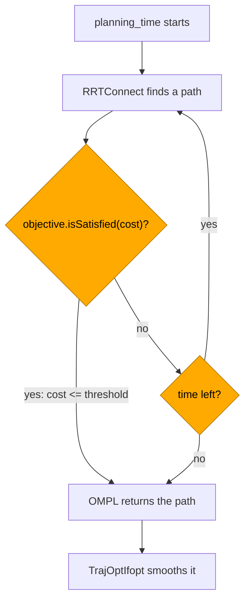
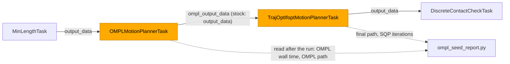

# OMPL Examples

**OMPL finds collision-free paths by sampling. From Python you choose the planners, how
long they optimize and the objective that decides when a path is good enough. On a sweep
through six cubes, a Python objective with a cost threshold ends the optimize loop at the
first path that meets it: in one run of 10 seeds the whole plan took 1.27 to 2.26 s, against
12.11 to 13.83 s for the default objective, which optimizes until `planning_time` runs out. On this
scene the first path OMPL finds usually meets the threshold already.**

All examples install as console scripts:

```bash
tesseract_freespace_clearance_objective_example

# or as a module
pixi run python -m tesseract_robotics.examples.freespace_clearance_objective_example
```

## Freespace OMPL

--8<-- "docs/demos/players/freespace_ompl_example.html"

Basic OMPL planning between joint configurations using the KUKA LBR iiwa 14 R820:

```bash
tesseract_freespace_ompl_example
```

See the source at
[`freespace_ompl_example.py`](https://github.com/tesseract-robotics/tesseract_nanobind/blob/main/src/tesseract_robotics/examples/freespace_ompl_example.py).

## Hybrid Planning (OMPL + TrajOpt)

--8<-- "docs/demos/players/freespace_hybrid_example.html"

OMPL finds a feasible path, TrajOpt smooths and optimizes it:

```bash
tesseract_freespace_hybrid_example
```

See the source at
[`freespace_hybrid_example.py`](https://github.com/tesseract-robotics/tesseract_nanobind/blob/main/src/tesseract_robotics/examples/freespace_hybrid_example.py).

## Ending the optimize loop on cost

--8<-- "docs/demos/players/freespace_clearance_objective_example.html"

The KUKA IIWA sweeps joint_a1 from -1.2 to 1.2 rad, a 1.25 m arc of the tool, through six
cubes of different sizes and orientations. The straight joint-space sweep hits them from
5 % to 92 % of the way. The example plans the sweep twice with `FreespaceIfoptPipeline`
(two RRTConnect planners, then TrajOptIfopt), with no solution-count exit:

1. **Default objective**: path length, `optimize = True`. Nothing but the time cap ends the
   optimize loop, so OMPL runs for the whole `planning_time`.
2. **Python objective**: an `OMPLRealVectorMoveProfile` subclass builds a
   `MultiOptimizationObjective` (path length x 1 + max-min clearance x 0.5) with a cost
   threshold. The loop ends at the first path whose cost meets it. Here that is usually the
   first path OMPL finds. With one planner such a path is the one `optimize = False`
   returns; with the example's two, see [the note below](#evidence).

The viewer shows case 2: the TCP path and, for each cube, a red line between the nearest
points of the robot and the cube, labelled with the distance.



The highlighted checks run on every path OMPL finds. With the default objective there is
no threshold, so `isSatisfied` stays false and only the time check ends the loop.

### The objective, from Python

```python
--8<-- "src/tesseract_robotics/examples/freespace_clearance_objective_example.py:objective_profile"
```

The planner calls `createOptimizationObjective` once per solve, with the problem's
`SpaceInformation`. Objectives are bound but cannot be subclassed in Python: a profile
composes the bound ones. See [OMPL optimization objectives](../user-guide/planning.md#ompl-optimization-objectives)
for the bound API.

### The example checks itself

`run()` raises a named error when one of its claims fails, so the test only runs it:

```python
--8<-- "src/tesseract_robotics/examples/freespace_clearance_objective_example.py:checks"
```

```python
--8<-- "src/tesseract_robotics/examples/freespace_clearance_objective_example.py:loop_checks"
```

| Error | Raised when |
|---|---|
| `PlanningFailedError` | a case did not plan |
| `ObjectiveNotUsedError` | the Python objective was not built exactly once |
| `DefaultEndedEarlyError` | case 1's OMPL node took less than `planning_time` |
| `ThresholdDidNotEndLoopError` | case 2's OMPL node took `planning_time` or longer |
| `CubeContactError` | case 2's path touches a cube |

The clearances come from a scan of case 2's path in 0.005 rad joint steps
(`closest_approaches`). The viewer draws them with `draw_clearances`, which the demo
recording calls too:

```python
--8<-- "src/tesseract_robotics/examples/freespace_clearance_objective_example.py:markers"
```

### Evidence

| Claim | Evidence | Source |
|---|---|---|
| Default objective runs to the time cap | 12.11 to 13.83 s end to end, OMPL 10.81 to 11.98 s, at `planning_time = 10` (one run of 10 seeds) | [Per seed](#per-seed) table |
| The threshold ends the loop early | Same run, on a loaded machine: OMPL 0.04 to 0.07 s against 10.81 to 11.98 s; end to end 1.27 to 2.26 s against 12.11 to 13.83 s | [Per seed](#per-seed) table |
| OMPL's first path usually meets 4.0 rad already | One planner, 5 seeds, identical over 3 runs: first path 3.57 to 4.21 rad. The 4 that meet the threshold come back unchanged (same length and state count as `optimize = False`, 0.04 to 0.05 s in those runs). Seed 2's first path is 4.21 rad; re-solving found a 3.95 rad path in 0.24 s | `pixi run ompl-first-path-probe` |
| OMPL is a small part of case 2's time | OMPL took 0.04 to 0.07 s of the 1.27 to 2.26 s in that run. The rest is the pipeline's other tasks, among them TrajOptIfopt, `MinLengthTask` and `DiscreteContactCheckTask`; none has its own timing here | [Per seed](#per-seed) table |
| The straight sweep is blocked | collides from 5 % to 92 % of the way (41 samples) | scene probe when the cubes were placed |
| Case 2's final path clears every cube | Smallest distance to any cube 31.0 to 51.0 mm (threshold rows, one run of 10 seeds). One direct `run()`: 35 to 151 mm per cube, each cube closest to `link_7` | [Per seed](#per-seed) table; `run()` printout; `CubeContactError` check in `run()` |

!!! warning "The clearance term adds nothing"
    tesseract's OMPL state validators do not implement `clearance()`, so OMPL reports 0 for
    every state and `MaximizeMinClearanceObjective` adds a constant. The objective reduces
    to path length. The red lines in the viewer are measured afterwards by the contact
    manager; the planner does not see them.

!!! note "Under verification"
    The recording above awaits review and is not yet published.

!!! note "The threshold rarely has to wait for a shorter path here"
    With the example's two planners OMPL stopped after 0.04 to 0.07 s on all 10 seeds of the
    [per-seed](#per-seed) run, because a first path usually meets 4.0 rad already. With one
    planner, which reproduces on a seed, 4 of 5 seeds end at the first solution, the path
    `optimize = False` returns; on seed 2 the first path is 4.21 rad, and the planner re-solved
    and found a 3.95 rad path, which ended the loop. With the two planners (seeds 1 to 3, both modes) 1 of 42 runs
    differed from its seed's usual path: one `optimize = False` run on seed 3 was longer,
    3.64 rad against 3.57 rad. The planners' race is the inferred cause; 36 repeats did not
    reproduce it. `pixi run ompl-first-path-probe` plans with one planner, so it does not
    cover this case.

### Per seed

**In one run of 10 seeds, the threshold ended OMPL in 0.04 to 0.07 s against 10.81 to
11.98 s for the default objective, and TrajOptIfopt brought both cases' final paths to
26.7 to 51.0 mm from the cubes.** `pixi run ompl-seed-report` plans both cases once per seed, each seed in its own
process, and writes JSON and this table to `build/ompl_seed_report/`.

It plans with `FreespaceIfoptOMPLOutputPipeline` (`scripts/ompl_seed_report_task_composer.yaml`).
That is stock `FreespaceIfoptPipeline` except for one key: OMPL hands its program to
TrajOptIfopt under `ompl_output_data` instead of `output_data`, which TrajOptIfopt overwrote,
so one run yields both stages' paths. On a fixed seed with one planner its final program is
bit-identical to stock's (`test_ompl_output_variant_is_bit_identical_to_stock`).



Both cases plan OMPL at `OMPL_CONTACT_MARGIN_M` (10 mm), so they differ only in the
objective. Clearances are each path's smallest distance to any cube, from the example's
0.005 rad scan; the final length is joint-space (sum of the per-step L2 norms). The table
below is `build/ompl_seed_report/table.md`, pasted verbatim apart from its header line's
commit, from Apple M1 Max.

Timings are load-sensitive evidence: the machine was shared with other timing probes, and
`uptime` read load averages 11.81 / 46.39 / 47.36 (1 / 5 / 15 min) at the start of the run
and 19.33 / 35.55 / 42.70 at the end (2:47 wall).

The run was on an uncommitted tree from before this change landed, so no commit reproduces it
exactly. Since that run the example's checks and comments have changed; its planning settings
have not.

N = 10 seeds, Darwin arm64, Python 3.14.10, pipeline `FreespaceIfoptOMPLOutputPipeline`.

| seed | case | OMPL (s) | OMPL min clearance (mm) | TrajOptIfopt iterations | TrajOptIfopt status | final min clearance (mm) | final length (rad) | total (s) |
|---|---|---|---|---|---|---|---|---|
| 1 | default | 11.42 | 10.0 | 2 | Found valid solution | 51.0 | 2.81 | 13.48 |
| 1 | threshold | 0.05 | 10.0 | 5 | Found valid solution | 33.0 | 2.75 | 1.99 |
| 2 | default | 11.98 | 10.1 | 2 | Found valid solution | 39.9 | 2.88 | 13.74 |
| 2 | threshold | 0.06 | 10.0 | 3 | Found valid solution | 51.0 | 2.89 | 1.74 |
| 3 | default | 11.02 | 10.0 | 2 | Found valid solution | 26.7 | 2.79 | 12.34 |
| 3 | threshold | 0.06 | 10.0 | 6 | Found valid solution | 33.6 | 2.76 | 1.69 |
| 4 | default | 11.57 | 10.0 | 4 | Found valid solution | 29.8 | 2.76 | 13.83 |
| 4 | threshold | 0.06 | 10.0 | 4 | Found valid solution | 43.3 | 2.85 | 2.26 |
| 5 | default | 10.97 | 10.1 | 2 | Found valid solution | 51.0 | 2.84 | 12.30 |
| 5 | threshold | 0.05 | 10.0 | 4 | Found valid solution | 35.6 | 2.76 | 1.67 |
| 6 | default | 11.65 | 10.0 | 5 | Found valid solution | 29.1 | 2.82 | 13.16 |
| 6 | threshold | 0.04 | 10.0 | 2 | Found valid solution | 51.0 | 2.81 | 1.69 |
| 7 | default | 10.84 | 10.0 | 5 | Found valid solution | 39.6 | 2.91 | 12.15 |
| 7 | threshold | 0.07 | 10.0 | 6 | Found valid solution | 40.2 | 2.79 | 1.60 |
| 8 | default | 10.95 | 10.0 | 4 | Found valid solution | 43.1 | 2.79 | 12.64 |
| 8 | threshold | 0.05 | 10.0 | 4 | Found valid solution | 45.0 | 2.81 | 1.57 |
| 9 | default | 10.81 | 10.0 | 5 | Found valid solution | 30.1 | 2.74 | 12.11 |
| 9 | threshold | 0.07 | 10.0 | 3 | Found valid solution | 31.0 | 2.72 | 1.42 |
| 10 | default | 10.95 | 10.0 | 5 | Found valid solution | 32.2 | 2.75 | 12.28 |
| 10 | threshold | 0.06 | 10.0 | 3 | Found valid solution | 51.0 | 2.85 | 1.27 |

| Claim | Evidence | Source |
|---|---|---|
| The default objective's OMPL stage runs to the time cap | 10.81 to 11.98 s at `planning_time = 10`, all 10 seeds of this run | table, OMPL (s) |
| The threshold ends OMPL early | 0.04 to 0.07 s, all 10 seeds of this run | table, OMPL (s) |
| TrajOptIfopt took 2 to 6 SQP iterations in this run | default 2 to 5, threshold 2 to 6; highest `overall_iteration` its callback saw | table |
| Both cases ended 26.7 to 51.0 mm from the cubes in this run | final min clearance; final length 2.72 to 2.91 rad | table |
| Both cases' OMPL paths sit at the 10 mm collision margin | default 10.0 to 10.1 mm, threshold 10.0 mm (0.0007 to 0.094 mm before the margin fix) | table, OMPL min clearance |
| The report's pipeline plans what stock plans | final program bit-identical to stock `FreespaceIfoptPipeline`'s on seed 1, one planner; stock reproduces itself on the seed | `tests/scripts/test_ompl_seed_report.py` |

!!! note "One run is not a bound"
    A second run of 10 seeds minutes earlier, not pasted here, went outside these ranges:
    threshold OMPL up to 0.09 s and total up to 2.83 s; default total up to 14.51 s and up
    to 7 SQP iterations. Final clearance on a seed also moved between the runs (threshold
    seed 1: 33.0 mm against 37.0 mm).

!!! note "The table does not say why OMPL's loop ended"
    tesseract's planner reports only "Found valid solution". The OMPL time column is what
    tells the two exits apart.

## Further reading

- [Optimal planning](https://ompl.kavrakilab.org/optimalPlanning.html): OMPL's overview of
  optimizing planners and termination conditions.
- [Optimization objectives tutorial](https://ompl.kavrakilab.org/optimizationObjectivesTutorial.html):
  defining objectives, combining them, and cost thresholds.
- [`OptimizationObjective`](https://ompl.kavrakilab.org/classompl_1_1base_1_1OptimizationObjective.html):
  `isSatisfied` and `setCostThreshold`.
- [`MultiOptimizationObjective`](https://ompl.kavrakilab.org/classompl_1_1base_1_1MultiOptimizationObjective.html):
  the weighted sum the example builds.
- [`PathLengthOptimizationObjective`](https://ompl.kavrakilab.org/classompl_1_1base_1_1PathLengthOptimizationObjective.html)
  and [`MaximizeMinClearanceObjective`](https://ompl.kavrakilab.org/classompl_1_1base_1_1MaximizeMinClearanceObjective.html):
  its two terms.
