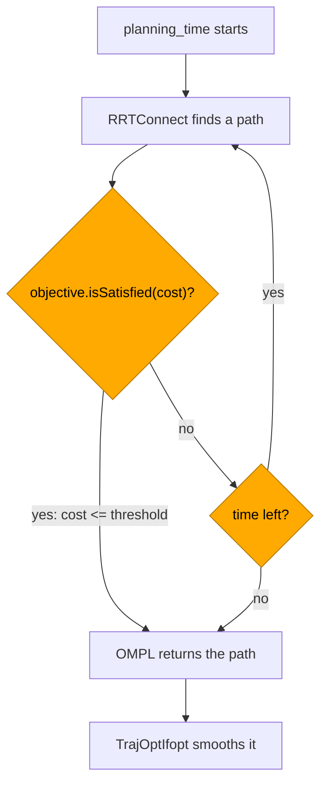
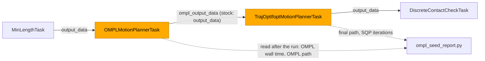

# OMPL Examples

**OMPL finds collision-free paths by sampling. From Python you choose the planners, how
long they optimize and the objective that decides when a path is good enough. On a sweep
through six cubes, a Python objective with a cost threshold ends the optimize loop at the
first path that meets it: the whole plan takes 1.7 to 2.1 s, against 13.2 to 13.9 s for the
default objective, which optimizes until `planning_time` runs out.**

All examples install as console scripts:

```bash
tesseract_freespace_clearance_objective_example

# or as a module
pixi run python -m tesseract_robotics.examples.freespace_clearance_objective_example
```

## Freespace OMPL

--8<-- "docs/demos/players/freespace_ompl_example.html"

Basic OMPL planning between joint configurations using the KUKA LBR iiwa 14 R820:

```bash
tesseract_freespace_ompl_example
```

See the source at
[`freespace_ompl_example.py`](https://github.com/tesseract-robotics/tesseract_nanobind/blob/main/src/tesseract_robotics/examples/freespace_ompl_example.py).

## Hybrid Planning (OMPL + TrajOpt)

--8<-- "docs/demos/players/freespace_hybrid_example.html"

OMPL finds a feasible path, TrajOpt smooths and optimizes it:

```bash
tesseract_freespace_hybrid_example
```

See the source at
[`freespace_hybrid_example.py`](https://github.com/tesseract-robotics/tesseract_nanobind/blob/main/src/tesseract_robotics/examples/freespace_hybrid_example.py).

## Ending the optimize loop on cost

--8<-- "docs/demos/players/freespace_clearance_objective_example.html"

The KUKA IIWA sweeps joint_a1 from -1.2 to 1.2 rad, a 1.25 m arc of the tool, through six
cubes of different sizes and orientations. The straight joint-space sweep hits them from
5 % to 92 % of the way. The example plans the sweep twice with `FreespaceIfoptPipeline`
(two RRTConnect planners, then TrajOptIfopt), with no solution-count exit:

1. **Default objective**: path length, `optimize = True`. Nothing but the time cap ends the
   optimize loop, so OMPL runs for the whole `planning_time`.
2. **Python objective**: an `OMPLRealVectorMoveProfile` subclass builds a
   `MultiOptimizationObjective` (path length x 1 + max-min clearance x 0.5) with a cost
   threshold. The loop ends at the first path whose cost meets it.

The viewer shows case 2: the TCP path and, for each cube, a red line between the nearest
points of the robot and the cube, labelled with the distance.



The highlighted checks run on every path OMPL finds. With the default objective there is
no threshold, so `isSatisfied` stays false and only the time check ends the loop.

### The objective, from Python

```python
--8<-- "src/tesseract_robotics/examples/freespace_clearance_objective_example.py:objective_profile"
```

The planner calls `createOptimizationObjective` once per solve, with the problem's
`SpaceInformation`. Objectives are bound but cannot be subclassed in Python: a profile
composes the bound ones. See [OMPL optimization objectives](../user-guide/planning.md#ompl-optimization-objectives)
for the bound API.

### The example checks itself

`run()` raises a named error when one of its claims fails, so the test only runs it:

```python
--8<-- "src/tesseract_robotics/examples/freespace_clearance_objective_example.py:checks"
```

| Error | Raised when |
|---|---|
| `PlanningFailedError` | a case did not plan |
| `ObjectiveNotUsedError` | the Python objective was not built exactly once |
| `DefaultEndedEarlyError` | case 1 finished inside `planning_time` |
| `ThresholdDidNotEndLoopError` | case 2 did not finish inside `planning_time` |
| `CubeContactError` | case 2's path touches a cube |

The clearances come from a scan of case 2's path in 0.005 rad joint steps
(`closest_approaches`). The viewer draws them with `draw_clearances`, which the demo
recording calls too:

```python
--8<-- "src/tesseract_robotics/examples/freespace_clearance_objective_example.py:markers"
```

### Evidence

| Claim | Evidence | Source |
|---|---|---|
| Default objective runs to the time cap | 13.2 to 13.9 s end to end at `planning_time = 10` (three runs, osx-arm64) | `test_freespace_clearance_objective_example` |
| The threshold ends the loop early | 1.7 to 2.1 s end to end, same runs; 5.4 to 7.0 s with other test suites loading the machine | same test; viewer runs of `main()` |
| OMPL alone meets the 4.0 rad threshold in about a second | `OMPLPipeline`: 1.1 to 1.5 s with the threshold (5 runs), 0.26 to 0.29 s to the first path (8 runs) | `PATH_LENGTH_THRESHOLD_RAD` comment |
| The rest of case 2 is TrajOptIfopt | 1.7 to 2.1 s end to end minus 1.1 to 1.5 s of OMPL | rows above |
| The straight sweep is blocked | collides from 5 % to 92 % of the way (41 samples) | scene probe when the cubes were placed |
| Case 2 clears every cube | 35 to 151 mm over the runs above, always to `link_7` | `CubeContactError` check in `run()` |

!!! warning "The clearance term adds nothing yet"
    tesseract's OMPL state validators do not implement `clearance()`, so OMPL reports 0 for
    every state and `MaximizeMinClearanceObjective` adds a constant. The objective reduces
    to path length until upstream reports clearance (#362). The red lines in the viewer are
    measured afterwards by the contact manager; the planner does not see them.

!!! note "Under verification"
    The recording above awaits review and is not yet published. Under heavy machine load
    case 2's TrajOptIfopt stage has taken up to 7.0 s of the 10 s budget.

### Per seed

**Over 10 seeds, the threshold ends OMPL in 0.04 to 0.05 s against 10.8 to 11.2 s for the
default objective, and TrajOptIfopt brings both cases' final paths to 27 to 51 mm from the
cubes.** `pixi run ompl-seed-report` plans both cases once per seed, each seed in its own
process, and writes JSON and this table to `build/ompl_seed_report/`.

It plans with `FreespaceIfoptOMPLOutputPipeline` (`scripts/ompl_seed_report_task_composer.yaml`).
That is stock `FreespaceIfoptPipeline` except for one key: OMPL hands its program to
TrajOptIfopt under `ompl_output_data` instead of `output_data`, which TrajOptIfopt overwrote,
so one run yields both stages' paths. On a fixed seed with one planner its final program is
bit-identical to stock's (`test_ompl_output_variant_is_bit_identical_to_stock`).



N = 10 seeds, commit `9126549d` plus the uncommitted report change, Darwin arm64 (Apple M1
Max), Python 3.14.10. Clearances are each path's smallest distance to any cube, from the
example's 0.005 rad scan; the final length is joint-space (sum of the per-step L2 norms).

| seed | case | OMPL (s) | OMPL min clearance (mm) | TrajOptIfopt iterations | TrajOptIfopt status | final min clearance (mm) | final length (rad) | total (s) |
|---|---|---|---|---|---|---|---|---|
| 1 | default | 11.05 | 10.0 | 2 | Found valid solution | 51.0 | 2.81 | 12.34 |
| 1 | threshold | 0.04 | 0.0 | 4 | Found valid solution | 39.9 | 2.79 | 1.43 |
| 2 | default | 11.05 | 10.1 | 2 | Found valid solution | 39.9 | 2.88 | 12.05 |
| 2 | threshold | 0.05 | 0.1 | 7 | Found valid solution | 27.8 | 2.77 | 1.46 |
| 3 | default | 11.08 | 10.0 | 2 | Found valid solution | 26.7 | 2.79 | 12.60 |
| 3 | threshold | 0.05 | 0.0 | 4 | Found valid solution | 50.3 | 2.79 | 2.37 |
| 4 | default | 10.76 | 10.0 | 4 | Found valid solution | 29.8 | 2.76 | 12.06 |
| 4 | threshold | 0.05 | 0.0 | 2 | Found valid solution | 49.2 | 2.89 | 1.34 |
| 5 | default | 11.12 | 10.0 | 2 | Found valid solution | 38.3 | 2.84 | 12.19 |
| 5 | threshold | 0.04 | 0.0 | 4 | Found valid solution | 35.5 | 2.79 | 1.54 |
| 6 | default | 11.05 | 10.1 | 2 | Found valid solution | 44.4 | 2.86 | 12.35 |
| 6 | threshold | 0.04 | 0.0 | 2 | Found valid solution | 47.3 | 2.90 | 1.28 |
| 7 | default | 11.07 | 10.0 | 5 | Found valid solution | 39.6 | 2.91 | 12.30 |
| 7 | threshold | 0.05 | 0.0 | 4 | Found valid solution | 37.1 | 2.98 | 1.49 |
| 8 | default | 11.19 | 10.0 | 4 | Found valid solution | 43.1 | 2.79 | 12.73 |
| 8 | threshold | 0.04 | 0.0 | 2 | Found valid solution | 51.0 | 2.96 | 1.36 |
| 9 | default | 11.12 | 10.0 | 7 | Found valid solution | 37.1 | 2.83 | 12.34 |
| 9 | threshold | 0.04 | 0.0 | 7 | Found valid solution | 34.7 | 2.73 | 1.59 |
| 10 | default | 11.21 | 10.0 | 5 | Found valid solution | 32.2 | 2.75 | 12.46 |
| 10 | threshold | 0.05 | 0.0 | 2 | Found valid solution | 51.0 | 2.91 | 1.27 |

| Claim | Evidence | Source |
|---|---|---|
| The default objective's OMPL stage runs to the time cap | 10.8 to 11.2 s at `planning_time = 10`, all 10 seeds | table, OMPL (s) |
| The threshold ends OMPL at its first path | 0.04 to 0.05 s, all 10 seeds | table, OMPL (s) |
| TrajOptIfopt takes 2 to 7 SQP iterations in both cases | highest `overall_iteration` its callback saw | table |
| Both cases end 27 to 51 mm from the cubes | final min clearance; final length 2.73 to 2.98 rad | table |
| The OMPL paths hug the cubes at their collision margin | default 10.0 to 10.1 mm (margin 10 mm); threshold 0.0007 to 0.094 mm (no margin, see below) | `rows.json` |
| The report's pipeline plans what stock plans | final program bit-identical to stock `FreespaceIfoptPipeline`'s on seed 1, one planner; stock reproduces itself on the seed | `tests/scripts/test_ompl_seed_report.py` |

!!! warning "The two cases plan OMPL with different collision margins"
    The profile helpers set the default case's OMPL `contact_manager_config.default_margin`
    to 0.01 m (`create_ompl_default_profiles`). Case 2's `LengthAndClearanceProfile` is a
    fresh `OMPLRealVectorMoveProfile`, and the example does not copy the margin to it. So its
    OMPL paths may graze the cubes (0.0007 to 0.094 mm above), and the cases differ in margin
    as well as in objective. That confounds the OMPL timing comparison until the example
    gives both cases the same margin. TrajOptIfopt's own margins push both final paths off
    the cubes.

!!! note "Termination reason: pending upstream"
    The table cannot say why OMPL's loop ended. tesseract's planner builds the reason and
    then reports only "Found valid solution". A termination-reason column follows once the
    reason is reported upstream (#362).

## Further reading

- [Optimal planning](https://ompl.kavrakilab.org/optimalPlanning.html): OMPL's overview of
  optimizing planners and termination conditions.
- [Optimization objectives tutorial](https://ompl.kavrakilab.org/optimizationObjectivesTutorial.html):
  defining objectives, combining them, and cost thresholds.
- [`OptimizationObjective`](https://ompl.kavrakilab.org/classompl_1_1base_1_1OptimizationObjective.html):
  `isSatisfied` and `setCostThreshold`.
- [`MultiOptimizationObjective`](https://ompl.kavrakilab.org/classompl_1_1base_1_1MultiOptimizationObjective.html):
  the weighted sum the example builds.
- [`PathLengthOptimizationObjective`](https://ompl.kavrakilab.org/classompl_1_1base_1_1PathLengthOptimizationObjective.html)
  and [`MaximizeMinClearanceObjective`](https://ompl.kavrakilab.org/classompl_1_1base_1_1MaximizeMinClearanceObjective.html):
  its two terms.
