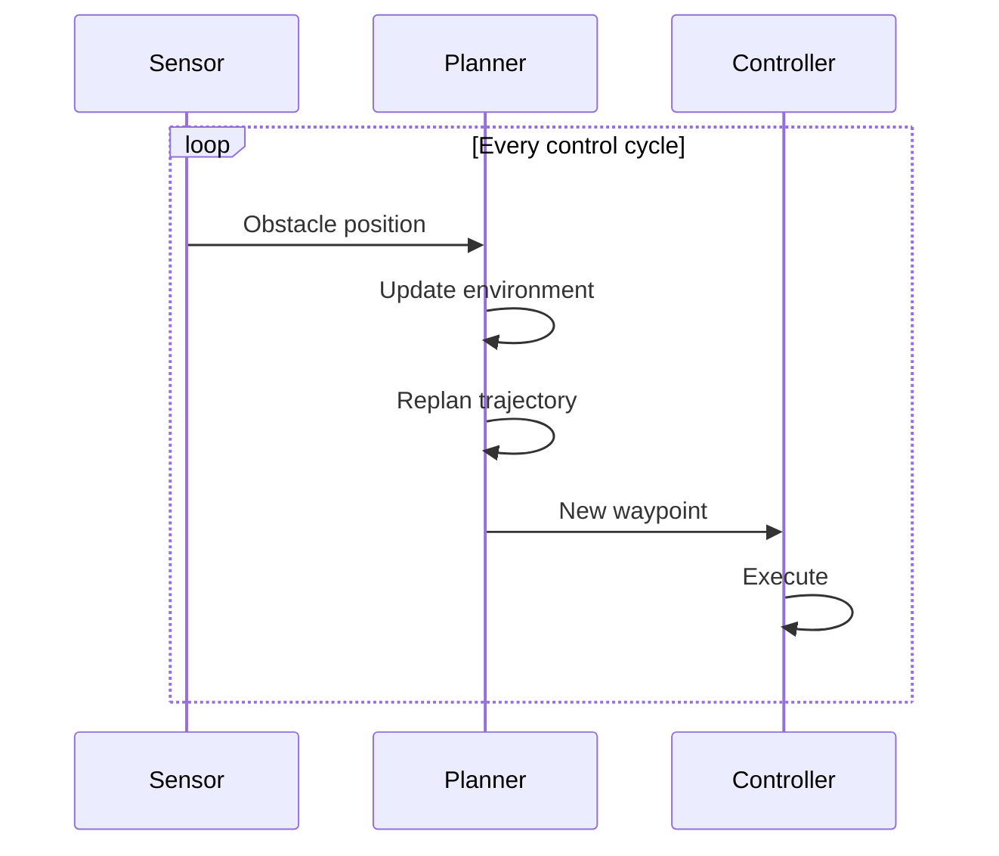

# Online planning

<!-- snippet: ambient
from tests.docs.doc_assets import sqp_scene

globals().update(sqp_scene(robot))
-->

Two examples replan a gantry robot's trajectory while a person walks up to its arm. They plan
the same task. `online_planning_sqp_example` follows tesseract_planning's C++
`online_planning_example.cpp`: it builds one `TrajOptQPProblem` and, every tick, moves the person
and re-solves it with `TrustRegionSQPSolver`, starting from the previous solution.
`online_planning_example` does the same job through the task composer, running a whole pipeline
per plan.

## The task

Both examples take their task from `online_planning_scene.py`. The robot runs 5.5 m down the cell
on the gantry's x axis, its arm at zero at both ends and pointing across the cell, towards the
person. The person, a cylinder 0.5 m in radius and 2 m tall on two prismatic joints, walks
0.8 m straight towards the arm and back at 1.3 m/s, a comfortable adult walking speed, halfway
down the robot's run; it never crosses the run. One replan every 0.1 s, the spacing of the C++
example's planned waypoints, so a lap takes 12 ticks; the examples run four laps. The person stays
in the arm's way: the straight plan would come within the margin on 9 ticks of every 12, and at
the near end run the arm 0.39 m into the person. In the C++ example someone drags the person's
joints by hand, and the target also moves the gantry 3 m across the cell.

To generate more impressive arm motion, gantry steps cost more than an arm step. Each joint's
velocity cost is weighted by the inverse of its velocity limit (`velocity_weights`). The URDF
rates the gantry at 0.2 and 0.5 m/s against 2.6 to 7.9 rad/s for the arm.

## Overview

--8<-- "docs/demos/players/online_planning_example.html"

Each tick of the loop:



## Performance comparison

| Method | Use Case |
|--------|----------|
| Task Composer | Moderate scene changes; each `plan` runs a whole pipeline |
| Low-Level SQP (discrete) | Replanning from the last solution; collisions checked at the waypoints |
| Low-Level SQP (LVS continuous) | Swept collision between waypoints; slower per step |

The reference
[`online_planning_sqp_example.py`](https://github.com/tesseract-robotics/tesseract_nanobind/blob/main/src/tesseract_robotics/examples/online_planning_sqp_example.py)
prints the mean replan step after the initial solve on its 8-DOF gantry workcell, for each
mode. Run it to get numbers for your machine and build; no rate or latency bound is claimed
here.

## Low-level SQP example

--8<-- "docs/demos/players/online_planning_sqp_example.html"

Replanning with discrete collision. The snippets below
are the real shipped source, split into three regions: `setup`, `problem`,
`sqp_loop`. For the accompanying conceptual guide see the
[Low-Level SQP API](../user-guide/low-level-sqp.md) page.

### Setup

```python title="online_planning_sqp_example.py (setup)"
--8<-- "src/tesseract_robotics/examples/online_planning_sqp_example.py:setup"
```

### Problem construction

The problem is a `TrajOptQPProblem`, built as tesseract_planning's
`online_planning_example.cpp` builds it, with the target as joints. The start and target joints
and one collision constraint per step are constraint sets, and the joint velocity is a squared
cost, weighted per joint. Continuous mode sets the
collision check type to `LVS_DISCRETE`, which its evaluator requires; the C++ reference sets
`DISCRETE` there and throws. Each collision constraint keeps 10 contacts as rows, not the C++
default 3, because several of the arm's links can touch the person and the floor at once.

```python title="online_planning_sqp_example.py (problem)"
--8<-- "src/tesseract_robotics/examples/online_planning_sqp_example.py:problem"
```

### SQP loop

```python title="online_planning_sqp_example.py (sqp_loop)"
--8<-- "src/tesseract_robotics/examples/online_planning_sqp_example.py:sqp_loop"
```

Run the complete example:

```bash
tesseract_online_planning_sqp_example
```

??? example "Expected output (the timings vary by machine)"
    ```text
    Manipulator joints (8): ['gantry_axis_1', 'gantry_axis_2', 'joint_1', 'joint_2', 'joint_3', 'joint_4', 'joint_5', 'joint_6']
    Building optimization problem (collision: discrete)...
    Running initial global solve...
    Initial solve: cost=35.9975, time=<ms>
    Online replanning (48 iterations)...
    Replan timing: avg=<ms> (<Hz>)
    Trajectory: 12 waypoints x 8 joints
    ```

    Between the second and third line, `problem.print()` dumps the problem's state, as the C++
    reference does. Before the first solve, trajopt prints zero counts and uninitialized
    bounds there.

## Key concepts

### 1. Variable hierarchy (0.34+)

Use `createNodesVariables` to build `NodesVariables` → `Node` → `Var`:

```python
from tesseract_robotics.trajopt_ifopt import Bounds, createNodesVariables

bounds = [Bounds(-3.14, 3.14)] * len(joint_names)  # one Bounds per joint
nodes_variables = createNodesVariables(
    "trajectory", joint_names, initial_states, bounds,
)
vars_list = [node.getVar("joints") for node in nodes_variables.getNodes()]
```

### 2. Warm-start from the previous solution

Between ticks, rebuild the problem with the previous trajectory as the variables' initial values,
as the C++ `setupProblem` does:

```python
from tesseract_robotics.trajopt_ifopt import createNodesVariables

seeded = createNodesVariables("trajectory", joint_names, list(trajectory), bounds)
# ... a new TrajOptQPProblem(seeded) with the constraint and cost sets, setup(), then:
solver.init(problem)
solver.stepSQPSolver()
```

Writing the values into an existing problem with `NodesVariables.setVariables` is not the same:
it only writes the values, and the collision constraints keep evaluating the trajectory they were
set up with. The solver then reports convergence without moving the plan.

### 3. Reset the trust region each tick

`stepSQPSolver` shrinks the trust region — if you don't reset it, successive
ticks get smaller and smaller steps:

```python
solver.stepSQPSolver()
solver.setBoxSize(0.01)  # Reset trust region
```

### 4. Single step vs full solve

- Use `solver.solve(problem)` on the first tick for global convergence.
- Use `solver.stepSQPSolver()` per tick afterwards for incremental optimization. The C++ example
  takes one step per loop, as fast as the solver runs. At a 0.1 s tick and walking speed one step
  of the 0.01 trust box runs the arm into the person, so the example takes up to
  `SQP_STEPS_PER_TICK` (10) steps a tick and stops at the first that converges.

### 5. Sparse collision checking

Check collision every N waypoints for speed:

```python
from tesseract_robotics.trajopt_ifopt import DiscreteCollisionConstraint

# Every other waypoint (faster)
for i in range(0, n_steps, 2):
    collision = DiscreteCollisionConstraint(evaluator, vars_list[i], name=f"collision_{i}")

# Every waypoint (slower, safer)
for i in range(n_steps):
    collision = DiscreteCollisionConstraint(evaluator, vars_list[i], name=f"collision_{i}")
```

## Continuous collision

To check the motion between waypoints, not only the waypoints, use
`ContinuousCollisionConstraint` with an LVS evaluator. Each evaluator requires its own check type
in the collision config, and its constructor raises otherwise: `LVSDiscreteCollisionEvaluator`
needs `LVS_DISCRETE` (the example's continuous mode), and
`LVSContinuousCollisionEvaluator` needs `LVS_CONTINUOUS` or `CONTINUOUS`:

```python
from tesseract_robotics.collision import CollisionEvaluatorType
from tesseract_robotics.trajopt_ifopt import (
    ContinuousCollisionConstraint,
    LVSContinuousCollisionEvaluator,
    TrajOptCollisionConfig,
)

from tesseract_robotics.trajopt_sqp import TrajOptQPProblem

problem = TrajOptQPProblem(nodes_variables)  # over the variables built above
config = TrajOptCollisionConfig(0.1, 10.0)  # margin (m), coefficient
config.collision_check_config.type = CollisionEvaluatorType.LVS_CONTINUOUS

# One constraint per segment between consecutive waypoints. The first segment starts at the
# pinned current state, so its start is fixed.
for i in range(n_steps - 1):
    evaluator = LVSContinuousCollisionEvaluator(manip, env, config, dynamic_environment=True)
    constraint = ContinuousCollisionConstraint(
        evaluator,
        vars_list[i], vars_list[i + 1],
        fixed0=(i == 0), fixed1=False,
        max_num_cnt=config.max_num_cnt,
        name=f"cont_collision_{i}",
    )
    problem.addConstraintSet(constraint)
```

## Visualization

Animate a trajectory in the viewer:

<!-- snippet: skip (starts the viewer on its default port and waits for Enter) -->
```python
from tesseract_robotics.viewer import TesseractViewer, Trajectory

# Rows of joint values plus a time column
dt = 0.1
rows = [wp.tolist() + [i * dt] for i, wp in enumerate(trajectory)]

with TesseractViewer() as viewer:
    viewer.update_environment(robot.env)
    viewer.update_trajectory(Trajectory.from_rows(joint_names, rows))
    print(f"Viewer at {viewer.url}")
    input("Press Enter to exit...")
```

## Task composer alternative

`online_planning_example.py` replans through the task composer instead: each plan runs a whole
pipeline, with profiles and the high-level API, at the cost of rebuilding the problem every
time. It is not a port of the C++ example; the SQP example above is.
See [`online_planning_example.py`](https://github.com/tesseract-robotics/tesseract_nanobind/blob/main/src/tesseract_robotics/examples/online_planning_example.py):

```bash
tesseract_online_planning_example
```

## Running the examples

```bash
# Low-level SQP (discrete collision)
tesseract_online_planning_sqp_example

# Task Composer based
tesseract_online_planning_example
```

Or via module invocation:

```bash
pixi run python -m tesseract_robotics.examples.online_planning_sqp_example
pixi run python -m tesseract_robotics.examples.online_planning_example
```

## Performance tuning

### Faster planning

```python
# Fewer waypoints
n_steps = 8  # Instead of 12

# Fewer collision checks
for i in range(0, n_steps, 3):  # Every third waypoint
    ...

# Smaller trust region (faster convergence)
solver.params.initial_trust_box_size = 0.01

# Fewer iterations per step
solver.params.max_iter = 5
```

### Better quality

```python
# More waypoints
n_steps = 20

# Continuous collision
# (use ContinuousCollisionConstraint + LVSContinuousCollisionEvaluator)

# More iterations
solver.params.max_iter = 50

# Tighter convergence
solver.params.min_approx_improve = 1e-5
```

## Next steps

- [Low-Level SQP Guide](../user-guide/low-level-sqp.md) - Full API reference
- [Collision Detection](../user-guide/collision.md) - Collision configuration
