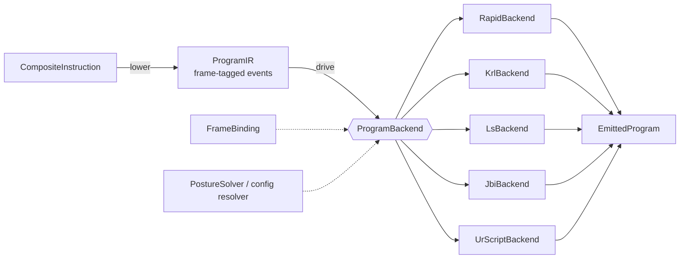

# Program emitters

`tesseract_robotics.emitters` turns a planned or hand-authored
`CompositeInstruction` into controller-native robot programs for five
dialects: ABB RAPID, KUKA KRL, Fanuc TP (LS), Yaskawa INFORM (JBI) and
Universal Robots URScript.

The governing rule: an emitted program must not move differently from the plan.
So the emitter never guesses a value the controller needs. Each move's frames
travel with it and resolve through a caller-supplied binding; robot
configuration bits are computed exactly from the waypoint's seed joints, or the
emit raises a named error. Unit conversion, precision, identifiers and comment
text follow one rule set per dialect, cited from the vendor manuals below.

## Architecture



Solid arrows are the pipeline every emit runs; dotted arrows are caller-supplied
inputs (the frame binding is required, the configuration source is required as
soon as a dialect needs one).

- `core/`: the brand-independent spine. `lower()` is the single walk of the
  composite; it combines each move's `ManipulatorInfo` with its parents'
  (as tesseract does) and emits frozen, typed events. `CartesianMove.target`
  is a `FramedPose` (pose plus the `MoveFrames` it is expressed in); every
  `JointMove` carries its `MoveFrames` too. `EmitIdentity` gives
  content-addressed reproducibility, `ProgramBackend` / `drive()` dispatch the
  events, `core.dsl` is the shared DSL skeleton, `core.precision` the display
  policy, `core.naming` the identifier validator, `core.posture` the arm
  posture solver.
- `rapid/`, `krl/`, `ls/`, `jbi/`, `urscript/`: one backend per dialect. Each
  owns a validated profile (`*Profile.build`), a frame-binding factory
  (`rapid_frames`, `krl_frames`, `ls_frames`, `jbi_frames`, `ur_frames`), pure
  target formatters, a hand-authoring DSL that specializes `core.dsl`, and a
  backend that drives that DSL from the IR.

### The DSL skeleton (`core.dsl`)

- `Writer`: an indented code buffer and a context manager. While its `with`
  block is open it is the active writer of its brand in the current context
  (one `contextvars.ContextVar` per writer class). Every emit opens its own
  writer, so an emit never touches a program the caller is building with the
  DSL, and threads or asyncio tasks never share a buffer.
- `Command`: the base of every statement; it writes itself into the active
  writer on construction, so `MoveL(...)` / `Ptp(...)` read like the target
  language. With no writer open, it raises `NoActiveWriterError`.
- `Block`: a `<opening> ... <closing>` indented `with` scope (RAPID `Module` /
  `Proc` / `While` / `For`, KRL `Def`, URScript `def`).

The RAPID writer also enforces the RAPID module grammar (3HAC050946, RAPID
kernel): `MODULE` only at top level, `PROC` only directly inside it, statements
only inside a routine, `PERS` only at module level, `VAR` / `CONST` at module
level or before a routine's first statement, every declaration with its data
type. A violation raises `ProgramStructureError`. Declarations are objects
carrying their typed name (`Robtarget(...).name`, `Speed(...).name`).

## Frames

A Cartesian waypoint is the pose of `tcp_frame` (composed with `tcp_offset`) in
`working_frame`. Each dialect resolves those names through a binding the caller
builds, and raises `UnboundFrameError` for a name it does not bind:

| dialect | binding | working frame becomes | TCP frame becomes |
|---|---|---|---|
| RAPID | `rapid_frames(work_objects=, tools=)` | `\WObj:=<wobjdata>` per move | `<tooldata>` argument per move |
| KRL | `krl_frames(bases=, tools=)` | `$BASE = BASE_DATA[i]` / `$NULLFRAME` on change | `$TOOL = TOOL_DATA[i]` / `$NULLFRAME` on change |
| LS | `ls_frames(user_frames=, tools=)` | `UFRAME_NUM=` on change, `UF :` in `/POS` | `UTOOL_NUM=` on change, `UT :` in `/POS` |
| JBI | `jbi_frames(tools=)` | (joint pulses only) | `///TOOL` of the position table |
| URScript | `ur_frames(features=, tcps=)` | target transformed into the base frame exactly | `set_tcp(p[...])` on change |

A non-identity `tcp_offset` raises `TcpOffsetError` on dialects that select a
stored tool by handle (it must already be part of that tool); URScript composes
it with the bound TCP pose exactly. A `tcp_offset` naming a link raises at
lowering: the emitter has no environment to resolve it. A `SetToolInstruction`
raises `UnsupportedInstructionError` in every dialect: the tool follows each
move's `tcp_frame`, and a separate tool index would contradict it.

## Robot configuration

A six-axis arm reaches most poses in up to eight configurations. The emitter
takes the configuration from the waypoint's seed joints (never as the target:
the seed is an IK hint) and from an arm-posture source:

- `OpwPostureSolver(OpwParameters)` computes the three geometric posture bits
  (wrist centre in front of axis 1, wrist centre in front of the lower arm,
  axis 5 positive) in closed form from tesseract's OPW kinematics parameters.
  A test checks it against tesseract forward kinematics of the IRB 2400 for
  200 random configurations. A seed exactly on a boundary raises
  `SingularPostureError`.

| dialect | what it needs | source |
|---|---|---|
| RAPID | confdata `[cf1, cf4, cf6, cfx]` on every robtarget | `cf1/cf4/cf6 = floor(q / 90 deg)` of axes 1/4/6; `cfx` from the posture bits by the manual's table (3HAC050917, `confdata`) |
| KRL `LIN` | nothing | KSS 8.3 §9.10: Status and Turn "are ignored for CP motions" |
| KRL `PTP` to a frame | Status and Turn | raises `MissingConfigurationError`: Status bit 2 depends on the A5 tilt relative to the A4 zero position, not on the plan's joint values alone; plan the move as a joint waypoint |
| LS | `CONFIG : 'F/N U/D T/B, t1, t4, t6'` | letters from the caller's `FanucConfigResolver`; turn numbers from the seed by the manual's table (`0: -179 to 179`, `1: 180 to 539`, `-1: -539 to -180`) |
| JBI Cartesian | `///RCONF`, a coordinate frame | not emitted: raises `UnsupportedInstructionError`; JBI programs are joint moves |
| URScript `movel` | nothing | the linear path fixes the configuration continuously |
| URScript FREESPACE Cartesian | IK branch | `get_inverse_kin(p, qnear=<seed>)`: "the solution closest to qnear is returned" |

Without seed joints, or without the posture solver / resolver a dialect needs,
the move raises `MissingConfigurationError`.

!!! note "Joint moves are joint-interpolated"
    A tesseract joint waypoint becomes the dialect's joint move (`MoveAbsJ`,
    `PTP`, `J`, `MOVJ`, `movej`) whatever its `MoveInstructionType`. For a
    planner's dense output that is the plan; a sparse `LINEAR` joint waypoint
    would need forward kinematics to become a linear move.

## Units and precision

The IR is strictly SI; backends convert only through `core.units`. Display
precision is one policy (`core.precision`), derived from a 1 µm resolution at
the TCP, an order of magnitude below industrial-arm repeatability:

| field | unit | decimals | why |
|---|---|---|---|
| positions | mm | 3 | 1 µm |
| positions (URScript) | m | 6 | 1 µm |
| angles, joints | deg | 4 | 5e-5 deg half-step: 2.6 µm at 3 m reach |
| angles, joints (URScript) | rad | 6 | 5e-7 rad half-step: 1.5 µm at 3 m |
| quaternion components (RAPID) | – | 9 | ~1e-9 rad, norm within 2e-9 of 1 |
| encoder pulses (JBI) | pulse | integer | `zero + round(q * pulses_per_rad)` from `JbiPulseCalibration` |

Quaternions are scalar-last `[qx, qy, qz, qw]` at every Python surface (RAPID
`Tooldata` / `Workobject` take `Pose`s in metres); RAPID prints scalar-first.
KUKA ABC is intrinsic ZYX and Fanuc WPR fixed-angle XYZ; both extractions are
exact on both gimbal-lock branches (B or P = ±90 deg).

## Identifiers and text

Names are validated, never mangled (`IdentifierError` names the rule broken):

| dialect | rule | source |
|---|---|---|
| RAPID | letter, then letters/digits/`_`; at most 32; not a reserved word (case-insensitive) | 3HAC050946 §2.3–2.4 |
| KRL | letter or `_`, then letters/digits/`_`; at most 24; not a keyword | KSS 8.3 §11.3.2 |
| LS | upper-case letter, then upper-case letters/digits/`_`; at most 36 (input is upper-cased) | TP program-name field |
| JBI | letter, then letters/digits/`_`; at most 32 | Motoman `//NAME` |
| URScript | letter or `_`, then letters/digits/`_`; not a keyword | URScript grammar |

The default program name is the composite's description, which is often not a
legal identifier: pass `program_name=` (or `module_name=` for RAPID).

Comments never contain a line break (`UnemittableTextError`); Fanuc remarks
also reject `;`, INFORM comments are at most 32 characters. RAPID `TPWrite`
strings double `"` and `\` and are at most 80 characters once escaped.

Named signals (`SetDigitalInstruction("do_torch", ...)`) are RAPID-only; the
other dialects number their IO and raise `UnsupportedInstructionError` rather
than map a name to a number. Analog outputs: RAPID `SetAO`, KRL `$ANOUT[i]`,
LS `AO[i]`, JBI `AOUT AO#(1..40)` within ±14 V, URScript
`set_standard_analog_out(0..1, level in [0, 1])`.

## External axes

RAPID takes an `ExternalAxisLayout` (`emit_rapid(external_axes=...)`): joint
vectors split by joint name into six robax and up to six `eax` values (mm for
LINEAR, deg for ROTARY). Coordinated Cartesian targets raise: a tesseract
`CartesianWaypoint` stores no external-axis target. The other dialects emit six
axes and raise `ExternalAxisError` on more.

## Example: KUKA KRL

```python
import numpy as np
from tesseract_robotics.emitters.krl import KrlNullFrame, KrlProfile, emit_krl, krl_frames
from tesseract_robotics.planning import CartesianTarget, JointTarget, MotionProgram, Pose

joint_names = [f"joint_{i}" for i in range(1, 7)]
program = MotionProgram("manipulator", tcp_frame="tool0", working_frame="base_link", profile="weld")
program.move_to(JointTarget(np.deg2rad([0, -20, 30, 0, 50, 0]), profile="approach"))
program.linear_to(CartesianTarget(Pose.from_xyz_rpy([0.6, -0.1, 0.8], [np.pi, 0, 0]), profile="weld"))
program.set_joint_names(joint_names)
composite = program.to_composite_instruction(joint_names=joint_names)

profiles = {"approach": KrlProfile.build(), "weld": KrlProfile.build(cp_speed_mms=100.0)}
frames = krl_frames(bases={"base_link": KrlNullFrame.NULLFRAME}, tools={"tool0": 1})
result = emit_krl(composite, profiles, frames=frames, program_name="WELD_01")
result.write_to("out")  # writes out/WELD_01.src
print(result.text)
```

```krl
DEF WELD_01()
  ; generated by tesseract_robotics.emitters <version>
  ; ir-digest: sha256:...
  ; profiles-digest: sha256:...
  ; DO NOT EDIT - regenerate from the planning pipeline
  $TOOL = TOOL_DATA[1]
  BAS(#VEL_PTP, 100)
  PTP {A1 0.0000,A2 -20.0000,A3 30.0000,A4 0.0000,A5 50.0000,A6 0.0000}
  $BASE = $NULLFRAME
  $VEL.CP = 0.100000
  LIN {X 600.000,Y -100.000,Z 800.000,A 0.0000,B 0.0000,C 180.0000}
END
```

## Example: ABB RAPID

```python
from tesseract_robotics.emitters import OpwParameters, OpwPostureSolver
from tesseract_robotics.emitters.rapid import RapidProfile, emit_rapid, rapid_frames
from tesseract_robotics.common import JointState

# RAPID's confdata comes from each Cartesian waypoint's seed joints. A planned program carries
# them; this hand-built one gets its IK solution as the seed.
weld = composite[1].asMoveInstruction().getWaypoint().asCartesianWaypoint()
weld.setSeed(JointState(joint_names, robot.ik("manipulator", weld.getTransform(), "tool0")))

# OPW parameters of the IRB 2400, as in tesseract_support's abb_irb2400_plugins.yaml.
irb2400 = OpwPostureSolver(OpwParameters.build(
    a1=0.100, a2=-0.135, b=0.0, c1=0.615, c2=0.705, c3=0.755, c4=0.085,
    offsets=[0, 0, -1.57079632679, 0, 0, 0], sign_corrections=[1, 1, 1, 1, 1, 1],
))
result = emit_rapid(
    composite,
    {"approach": RapidProfile.build(), "weld": RapidProfile.build(speed="v100", zone="fine")},
    frames=rapid_frames(work_objects={"base_link": "wobj0"}, tools={"tool0": "tool0"}),
    posture=irb2400,
    module_name="WELD_01",
)
```

## Determinism and identity

The same program and settings give byte-identical output. Every
`EmittedProgram` carries an `EmitIdentity`: the installed distribution version
(an uninstalled package raises `PackageNotFoundError` rather than print a
placeholder) and SHA-256 digests of the canonical IR and of the emit settings
(profiles, frame binding, posture solver or resolver). RAPID, KRL, LS and
URScript embed it as header comments; JBI does not, because its lines exceed
INFORM's 32-character comment limit. There are no timestamps in the body.

## Evidence

| claim | test |
|---|---|
| emitted RAPID is grammatical | `tests/emitters/rapid/rapid_grammar.py` re-parses the full-DSL and zigzag modules |
| robtargets parse back to pose, quaternion and seed confdata | `tests/emitters/rapid/test_zigzag_square.py` |
| OPW posture equals forward-kinematics geometry | `tests/emitters/core/test_posture.py` |
| quadrant boundaries and the cfx table | `tests/emitters/rapid/test_confdata.py` |
| KRL ABC / LS WPR rebuild the input rotation, gimbal branches included | `tests/emitters/{krl,ls}/test_targets.py`, `test_parse_back.py` |
| JBI pulse rows invert to the input angles within half a pulse | `tests/emitters/jbi/test_parse_back.py` |
| URScript poses, `set_tcp`, `qnear` parse back | `tests/emitters/urscript/test_parse_back.py` |
| an emit leaves a caller's open DSL program and other threads untouched | `tests/emitters/core/test_dsl.py` |

!!! warning "Under verification"
    The LS program-name rule (36 characters) and the KRL keyword list are not
    taken from a manual page that states them in full. The KRL keyword list is
    KRL's statement, declaration and motion vocabulary; a controller may
    reserve more.

## Supported dialects

| brand | entry point | output |
|---|---|---|
| ABB | `emitters.rapid.emit_rapid` | RAPID `.mod` |
| KUKA KRC4 | `emitters.krl.emit_krl` | KRL `.src` |
| Fanuc | `emitters.ls.emit_ls` | TP ASCII `.ls` |
| Yaskawa Motoman | `emitters.jbi.emit_jbi` | INFORM `.jbi` (joint moves) |
| Universal Robots | `emitters.urscript.emit_urscript` | `.script` |
