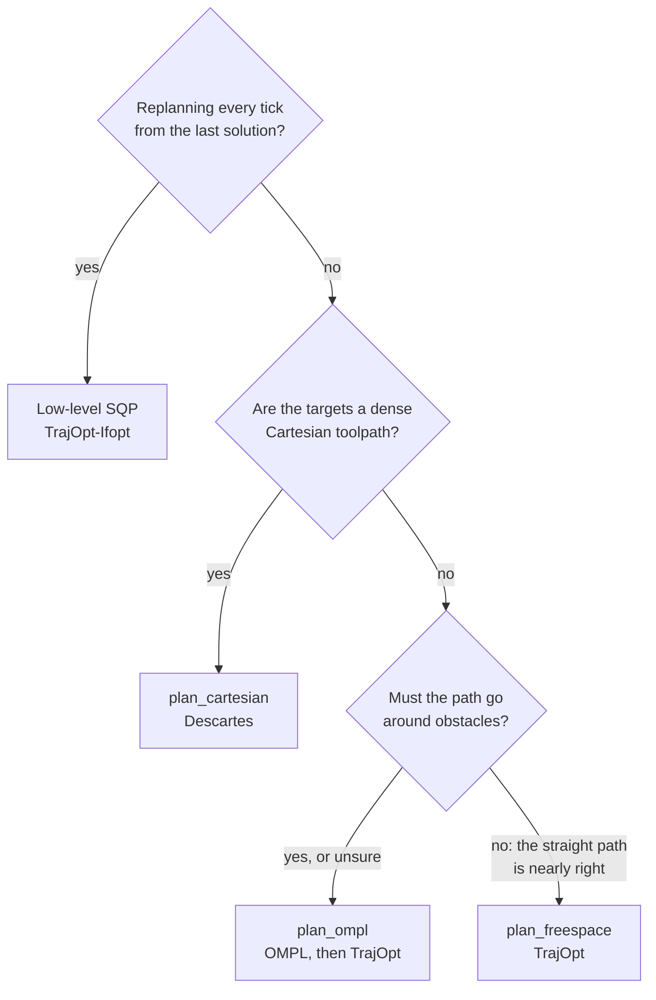

# Motion planning

<!-- snippet: ambient
from tesseract_robotics.planning import JointTarget, MotionProgram, Pose

joint_values = np.zeros(6)
pose = Pose.from_xyz_quat(0.8, -0.2, 0.8, 0.0, -1.0, 0.0, 0.0)
program = (
    MotionProgram("manipulator", tcp_frame="tool0", working_frame="base_link")
    .set_joint_names(robot.get_joint_names("manipulator"))
    .move_to(JointTarget(joint_values))
    .move_to(JointTarget(np.full(6, 0.2)))
)
-->

Plan a move among obstacles with `plan_ompl`, a move whose straight joint path is nearly
collision-free with `plan_freespace`, and a Cartesian toolpath with `plan_cartesian`; replan
every tick from the last solution with the [low-level SQP API](low-level-sqp.md). Each `plan_*`
call runs a [pipeline](task-composer.md#available-pipelines): the planner, a contact check of
the result, then time parameterization, and returns a `PlanningResult`. This page covers the
choice, the settings that matter for each planner, and what to do when a plan fails. The terms
(waypoint, profile, pipeline, TCP) are defined in the [glossary](../concepts/glossary.md).

## Choosing a planner



| Planner | Kind | Use for | What it guarantees |
| --- | --- | --- | --- |
| OMPL | sampling | free space among obstacles | probabilistically complete: finds a path if one exists, given enough time; nothing within a fixed time |
| TrajOpt | sequential convex optimization | smoothing, Cartesian paths, constraints | on success, a local (stationary) point of the costs with constraints holding to the solver tolerance at the evaluated points; a failed solve guarantees neither |
| TrajOpt-Ifopt | SQP with OSQP | replanning from a warm start | as TrajOpt: on success, a local (stationary) point of the costs with constraints holding to the solver tolerance at the evaluated points; a failed solve guarantees neither |
| Descartes | graph search over IK solutions | dense Cartesian toolpaths | the minimum-cost path through the sampled solutions: optimal for that discretization, not for the continuous problem |
| Simple | interpolation | seeds, joint moves | none; no collision checking |

On one freespace problem, measured:

<figure markdown>


<figcaption markdown="span">On upstream's freespace example (IIWA 14, joint_a1 −0.4 → 0.4 rad past a 0.15 m sphere), TrajOpt and OMPL + TrajOpt find the same short path (median 0.86 rad, 0.46 m of TCP travel, 5 mm clearance: TrajOpt's safety margin); raw OMPL (first RRTConnect solution, no smoothing) travels 5.8 rad and keeps 25 mm; TrajOptIfopt converges to a longer path (1.75 rad). Planner-node times differ by 10×, from 5 ms (TrajOptIfopt) to 65 ms (OMPL + TrajOpt), but each whole pipeline takes about 0.5 s, dominated by its other tasks. N = 20 seeds, one process each, first plan after `TaskComposer.warmup`, OMPL with one planner thread; Apple M1 Max (10 logical CPUs), macOS 15.3.2, 1-min load 20 during the run (other work on the host: absolute times are pessimistic). Descartes is not compared: it follows Cartesian paths and has no joint-to-joint query. Data: `docs/assets/figures/data/planner_comparison.json` (hardware, OS, library build, git commit, seeds, raw rows). Re-measure: `pixi run docs-figures-measure planner_comparison`, then `pixi run docs-figures planner_comparison`.</figcaption>
</figure>

## Plan with the high-level calls

All three calls take a `Robot` and a `MotionProgram` (or a `CompositeInstruction`) and return a
`PlanningResult`.

=== "plan_ompl"

    `FreespacePipeline`: parallel RRTConnect finds a path, TrajOpt smooths it, a discrete contact
    check validates it and iterative spline parameterization times it.

    ```python
    import numpy as np
    from tesseract_robotics.planning import (
        Robot, MotionProgram, JointTarget, plan_ompl,
    )

    locator = GeneralResourceLocator(paths=[get_tesseract_resource_path()])  # the [support] extra
    robot = Robot.from_tesseract_support("abb_irb2400", locator)
    program = (
        MotionProgram("manipulator", tcp_frame="tool0", working_frame="base_link")
        .move_to(JointTarget(np.zeros(6)))
        .move_to(JointTarget(np.array([0.5, -0.5, 0.5, 0.0, 0.5, 0.0])))  # rad
    )

    result = plan_ompl(robot, program)
    if result.successful:
        for state in result.trajectory:
            print(state.positions)
    ```

=== "plan_freespace"

    `TrajOptPipeline`: TrajOpt optimizes the program, then the same contact check and time
    parameterization run. TrajOpt is a local method: use it when the
    straight path is nearly collision-free.

    ```python
    from tesseract_robotics.planning import plan_freespace

    result = plan_freespace(robot, program)
    assert result.successful, result.message
    ```

=== "plan_cartesian"

    `DescartesDPipeline`: Descartes searches the IK solutions of every Cartesian waypoint for the
    cheapest joint path, then the contact check and time parameterization run. Use it when the
    program is a sequence of `CartesianTarget` poses the tool must hit.

    ```python
    from tesseract_robotics.planning import CartesianTarget, Pose, plan_cartesian

    cartesian_program = (
        MotionProgram("manipulator", tcp_frame="tool0", working_frame="base_link")
        # m in base_link, tool pointing down: [qx, qy, qz, qw] = [0, 1, 0, 0]
        .move_to(CartesianTarget(Pose.from_xyz_quat(0.8, -0.2, 0.5, 0.0, 1.0, 0.0, 0.0)))
        .linear_to(CartesianTarget(Pose.from_xyz_quat(0.8, 0.2, 0.5, 0.0, 1.0, 0.0, 0.0)))
    )

    result = plan_cartesian(robot, cartesian_program)
    assert result.successful, result.message
    ```

| Call | Pipeline | Default profiles | Settings |
|---|---|---|---|
| `plan_ompl` | `FreespacePipeline` | `create_freespace_pipeline_profiles()` | [OMPL](#ompl), [TrajOpt](#trajopt) |
| `plan_freespace` | `TrajOptPipeline` | `create_trajopt_default_profiles()` | [TrajOpt](#trajopt) |
| `plan_cartesian` | `DescartesDPipeline` | `create_descartes_default_profiles()` | [Descartes](#descartes) |

Every call takes `pipeline=` to run another pipeline (`plan_ompl(..., pipeline="OMPLPipeline")`
returns OMPL's path without the TrajOpt step), `profiles=` to replace the defaults, and
`composer=`. Without `composer=`, each call loads the task composer plugins again: hold one
`TaskComposer` and pass it to every call when you plan more than once
([Plugin warmup](task-composer.md#plugin-warmup)).

## Trajectory output

```python
if result.successful:
    print(f"Waypoints: {len(result.trajectory)}")
    first = result.trajectory[0]
    print(first.joint_names, first.positions, first.velocities, first.time)
    positions = result.to_numpy()  # (N, joints)
```

`PlanningResult` is truthy when `successful`. Its fields:

| Field | Content |
|---|---|
| `trajectory` | `TrajectoryPoint`s: `joint_names`, `positions` (rad, or m for a prismatic joint), and `velocities`, `accelerations`, `time` (s from the start) where the pipeline time-parameterized the waypoint, else `None` |
| `message` | `"Planning successful"`, or `"<task>: <message>"` for each task that failed |
| `raw_results` | the output `CompositeInstruction`, for the viewer, an emitter or a second plan |
| `task_infos` | one `TaskComposerNodeInfo` per node that ran (`name`, `status_message`, `elapsed_time`) |
| `data_storage` | the run's data storage, with each nested pipeline's own storage under its uuid |

The time stamps come from the pipeline's time parameterization task, which moves along the
planned path as fast as the joint limits allow. The shipped pipelines run iterative spline
parameterization; the figure shows TOTG:

<figure markdown>


<figcaption markdown="span">TOTG times a path against the URDF limits: here no joint reaches its velocity limit, and outside the blends at the two interior configurations one joint is always on its acceleration limit. The IRB2400 path runs through four joint configurations (dotted lines mark the interior two), 40 waypoints per segment, `TimeOptimalTrajectoryGeneration` with the default composite profile. Velocity and acceleration are fractions of each joint's limit; acceleration is the change of TOTG's waypoint velocities over each interval (Δv/Δt). Reproduce: `pixi run docs-figures time_parameterization`.</figcaption>
</figure>

## Motion types

Each builder method of `MotionProgram` adds a move of one type to a target:

| Method | Move type | The TCP between waypoints |
|---|---|---|
| `move_to(target)` | `FREESPACE` | any collision-free path |
| `linear_to(target)` | `LINEAR` | a straight line in the working frame |
| `circular_to(target)` | `CIRCULAR` | an arc |

```python
from tesseract_robotics.planning import CartesianTarget

moves = (
    MotionProgram("manipulator", tcp_frame="tool0", working_frame="base_link")
    .move_to(JointTarget(joint_values))
    .move_to(CartesianTarget(pose))  # freespace to a pose
    .linear_to(CartesianTarget(pose))
)
```

A target is a `JointTarget`, a `StateTarget` or a `CartesianTarget`, and may name a `profile`;
without one it takes the program's. A raster combines the move types: a freespace approach, then
linear strokes joined by linear step-overs.

<figure markdown>


<figcaption markdown="span">A zigzag raster planned with `CartesianPipeline` (Descartes, then TrajOpt): five 50 cm strokes 5 cm apart, 35 cm above base_link, tool down, joined by linear step-overs, after a freespace approach from home. Path and glyphs are forward kinematics of the planned joint states: blue strokes, orange step-overs, the dashed approach is the TCP under joint-space interpolation (not a straight line). Glyphs: TCP z (tool axis, blue) and x (red) at every planned state; the strokes stay on the plane to within 1 mm. Reproduce: `pixi run docs-figures raster_toolpath`.</figcaption>
</figure>

`MotionProgram` builds a `CompositeInstruction` of `MoveInstruction`s; the planning calls accept
either. The [`command_language` reference](../api/command_language.md) shows the instruction
types.

## Frames and the TCP

A `MotionProgram` names its `tcp_frame` and `working_frame`, and optionally a `tcp_offset`; the
planner puts `tcp_frame` · `tcp_offset` on each Cartesian target, expressed in `working_frame`.
[Frames and poses](../concepts/frames.md) defines each frame with a figure and a worked check;
[TCP offsets](../api/environment.md#tcp-offsets) has the lookup rule of a named offset.
`Robot.fk` and `Robot.ik` take a link, not a named TCP: apply or strip the offset yourself (see
[Tool frames](kinematics.md#tool-frames)).

## Standard toolpaths

`tesseract_robotics.planning.toolpaths` has fixed, parametric toolpaths, so a new solver,
constraint or emitter is judged on the same path every time (#84). Each factory returns a
`list[Pose]` in the working frame; profiles and move types stay with the caller.

| Factory | Shape | Poses | Used by |
|---|---|---|---|
| `zigzag_square()` | 0.8 m × 0.8 m square outline (x 0.6 to 1.4 m, y −0.4 to 0.4 m, z = 0.4 m), then 11 zigzag lines at 0.08 m spacing, tool down | `OUTLINE_POSE_COUNT + 2 * ZIGZAG_LINE_COUNT` = 27 | the RAPID golden test (`tests/emitters/rapid/test_zigzag_square.py`) |
| `circle(radius_m, n_waypoints, center=, z_m=)` | horizontal circle, tool down, evenly spaced, counter-clockwise from `+X`, start not repeated | `n_waypoints` (≥ 3) | the Descartes pool measurements of #140 (84 to 419 waypoints on the IRB 2400) |

```python
from tesseract_robotics.planning import CartesianTarget, MotionProgram
from tesseract_robotics.planning.toolpaths import OUTLINE_POSE_COUNT, circle, zigzag_square

raster = MotionProgram("manipulator", tcp_frame="tool0", working_frame="base_link")
for i, pose in enumerate(zigzag_square()):
    raster.linear_to(CartesianTarget(pose, profile="OUTLINE" if i < OUTLINE_POSE_COUNT else "RASTER"))

contour = circle(0.25, 210, center=(0.8, 0.0), z_m=0.6)  # m
```

Every zigzag pose has `ZIGZAG_QUAT_XYZW = (0, 1, 0, 0)`: 180° about the working frame's y axis,
so the TCP z axis points along −z, into the workpiece. The IRB 2400 reaches every pose of the
default placement tool down. `tests/conftest.py` serves the zigzag square as the
`zigzag_square_poses` fixture.

## OMPL

OMPL samples joint space for a collision-free path. `plan_ompl` runs it in `FreespacePipeline`,
with `create_freespace_pipeline_profiles` (the OMPL settings below plus the
[TrajOpt defaults](#trajopt) for the smoothing step); `create_ompl_default_profiles` takes the
same OMPL arguments for `OMPLPipeline`.

| Argument | Default | Effect |
|---|---|---|
| `planning_time` | 10 s | wall-clock budget of all planners together |
| `num_planners` | `min(4, CPU count)` | parallel RRTConnect planners |
| `optimize` | `True` | keep solving until the budget, `max_solutions` or the [objective](#ompl-optimization-objectives) ends the loop; `False` returns the first path |
| `max_solutions` | 10 | solutions after which the loop ends |
| `planner_range` | 0: OMPL's estimate from the joint ranges | longest RRTConnect extension step, rad of joint-space norm |
| `simplify` (`create_ompl_default_profiles` only) | `False` | simplify the path after planning |

A state closer than 10 mm to an obstacle is invalid (`OMPL_CONTACT_MARGIN_M`). Any argument out
of range raises `InvalidProfileArgumentError`.

```python
from tesseract_robotics.planning import TaskComposer, plan_ompl
from tesseract_robotics.planning.profiles import create_freespace_pipeline_profiles

composer = TaskComposer.from_config()
profiles = create_freespace_pipeline_profiles(planning_time=5.0, num_planners=2, optimize=False)
result = plan_ompl(robot, program, profiles=profiles, composer=composer)
assert result.successful, result.message
```

`create_ompl_planner_configurators(planners=[...], num_planners=n, **fields)` builds the
planner list of a profile from any `OMPLPlannerType`: `SBL`, `EST`, `LBKPIECE1`, `BKPIECE1`,
`KPIECE1`, `BiTRRT`, `RRT`, `RRTConnect`, `RRTstar`, `TRRT`, `PRM`, `PRMstar`, `LazyPRMstar`,
`SPARS`; the [OMPL reference](../api/motion_planners_ompl.md) shows it on a profile.

### OMPL optimization objectives

With `optimize = True`, the OMPL planner re-solves until `planning_time` runs out,
`max_solutions` solutions exist, or the objective calls the best path good enough
(`objective.isSatisfied(cost)`). The default objective is joint-space path length with no
threshold, so the loop ends on time or count. A Python subclass of `OMPLRealVectorMoveProfile`
can supply its own objective by overriding `createOptimizationObjective(si, env, manip)`; the
planner calls it once per solve, and a cost threshold on the returned objective ends the loop as
soon as a path meets it (#362).

```python
from tesseract_robotics.motion_planners_ompl import (
    Cost,
    MaximizeMinClearanceObjective,
    MultiOptimizationObjective,
    OMPLRealVectorMoveProfile,
    PathLengthOptimizationObjective,
)


class LengthAndClearance(OMPLRealVectorMoveProfile):
    def createOptimizationObjective(self, si, env, manip):
        objective = MultiOptimizationObjective(si)
        objective.addObjective(PathLengthOptimizationObjective(si), 1.0)
        objective.addObjective(MaximizeMinClearanceObjective(si), 0.5)
        objective.setCostThreshold(Cost(6.0))  # rad of joint-space path length
        return objective
```

Register the instance under `OMPL_DEFAULT_NAMESPACE` like any OMPL profile.

| Type | Role |
|---|---|
| `SpaceInformation` | the problem's OMPL space information; opaque, the objectives are built on it |
| `Cost` | a cost value: `Cost(2.0)`, `.value()` |
| `OptimizationObjective` | base: `isSatisfied`, `setCostThreshold`, `getCostThreshold`, `getDescription` |
| `PathLengthOptimizationObjective` | joint-space path length, the default |
| `MaximizeMinClearanceObjective` | maximise the smallest clearance along the path |
| `MechanicalWorkOptimizationObjective` | mechanical work, plus a small path-length term |
| `MultiOptimizationObjective` | weighted sum: `addObjective(objective, weight)` |
| `StateCostIntegralObjective` | integral of a per-state cost; subclass it to price states in Python |

The override may return `None` for no objective; anything else that is not an
`OptimizationObjective` raises `OMPLObjectiveReturnTypeError` from `solve`, and a Python error
raised in it propagates from `solve` as itself. Of the objectives, only
`StateCostIntegralObjective` can be subclassed in Python.

A threshold that the first path meets ends the loop at that path. On
`freespace_clearance_objective_example.py`, a 4.0 rad threshold ended OMPL in 0.04 to 0.07 s
against 10.81 to 11.98 s for the default objective at `planning_time = 10`
([evidence and per-seed table](../examples/ompl.md#evidence)); on the sphere sweep of
`freespace_hybrid_example.py`, `tests/tesseract_motion_planners/test_ompl_objective.py` asserts
that an infinite threshold returns in under 2 s at `planning_time = 10.0`.

!!! warning "Clearance is not reported on this stack"
    tesseract's OMPL state validators do not implement `clearance()`, so OMPL's default,
    0, applies to every state and `MaximizeMinClearanceObjective` adds a constant. A
    clearance-weighted objective therefore optimizes path length alone.

#### A per-state cost in Python

`StateCostIntegralObjective` prices each state with `stateCost` and integrates the cost along
each motion: the mean of the two end states' costs times the motion's length, or the sum over
`validSegmentCount` sub-motions with `enable_motion_cost_interpolation=True`. Without an override
every state costs 1, so the integral is path length. Override `stateCost(self, values) -> float`
to price states in Python; `values` is a copy of the state's joint positions (rad, or m for a
prismatic joint, in the group's joint order). Since the validators report no clearance, this is
the way to price clearance.

```python
from tesseract_robotics.motion_planners_ompl import (
    Cost,
    OMPLRealVectorMoveProfile,
    StateCostIntegralObjective,
)


class AvoidJointA1Extremes(StateCostIntegralObjective):
    def stateCost(self, values):
        return 1.0 + values[0] ** 2  # values[0]: joint_a1 (rad)


class Profile(OMPLRealVectorMoveProfile):
    def createOptimizationObjective(self, si, env, manip):
        objective = AvoidJointA1Extremes(si)
        objective.setCostThreshold(Cost(6.0))
        return objective
```

Only the optimize loop prices paths: with `optimize = False` the planner builds no objective,
so `stateCost` is never called.

| Raised | When |
|---|---|
| `OMPLStateCostError` (a `TypeError`), from `solve` | `stateCost` returned something other than a `float` (a numpy float qualifies) |
| `OMPLStateSpaceTypeError` (a `TypeError`), building the subclass | the planning space is not a `RealVectorStateSpace` |
| the override's own exception, from `solve` | `stateCost` raised on the thread that called `solve` (see the warning below) |

`scripts/bench_state_cost.py` measures what the Python calls cost: one RRTConnect planner on
seed 1 on the sphere sweep, an infinite cost threshold so the loop prices the first path once,
motion-cost interpolation on, a C++ arm against a Python `stateCost` arm, each in its own
processes. Run it on your machine; the figures depend on the hardware and the scene.

!!! note "Each call takes the GIL"
    `solve` releases the GIL and every `stateCost` call takes it back. Parallel planners
    that price states serialise on the GIL while they do, and a slow `stateCost` slows
    every planner thread.

!!! warning "Optimizing planners: a raising `stateCost` aborts the process"
    RRTConnect never prices states itself. tesseract's optimize loop does, on the thread
    that called `solve`, so a Python error reaches the caller. An optimizing planner such
    as RRT\* prices states inside its own solve, on an OMPL `ParallelPlan` worker thread,
    and an exception there ends the process (`std::terminate`). Use a Python `stateCost`
    with RRTConnect, or make sure it cannot raise.

## TrajOpt

TrajOpt optimizes the whole trajectory by sequential convex optimization: it linearizes the
costs and constraints around the current trajectory, solves a QP inside a trust region, and
repeats until it converges. It finds a local optimum near its seed. Two profiles configure it,
both in the `TrajOptMotionPlannerTask` namespace: the **move profile**
(`TrajOptDefaultMoveProfile`, per waypoint: how a target is held) and the **composite profile**
(`TrajOptDefaultCompositeProfile`, over the trajectory: collision and smoothing).
`create_trajopt_default_profiles()` sets them from the C++ examples:

| Setting | Default profiles |
|---|---|
| Joint and Cartesian targets | constraints (`joint_constraint_config`, `cartesian_constraint_config`); the cost forms are off |
| Collision constraint | margin 0 m, buffer 5 mm, coefficient 10 |
| Collision cost | margin 5 mm, buffer 10 mm, coefficient 50 |
| Collision evaluator | `LVS_CONTINUOUS`, `longest_valid_segment_length` 0.1 (joint-space norm) |
| Smoothing | `smooth_velocities`, `smooth_accelerations` and `smooth_jerks` stay at the C++ default (`True`); the Ifopt helper, `create_trajopt_ifopt_default_profiles`, sets all three to `False` |

```python
from tesseract_robotics.planning.profiles import create_trajopt_profile_pair

composite, move = create_trajopt_profile_pair()
composite.collision_cost_config.contact_manager_config.default_margin = 0.025  # m
```

### Collision configuration

The **margin** is the clearance a collision term drives toward; it lives in
`contact_manager_config.default_margin`, which `TrajOptCollisionConfig`'s first argument sets.
`collision_margin_buffer` only widens the distance within which contacts are collected and adds
no error, so it cannot stand in for the margin. [Distance, margin and
penetration](collision.md#distance-margin-and-penetration) shows what a check reports inside and
outside the margin.

```python
from tesseract_robotics.trajopt_ifopt import TrajOptCollisionConfig
from tesseract_robotics.collision import CollisionEvaluatorType

collision_config = TrajOptCollisionConfig(0.025, 20.0)  # margin (m), coefficient
collision_config.collision_margin_buffer = 0.005  # m: collect contacts 5 mm past the margin
collision_config.collision_check_config.type = CollisionEvaluatorType.LVS_DISCRETE
collision_config.collision_check_config.longest_valid_segment_length = 0.05  # LVS step
```

`TrajOptCollisionConfig` lives in `trajopt_ifopt` and is shared by both TrajOpt planners. A
default-constructed config has no margin (`default_margin` is `None`): the term then engages
only at contact, TrajOpt settles paths on the obstacle's surface, and the pipeline's contact
check can reject them. `DISCRETE` checks the waypoints only, so a thin obstacle can sit between
two collision-free waypoints; the LVS and `CONTINUOUS` evaluators check the motion between them
([Discrete, continuous and LVS checks](collision.md#discrete-continuous-and-lvs-checks)).

### Costs vs constraints (soft vs hard)

| Kind | The solver | Use for |
|---|---|---|
| Cost | minimises its weighted error; it may stay nonzero | preferences: clearance beyond the minimum, smoothness, a preferred pose |
| Constraint | drives its error to zero at the evaluated points, raising its penalty until it does or the solve stops | requirements: a target pose, a minimum clearance, an orientation |

The default profiles use both for collision: a cost with a 5 mm margin pushes the path clear,
and a constraint at 0 m forbids penetration at the checked states. Without the cost, TrajOpt
converged onto the zero-distance boundary and the pipeline's contact check rejected the path
whenever the solver's residual came out negative (#103).

```python
from tesseract_robotics.collision import CollisionEvaluatorType
from tesseract_robotics.motion_planners_trajopt import (
    TrajOptDefaultCompositeProfile,
    TrajOptDefaultMoveProfile,
)

composite = TrajOptDefaultCompositeProfile()
composite.collision_cost_config.enabled = True
composite.collision_cost_config.contact_manager_config.default_margin = 0.025  # m
composite.collision_cost_config.collision_coeff_data.setDefaultCollisionCoeff(20.0)
composite.collision_cost_config.collision_check_config.type = CollisionEvaluatorType.DISCRETE
composite.collision_constraint_config.enabled = True
composite.collision_constraint_config.contact_manager_config.default_margin = 0.01  # m
composite.collision_constraint_config.collision_check_config.type = CollisionEvaluatorType.DISCRETE

move = TrajOptDefaultMoveProfile()
move.cartesian_cost_config.enabled = True  # try to reach the pose ...
move.cartesian_cost_config.coeff = [10, 10, 10, 5, 5, 5]  # x, y, z, rx, ry, rz
move.cartesian_constraint_config.enabled = False  # ... instead of having to
```

A `coeff` weights each axis' error, `[x, y, z, rx, ry, rz]` for a Cartesian term and one per
joint for a joint term; a zero frees that axis. Start with costs, check the solution, and add
constraints one at a time: a set of constraints with no common solution ends the solve at
`OPT_PENALTY_ITERATION_LIMIT`.

### Orientation and joint constraints

The `UPRIGHT` profile holds the tool's orientation and leaves its position free (Cartesian
constraint `coeff = [0, 0, 0, 1, 1, 1]`, as the C++ glass upright example); a program uses it by
naming it:

```python
from tesseract_robotics.planning import StateTarget, plan_freespace
from tesseract_robotics.planning.profiles import create_trajopt_upright_profiles

names = robot.get_joint_names("manipulator")
upright = (
    MotionProgram("manipulator", tcp_frame="tool0", working_frame="base_link", profile="UPRIGHT")
    .set_joint_names(names)
    .linear_to(StateTarget(np.zeros(6), names=names))
    .linear_to(StateTarget(np.array([0.4, 0.0, 0.0, 0.0, 0.0, 0.0]), names=names))  # rad
)
result = plan_freespace(robot, upright, profiles=create_trajopt_upright_profiles(), composer=composer)
assert result.successful, result.message
```

A joint term weights joints the same way. `joint_cost_config` is disabled by default and the joint
constraint is the default, so enable the cost and set the weights:

```python
move.joint_cost_config.enabled = True
move.joint_cost_config.coeff = [100, 1, 1, 1, 1, 1]
```

The first joint's deviation from a joint target now weighs a hundred times that of the others. The
[glass upright example](../examples/planning.md#glass-upright-orientation-constraint) runs
the full scene.

## Descartes

Descartes samples the IK solutions of every Cartesian waypoint, links the solutions of
consecutive waypoints into a ladder graph, and returns the cheapest path through it (joint-space
distance by default). It follows the poses exactly or fails; it does not smooth. Use it for dense
toolpaths (welding, painting, machining), alone (`plan_cartesian`) or as the seed of TrajOpt
(`CartesianPipeline`, the raster pipelines).

| `create_descartes_default_profiles` argument | Default | Effect |
|---|---|---|
| `enable_collision` | on | reject waypoint solutions in collision |
| `enable_edge_collision` | off | also check the motion between solutions; slower |
| `num_threads` | CPU count | threads of the ladder-graph solver |
| `sample_axis`, `sample_resolution`, `sample_min`, `sample_max` | target fixed; once one is set, the library's −π to π/2 in π/2 steps | sample the target's rotation about a tool axis (rad), for axis-symmetric tools; set `sample_max` with the resolution |
| `ik_solver` | the group's | IK solver used for sampling, such as `"OPWInvKin"` |
| `use_redundant_joint_solutions` | off | also sample joint-redundant solutions (wrist flips) |
| `move_profile` | none | a whole `DescartesDefaultMoveProfileD` / `F`; excludes the arguments above |

```python
from tesseract_robotics.planning.profiles import create_descartes_default_profiles

profiles = create_descartes_default_profiles(
    enable_collision=True,
    enable_edge_collision=False,
    num_threads=1,
)
result = plan_cartesian(robot, cartesian_program, profiles=profiles, composer=composer)
assert result.successful, result.message
```

!!! note "Two scalar types"
    `plan_cartesian`'s `DescartesDPipeline` runs Descartes on `double` states and reads the `D`
    profiles; `CartesianPipeline`, `DescartesFPipeline` and every raster pipeline run it on
    `float` states and read the `F` ones. The helpers register both, and `TaskComposer.plan`
    raises `ProfileTypeMismatchError` if a pipeline would find only the other type (see the
    [Descartes API page](../api/motion_planners_descartes.md#scalar-types-d-and-f)).

### Custom edge and state evaluators in Python

To change which IK branch Descartes picks (penalise wrist flips, weight joints, score edges with
an external signal), subclass the evaluator interfaces in Python:

| Class | Override | When it runs |
|-------|----------|--------------|
| `DescartesWaypointSamplerD` | `sample() -> list[DescartesStateSampleD]` | generating IK candidates for a waypoint |
| `DescartesEdgeEvaluatorD` | `evaluate(start, end) -> (valid, cost)` | an edge between two graph states |
| `DescartesStateEvaluatorD` | `evaluate(state) -> (valid, cost)` | a per-state cost |

Each has an `F` twin (`DescartesEdgeEvaluatorF`, …) on `float32` states; use the type of the
pipeline you plan with. `start` and `end` are `DescartesStateD` objects whose `.values` is a 1-D
numpy array of joint positions in the group's order. A subclass of `DescartesMoveProfileD`
returns your objects from its three factory methods and delegates the others to a
`DescartesDefaultMoveProfileD`:

```python
import numpy as np
from tesseract_robotics.motion_planners_descartes import (
    DescartesDefaultMoveProfileD,
    DescartesEdgeEvaluatorD,
    DescartesMoveProfileD,
)

class WristFlipPenaltyEvaluator(DescartesEdgeEvaluatorD):
    """Cost = L2 joint delta; reject a wrist swing over 90 degrees."""

    def evaluate(self, start, end):
        delta = end.values - start.values
        cost = float(np.linalg.norm(delta))
        if abs(delta[-1]) > np.pi / 2:   # wrist joint flip
            return (False, cost)         # reject this edge
        return (True, cost)


class MyMoveProfile(DescartesMoveProfileD):
    def __init__(self):
        super().__init__()
        self._inner = DescartesDefaultMoveProfileD()
        # One evaluator instance for every edge evaluation
        self._edge_evaluator = WristFlipPenaltyEvaluator()

    def createWaypointSampler(self, move_instruction, composite_manip_info, env):
        return self._inner.createWaypointSampler(move_instruction, composite_manip_info, env)

    def createEdgeEvaluator(self, move_instruction, composite_manip_info, env):
        return self._edge_evaluator

    def createStateEvaluator(self, move_instruction, composite_manip_info, env):
        return self._inner.createStateEvaluator(move_instruction, composite_manip_info, env)
```

Register it in a `ProfileDictionary` yourself, under the namespace and the profile name the
instructions carry; `create_descartes_default_profiles(move_profile=...)` refuses a subclass,
because its hooks have no twin of the other scalar type.

```python
from tesseract_robotics.command_language import ProfileDictionary

profiles = ProfileDictionary()
profiles.addProfile("DescartesMotionPlannerTask", "MY_PROFILE", MyMoveProfile())
```

An edge evaluator is also how to keep one IK branch across a raster program: the raster pipeline
does not backtrack when a later transition fails, so the branch has to be chosen during the
Descartes search.

!!! warning "Threading and the GIL"
    Each call into Python takes the GIL, so with `num_threads > 1` the Python evaluators run
    one at a time; only the C++ IK sampling runs in parallel. Keep `evaluate` small (numpy
    operations, no allocations). On macOS a wheel installed into a conda or pixi environment
    brings a second OpenMP runtime, and the ladder solver segfaults above one thread
    ([macOS wheel gotchas](../developer/macos-wheels.md)).

### Setup cost with vertex collision

With vertex collision on, a Descartes solve is dominated by setup, not search. Building each
waypoint's sampler constructs a `DescartesCollision`, which clones the environment's Bullet
contact manager, and a Bullet clone rebuilds and zero-fills its pool allocators. A `sample`
profile of `DescartesMotionPlannerD.solve` on a 419-waypoint contour (`abb_irb2400`, redundant
solutions on) puts about 97 % of the solve there, serially on the calling thread, before the
parallel ladder build starts. Source: [#140](https://github.com/tesseract-robotics/tesseract_nanobind/issues/140) (0.35.0.7, macOS arm64; the issue does not record
the chip):

| Vertex collision | Threads | Wall | CPU / wall |
|---|---|---|---|
| on | 1 | 435.4 ms | 1.00 |
| on | 8 | 432.3 ms | 1.02 |
| off | 1 | 2.7 ms | 1.00 |
| off | 8 | 1.9 ms | 1.78 |

So `num_threads` changes nothing measurable while vertex collision is on. Turning vertex
collision off needs `allow_collision = True` as well, or the planner refuses for want of a
checker, and collisions must then be checked elsewhere, such as by the pipeline's
`DiscreteContactCheckTask`.

Smaller Bullet pools cut the clone cost. They are sized by default for a physics world (4096
persistent manifolds, 4096 collision algorithms; about 7 MiB per clone), and the Bullet plugins
read both sizes from the contact-manager plugin YAML your SRDF points to:

```yaml
contact_manager_plugins:
  discrete_plugins:
    default: BulletDiscreteBVHManager
    plugins:
      BulletDiscreteBVHManager:
        class: BulletDiscreteBVHManagerFactory
        config:
          max_persistent_manifold_pool_size: 16
          max_collision_algorithm_pool_size: 16
```

Pool size is capacity, not semantics: the contacts are the same
(`tests/tesseract_collision/test_bullet_pool_config.py`). Measured in
[#140](https://github.com/tesseract-robotics/tesseract_nanobind/issues/140) (0.35.0.7, macOS arm64; the issue does not record the chip):

| Scene | Planner | Default pools (4096/4096) | 16/16 pools | Output |
|---|---|---|---|---|
| free space, 419 wp | Descartes | 413 ms, +2922 MiB peak RSS | 17.8 ms, +30 MiB | identical joints |
| `docs/assets/sample.ply` octree (333 boxes), tool 5 cm above, 210 wp | Descartes | 247 ms | 43 ms | identical joints |
| same scan at 1 cm (4021 boxes), edge collision on | Descartes | 6.6 s | 5.6 s | identical joints |
| BasicCartesianExample, C++ example's octomap | TrajOpt | 60 ms, +404 MiB | 38 ms, +8 MiB | both plan |

The per-waypoint clones are upstream's: TrajOpt's are tesseract-robotics/trajopt#625 (fix in
tesseract_planning#789); Descartes's have no upstream issue yet.

## When a plan fails

A planner that ran and found no solution returns `successful=False`, and `result.message` names
the task that failed, `"<task>: <message>"`. A configuration error (an unknown pipeline, profiles
of the wrong type, an empty program) raises instead; the
[task composer page](task-composer.md#what-goes-wrong) lists those. The messages below were
recorded on the IRB2400:

| `result.message` | Cause | Fix |
|---|---|---|
| `DescartesMotionPlannerTask: Failed to build graph` | a Cartesian waypoint has no valid IK solution: out of reach, every solution in collision, or no edge to the next waypoint | check the pose and the TCP ([Frames and the TCP](#frames-and-the-tcp)); sample the tool axis (`sample_axis`) |
| `TrajOptMotionPlannerTask: Failed to find valid solution: OPT_PENALTY_ITERATION_LIMIT` | the constraints cannot all hold near the seed: a target out of reach or in collision, or an obstacle the straight seed cannot be pushed around | check the targets; plan around obstacles with `plan_ompl` |
| `OMPLMotionPlannerTask: Failed to find valid solution: Exceeded allowed time` | no path within `planning_time`, or the start or goal is in collision (the log then reads `Goal state is in collision` with the link pair) | check the start and goal states; raise `planning_time` |
| `DiscreteContactCheckTask: Contact(s) found:`, a `Format:` header, then one line per contact, `Step <n>: [link_a, link_b] @ <distance m>` (negative is penetration) | the planned path is within the contact check's margin at the listed step | widen TrajOpt's collision cost margin; check the motion between waypoints with an LVS evaluator |

Check the start and goal states for contacts before you change planners:

```python
from tesseract_robotics.collision import CollisionCheckConfig, CollisionEvaluatorType
from tesseract_robotics.environment import checkTrajectory

endpoints = np.array([np.zeros(6), np.full(6, 0.2)])  # start and goal, rad

config = CollisionCheckConfig()
config.type = CollisionEvaluatorType.DISCRETE
manager = robot.env.getDiscreteContactManager()
results, contacts = checkTrajectory(manager, robot.env.getJointGroup("manipulator"), endpoints, config)
print(results.condensedSummary() if results else "start and goal are collision-free")
```

`result.task_infos` holds every node that ran, with its `status_message` and `elapsed_time`;
the [annotated pipeline graph](task-composer.md#debugging-a-failed-plan) shows which node
stopped the run.

## Next steps

- [Task composer](task-composer.md): pipelines, profiles, custom graphs.
- [Low-level SQP](low-level-sqp.md): build and step the optimization problem yourself.
- [Planning examples](../examples/planning.md): runnable scenes for each planner.
