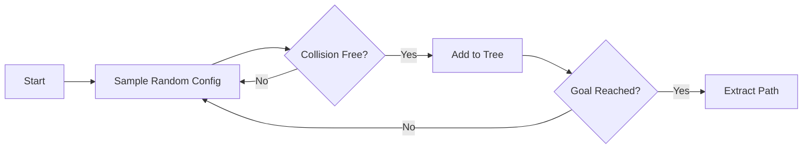
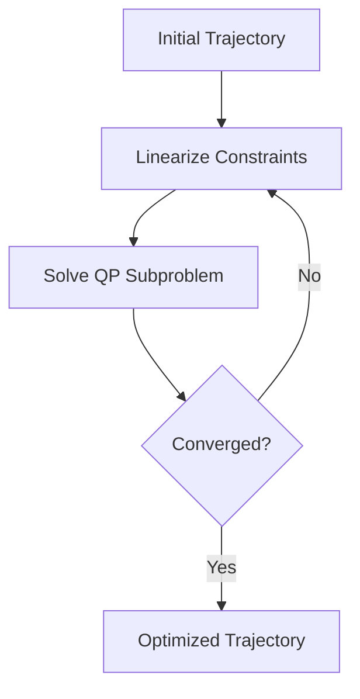
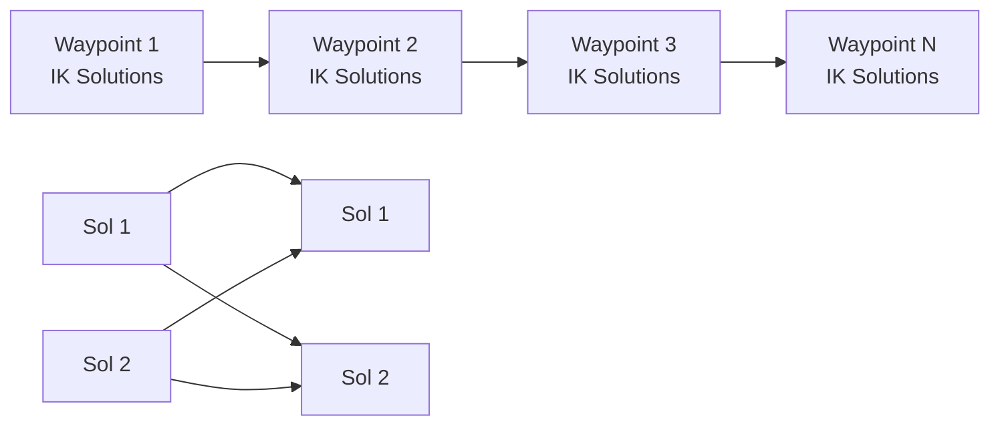

# Motion Planning

tesseract_robotics provides multiple motion planners for different use cases. The
high-level `tesseract_robotics.planning` API exposes three module-level entry
points — `plan_freespace`, `plan_ompl`, and `plan_cartesian` — each accepting a
`MotionProgram` describing the waypoints. Under the hood these dispatch to
`TaskComposer` pipelines, so you can drop down to `TaskComposer.plan(...)` when
you need a specific pipeline variant.

## Planner Comparison

| Planner | Type | Speed | Quality | Use Case |
|---------|------|-------|---------|----------|
| **OMPL** | Sampling | Medium | Good | Free-space, complex environments |
| **TrajOpt** | Optimization | Fast | Excellent | Cartesian paths, smoothing |
| **TrajOptIfopt** | SQP/OSQP | Very Fast | Excellent | Real-time replanning |
| **Descartes** | Graph Search | Slow | Optimal | Dense Cartesian toolpaths |
| **Simple** | Interpolation | Instant | N/A | Joint-space interpolation |

## Quick Planning

All three entry points take the same shape: a `Robot` plus a `MotionProgram` of
`JointTarget` / `CartesianTarget` waypoints.

=== "OMPL (Freespace)"

    `plan_ompl` defaults to the `FreespacePipeline` — OMPL RRTConnect for path
    finding, TrajOpt for smoothing, and time parameterization.

    ```python
    import numpy as np
    from tesseract_robotics.planning import (
        Robot, MotionProgram, JointTarget, plan_ompl,
    )

    locator = GeneralResourceLocator(paths=[get_tesseract_resource_path()])  # the [support] extra
    robot = Robot.from_tesseract_support("abb_irb2400", locator)
    program = (
        MotionProgram("manipulator", tcp_frame="tool0", working_frame="base_link")
        .move_to(JointTarget(np.zeros(6)))
        .move_to(JointTarget(np.array([0.5, -0.5, 0.5, 0.0, 0.5, 0.0])))
    )

    result = plan_ompl(robot, program)
    if result.successful:
        for state in result.trajectory:
            print(state.positions)
    ```

=== "TrajOpt (Freespace)"

    `plan_freespace` drives the `TrajOptPipeline` — pure optimization-based
    freespace planning. Ideal when the direct path is roughly correct and just
    needs smoothing plus collision margin enforcement.

    ```python
    from tesseract_robotics.planning import plan_freespace

    result = plan_freespace(robot, program)
    ```

=== "Cartesian (Descartes)"

    `plan_cartesian` drives the `DescartesDPipeline` — Descartes graph search for
    precise Cartesian paths, with TrajOpt smoothing. Use this when the program
    contains `CartesianTarget` waypoints and you need tool-pose accuracy.

    ```python
    from tesseract_robotics.planning import CartesianTarget, Pose, plan_cartesian

    program = (
        MotionProgram("manipulator", tcp_frame="tool0", working_frame="base_link")
        .move_to(CartesianTarget(Pose.from_xyz(0.5, -0.2, 0.5)))
        .linear_to(CartesianTarget(Pose.from_xyz(0.5, 0.2, 0.5)))
    )

    result = plan_cartesian(robot, program)
    ```

=== "Hybrid (OMPL + TrajOpt)"

    For hybrid planning (OMPL for global search, TrajOpt for local refinement)
    use the `FreespacePipeline` directly via `TaskComposer` — it chains OMPL,
    TrajOpt, and time parameterization in one call.

    ```python
    from tesseract_robotics.planning import TaskComposer

    composer = TaskComposer.from_config()
    result = composer.plan(robot, program, pipeline="FreespacePipeline")
    ```

    `plan_ompl(robot, program)` is a shortcut for exactly this pipeline.

## OMPL Planner

Sampling-based planner for complex environments:



### OMPL Profiles

Profiles control per-call planner behaviour. The `create_ompl_default_profiles`
helper packages sensible defaults (parallel RRTConnect with a 10 s budget):

```python
from tesseract_robotics.planning.profiles import create_ompl_default_profiles

profiles = create_ompl_default_profiles(
    planning_time=5.0,   # Max planning time (seconds)
    num_planners=4,      # Parallel RRTConnect instances
    max_solutions=10,    # Stop after this many solutions
    optimize=True,       # Continue improving until timeout
)

result = plan_ompl(robot, program, profiles=profiles)
```

For freespace-pipeline use (OMPL + TrajOpt together), use
`create_freespace_pipeline_profiles` — same arguments plus the TrajOpt smoothing
profile in the same dictionary.

### OMPL optimization objectives

With `optimize = True`, the OMPL planner re-solves until `planning_time` runs out,
`max_solutions` solutions exist, or the objective calls the best path good enough
(`objective.isSatisfied(cost)`). The default objective is joint-space path length with no
reachable threshold, so in practice the loop ends on time or count. A Python subclass of
`OMPLRealVectorMoveProfile` can supply its own objective by overriding
`createOptimizationObjective(si, env, manip)`; the planner calls it once per solve, and a
cost threshold on the returned objective ends the loop as soon as a path meets it (#362).

```python
from tesseract_robotics.tesseract_motion_planners_ompl import (
    Cost,
    MaximizeMinClearanceObjective,
    MultiOptimizationObjective,
    OMPLRealVectorMoveProfile,
    PathLengthOptimizationObjective,
)


class LengthAndClearance(OMPLRealVectorMoveProfile):
    def createOptimizationObjective(self, si, env, manip):
        objective = MultiOptimizationObjective(si)
        objective.addObjective(PathLengthOptimizationObjective(si), 1.0)
        objective.addObjective(MaximizeMinClearanceObjective(si), 0.5)
        objective.setCostThreshold(Cost(6.0))  # rad of joint-space path length
        return objective
```

Register the instance under `OMPL_DEFAULT_NAMESPACE` like any OMPL profile.

| Type | Role |
|---|---|
| `SpaceInformation` | the problem's OMPL space information; opaque, the objectives are built on it |
| `Cost` | a cost value: `Cost(2.0)`, `.value()` |
| `OptimizationObjective` | base: `isSatisfied`, `setCostThreshold`, `getCostThreshold`, `getDescription` |
| `PathLengthOptimizationObjective` | joint-space path length, the default |
| `MaximizeMinClearanceObjective` | maximise the smallest clearance along the path |
| `MechanicalWorkOptimizationObjective` | mechanical work, plus a small path-length term |
| `MultiOptimizationObjective` | weighted sum: `addObjective(objective, weight)` |

The override may return `None` for no objective; anything else that is not an
`OptimizationObjective` raises `OMPLObjectiveReturnTypeError` from `solve`. Objectives
cannot be subclassed in Python.

Measured on `freespace_clearance_objective_example.py` (the KUKA IIWA sweeps joint_a1
from -1.2 to 1.2 rad through six rotated cubes; `FreespaceIfoptPipeline`, two RRTConnect
planners, no solution-count exit, `planning_time = 10`, the profile helpers' default;
osx-arm64, three runs): the default objective took 13.2 to 13.9 s end to end, the 4.0 rad
threshold 1.7 to 2.1 s. The first paths RRTConnect finds there are 3.3 to 3.7 rad long.
On the sphere sweep of `freespace_hybrid_example.py`, with an infinite threshold the OMPL
solve alone returns in 0.2 s against 3.0 s for the default objective at
`planning_time = 3` (`tests/tesseract_motion_planners/test_ompl_objective.py`).

!!! warning "Clearance is not reported on this stack"
    tesseract's OMPL state validators do not implement `clearance()`, so OMPL's default,
    0, applies to every state and `MaximizeMinClearanceObjective` adds a constant. A
    clearance-weighted objective therefore optimizes path length alone until upstream
    reports clearance. Ending the loop on cost convergence (no improvement over the last
    `k` solutions) needs an upstream `OMPLSolverConfig` option, also tracked in #362.

### Available OMPL Planners

| Planner | Description |
|---------|-------------|
| `RRTConnect` | Bidirectional RRT (default, fast) |
| `RRT` | Single-tree RRT |
| `RRTstar` | Asymptotically optimal RRT |
| `PRM` | Probabilistic Roadmap |
| `LazyPRM` | Lazy collision checking PRM |
| `BKPIECE` | Bi-directional KPIECE |

Use `create_ompl_planner_configurators` to mix planner types inside one profile.

## TrajOpt Planner

Optimization-based planner using sequential convex optimization:



### TrajOpt Costs and Constraints

```python
from tesseract_robotics.tesseract_motion_planners_trajopt import (
    TrajOptDefaultMoveProfile,
    TrajOptDefaultCompositeProfile,
)
from tesseract_robotics.tesseract_collision import CollisionEvaluatorType

# Plan profile (per-waypoint settings)
plan_profile = TrajOptDefaultMoveProfile()
plan_profile.cartesian_constraint_config.enabled = True
plan_profile.cartesian_constraint_config.coeff = [5, 5, 5, 5, 5, 5]  # Position/orientation weights

# Composite profile (trajectory-wide settings)
composite_profile = TrajOptDefaultCompositeProfile()
composite_profile.collision_cost_config.enabled = True
composite_profile.collision_cost_config.contact_manager_config.default_margin = 0.025  # 2.5cm margin
composite_profile.collision_cost_config.collision_coeff_data.setDefaultCollisionCoeff(20.0)
composite_profile.collision_cost_config.collision_check_config.type = CollisionEvaluatorType.DISCRETE
composite_profile.smooth_velocities = True
composite_profile.smooth_accelerations = True
```

### Collision Configuration

```python
from tesseract_robotics.trajopt_ifopt import TrajOptCollisionConfig
from tesseract_robotics.tesseract_collision import CollisionEvaluatorType

# TrajOptCollisionConfig constructor: (margin, coeff) or default
collision_config = TrajOptCollisionConfig(0.025, 20.0)  # margin=2.5cm, coeff=20
collision_config.collision_margin_buffer = 0.005  # collect contacts 5mm past the margin
collision_config.collision_check_config.type = CollisionEvaluatorType.DISCRETE
collision_config.collision_check_config.longest_valid_segment_length = 0.05  # For LVS modes
```

`TrajOptCollisionConfig` lives in `trajopt_ifopt` (trajopt_common); import it from there.

The margin is the clearance the term drives toward; it lives in
`contact_manager_config.default_margin`, which the constructor's first argument sets.
`collision_margin_buffer` only widens the distance within which contacts are collected and
adds no error, so it cannot stand in for the margin. A default-constructed config has no
margin (`default_margin` is `None`): the term then engages only at contact, and TrajOpt
settles paths on the obstacle's surface, where a later contact check can reject them.

## Costs vs Constraints (Soft vs Hard)

TrajOpt distinguishes between **costs** (soft constraints) and **constraints** (hard constraints):

| Type | Behavior | Solver Treatment | Use When |
|------|----------|------------------|----------|
| **Cost** | Penalized, can be violated | Added to objective function | Preferences, nice-to-haves |
| **Constraint** | Must be satisfied exactly | Strict equality/inequality | Safety-critical requirements |

### When to Use Each

**Use Costs (Soft) for:**

- Collision avoidance during optimization (allows exploration)
- Smoothness objectives (velocity, acceleration, jerk)
- Preferred poses or configurations
- Joint centering (stay near middle of range)

**Use Constraints (Hard) for:**

- Final collision check (must be collision-free)
- Exact Cartesian poses (pick/place positions)
- Joint limits (physical limits)
- Orientation requirements (e.g., tool must be vertical)

### Example: Collision as Cost vs Constraint

```python
from tesseract_robotics.tesseract_motion_planners_trajopt import (
    TrajOptDefaultCompositeProfile,
)
from tesseract_robotics.tesseract_collision import CollisionEvaluatorType

profile = TrajOptDefaultCompositeProfile()

# SOFT: Collision as cost - allows temporary violations during optimization
# Good for finding paths through tight spaces
profile.collision_cost_config.enabled = True
profile.collision_cost_config.contact_manager_config.default_margin = 0.025  # 2.5cm
profile.collision_cost_config.collision_coeff_data.setDefaultCollisionCoeff(20.0)
profile.collision_cost_config.collision_check_config.type = CollisionEvaluatorType.DISCRETE

# HARD: Collision as constraint - must be satisfied at solution
# Guarantees collision-free result (but may fail to find solution)
profile.collision_constraint_config.enabled = True
profile.collision_constraint_config.contact_manager_config.default_margin = 0.01  # 1cm (tighter)
profile.collision_constraint_config.collision_check_config.type = CollisionEvaluatorType.DISCRETE
```

!!! tip "Recommended Pattern"
    Use **both** cost and constraint:

    1. Cost with larger margin (2.5cm) guides optimization away from obstacles
    2. Constraint with tighter margin (1cm) ensures final solution is collision-free

    The cost helps the optimizer explore, while the constraint guarantees safety.

### Example: Cartesian Pose as Cost vs Constraint

```python
from tesseract_robotics.tesseract_motion_planners_trajopt import TrajOptDefaultMoveProfile

plan_profile = TrajOptDefaultMoveProfile()

# SOFT: Cartesian cost - "try to reach this pose"
# Useful when exact pose isn't critical
plan_profile.cartesian_cost_config.enabled = True
plan_profile.cartesian_cost_config.coeff = [10, 10, 10, 5, 5, 5]  # xyz, rpy weights

# HARD: Cartesian constraint - "must reach this exact pose"
# Required for pick/place operations
plan_profile.cartesian_constraint_config.enabled = True
plan_profile.cartesian_constraint_config.coeff = [1, 1, 1, 1, 1, 1]
```

### Coefficient Interpretation

The `coeff` values control how strongly violations are penalized:

- **Higher coefficient** = stronger penalty = more important to satisfy
- **Lower coefficient** = weaker penalty = more flexibility allowed

```python
# Position matters more than orientation
plan_profile.cartesian_cost_config.coeff = [100, 100, 100, 1, 1, 1]

# Rotation around Z is free (e.g., symmetric tool)
plan_profile.cartesian_cost_config.coeff = [10, 10, 10, 10, 10, 0]
```

!!! warning "Hard Constraints Can Cause Failures"
    Over-constraining a problem makes it harder (or impossible) to solve:

    - Start with costs only, verify solution quality
    - Add constraints incrementally
    - If planning fails, check if constraints are feasible

## Descartes Planner

Graph-search planner for dense Cartesian toolpaths:



Best for:

- Welding paths
- Painting trajectories
- Machining toolpaths

```python
from tesseract_robotics.planning.profiles import create_descartes_default_profiles

profiles = create_descartes_default_profiles(
    enable_collision=True,        # Check vertex (waypoint) collisions
    enable_edge_collision=False,  # Check transition collisions (slower)
    num_threads=4,                # Parallel IK solving
)

result = plan_cartesian(robot, program, profiles=profiles)
```

!!! note "Two scalar types"
    `plan_cartesian`'s `DescartesDPipeline` runs Descartes on `double` states and reads the `D`
    profiles; `CartesianPipeline`, `DescartesFPipeline` and every raster pipeline run it on
    `float` states and read the `F` ones. The helpers register both, and `TaskComposer.plan`
    raises `ProfileTypeMismatchError` if a pipeline would find only the other type (see the
    [Descartes API page](../api/tesseract_motion_planners_descartes.md#scalar-types-d-and-f)).

### Custom Edge / State Evaluators in Python

When the default cost function (joint-space distance) does not fully satisfy your
requirements, you can subclass the evaluator interfaces directly in Python to
tweak how Descartes picks the right IK branch. Examples include penalizing wrist
flips, weighting specific joints, or scoring edges using an external signal.

The three extension points are:

| Class | Override | When it runs |
|-------|----------|--------------|
| `DescartesWaypointSamplerD` | `sample() -> list[DescartesStateSampleD]` | Generating IK candidates for a waypoint |
| `DescartesEdgeEvaluatorD` | `evaluate(start, end) -> (valid, cost)` | Edge between two graph states |
| `DescartesStateEvaluatorD` | `evaluate(state) -> (valid, cost)` | Per-state cost |

Each has an `F` twin (`DescartesEdgeEvaluatorF`, …) on `float32` states. Use the type of the
pipeline you plan with: `D` for `DescartesDPipeline` (the `plan_cartesian` default), `F` for
`CartesianPipeline`, `DescartesFPipeline` and the raster pipelines. The example below is `D`;
replace every `D` suffix with `F` for the others.

To inject them into the planner, subclass `DescartesMoveProfileD` and
return your custom objects from the three factory methods. Delegate the
ones you don't want to customize to an inner `DescartesDefaultMoveProfileD`:

```python
import numpy as np
from tesseract_robotics.tesseract_motion_planners_descartes import (
    DescartesDefaultMoveProfileD,
    DescartesEdgeEvaluatorD,
    DescartesMoveProfileD,
)

class WristFlipPenaltyEvaluator(DescartesEdgeEvaluatorD):
    """Cost = L2 joint delta + large penalty for >90 deg wrist swing."""

    def evaluate(self, start, end):
        delta = end.values - start.values
        cost = float(np.linalg.norm(delta))
        if abs(delta[-1]) > np.pi / 2:   # wrist joint flip
            return (False, cost)         # reject this edge
        return (True, cost)


class MyMoveProfile(DescartesMoveProfileD):
    def __init__(self):
        super().__init__()
        self._inner = DescartesDefaultMoveProfileD()
        # Hold evaluators on self so the planner sees the same instance
        # across all edge evaluations.
        self._edge_evaluator = WristFlipPenaltyEvaluator()

    def createWaypointSampler(self, move_instruction, composite_manip_info, env):
        return self._inner.createWaypointSampler(move_instruction, composite_manip_info, env)

    def createEdgeEvaluator(self, move_instruction, composite_manip_info, env):
        return self._edge_evaluator

    def createStateEvaluator(self, move_instruction, composite_manip_info, env):
        return self._inner.createStateEvaluator(move_instruction, composite_manip_info, env)
```

The `start` and `end` arguments to `evaluate` are `DescartesStateD`
objects with a `.values` attribute that is a 1-D numpy array of joint
positions in the manipulator's joint order.

Then, register the profile in the `ProfileDictionary` the same way you would a
C++ profile; `addProfile` takes the Python subclass directly. Register it yourself:
`create_descartes_default_profiles(move_profile=...)` refuses a subclass, because its hooks
have no twin of the other scalar type.

```python
from tesseract_robotics.tesseract_command_language import ProfileDictionary

profiles = ProfileDictionary()
profiles.addProfile(
    "DescartesMotionPlannerTask",          # namespace
    "MY_PROFILE",                          # profile name (referenced by MoveInstruction)
    MyMoveProfile(),
)
```

!!! warning "Threading and the GIL"
    Each call back into Python acquires the GIL, so OpenMP-parallel
    edge evaluation inside Descartes is serialized through your Python
    evaluator. If you set `num_threads > 1`, the cost computation
    itself runs single-threaded — only IK sampling parallelizes. Keep
    the Python evaluate body tight (numpy ops, no allocations) for best
    throughput.

    On macOS, `num_threads > 1` may not be available at all: a wheel
    installed into a conda or pixi environment brings a second OpenMP
    runtime, and the ladder solver segfaults above one thread. See
    [macOS Wheel Gotchas](../developer/macos-wheels.md).

!!! warning "With vertex collision on, a Descartes solve is dominated by setup, not search"
    Building each waypoint's sampler constructs a `DescartesCollision`, which
    clones the environment's Bullet contact manager — and a Bullet clone
    rebuilds and zero-fills its pool allocators. A `sample` profile of
    `DescartesMotionPlannerD.solve` on a 419-waypoint contour
    (`abb_irb2400`, redundant solutions on) puts ~97 % of the solve there,
    serially on the calling thread, before the parallel ladder build starts;
    the OpenMP workers wait throughout.

    | Vertex collision | Threads | Wall | CPU / wall |
    |---|---|---|---|
    | on | 1 | 435.4 ms | 1.00 |
    | on | 8 | 432.3 ms | 1.02 |
    | off | 1 | 2.7 ms | 1.00 |
    | off | 8 | 1.9 ms | 1.78 |

    So `num_threads` changes nothing measurable while vertex collision is
    on, and the graph search itself is cheap. Turning vertex collision off
    needs `allow_collision = True` as well, or the planner refuses for want
    of a checker — and then collisions must be checked elsewhere, for
    instance by the pipeline's own `DiscreteContactCheckTask`.

    **Workaround: smaller Bullet pools.** A clone's cost is Bullet's pool
    allocators, sized by default for a physics world (4096 persistent
    manifolds, 4096 collision algorithms; ~7 MiB per clone). The Bullet
    plugins read both sizes from their config, so set them in the
    contact-manager plugin YAML your SRDF points to:

    ```yaml
    contact_manager_plugins:
      discrete_plugins:
        default: BulletDiscreteBVHManager
        plugins:
          BulletDiscreteBVHManager:
            class: BulletDiscreteBVHManagerFactory
            config:
              max_persistent_manifold_pool_size: 16
              max_collision_algorithm_pool_size: 16
    ```

    Pool size is capacity, not semantics: the contacts are the same
    (`tests/tesseract_collision/test_bullet_pool_config.py`). Measured in
    [#140](https://github.com/tesseract-robotics/tesseract_nanobind/issues/140)
    (0.35.0.7, macOS arm64):

    | Scene | Planner | Default pools (4096/4096) | 16/16 pools | Output |
    |---|---|---|---|---|
    | free space, 419 wp | Descartes | 413 ms, +2922 MiB peak RSS | 17.8 ms, +30 MiB | identical joints |
    | `docs/assets/sample.ply` octree (333 boxes), tool 5 cm above, 210 wp | Descartes | 247 ms | 43 ms | identical joints |
    | same scan at 1 cm (4021 boxes), edge collision on | Descartes | 6.6 s | 5.6 s | identical joints |
    | BasicCartesianExample, C++ example's octomap | TrajOpt | 60 ms, +404 MiB | 38 ms, +8 MiB | both plan |

    The per-waypoint clones themselves are upstream's: TrajOpt's are
    tesseract-robotics/trajopt#625 (fix in tesseract_planning#789);
    Descartes's have no upstream issue yet.

!!! tip "Use for joint-continuity across rasters"
    A custom edge evaluator is the cleanest way to globally enforce
    IK-branch consistency across an entire raster program — the raster
    pipeline itself does **not** backtrack on a downstream transition
    failure, so picking compatible IK solutions during Descartes is the
    only reliable solution.

## Profiles from YAML

Every planner profile with a C++ YAML constructor has a static `from_yaml(text)`. It parses the
YAML text with the profile's own C++ reader, so the keys are the C++ field names. Keys left out
keep the profile's defaults. Malformed YAML raises `ValueError`; a value of the wrong type raises
the C++ reader's error.

=== "Simple"

    ```python
    from tesseract_robotics.tesseract_motion_planners_simple import SimplePlannerLVSMoveProfile

    profile = SimplePlannerLVSMoveProfile.from_yaml("min_steps: 4\n")
    assert profile == SimplePlannerLVSMoveProfile(min_steps=4)
    ```

=== "OMPL"

    ```python
    from tesseract_robotics.tesseract_motion_planners_ompl import OMPLRealVectorMoveProfile

    profile = OMPLRealVectorMoveProfile.from_yaml("solver_config:\n  planning_time: 3.5\n")
    assert profile.solver_config.planning_time == 3.5
    ```

    A nested key replaces that sub-config, built from its own defaults: `solver_config:` starts
    with no planners, so add them with `profile.solver_config.addPlanner(...)`.

=== "TrajOpt"

    ```python
    from tesseract_robotics.tesseract_motion_planners_trajopt import (
        TrajOptDefaultCompositeProfile,
        TrajOptDefaultMoveProfile,
        TrajOptOSQPSolverProfile,
    )

    move = TrajOptDefaultMoveProfile.from_yaml("joint_cost_config:\n  enabled: true\n")
    composite = TrajOptDefaultCompositeProfile.from_yaml("avoid_singularity_coeff: 7.5\n")
    solver = TrajOptOSQPSolverProfile.from_yaml("settings:\n  max_iter: 321\n")
    assert move.joint_cost_config.enabled
    assert composite.avoid_singularity_coeff == 7.5
    assert solver.settings.max_iter == 321
    ```

    `settings:` and `opt_params:` merge into the solver profile's values: keys left out keep them.

=== "TrajOpt-Ifopt"

    ```python
    from tesseract_robotics.tesseract_motion_planners_trajopt_ifopt import (
        TrajOptIfoptDefaultCompositeProfile,
        TrajOptIfoptOSQPSolverProfile,
    )

    composite = TrajOptIfoptDefaultCompositeProfile.from_yaml("smooth_jerks: false\n")
    solver = TrajOptIfoptOSQPSolverProfile.from_yaml("opt_params:\n  max_iter: 7\n")
    assert not composite.smooth_jerks
    assert solver.opt_params.max_iter == 7
    ```

=== "Task composer"

    ```python
    from tesseract_robotics.tesseract_task_composer_planning import (
        MinLengthProfile,
        UpsampleTrajectoryProfile,
    )

    assert MinLengthProfile.from_yaml("min_length: 99\n").min_length == 99
    upsample = UpsampleTrajectoryProfile.from_yaml("longest_valid_segment_length: 0.7\n")
    assert upsample.longest_valid_segment_length == 0.7
    ```

The Descartes profiles have no YAML constructor upstream, so they have no `from_yaml`. Put a
loaded profile in a `ProfileDictionary` with `addProfile`, as any other profile.

## Motion Types

Motion type is set via the `MotionProgram` builder methods:

### Freespace Motion

Any collision-free path between configurations. Use `move_to(...)`:

```python
program.move_to(JointTarget(joint_values))
program.move_to(CartesianTarget(pose))  # freespace to pose
```

### Linear Motion

Straight-line Cartesian path. Use `linear_to(...)`:

```python
program.linear_to(CartesianTarget(pose))
```

!!! warning "Linear Motion Requirements"
    Linear motion requires:

    - Reachable start and end poses
    - Collision-free swept volume
    - Within joint velocity limits

### Circular Motion

Arc motion (specialized planners). Use `circular_to(...)`:

```python
program.circular_to(CartesianTarget(pose))
```

## Standard toolpaths

`tesseract_robotics.planning.toolpaths` has fixed, parametric toolpaths, so a new
solver, constraint or emitter is judged on the same path every time, the way
image processing uses one test image (#84). Each factory returns a `list[Pose]`
in the working frame; profiles and move types stay with the caller.

| Factory | Shape | Poses | Used by |
|---|---|---|---|
| `zigzag_square()` | 1 m × 1 m square outline at z = 0.5 m, then 11 zigzag lines at 0.1 m spacing | `OUTLINE_POSE_COUNT + 2 * ZIGZAG_LINE_COUNT` = 27 | the RAPID golden test (`tests/emitters/rapid/test_zigzag_square.py`) |
| `circle(radius_m, n_waypoints, center=, z_m=)` | horizontal circle, tool down, evenly spaced, counter-clockwise from `+X`, start not repeated | `n_waypoints` (≥ 3) | the Descartes pool measurements of #140 (84 to 419 waypoints on the IRB 2400) |

```python
from tesseract_robotics.planning import CartesianTarget, MotionProgram
from tesseract_robotics.planning.toolpaths import OUTLINE_POSE_COUNT, circle, zigzag_square

program = MotionProgram("manipulator", tcp_frame="tool0", working_frame="base_link")
for i, pose in enumerate(zigzag_square()):
    program.linear_to(CartesianTarget(pose, profile="OUTLINE" if i < OUTLINE_POSE_COUNT else "RASTER"))

contour = circle(0.25, 210, center=(0.8, 0.0), z_m=0.6)
```

`tests/conftest.py` serves the zigzag square as the `zigzag_square_poses` fixture.

!!! warning "The zigzag square is not tool down"
    Its orientation, `ZIGZAG_QUAT_XYZW = (0, 0, 1, 0)`, is 180° about world Z,
    so the TCP z-axis stays on world +Z. It reads like Eigen's scalar-first
    `Quaterniond(0, 0, 1, 0)` (180° about Y, tool down) taken as scalar-last.
    The RAPID golden locks it, so it stays until that golden is regenerated on
    purpose. `circle` uses the real tool-down orientation, `TOOL_DOWN_QUAT_XYZW
    = (1, 0, 0, 0)`.

## Program Structure

Use the `MotionProgram` builder — it handles all the poly-type wrapping
automatically. For reference, the equivalent low-level call would be:

```python
from tesseract_robotics.tesseract_command_language import (
    CartesianWaypoint, CartesianWaypointPoly,
    CompositeInstruction, MoveInstruction, MoveInstructionType,
    MoveInstructionPoly,
)

composite = CompositeInstruction("DEFAULT")
for pose in waypoints:
    wp = CartesianWaypointPoly(CartesianWaypoint(pose))
    instr = MoveInstructionPoly(
        MoveInstruction(wp, MoveInstructionType.LINEAR, "DEFAULT")
    )
    composite.push_back(instr)
```

The `MotionProgram` fluent API builds exactly the same structure with far less
ceremony, and the planning entry points accept either form.

## Frames and the TCP

A `MotionProgram` names its frames; the planning API never picks one for you:

| Argument | Meaning | ABB IRB2400 example |
|---|---|---|
| `tcp_frame` (required) | the link the TCP is attached to | `"tool0"` |
| `working_frame` (required) | the link `CartesianTarget` poses are relative to | `"base_link"` |
| `tcp_offset` (keyword, optional) | offset from `tcp_frame`: a named TCP or an `Isometry3d` | `"laser"` |

The planner puts the tool, `T(tcp_frame) * tcp_offset`, on each Cartesian target. A named
offset is resolved by the environment at plan time, first from the SRDF `group_tcps` of the
program's group, then from find-TCP callbacks; a link name there is an error (use it as
`tcp_frame`). The full rule, with upstream sources, is under
[TCP offsets](../api/tesseract_environment.md#tcp-offsets); the SRDF side is under
[Named TCPs](../api/tesseract_srdf.md#named-tcps-group_tcps).

```python
import numpy as np
from tesseract_robotics.planning import CartesianTarget, MotionProgram, Pose
from tesseract_robotics.tesseract_common import Isometry3d

# a named TCP from abb_irb2400.srdf's <group_tcps group="manipulator">
welder = MotionProgram("manipulator", tcp_frame="tool0", working_frame="base_link", tcp_offset="welder")

# or an explicit offset: a tool 10 cm along tool0's z axis
offset = np.eye(4)
offset[2, 3] = 0.10
program = MotionProgram(
    "manipulator", tcp_frame="tool0", working_frame="base_link", tcp_offset=Isometry3d(offset)
).move_to(CartesianTarget(Pose.from_xyz(0.8, 0.0, 1.0)))
```

`Robot.get_manipulator_info(group, tcp_frame, working_frame, tcp_offset=...)` builds the same
`ManipulatorInfo` for the low-level API. `Robot.fk` / `Robot.ik` take a link (`tip_link`), not
a named TCP: apply or strip the offset yourself (see
[Tool Frames](kinematics.md#tool-frames)).

## Planning with Constraints

### Orientation Constraints

Keep end-effector upright (e.g., carrying a glass). The `UPRIGHT` profile is
pre-baked by `create_trajopt_upright_profiles`:

```python
from tesseract_robotics.planning.profiles import create_trajopt_upright_profiles

profiles = create_trajopt_upright_profiles()
result = plan_freespace(robot, program, profiles=profiles)
```

Equivalent manual setup:

```python
# In TrajOpt plan profile — position free (0), orientation constrained (5)
plan_profile.cartesian_constraint_config.coeff = [0, 0, 0, 5, 5, 5]
```

### Joint Constraints

Weight individual joints to lock or favour them:

```python
# High weight on joint 1 - strongly discouraged from moving
plan_profile.joint_constraint_config.coeff = [100, 1, 1, 1, 1, 1]
```

## Handling Planning Failures

Each debug step below plans again, so hold one composer and pass it to every
call; without `composer=`, each call reloads the task composer plugins.

```python
from tesseract_robotics.planning import (
    TaskComposer, plan_cartesian, plan_freespace, plan_ompl,
)

composer = TaskComposer.from_config()
result = plan_freespace(robot, program, composer=composer)

if not result.successful:
    print(f"Planning failed: {result.message}")

    # Debug strategies:

    # 1. Check if start/goal are collision-free
    from tesseract_robotics.tesseract_collision import (
        ContactRequest, ContactResultMap, ContactTestType,
    )
    manager = robot.env.getDiscreteContactManager()
    manager.setActiveCollisionObjects(robot.env.getActiveLinkIds())
    manager.setCollisionObjectsTransform(robot.env.getState().link_transforms)
    contacts = ContactResultMap()
    manager.contactTest(contacts, ContactRequest(ContactTestType.ALL))
    print(f"Collision-free: {contacts.size() == 0}")

    # 2. Try a different backend
    result = plan_ompl(robot, program, composer=composer)       # sampling-based (OMPL + TrajOpt)
    result = plan_cartesian(robot, program, composer=composer)  # graph search (Descartes)

    # 3. Increase planning time on OMPL
    from tesseract_robotics.planning.profiles import create_ompl_default_profiles
    profiles = create_ompl_default_profiles(planning_time=30.0)
    result = plan_ompl(robot, program, profiles=profiles, composer=composer)
```

## Trajectory Output

```python
if result.successful:
    print(f"Waypoints: {len(result.trajectory)}")

    for i, state in enumerate(result.trajectory):
        print(f"  [{i}] positions:     {state.positions}")
        print(f"       velocities:    {state.velocities}")
        print(f"       accelerations: {state.accelerations}")
        print(f"       time:          {state.time}")
```

Each `TrajectoryPoint` carries `joint_names`, `positions`, and optionally
`velocities`, `accelerations`, and `time` (time from start, seconds). Velocities
and timing are populated by pipelines that include time parameterization
(`FreespacePipeline`, `CartesianPipeline`, etc.); pure OMPL output has positions
only. `result.to_numpy()` returns an `(N, num_joints)` array of positions.

## Performance Tips

!!! tip "Warm-Start via FreespacePipeline"
    The `FreespacePipeline` (what `plan_ompl` runs by default) already does
    warm-start internally: OMPL finds a feasible path, TrajOpt then refines it
    in the same call. If you only need a sampling solution, pass
    `pipeline="OMPLPipeline"` to drop the TrajOpt step.

    ```python
    from tesseract_robotics.planning import TaskComposer, plan_ompl

    composer = TaskComposer.from_config()

    # Default: OMPL + TrajOpt refinement
    result = plan_ompl(robot, program, composer=composer)

    # Raw OMPL output (no refinement)
    result = plan_ompl(robot, program, pipeline="OMPLPipeline", composer=composer)
    ```

!!! tip "Hold and Pre-Load One Composer"
    Every `TaskComposer.from_config()` loads the task composer plugins, about
    4.3 s on macOS arm64, and a `plan_*()` call without `composer=` builds a
    new one each time. Build one composer at startup, warm the pipelines you
    will run, and pass it to every call. A warmup only pays off on the composer
    that then plans: a 419-waypoint Descartes solve takes 0.47 s through a held,
    warmed composer versus about 5 s through `plan_cartesian` without one (#137).

    ```python
    from tesseract_robotics.planning import TaskComposer, plan_cartesian, plan_ompl

    composer = TaskComposer.from_config(warmup=["FreespacePipeline", "DescartesDPipeline"])

    result = plan_ompl(robot, program, composer=composer)       # FreespacePipeline
    result = plan_cartesian(robot, program, composer=composer)  # DescartesDPipeline
    ```

!!! tip "Cache the Composer and the Profiles"
    For repeated plans, hold both the composer and the `ProfileDictionary`.
    The composer is the large saving: it skips the plugin load (about 4.3 s on
    macOS arm64) that every `plan_*()` call without `composer=` repeats.
    Caching profiles saves the work the profile factory helpers do to build
    them, which is far smaller; on its own it leaves the plugin load in every
    call.

    ```python
    from tesseract_robotics.planning import TaskComposer, plan_ompl
    from tesseract_robotics.planning.profiles import (
        create_freespace_pipeline_profiles,
    )

    # Create once
    composer = TaskComposer.from_config(warmup=["FreespacePipeline"])
    freespace_profiles = create_freespace_pipeline_profiles()

    # Reuse for all plans
    for program in programs:
        result = plan_ompl(robot, program, profiles=freespace_profiles, composer=composer)
    ```

## Next Steps

- [Task Composer](task-composer.md) - Complex multi-step planning
- [Low-Level SQP](low-level-sqp.md) - Real-time trajectory optimization
