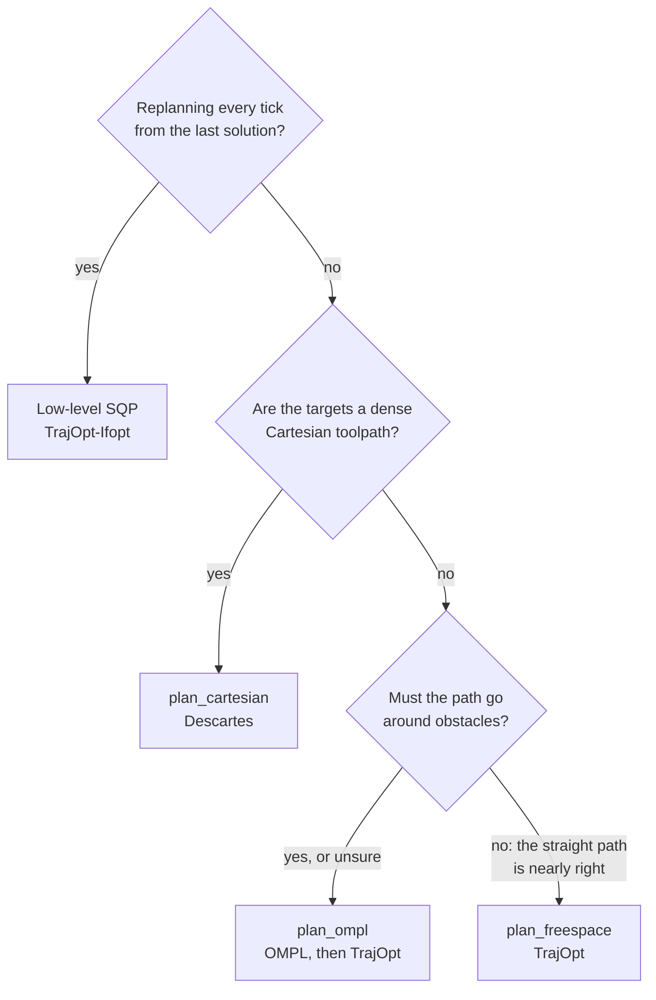
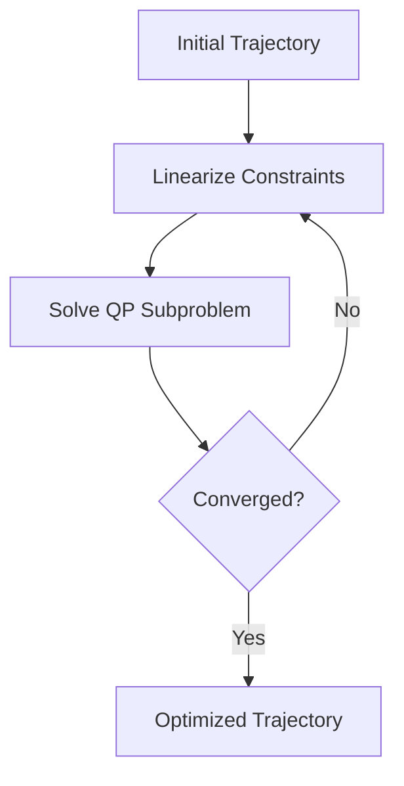
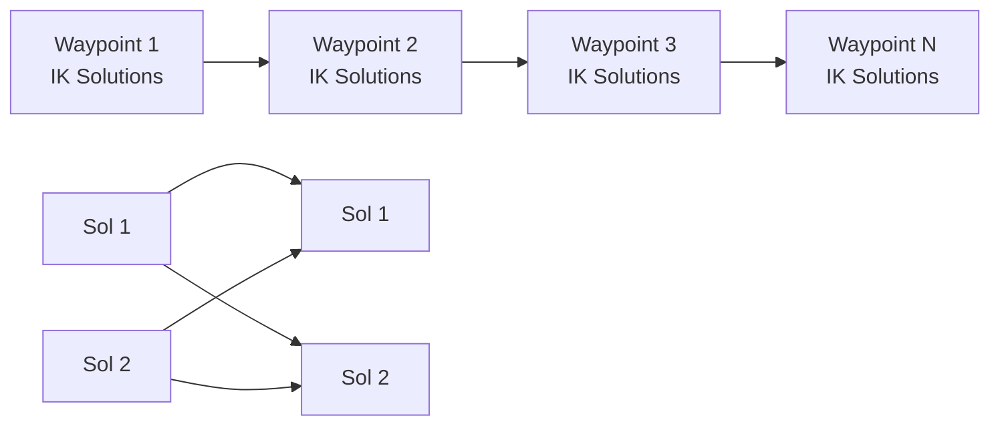

# Motion planning

<!-- snippet: ambient
from tesseract_robotics.planning import JointTarget, MotionProgram, Pose

joint_values = np.zeros(6)
pose = Pose.from_xyz_quat(0.8, -0.2, 0.8, 0.0, -1.0, 0.0, 0.0)
program = (
    MotionProgram("manipulator", tcp_frame="tool0", working_frame="base_link")
    .set_joint_names(robot.get_joint_names("manipulator"))
    .move_to(JointTarget(joint_values))
    .move_to(JointTarget(np.full(6, 0.2)))
)
programs = [program]
waypoints = [pose]
-->

A planner turns a program, a list of waypoints, into a collision-free trajectory. Four planner
families are bound, each with different guarantees; the `planning` module wraps the common
cases in three calls, `plan_freespace`, `plan_ompl` and `plan_cartesian`, that run a whole
task composer pipeline: plan, check collisions, time-parameterize. This page covers choosing a
planner, the settings that matter for each, costs and constraints, and what to do when a plan
fails.

## Choosing a planner



| Planner | Kind | Use for | What it guarantees |
| --- | --- | --- | --- |
| OMPL | sampling | free space among obstacles | probabilistically complete: finds a path if one exists, given enough time; nothing within a fixed time |
| TrajOpt | sequential convex optimization | smoothing, Cartesian paths, constraints | a local optimum of the costs; constraints hold where they are evaluated |
| TrajOpt-Ifopt | SQP with OSQP | replanning from a warm start | as TrajOpt |
| Descartes | graph search over IK solutions | dense Cartesian toolpaths | the minimum-cost path through the sampled solutions: optimal for that discretization, not for the continuous problem |
| Simple | interpolation | seeds, joint moves | none; no collision checking |

On one freespace problem, measured:

<figure markdown>


<figcaption markdown="span">On upstream's freespace example (IIWA 14, joint_a1 −0.4 → 0.4 rad past a 0.15 m sphere), TrajOpt and OMPL + TrajOpt find the same short path (median 0.86 rad, 0.46 m of TCP travel, 5 mm clearance: TrajOpt's safety margin); raw OMPL (first RRTConnect solution, no smoothing) travels 5.8 rad and keeps 25 mm; TrajOptIfopt converges to a longer path (1.75 rad). Planner-node times differ by 10×, from 5 ms (TrajOptIfopt) to 65 ms (OMPL + TrajOpt), but each whole pipeline takes about 0.5 s, dominated by its other tasks. N = 20 seeds, one process each, first plan after `TaskComposer.warmup`, OMPL with one planner thread; Apple M1 Max (10 logical CPUs), macOS 15.3.2, 1-min load 20 during the run (other work on the host: absolute times are pessimistic). Descartes is not compared: it follows Cartesian paths and has no joint-to-joint query. Data: `docs/assets/figures/data/planner_comparison.json` (hardware, OS, library build, git commit, seeds, raw rows). Re-measure: `pixi run docs-figures-measure planner_comparison`, then `pixi run docs-figures planner_comparison`.</figcaption>
</figure>

## Plan with the high-level calls

All three calls take a `Robot` and a `MotionProgram`, and return a `PlanningResult`. Each loads
the planning plugins unless you pass `composer=`; hold one `TaskComposer` when you plan more than
once ([Plugin warmup](task-composer.md#plugin-warmup)).

=== "plan_ompl"

    `FreespacePipeline`: parallel RRTConnect finds a path, TrajOpt smooths it, a discrete contact
    check validates it and iterative spline parameterization times it.

    ```python
    import numpy as np
    from tesseract_robotics.planning import (
        Robot, MotionProgram, JointTarget, plan_ompl,
    )

    locator = GeneralResourceLocator(paths=[get_tesseract_resource_path()])  # the [support] extra
    robot = Robot.from_tesseract_support("abb_irb2400", locator)
    program = (
        MotionProgram("manipulator", tcp_frame="tool0", working_frame="base_link")
        .move_to(JointTarget(np.zeros(6)))
        .move_to(JointTarget(np.array([0.5, -0.5, 0.5, 0.0, 0.5, 0.0])))
    )

    result = plan_ompl(robot, program)
    if result.successful:
        for state in result.trajectory:
            print(state.positions)
    ```

=== "plan_freespace"

    `TrajOptPipeline`: TrajOpt optimizes the program, then the same contact check and time
    parameterization run. TrajOpt is a local method: use it when the straight path is nearly
    collision-free.

    ```python
    from tesseract_robotics.planning import plan_freespace

    result = plan_freespace(robot, program)
    ```

=== "plan_cartesian"

    `DescartesDPipeline`: Descartes searches the IK solutions of every Cartesian waypoint for the
    cheapest joint path, then the contact check and time parameterization run. Use it when the
    program is a sequence of `CartesianTarget` poses the tool must hit.

    ```python
    from tesseract_robotics.planning import CartesianTarget, Pose, plan_cartesian

    program = (
        MotionProgram("manipulator", tcp_frame="tool0", working_frame="base_link")
        .move_to(CartesianTarget(Pose.from_xyz(0.5, -0.2, 0.5)))
        .linear_to(CartesianTarget(Pose.from_xyz(0.5, 0.2, 0.5)))
    )

    result = plan_cartesian(robot, program)
    ```

`TaskComposer.plan(robot, program, pipeline=...)` runs any other pipeline by name.

## OMPL

### OMPL profiles

Profiles control per-call planner behaviour. The `create_ompl_default_profiles`
helper packages sensible defaults (parallel RRTConnect with a 10 s budget):

```python
from tesseract_robotics.planning.profiles import create_ompl_default_profiles

profiles = create_ompl_default_profiles(
    planning_time=5.0,   # Max planning time (seconds)
    num_planners=4,      # Parallel RRTConnect instances
    max_solutions=10,    # Stop after this many solutions
    optimize=True,       # Continue improving until timeout
)

result = plan_ompl(robot, program, profiles=profiles)
```

For freespace-pipeline use (OMPL + TrajOpt together), use
`create_freespace_pipeline_profiles` — same arguments plus the TrajOpt smoothing
profile in the same dictionary.

### OMPL optimization objectives

With `optimize = True`, the OMPL planner re-solves until `planning_time` runs out,
`max_solutions` solutions exist, or the objective calls the best path good enough
(`objective.isSatisfied(cost)`). The default objective is joint-space path length with no
reachable threshold, so in practice the loop ends on time or count. A Python subclass of
`OMPLRealVectorMoveProfile` can supply its own objective by overriding
`createOptimizationObjective(si, env, manip)`; the planner calls it once per solve, and a
cost threshold on the returned objective ends the loop as soon as a path meets it (#362).

```python
from tesseract_robotics.motion_planners_ompl import (
    Cost,
    MaximizeMinClearanceObjective,
    MultiOptimizationObjective,
    OMPLRealVectorMoveProfile,
    PathLengthOptimizationObjective,
)


class LengthAndClearance(OMPLRealVectorMoveProfile):
    def createOptimizationObjective(self, si, env, manip):
        objective = MultiOptimizationObjective(si)
        objective.addObjective(PathLengthOptimizationObjective(si), 1.0)
        objective.addObjective(MaximizeMinClearanceObjective(si), 0.5)
        objective.setCostThreshold(Cost(6.0))  # rad of joint-space path length
        return objective
```

Register the instance under `OMPL_DEFAULT_NAMESPACE` like any OMPL profile.

| Type | Role |
|---|---|
| `SpaceInformation` | the problem's OMPL space information; opaque, the objectives are built on it |
| `Cost` | a cost value: `Cost(2.0)`, `.value()` |
| `OptimizationObjective` | base: `isSatisfied`, `setCostThreshold`, `getCostThreshold`, `getDescription` |
| `PathLengthOptimizationObjective` | joint-space path length, the default |
| `MaximizeMinClearanceObjective` | maximise the smallest clearance along the path |
| `MechanicalWorkOptimizationObjective` | mechanical work, plus a small path-length term |
| `MultiOptimizationObjective` | weighted sum: `addObjective(objective, weight)` |
| `StateCostIntegralObjective` | integral of a per-state cost; subclass it to price states in Python |

The override may return `None` for no objective; anything else that is not an
`OptimizationObjective` raises `OMPLObjectiveReturnTypeError` from `solve`, and a Python
error raised in it propagates from `solve` as itself. Of the objectives, only
`StateCostIntegralObjective` can be subclassed in Python (see below).

Measured on `freespace_clearance_objective_example.py` (the KUKA IIWA sweeps joint_a1
from -1.2 to 1.2 rad through six rotated cubes; `FreespaceIfoptOMPLOutputPipeline`, the report's copy of
`FreespaceIfoptPipeline` that also keeps OMPL's program; two RRTConnect
planners, no solution-count exit, `planning_time = 10`, the profile helpers' default;
osx-arm64, one run of 10 seeds, both cases at the helpers' 10 mm OMPL collision margin): the default
objective took 12.11 to 13.83 s end to end, the 4.0 rad threshold 1.27 to 2.26 s
([per-seed table](../examples/ompl.md#per-seed); timings are load-sensitive). The first path
RRTConnect finds there usually meets the threshold already, so the loop usually ends at the
first solution. With one planner (reproducible on a seed, `pixi run ompl-first-path-probe`)
that solution is the path `optimize = False` returns on 4 of 5 seeds; on the fifth the
first path is 4.21 rad, and the planner re-solved and found a 3.95 rad path, which ended the loop.
With the example's two planners (seeds 1 to 3, both modes) 1 of 42 runs differed from its
seed's usual path: one `optimize = False` run on seed 3 was longer, 3.64 rad against 3.57
rad. The planners' race is the inferred cause; 36 repeats did not reproduce it.
On the sphere sweep of `freespace_hybrid_example.py`, with an infinite threshold the OMPL
solve alone returns in 0.2 s against 3.0 s for the default objective at
`planning_time = 3` (`tests/tesseract_motion_planners/test_ompl_objective.py`).

!!! warning "Clearance is not reported on this stack"
    tesseract's OMPL state validators do not implement `clearance()`, so OMPL's default,
    0, applies to every state and `MaximizeMinClearanceObjective` adds a constant. A
    clearance-weighted objective therefore optimizes path length alone.

#### A per-state cost in Python

`StateCostIntegralObjective` prices each state with `stateCost` and integrates the cost
along each motion: the mean of the two end states' costs times the motion's length, or the
sum over `validSegmentCount` sub-motions with `enable_motion_cost_interpolation=True`.
Without an override every state costs 1, so the integral is path length. Override
`stateCost(self, values) -> float` to price states in Python. `values` is a copy of the
state's joint positions (rad, or m for a prismatic joint, in the group's joint order).
tesseract's validators report no clearance, so this is the way to price clearance.

```python
from tesseract_robotics.motion_planners_ompl import (
    Cost,
    OMPLRealVectorMoveProfile,
    StateCostIntegralObjective,
)


class AvoidJointA1Extremes(StateCostIntegralObjective):
    def stateCost(self, values):
        return 1.0 + values[0] ** 2  # values[0]: joint_a1 (rad)


class Profile(OMPLRealVectorMoveProfile):
    def createOptimizationObjective(self, si, env, manip):
        objective = AvoidJointA1Extremes(si)
        objective.setCostThreshold(Cost(6.0))
        return objective
```

| Raised | When |
|---|---|
| `OMPLStateCostError` (a `TypeError`), from `solve` | `stateCost` returned something other than a `float` (a numpy float qualifies) |
| `OMPLStateSpaceTypeError` (a `TypeError`), building the subclass | the planning space is not a `RealVectorStateSpace` |
| the override's own exception, from `solve` | `stateCost` raised on the thread that called `solve` (see the warning below) |

Only the optimize loop prices paths: with `optimize = False` the planner builds no
objective, so `stateCost` is never called.

What a Python `stateCost` costs, measured with `scripts/bench_state_cost.py`: the sphere
sweep of `freespace_hybrid_example.py`, one RRTConnect planner on seed 1 (both arms plan the
same path), an infinite cost threshold (the loop prices the first path once), motion-cost
interpolation on, 5 processes per arm. Apple M1 Max, Python 3.14, `895ef747` plus this
change.

| Measure | Value | Source |
|---|---|---|
| `stateCost` calls per solve | 517, the same in every seeded run | `bench_state_cost.py`, run 1 |
| Solve median, C++ `stateCost` | 15.2 ms (14.6 to 16.0) | run 1 |
| Solve median, Python `stateCost` | 15.2 ms (15.0 to 16.4) | run 1 |
| Calls per second of solve | 34 097 | run 1 |
| Extra time per call | not resolved: the medians differ by less than the C++ arm's spread, 1.4 ms / 517 calls = 2.7 µs per call | run 1 |
| Repeat | medians 16.1 and 16.3 ms, 31 747 calls/s; one C++ run took 29.5 ms, which widens the bound to 26 µs | run 2 |

On this scene the Python calls cost less than the solve's run-to-run noise. A scene whose
planner prices many more states would resolve the per-call cost; this one does not.

!!! note "Each call takes the GIL"
    `solve` releases the GIL and every `stateCost` call takes it back. Parallel planners
    that price states serialise on the GIL while they do, and a slow `stateCost` slows
    every planner thread.

!!! warning "Optimizing planners: a raising `stateCost` aborts the process"
    RRTConnect never prices states itself. tesseract's optimize loop does, on the thread
    that called `solve`, so a Python error reaches the caller. An optimizing planner such
    as RRT\* prices states inside its own solve, on an OMPL `ParallelPlan` worker thread,
    and an exception there ends the process (`std::terminate`). Use a Python `stateCost`
    with RRTConnect, or make sure it cannot raise.

### Available OMPL planners

| Planner | Description |
|---------|-------------|
| `RRTConnect` | Bidirectional RRT (default, fast) |
| `RRT` | Single-tree RRT |
| `RRTstar` | Asymptotically optimal RRT |
| `PRM` | Probabilistic Roadmap |
| `LazyPRM` | Lazy collision checking PRM |
| `BKPIECE` | Bi-directional KPIECE |

Use `create_ompl_planner_configurators` to mix planner types inside one profile.

## TrajOpt planner

Optimization-based planner using sequential convex optimization:



### TrajOpt costs and constraints

```python
from tesseract_robotics.motion_planners_trajopt import (
    TrajOptDefaultMoveProfile,
    TrajOptDefaultCompositeProfile,
)
from tesseract_robotics.collision import CollisionEvaluatorType

# Plan profile (per-waypoint settings)
plan_profile = TrajOptDefaultMoveProfile()
plan_profile.cartesian_constraint_config.enabled = True
plan_profile.cartesian_constraint_config.coeff = [5, 5, 5, 5, 5, 5]  # Position/orientation weights

# Composite profile (trajectory-wide settings)
composite_profile = TrajOptDefaultCompositeProfile()
composite_profile.collision_cost_config.enabled = True
composite_profile.collision_cost_config.contact_manager_config.default_margin = 0.025  # 2.5cm margin
composite_profile.collision_cost_config.collision_coeff_data.setDefaultCollisionCoeff(20.0)
composite_profile.collision_cost_config.collision_check_config.type = CollisionEvaluatorType.DISCRETE
composite_profile.smooth_velocities = True
composite_profile.smooth_accelerations = True
```

### Collision configuration

```python
from tesseract_robotics.trajopt_ifopt import TrajOptCollisionConfig
from tesseract_robotics.collision import CollisionEvaluatorType

# TrajOptCollisionConfig constructor: (margin, coeff) or default
collision_config = TrajOptCollisionConfig(0.025, 20.0)  # margin=2.5cm, coeff=20
collision_config.collision_margin_buffer = 0.005  # collect contacts 5mm past the margin
collision_config.collision_check_config.type = CollisionEvaluatorType.DISCRETE
collision_config.collision_check_config.longest_valid_segment_length = 0.05  # For LVS modes
```

`TrajOptCollisionConfig` lives in `trajopt_ifopt` (trajopt_common); import it from there.

The margin is the clearance the term drives toward; it lives in
`contact_manager_config.default_margin`, which the constructor's first argument sets.
`collision_margin_buffer` only widens the distance within which contacts are collected and
adds no error, so it cannot stand in for the margin. A default-constructed config has no
margin (`default_margin` is `None`): the term then engages only at contact, and TrajOpt
settles paths on the obstacle's surface, where a later contact check can reject them.

## Costs vs constraints (soft vs hard)

TrajOpt distinguishes between **costs** (soft constraints) and **constraints** (hard constraints):

| Type | Behavior | Solver Treatment | Use When |
|------|----------|------------------|----------|
| **Cost** | Penalized, can be violated | Added to objective function | Preferences, nice-to-haves |
| **Constraint** | Must be satisfied exactly | Strict equality/inequality | Safety-critical requirements |

### When to use each

**Use Costs (Soft) for:**

- Collision avoidance during optimization (allows exploration)
- Smoothness objectives (velocity, acceleration, jerk)
- Preferred poses or configurations
- Joint centering (stay near middle of range)

**Use Constraints (Hard) for:**

- Final collision check (must be collision-free)
- Exact Cartesian poses (pick/place positions)
- Joint limits (physical limits)
- Orientation requirements (e.g., tool must be vertical)

### Example: collision as cost vs constraint

```python
from tesseract_robotics.motion_planners_trajopt import (
    TrajOptDefaultCompositeProfile,
)
from tesseract_robotics.collision import CollisionEvaluatorType

profile = TrajOptDefaultCompositeProfile()

# SOFT: Collision as cost - allows temporary violations during optimization
# Good for finding paths through tight spaces
profile.collision_cost_config.enabled = True
profile.collision_cost_config.contact_manager_config.default_margin = 0.025  # 2.5cm
profile.collision_cost_config.collision_coeff_data.setDefaultCollisionCoeff(20.0)
profile.collision_cost_config.collision_check_config.type = CollisionEvaluatorType.DISCRETE

# HARD: Collision as constraint - the optimizer must satisfy it at the checked states
# (with DISCRETE: the trajectory's waypoints; the motion between them is not checked)
profile.collision_constraint_config.enabled = True
profile.collision_constraint_config.contact_manager_config.default_margin = 0.01  # 1cm (tighter)
profile.collision_constraint_config.collision_check_config.type = CollisionEvaluatorType.DISCRETE
```

!!! tip "Recommended Pattern"
    Use **both** cost and constraint:

    1. Cost with larger margin (2.5cm) guides optimization away from obstacles
    2. Constraint with tighter margin (1cm) keeps the solution clear of obstacles at the checked states

    The cost helps the optimizer explore, while the constraint pushes the solution clear of
    obstacles at the checked states. `DISCRETE` checks the waypoints only: a thin obstacle can
    sit between two collision-free waypoints. Use `LVS_DISCRETE` or `LVS_CONTINUOUS` (or
    `CONTINUOUS`) to check the motion between waypoints, and verify the result with a
    contact check (the `ContactCheckTask` the pipelines run).

### Example: Cartesian pose as cost vs constraint

```python
from tesseract_robotics.motion_planners_trajopt import TrajOptDefaultMoveProfile

plan_profile = TrajOptDefaultMoveProfile()

# SOFT: Cartesian cost - "try to reach this pose"
# Useful when exact pose isn't critical
plan_profile.cartesian_cost_config.enabled = True
plan_profile.cartesian_cost_config.coeff = [10, 10, 10, 5, 5, 5]  # xyz, rpy weights

# HARD: Cartesian constraint - "must reach this exact pose"
# Required for pick/place operations
plan_profile.cartesian_constraint_config.enabled = True
plan_profile.cartesian_constraint_config.coeff = [1, 1, 1, 1, 1, 1]
```

### Coefficient interpretation

The `coeff` values control how strongly violations are penalized:

- **Higher coefficient** = stronger penalty = more important to satisfy
- **Lower coefficient** = weaker penalty = more flexibility allowed

```python
# Position matters more than orientation
plan_profile.cartesian_cost_config.coeff = [100, 100, 100, 1, 1, 1]

# Rotation around Z is free (e.g., symmetric tool)
plan_profile.cartesian_cost_config.coeff = [10, 10, 10, 10, 10, 0]
```

!!! warning "Hard Constraints Can Cause Failures"
    Over-constraining a problem makes it harder (or impossible) to solve:

    - Start with costs only, verify solution quality
    - Add constraints incrementally
    - If planning fails, check if constraints are feasible

## Descartes planner

Graph-search planner for dense Cartesian toolpaths:



Best for:

- Welding paths
- Painting trajectories
- Machining toolpaths

```python
from tesseract_robotics.planning.profiles import create_descartes_default_profiles

profiles = create_descartes_default_profiles(
    enable_collision=True,        # Check vertex (waypoint) collisions
    enable_edge_collision=False,  # Check transition collisions (slower)
    num_threads=4,                # Parallel IK solving
)

result = plan_cartesian(robot, program, profiles=profiles)
```

!!! note "Two scalar types"
    `plan_cartesian`'s `DescartesDPipeline` runs Descartes on `double` states and reads the `D`
    profiles; `CartesianPipeline`, `DescartesFPipeline` and every raster pipeline run it on
    `float` states and read the `F` ones. The helpers register both, and `TaskComposer.plan`
    raises `ProfileTypeMismatchError` if a pipeline would find only the other type (see the
    [Descartes API page](../api/motion_planners_descartes.md#scalar-types-d-and-f)).

### Custom edge / state evaluators in Python

When the default cost function (joint-space distance) does not fully satisfy your
requirements, you can subclass the evaluator interfaces directly in Python to
tweak how Descartes picks the right IK branch. Examples include penalizing wrist
flips, weighting specific joints, or scoring edges using an external signal.

The three extension points are:

| Class | Override | When it runs |
|-------|----------|--------------|
| `DescartesWaypointSamplerD` | `sample() -> list[DescartesStateSampleD]` | Generating IK candidates for a waypoint |
| `DescartesEdgeEvaluatorD` | `evaluate(start, end) -> (valid, cost)` | Edge between two graph states |
| `DescartesStateEvaluatorD` | `evaluate(state) -> (valid, cost)` | Per-state cost |

Each has an `F` twin (`DescartesEdgeEvaluatorF`, …) on `float32` states. Use the type of the
pipeline you plan with: `D` for `DescartesDPipeline` (the `plan_cartesian` default), `F` for
`CartesianPipeline`, `DescartesFPipeline` and the raster pipelines. The example below is `D`;
replace every `D` suffix with `F` for the others.

To inject them into the planner, subclass `DescartesMoveProfileD` and
return your custom objects from the three factory methods. Delegate the
ones you don't want to customize to an inner `DescartesDefaultMoveProfileD`:

```python
import numpy as np
from tesseract_robotics.motion_planners_descartes import (
    DescartesDefaultMoveProfileD,
    DescartesEdgeEvaluatorD,
    DescartesMoveProfileD,
)

class WristFlipPenaltyEvaluator(DescartesEdgeEvaluatorD):
    """Cost = L2 joint delta + large penalty for >90 deg wrist swing."""

    def evaluate(self, start, end):
        delta = end.values - start.values
        cost = float(np.linalg.norm(delta))
        if abs(delta[-1]) > np.pi / 2:   # wrist joint flip
            return (False, cost)         # reject this edge
        return (True, cost)


class MyMoveProfile(DescartesMoveProfileD):
    def __init__(self):
        super().__init__()
        self._inner = DescartesDefaultMoveProfileD()
        # Hold evaluators on self so the planner sees the same instance
        # across all edge evaluations.
        self._edge_evaluator = WristFlipPenaltyEvaluator()

    def createWaypointSampler(self, move_instruction, composite_manip_info, env):
        return self._inner.createWaypointSampler(move_instruction, composite_manip_info, env)

    def createEdgeEvaluator(self, move_instruction, composite_manip_info, env):
        return self._edge_evaluator

    def createStateEvaluator(self, move_instruction, composite_manip_info, env):
        return self._inner.createStateEvaluator(move_instruction, composite_manip_info, env)
```

The `start` and `end` arguments to `evaluate` are `DescartesStateD`
objects with a `.values` attribute that is a 1-D numpy array of joint
positions in the manipulator's joint order.

Then, register the profile in the `ProfileDictionary` the same way you would a
C++ profile; `addProfile` takes the Python subclass directly. Register it yourself:
`create_descartes_default_profiles(move_profile=...)` refuses a subclass, because its hooks
have no twin of the other scalar type.

```python
from tesseract_robotics.command_language import ProfileDictionary

profiles = ProfileDictionary()
profiles.addProfile(
    "DescartesMotionPlannerTask",          # namespace
    "MY_PROFILE",                          # profile name (referenced by MoveInstruction)
    MyMoveProfile(),
)
```

!!! warning "Threading and the GIL"
    Each call back into Python acquires the GIL, so OpenMP-parallel
    edge evaluation inside Descartes is serialized through your Python
    evaluator. If you set `num_threads > 1`, the cost computation
    itself runs single-threaded — only IK sampling parallelizes. Keep
    the Python evaluate body tight (numpy ops, no allocations) for best
    throughput.

    On macOS, `num_threads > 1` may not be available at all: a wheel
    installed into a conda or pixi environment brings a second OpenMP
    runtime, and the ladder solver segfaults above one thread. See
    [macOS Wheel Gotchas](../developer/macos-wheels.md).

!!! warning "With vertex collision on, a Descartes solve is dominated by setup, not search"
    Building each waypoint's sampler constructs a `DescartesCollision`, which
    clones the environment's Bullet contact manager — and a Bullet clone
    rebuilds and zero-fills its pool allocators. A `sample` profile of
    `DescartesMotionPlannerD.solve` on a 419-waypoint contour
    (`abb_irb2400`, redundant solutions on) puts ~97 % of the solve there,
    serially on the calling thread, before the parallel ladder build starts;
    the OpenMP workers wait throughout.

    | Vertex collision | Threads | Wall | CPU / wall |
    |---|---|---|---|
    | on | 1 | 435.4 ms | 1.00 |
    | on | 8 | 432.3 ms | 1.02 |
    | off | 1 | 2.7 ms | 1.00 |
    | off | 8 | 1.9 ms | 1.78 |

    So `num_threads` changes nothing measurable while vertex collision is
    on, and the graph search itself is cheap. Turning vertex collision off
    needs `allow_collision = True` as well, or the planner refuses for want
    of a checker — and then collisions must be checked elsewhere, for
    instance by the pipeline's own `DiscreteContactCheckTask`.

    **Workaround: smaller Bullet pools.** A clone's cost is Bullet's pool
    allocators, sized by default for a physics world (4096 persistent
    manifolds, 4096 collision algorithms; ~7 MiB per clone). The Bullet
    plugins read both sizes from their config, so set them in the
    contact-manager plugin YAML your SRDF points to:

    ```yaml
    contact_manager_plugins:
      discrete_plugins:
        default: BulletDiscreteBVHManager
        plugins:
          BulletDiscreteBVHManager:
            class: BulletDiscreteBVHManagerFactory
            config:
              max_persistent_manifold_pool_size: 16
              max_collision_algorithm_pool_size: 16
    ```

    Pool size is capacity, not semantics: the contacts are the same
    (`tests/tesseract_collision/test_bullet_pool_config.py`). Measured in
    [#140](https://github.com/tesseract-robotics/tesseract_nanobind/issues/140)
    (0.35.0.7, macOS arm64):

    | Scene | Planner | Default pools (4096/4096) | 16/16 pools | Output |
    |---|---|---|---|---|
    | free space, 419 wp | Descartes | 413 ms, +2922 MiB peak RSS | 17.8 ms, +30 MiB | identical joints |
    | `docs/assets/sample.ply` octree (333 boxes), tool 5 cm above, 210 wp | Descartes | 247 ms | 43 ms | identical joints |
    | same scan at 1 cm (4021 boxes), edge collision on | Descartes | 6.6 s | 5.6 s | identical joints |
    | BasicCartesianExample, C++ example's octomap | TrajOpt | 60 ms, +404 MiB | 38 ms, +8 MiB | both plan |

    The per-waypoint clones themselves are upstream's: TrajOpt's are
    tesseract-robotics/trajopt#625 (fix in tesseract_planning#789);
    Descartes's have no upstream issue yet.

!!! tip "Use for joint-continuity across rasters"
    A custom edge evaluator is the cleanest way to globally enforce
    IK-branch consistency across an entire raster program — the raster
    pipeline itself does **not** backtrack on a downstream transition
    failure, so picking compatible IK solutions during Descartes is the
    only reliable solution.

## Profiles from YAML

Every planner profile with a C++ YAML constructor has a static `from_yaml(text)`. It parses the
YAML text with the profile's own C++ reader, so the keys are the C++ field names. Keys left out
keep the profile's defaults. Malformed YAML raises `ValueError`; a value of the wrong type raises
the C++ reader's error.

=== "Simple"

    ```python
    from tesseract_robotics.motion_planners_simple import SimplePlannerLVSMoveProfile

    profile = SimplePlannerLVSMoveProfile.from_yaml("min_steps: 4\n")
    assert profile == SimplePlannerLVSMoveProfile(min_steps=4)
    ```

=== "OMPL"

    ```python
    from tesseract_robotics.motion_planners_ompl import OMPLRealVectorMoveProfile

    profile = OMPLRealVectorMoveProfile.from_yaml("solver_config:\n  planning_time: 3.5\n")
    assert profile.solver_config.planning_time == 3.5
    ```

    A nested key replaces that sub-config, built from its own defaults: `solver_config:` starts
    with no planners, so add them with `profile.solver_config.addPlanner(...)`.

=== "TrajOpt"

    ```python
    from tesseract_robotics.motion_planners_trajopt import (
        TrajOptDefaultCompositeProfile,
        TrajOptDefaultMoveProfile,
        TrajOptOSQPSolverProfile,
    )

    move = TrajOptDefaultMoveProfile.from_yaml("joint_cost_config:\n  enabled: true\n")
    composite = TrajOptDefaultCompositeProfile.from_yaml("avoid_singularity_coeff: 7.5\n")
    solver = TrajOptOSQPSolverProfile.from_yaml("settings:\n  max_iter: 321\n")
    assert move.joint_cost_config.enabled
    assert composite.avoid_singularity_coeff == 7.5
    assert solver.settings.max_iter == 321
    ```

    `settings:` and `opt_params:` merge into the solver profile's values: keys left out keep them.

=== "TrajOpt-Ifopt"

    ```python
    from tesseract_robotics.motion_planners_trajopt_ifopt import (
        TrajOptIfoptDefaultCompositeProfile,
        TrajOptIfoptOSQPSolverProfile,
    )

    composite = TrajOptIfoptDefaultCompositeProfile.from_yaml("smooth_jerks: false\n")
    solver = TrajOptIfoptOSQPSolverProfile.from_yaml("opt_params:\n  max_iter: 7\n")
    assert not composite.smooth_jerks
    assert solver.opt_params.max_iter == 7
    ```

=== "Task composer"

    ```python
    from tesseract_robotics.task_composer_planning import (
        MinLengthProfile,
        UpsampleTrajectoryProfile,
    )

    assert MinLengthProfile.from_yaml("min_length: 99\n").min_length == 99
    upsample = UpsampleTrajectoryProfile.from_yaml("longest_valid_segment_length: 0.7\n")
    assert upsample.longest_valid_segment_length == 0.7
    ```

The Descartes profiles have no YAML constructor upstream, so they have no `from_yaml`. Put a
loaded profile in a `ProfileDictionary` with `addProfile`, as any other profile.

## Motion types

Motion type is set via the `MotionProgram` builder methods:

A raster combines the three: a freespace approach, then linear strokes joined by linear
step-overs.

<figure markdown>


<figcaption markdown="span">A zigzag raster planned with `CartesianPipeline` (Descartes, then TrajOpt): five 50 cm strokes 5 cm apart, 35 cm above base_link, tool down, joined by linear step-overs, after a freespace approach from home. Path and glyphs are forward kinematics of the planned joint states: blue strokes, orange step-overs, the dashed approach is the TCP under joint-space interpolation (not a straight line). Glyphs: TCP z (tool axis, blue) and x (red) at every planned state; the strokes stay on the plane to within 1 mm. Reproduce: `pixi run docs-figures raster_toolpath`.</figcaption>
</figure>

### Freespace motion

Any collision-free path between configurations. Use `move_to(...)`:

```python
program.move_to(JointTarget(joint_values))
program.move_to(CartesianTarget(pose))  # freespace to pose
```

### Linear motion

Straight-line Cartesian path. Use `linear_to(...)`:

```python
program.linear_to(CartesianTarget(pose))
```

!!! warning "Linear Motion Requirements"
    Linear motion requires:

    - Reachable start and end poses
    - Collision-free swept volume
    - Within joint velocity limits

### Circular motion

Arc motion (specialized planners). Use `circular_to(...)`:

```python
program.circular_to(CartesianTarget(pose))
```

## Standard toolpaths

`tesseract_robotics.planning.toolpaths` has fixed, parametric toolpaths, so a new
solver, constraint or emitter is judged on the same path every time, the way
image processing uses one test image (#84). Each factory returns a `list[Pose]`
in the working frame; profiles and move types stay with the caller.

| Factory | Shape | Poses | Used by |
|---|---|---|---|
| `zigzag_square()` | 0.8 m × 0.8 m square outline (x 0.6 to 1.4 m, y −0.4 to 0.4 m, z = 0.4 m), then 11 zigzag lines at 0.08 m spacing, tool down | `OUTLINE_POSE_COUNT + 2 * ZIGZAG_LINE_COUNT` = 27 | the RAPID golden test (`tests/emitters/rapid/test_zigzag_square.py`) |
| `circle(radius_m, n_waypoints, center=, z_m=)` | horizontal circle, tool down, evenly spaced, counter-clockwise from `+X`, start not repeated | `n_waypoints` (≥ 3) | the Descartes pool measurements of #140 (84 to 419 waypoints on the IRB 2400) |

```python
from tesseract_robotics.planning import CartesianTarget, MotionProgram
from tesseract_robotics.planning.toolpaths import OUTLINE_POSE_COUNT, circle, zigzag_square

program = MotionProgram("manipulator", tcp_frame="tool0", working_frame="base_link")
for i, pose in enumerate(zigzag_square()):
    program.linear_to(CartesianTarget(pose, profile="OUTLINE" if i < OUTLINE_POSE_COUNT else "RASTER"))

contour = circle(0.25, 210, center=(0.8, 0.0), z_m=0.6)
```

`tests/conftest.py` serves the zigzag square as the `zigzag_square_poses` fixture.

!!! note "Orientation and reach"
    Every zigzag pose has `ZIGZAG_QUAT_XYZW = (0, 1, 0, 0)`: 180° about the working frame's
    y axis, so the TCP z axis points along −z, into the workpiece. The default placement is one
    the IRB 2400 reaches tool down at every pose.

## Program structure

Use the `MotionProgram` builder — it handles all the poly-type wrapping
automatically. For reference, the equivalent low-level call would be:

```python
from tesseract_robotics.command_language import (
    CartesianWaypoint, CartesianWaypointPoly,
    CompositeInstruction, MoveInstruction, MoveInstructionType,
    MoveInstructionPoly,
)

composite = CompositeInstruction("DEFAULT")
for pose in waypoints:
    wp = CartesianWaypointPoly(CartesianWaypoint(pose))
    instr = MoveInstructionPoly(
        MoveInstruction(wp, MoveInstructionType.LINEAR, "DEFAULT")
    )
    composite.push_back(instr)
```

The `MotionProgram` fluent API builds exactly the same structure with far less
ceremony, and the planning entry points accept either form.

## Frames and the TCP

A `MotionProgram` names its `tcp_frame` and `working_frame`, and optionally a `tcp_offset`; the
planner puts `tcp_frame` · `tcp_offset` on each Cartesian target, expressed in `working_frame`.
[Frames and poses](../concepts/frames.md) defines each frame with a figure and a worked check;
[TCP offsets](../api/environment.md#tcp-offsets) has the lookup rule of a named offset.
`Robot.fk` and `Robot.ik` take a link, not a named TCP: apply or strip the offset yourself (see
[Tool frames](kinematics.md#tool-frames)).

## Planning with constraints

### Orientation constraints

Keep end-effector upright (e.g., carrying a glass). The `UPRIGHT` profile is
pre-baked by `create_trajopt_upright_profiles`:

```python
from tesseract_robotics.planning.profiles import create_trajopt_upright_profiles

profiles = create_trajopt_upright_profiles()
result = plan_freespace(robot, program, profiles=profiles)
```

Equivalent manual setup:

```python
# In TrajOpt plan profile — position free (0), orientation constrained (1)
plan_profile.cartesian_constraint_config.coeff = [0, 0, 0, 1, 1, 1]
```

### Joint constraints

Weight individual joints to lock or favour them:

```python
# High weight on joint 1 - strongly discouraged from moving
plan_profile.joint_constraint_config.coeff = [100, 1, 1, 1, 1, 1]
```

## Handling planning failures

Each debug step below plans again, so hold one composer and pass it to every
call; without `composer=`, each call reloads the task composer plugins.

```python
from tesseract_robotics.planning import (
    TaskComposer, plan_cartesian, plan_freespace, plan_ompl,
)

composer = TaskComposer.from_config()
result = plan_freespace(robot, program, composer=composer)

if not result.successful:
    print(f"Planning failed: {result.message}")

    # Debug strategies:

    # 1. Check if start/goal are collision-free
    from tesseract_robotics.collision import (
        ContactRequest, ContactResultMap, ContactTestType,
    )
    manager = robot.env.getDiscreteContactManager()
    manager.setActiveCollisionObjects(robot.env.getActiveLinkIds())
    manager.setCollisionObjectsTransform(robot.env.getState().link_transforms)
    contacts = ContactResultMap()
    manager.contactTest(contacts, ContactRequest(ContactTestType.ALL))
    print(f"Collision-free: {contacts.size() == 0}")

    # 2. Try a different backend
    result = plan_ompl(robot, program, composer=composer)       # sampling-based (OMPL + TrajOpt)
    result = plan_cartesian(robot, program, composer=composer)  # graph search (Descartes)

    # 3. Increase planning time on OMPL
    from tesseract_robotics.planning.profiles import create_ompl_default_profiles
    profiles = create_ompl_default_profiles(planning_time=30.0)
    result = plan_ompl(robot, program, profiles=profiles, composer=composer)
```

## Trajectory output

```python
if result.successful:
    print(f"Waypoints: {len(result.trajectory)}")

    for i, state in enumerate(result.trajectory):
        print(f"  [{i}] positions:     {state.positions}")
        print(f"       velocities:    {state.velocities}")
        print(f"       accelerations: {state.accelerations}")
        print(f"       time:          {state.time}")
```

Each `TrajectoryPoint` carries `joint_names`, `positions`, and optionally
`velocities`, `accelerations`, and `time` (time from start, seconds). Velocities
and timing are populated by pipelines that include time parameterization
(`FreespacePipeline`, `CartesianPipeline`, etc.); pure OMPL output has positions
only. `result.to_numpy()` returns an `(N, num_joints)` array of positions.

The time stamps come from the pipeline's time parameterization task, which moves along the
planned path as fast as the joint limits allow. With TOTG:

<figure markdown>


<figcaption markdown="span">TOTG times a path against the URDF limits: here no joint reaches its velocity limit, and outside the blends at the two interior configurations one joint is always on its acceleration limit. The IRB2400 path runs through four joint configurations (dotted lines mark the interior two), 40 waypoints per segment, `TimeOptimalTrajectoryGeneration` with the default composite profile. Velocity and acceleration are fractions of each joint's limit; acceleration is the change of TOTG's waypoint velocities over each interval (Δv/Δt). Reproduce: `pixi run docs-figures time_parameterization`.</figcaption>
</figure>

## Performance tips

!!! tip "Warm-Start via FreespacePipeline"
    The `FreespacePipeline` (what `plan_ompl` runs by default) already does
    warm-start internally: OMPL finds a feasible path, TrajOpt then refines it
    in the same call. If you only need a sampling solution, pass
    `pipeline="OMPLPipeline"` to drop the TrajOpt step.

    ```python
    from tesseract_robotics.planning import TaskComposer, plan_ompl

    composer = TaskComposer.from_config()

    # Default: OMPL + TrajOpt refinement
    result = plan_ompl(robot, program, composer=composer)

    # Raw OMPL output (no refinement)
    result = plan_ompl(robot, program, pipeline="OMPLPipeline", composer=composer)
    ```

!!! tip "Hold and Pre-Load One Composer"
    Every `TaskComposer.from_config()` loads the task composer plugins
    (0.3 to 1.0 s on an Apple M1 Max), and a `plan_*()` call without `composer=` builds a new
    one each time. Build one composer at startup, warm the pipelines you will
    run, and pass it to every call. A warmup only pays off on the composer that
    then plans.

    ```python
    from tesseract_robotics.planning import TaskComposer, plan_cartesian, plan_ompl

    composer = TaskComposer.from_config(warmup=["FreespacePipeline", "DescartesDPipeline"])

    result = plan_ompl(robot, program, composer=composer)       # FreespacePipeline
    result = plan_cartesian(robot, program, composer=composer)  # DescartesDPipeline
    ```

!!! tip "Cache the Composer and the Profiles"
    For repeated plans, hold both the composer and the `ProfileDictionary`.
    The composer is the larger saving: it skips the plugin load that every
    `plan_*()` call without `composer=` repeats.
    Caching profiles saves the work the profile factory helpers do to build
    them, which is far smaller; on its own it leaves the plugin load in every
    call.

    ```python
    from tesseract_robotics.planning import TaskComposer, plan_ompl
    from tesseract_robotics.planning.profiles import (
        create_freespace_pipeline_profiles,
    )

    # Create once
    composer = TaskComposer.from_config(warmup=["FreespacePipeline"])
    freespace_profiles = create_freespace_pipeline_profiles()

    # Reuse for all plans
    for program in programs:
        result = plan_ompl(robot, program, profiles=freespace_profiles, composer=composer)
    ```

## Next steps

- [Task Composer](task-composer.md) - Complex multi-step planning
- [Low-Level SQP](low-level-sqp.md) - Trajectory optimization
