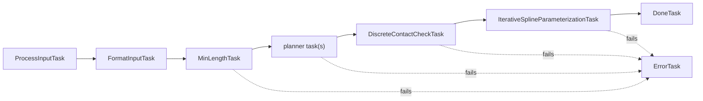
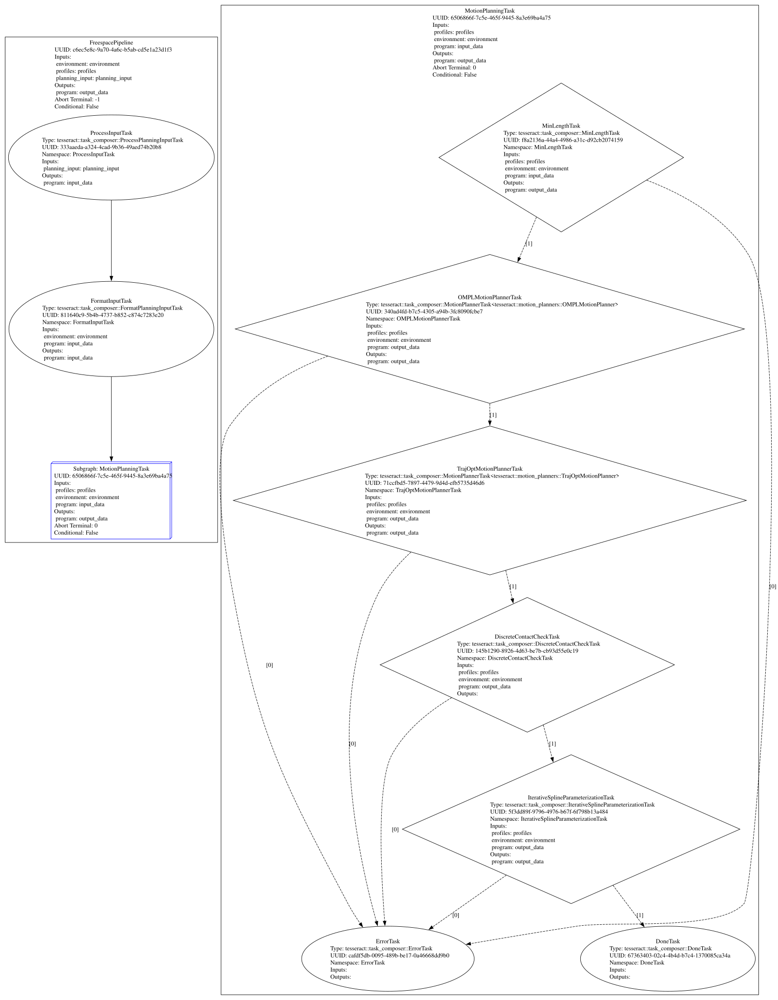
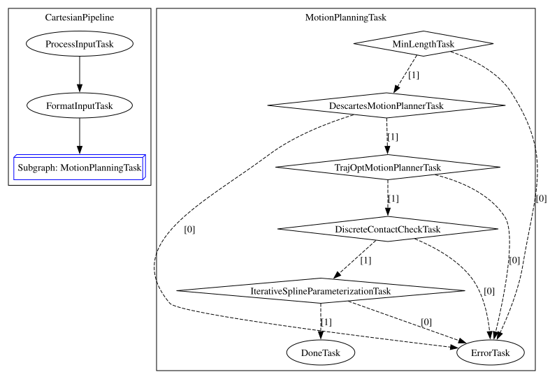
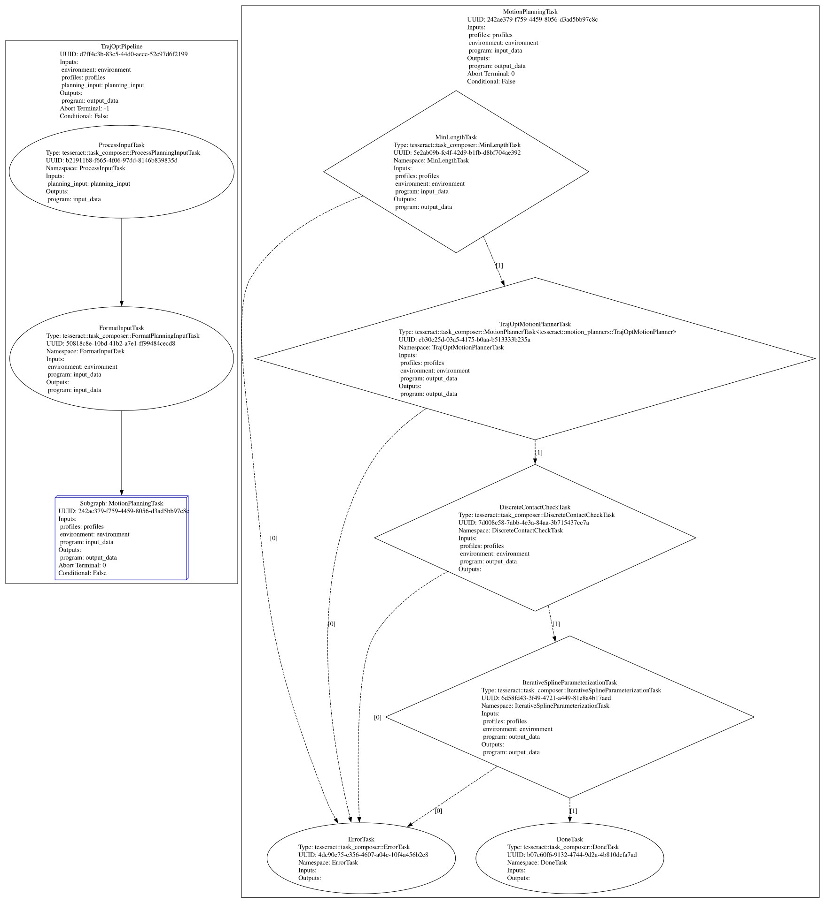
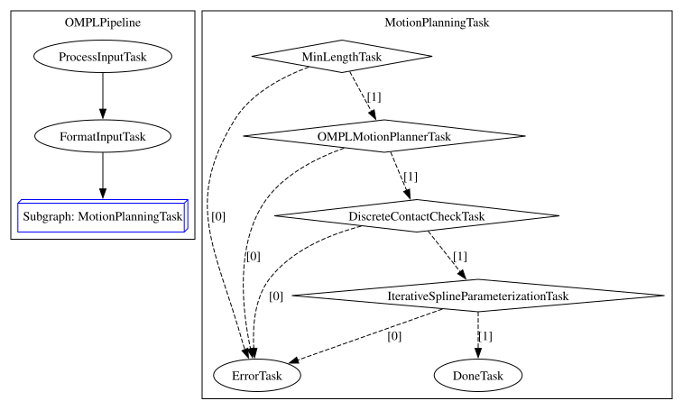
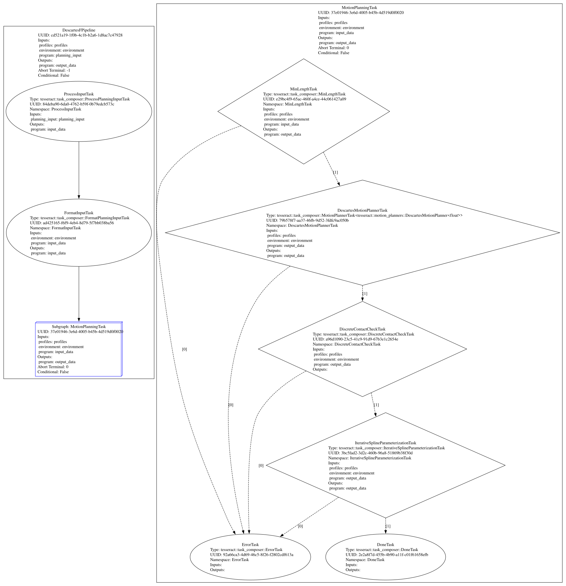
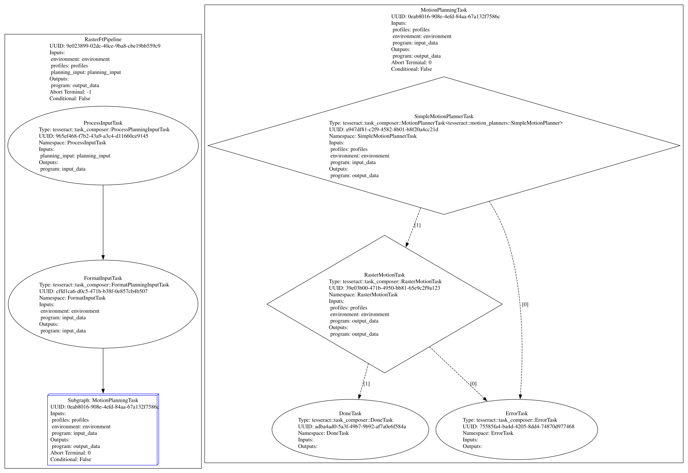
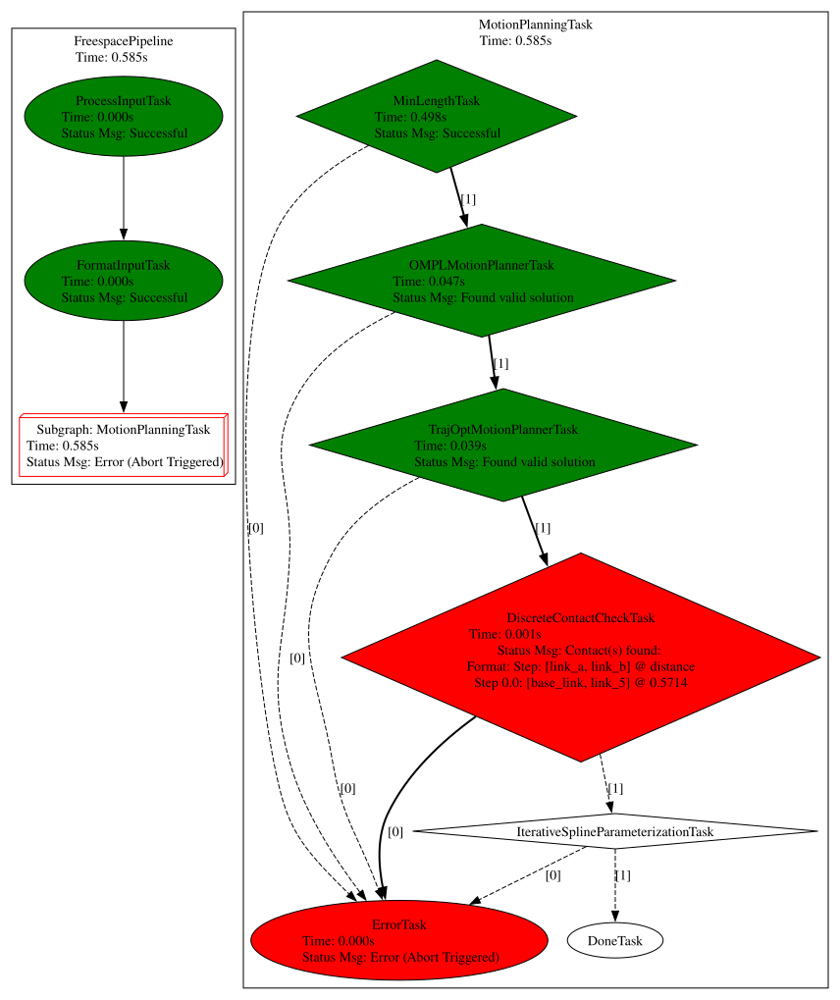

# Task composer

<!-- snippet: ambient
import tesseract_robotics
from tesseract_robotics.planning import TaskComposer
from tesseract_robotics.command_language import ProfileDictionary
from tesseract_robotics.task_composer import (
    AnyPoly_wrap_CompositeInstruction, AnyPoly_wrap_EnvironmentConst, AnyPoly_wrap_ProfileDictionary,
    TaskComposerDataStorage, TaskComposerPluginFactory,
)
from tests.docs.doc_assets import enter_scratch_dir, joint_program

enter_scratch_dir()
config_path = tesseract_robotics.get_task_composer_config_path()
composer = TaskComposer.from_config()
program = joint_program(robot)
composite = program
profiles = ProfileDictionary()
programs = [program]
factory = TaskComposerPluginFactory(config_path, locator)
task = factory.createTaskComposerNode("FreespacePipeline")
task_data = TaskComposerDataStorage()
task_data.setData("planning_input", AnyPoly_wrap_CompositeInstruction(program))
task_data.setData("environment", AnyPoly_wrap_EnvironmentConst(env))
task_data.setData("profiles", AnyPoly_wrap_ProfileDictionary(ProfileDictionary()))
-->

Hold one `TaskComposer` per process and plan every program through it: building one loads the
task plugins, and only the composer that loaded them plans fast. The task composer runs
[pipelines](../concepts/glossary.md#planning): graphs of tasks (a planner, a contact check, a
time parameterization) that a YAML config declares and plugins implement. Each `plan_*` call of
the [planning guide](planning.md) runs one. Use `TaskComposer` directly to run another
pipeline, pass your own [profiles](#profiles), see which task failed, or run a pipeline of your
own. The wrapper is `tesseract_robotics.planning.TaskComposer`; the bound C++ types are in
`tesseract_robotics.task_composer`.

## Run a pipeline

=== "TaskComposer"

    ```python
    import numpy as np
    from tesseract_robotics.planning import (
        CartesianTarget, JointTarget, MotionProgram, Pose, Robot, TaskComposer,
    )

    locator = GeneralResourceLocator(paths=[get_tesseract_resource_path()])  # the [support] extra
    robot = Robot.from_tesseract_support("abb_irb2400", locator)

    program = (
        MotionProgram("manipulator", tcp_frame="tool0", working_frame="base_link")
        .move_to(JointTarget(np.zeros(6)))
        # m in base_link, tool pointing down: [qx, qy, qz, qw] = [0, 1, 0, 0]
        .move_to(CartesianTarget(Pose.from_xyz_quat(0.8, 0.0, 0.5, 0.0, 1.0, 0.0, 0.0)))
    )

    composer = TaskComposer.from_config()
    result = composer.plan(robot, program, pipeline="TrajOptPipeline")
    assert result.successful, result.message
    print(f"Planned {len(result.trajectory)} waypoints")
    ```

=== "Plugin factory"

    ```python
    from pathlib import Path

    from tesseract_robotics.common import GeneralResourceLocator
    from tesseract_robotics.task_composer import (
        AnyPoly_wrap_CompositeInstruction,
        AnyPoly_wrap_EnvironmentConst,
        AnyPoly_wrap_ProfileDictionary,
        TaskComposerDataStorage,
        TaskComposerPluginFactory,
    )

    locator = GeneralResourceLocator()  # any ResourceLocator, including a Python subclass
    # a pathlib.Path is a config file; a str is YAML text
    factory = TaskComposerPluginFactory(Path(config_path), locator)

    executor = factory.createTaskComposerExecutor("TaskflowExecutor")
    pipeline = factory.createTaskComposerNode("TrajOptPipeline")

    # The inputs the pipeline's ports name, each wrapped in an AnyPoly
    storage = TaskComposerDataStorage()
    storage.setData("planning_input", AnyPoly_wrap_CompositeInstruction(composite))
    storage.setData("environment",    AnyPoly_wrap_EnvironmentConst(env))
    storage.setData("profiles",       AnyPoly_wrap_ProfileDictionary(profiles))

    future = executor.run(pipeline, storage)
    future.wait()

    output_key = pipeline.getOutputPortMappings().single("program")
    output = future.context.data_storage.getData(output_key)
    ```

`TaskComposer.plan` does what the second tab spells out: it converts a `MotionProgram`, seeds
Cartesian waypoints with the current state (on a copy; `auto_seed=False` turns it off), picks the
pipeline's default profiles, wraps the inputs, runs, and unpacks the trajectory into a
`PlanningResult`. Drop to the factory to run a node `plan` cannot bind (one without a `program`
output) or to read intermediate data. `PlanningResult` is described under
[Trajectory output](planning.md#trajectory-output).

| `TaskComposer.from_config` argument | Default | Effect |
|---|---|---|
| `config_path` | `get_task_composer_config_path()`: `TESSERACT_TASK_COMPOSER_CONFIG_FILE` if set, else the bundled config | the YAML that declares the pipelines and the executor |
| `num_threads` | the config's executor (`threads: 5` in the bundled config) | threads of a new `TaskflowExecutor`; at least 1 |
| `executor` | none | a pre-built executor; excludes `num_threads` |
| `warmup` | `False` | `True` builds the [common pipelines](#plugin-warmup) now; a list builds those |

## Plugin warmup

The task composer loads its tasks as plugins (`boost_plugin_loader`, `dlopen`). Building a
`TaskComposer` loads the factory, and the first plan through a pipeline creates its nodes; later
plans through the same composer reuse them. Measured on an Apple M1 Max (10 cores):
`TaskComposer.from_config()` takes 0.3 to 1.0 s (0.6 s on a re-measurement here), and the first
plan through a pipeline is slower than later ones through the same composer (a
`basic_cartesian_example` `TrajOptPipeline` plan: 1.02 s first, 0.95 s after, on the same machine).

`warmup` moves the node creation to startup, where it does not land on the first plan:

```python
from tesseract_robotics.planning import TaskComposer

composer = TaskComposer.from_config()
composer.warmup(["FreespacePipeline"])  # create this pipeline's nodes now
result = composer.plan(robot, program, pipeline="FreespacePipeline")
assert result.successful, result.message

composer = TaskComposer.from_config(warmup=True)  # the common pipelines, listed below
composer = TaskComposer.from_config(warmup=["TrajOptPipeline", "OMPLPipeline"])
```

`warmup=True` builds `TrajOptPipeline`, `TrajOptIfoptPipeline`, `FreespacePipeline`,
`FreespaceIfoptPipeline`, `CartesianPipeline` and `OMPLPipeline`. A name that does not load
raises `PipelineWarmupError`. Warming up pays off in a REPL, a service and a benchmark; a script
that plans once spends the same time either way.

The module-level `plan_*` functions build a new composer on every call unless you pass
`composer=`, and pay the load again each time:

```python
from tesseract_robotics.planning import TaskComposer, plan_cartesian

composer = TaskComposer.from_config(warmup=["DescartesDPipeline"])
for program in programs:
    result = plan_cartesian(robot, program, composer=composer)
```

## Available pipelines

`TaskComposer.get_available_pipelines()` lists the node names the config declares that build;
the bundled config has 36. Each shipped `<Name>Pipeline` wraps a `<Name>Task` behind two input
formatting tasks, and every `<Name>Task` but the raster ones has the same shape:



The pipelines differ in the planner tasks between `MinLengthTask` and the contact check:

| Pipeline | Planner tasks | `plan_*` that runs it |
|---|---|---|
| `TrajOptPipeline` | TrajOpt | `plan_freespace` |
| `FreespacePipeline` | OMPL, then TrajOpt | `plan_ompl` |
| `OMPLPipeline` | OMPL | |
| `TrajOptIfoptPipeline` | TrajOpt-Ifopt | |
| `FreespaceIfoptPipeline` | OMPL, then TrajOpt-Ifopt | |
| `CartesianPipeline` | Descartes (`float`), then TrajOpt | |
| `DescartesDPipeline` / `DescartesFPipeline` | Descartes on `double` / `float` states | `plan_cartesian` (`D`) |
| `DescartesDNPCPipeline` / `DescartesFNPCPipeline` | as above, without the contact check | |
| `Raster{Ft,Ct}{,Only}{,Global}Pipeline` | a raster program: a `SimpleMotionPlannerTask` seed, then (`Global`: a whole-program `DescartesFMotionPlannerTask`), then `RasterMotionTask`: a `CartesianTask` per raster, a `FreespaceTask` (`Ft`) or `CartesianTask` (`Ct`) per transition, plus freespace approach and return unless `Only` (`RasterOnlyMotionTask`). Min-length, contact check and time parameterization run inside the sub-tasks | |

Each `Pipeline` has a `Task` twin (`TrajOptTask`, …) without the two formatting tasks, which a
custom graph can embed. [The DOT graphs](#visualizing-pipelines) show every node.

```python
pipelines = composer.get_available_pipelines()
assert "FreespacePipeline" in pipelines
```

### Splitting a config with `!include`

The factory expands `!include` when it loads a config from a path. A relative path resolves
against the including file's directory:

```yaml
# main.yaml
task_composer_plugins:
  search_paths: [...]
  search_libraries: [...]
  executors: {...}
  tasks: !include tasks.yaml
```

`TaskComposer.from_config("main.yaml")` and `get_available_pipelines()` see the included tasks.
To inspect the config the factory loaded:

```python
factory = composer.factory
factory.getTaskComposerNodePlugins()           # {node name: PluginInfo}
factory.getAvailableTaskComposerNodePlugins()  # node factory class names
```

`getTaskComposerNodePlugins()` is keyed by the names `plan(pipeline=...)` takes
(`TrajOptPipeline`); `getAvailableTaskComposerNodePlugins()` lists the factory classes the plugin
libraries export (`PipelineTaskFactory`), the values `PluginInfo.class_name` may take. The second
call loads the plugin libraries.

## Profiles

A task reads its settings from the `ProfileDictionary` under its own name (the namespace) and the
profile name each instruction carries (`DEFAULT` unless the program or target names another);
[Profiles](../concepts/index.md#profiles) explains the lookup. `plan` with `profiles=None` takes
the pipeline's default set from `default_profiles_for(pipeline)`:

| Pipelines | Default set |
|---|---|
| `TrajOpt*` | `create_trajopt_default_profiles()` |
| `TrajOptIfopt*` | `create_trajopt_ifopt_default_profiles()` |
| `OMPL*` | `create_ompl_default_profiles()` |
| `Freespace*` | `create_freespace_pipeline_profiles()` |
| `FreespaceIfopt*` | `create_freespace_ifopt_pipeline_profiles()` |
| `Cartesian*` | `create_cartesian_pipeline_profiles()` |
| `Descartes*` | `create_descartes_default_profiles()` |
| `Raster*` | `create_raster_pipeline_profiles()` |

Any other node raises `NoDefaultProfilesError`; pass `profiles=`. The planner settings these
helpers expose are on the [planning guide](planning.md). The other tasks (`MinLengthTask`, the
contact check, the time parameterization) use their library defaults unless you add a profile
under their name.

```python
from tesseract_robotics.planning import create_trajopt_default_profiles

profiles = create_trajopt_default_profiles()
result = composer.plan(robot, program, pipeline="TrajOptPipeline", profiles=profiles)
```

A hand-built dictionary takes one `addProfile(namespace, profile name, profile)` per entry:

```python
from tesseract_robotics.command_language import ProfileDictionary
from tesseract_robotics.motion_planners_ompl import OMPLRealVectorMoveProfile
from tesseract_robotics.motion_planners_trajopt import TrajOptDefaultMoveProfile

profiles = ProfileDictionary()
profiles.addProfile("OMPLMotionPlannerTask", "DEFAULT", OMPLRealVectorMoveProfile())
profiles.addProfile("TrajOptMotionPlannerTask", "DEFAULT", TrajOptDefaultMoveProfile())
```

### Profiles from YAML

Every planner profile with a C++ YAML constructor has a static `from_yaml(text)`. It parses the
text with the profile's own C++ reader, so the keys are the C++ field names; keys left out keep
the profile's defaults. Malformed YAML raises `ValueError`; a value of the wrong type raises the
C++ reader's error.

=== "Simple"

    ```python
    from tesseract_robotics.motion_planners_simple import SimplePlannerLVSMoveProfile

    profile = SimplePlannerLVSMoveProfile.from_yaml("min_steps: 4\n")
    assert profile == SimplePlannerLVSMoveProfile(min_steps=4)
    ```

=== "OMPL"

    ```python
    from tesseract_robotics.motion_planners_ompl import OMPLRealVectorMoveProfile

    profile = OMPLRealVectorMoveProfile.from_yaml("solver_config:\n  planning_time: 3.5\n")
    assert profile.solver_config.planning_time == 3.5
    ```

    A nested key replaces that sub-config, built from its own defaults: `solver_config:` starts
    with no planners, so add them with `profile.solver_config.addPlanner(...)`.

=== "TrajOpt"

    ```python
    from tesseract_robotics.motion_planners_trajopt import (
        TrajOptDefaultCompositeProfile,
        TrajOptDefaultMoveProfile,
        TrajOptOSQPSolverProfile,
    )

    move = TrajOptDefaultMoveProfile.from_yaml("joint_cost_config:\n  enabled: true\n")
    composite = TrajOptDefaultCompositeProfile.from_yaml("avoid_singularity_coeff: 7.5\n")
    solver = TrajOptOSQPSolverProfile.from_yaml("settings:\n  max_iter: 321\n")
    assert move.joint_cost_config.enabled
    assert composite.avoid_singularity_coeff == 7.5
    assert solver.settings.max_iter == 321
    ```

    `settings:` and `opt_params:` merge into the solver profile's values: keys left out keep them.

=== "TrajOpt-Ifopt"

    ```python
    from tesseract_robotics.motion_planners_trajopt_ifopt import (
        TrajOptIfoptDefaultCompositeProfile,
        TrajOptIfoptOSQPSolverProfile,
    )

    composite = TrajOptIfoptDefaultCompositeProfile.from_yaml("smooth_jerks: false\n")
    solver = TrajOptIfoptOSQPSolverProfile.from_yaml("opt_params:\n  max_iter: 7\n")
    assert not composite.smooth_jerks
    assert solver.opt_params.max_iter == 7
    ```

=== "Task composer"

    ```python
    from tesseract_robotics.task_composer_planning import (
        MinLengthProfile,
        UpsampleTrajectoryProfile,
    )

    assert MinLengthProfile.from_yaml("min_length: 99\n").min_length == 99
    upsample = UpsampleTrajectoryProfile.from_yaml("longest_valid_segment_length: 0.7\n")
    assert upsample.longest_valid_segment_length == 0.7
    ```

The Descartes profiles have no YAML constructor upstream, so they have no `from_yaml`.

## Visualizing pipelines

Every `TaskComposerNode` exports its graph as [Graphviz DOT](https://graphviz.org/), the `dump()`
output of the C++ task composer: `getDotgraph()` returns the DOT source, `saveDotgraph(path)`
writes it, and `dot -Tsvg pipeline.dot -o pipeline.svg` renders it. The graphs below come from
`pixi run docs-dotgraphs` (`scripts/generate_pipeline_dotgraphs.py`), which trims the debug fields (UUIDs, C++ type names,
port maps) from the labels. Diamonds are conditional tasks; an edge label is the return value
that takes it, `[1]` onward and `[0]` to `ErrorTask`. Click a graph to zoom.

=== "Freespace"

    [](../assets/dotgraphs/FreespacePipeline.svg)

=== "Cartesian"

    [](../assets/dotgraphs/CartesianPipeline.svg)

=== "TrajOpt"

    [](../assets/dotgraphs/TrajOptPipeline.svg)

=== "OMPL"

    [](../assets/dotgraphs/OMPLPipeline.svg)

=== "Descartes"

    [](../assets/dotgraphs/DescartesFPipeline.svg)

=== "Raster"

    [](../assets/dotgraphs/RasterFtPipeline.svg)

### Debugging a failed plan

`result.message` names the task that failed and why, `"<task>: <message>"`; the
[planning guide](planning.md#when-a-plan-fails) lists the common ones. `result.task_infos` holds
every node that ran (`name`, `status_code`, `status_message`, `elapsed_time`). To see where in
the graph a run stopped, pass the run's info map to `saveDotgraph` (or `getDotgraph`) to colour
the graph with it.

```python
future = composer.executor.run(task, task_data)
future.wait()

if not future.context.isSuccessful():
    # green: succeeded, with its time; red: failed or aborted
    task.saveDotgraph("debug.dot", future.context.task_infos.getInfoMap())
```

Here `DiscreteContactCheckTask` aborted the run: the planners succeeded (green, with their solve
times), the contact check failed (red, its message naming the link pair) and the enclosing graph
reports the abort.

[](../assets/dotgraphs/FreespacePipeline_annotated.svg)

## Custom pipelines

A pipeline of your own is a `PipelineTaskFactory` entry under `tasks: plugins:` in the config:
`nodes` by name, each a task factory `class` with its `config`, or an existing node by `task`;
`edges` from each node to its destinations, the first on failure (`[0]`) and the second on
success (`[1]`); and `terminals`. This one is `TrajOptTask` without its contact check, behind
the `TrajOptPipeline` front end:

```python
import copy
from pathlib import Path

import yaml

from tesseract_robotics.planning import TaskComposer, create_trajopt_default_profiles
from tesseract_robotics.task_composer import TaskComposerPluginFactory

custom = yaml.safe_load("""
TrajOptNoCheckTask:
  class: PipelineTaskFactory
  config:
    conditional: true
    inputs: {program: input_data, environment: environment, profiles: profiles}
    outputs: {program: output_data}
    nodes:
      DoneTask: {class: DoneTaskFactory, config: {conditional: false}}
      ErrorTask: {class: ErrorTaskFactory, config: {conditional: false}}
      MinLengthTask:
        class: MinLengthTaskFactory
        config:
          conditional: true
          inputs: {program: input_data, environment: environment, profiles: profiles}
          outputs: {program: output_data}
      TrajOptMotionPlannerTask:
        class: TrajOptMotionPlannerTaskFactory
        config:
          conditional: true
          inputs: {program: output_data, environment: environment, profiles: profiles}
          outputs: {program: output_data}
          format_result_as_input: false
      IterativeSplineParameterizationTask:
        class: IterativeSplineParameterizationTaskFactory
        config:
          conditional: true
          inputs: {program: output_data, environment: environment, profiles: profiles}
          outputs: {program: output_data}
    edges:
      - {source: MinLengthTask, destinations: [ErrorTask, TrajOptMotionPlannerTask]}
      - {source: TrajOptMotionPlannerTask, destinations: [ErrorTask, IterativeSplineParameterizationTask]}
      - {source: IterativeSplineParameterizationTask, destinations: [ErrorTask, DoneTask]}
    terminals: [ErrorTask, DoneTask]
""")

config = yaml.safe_load(Path(config_path).read_text())
tasks = config["task_composer_plugins"]["tasks"]["plugins"]
tasks.update(custom)
# Reuse the shipped pipeline's front end, pointed at the new task
tasks["TrajOptNoCheckPipeline"] = copy.deepcopy(tasks["TrajOptPipeline"])
tasks["TrajOptNoCheckPipeline"]["config"]["nodes"]["MotionPlanningTask"]["task"] = "TrajOptNoCheckTask"

factory = TaskComposerPluginFactory(yaml.safe_dump(config), locator)  # a str is YAML text
custom_composer = TaskComposer(factory, locator)
result = custom_composer.plan(
    robot, program, pipeline="TrajOptNoCheckPipeline", profiles=create_trajopt_default_profiles()
)
assert result.successful, result.message
```

A custom node has no default profiles, so `plan` needs `profiles=`. In a file, the same entries
go under `tasks: plugins:` of your config, or into a file it pulls in with `!include`.

### Config schemas

Each node and executor type describes the config it accepts as a schema, a
`common.PropertyTree`; YAML crosses as text. `applyConfig` checks a config against it:

```python
from tesseract_robotics.task_composer import (
    TaskComposerGraph, TaskComposerNodePorts, TaskComposerTask,
)

TaskComposerGraph.schema().keys()  # [..., 'inputs', 'outputs', 'nodes', 'edges', 'terminals']

ports = TaskComposerNodePorts()
ports.addRequiredInput("program").addRequiredOutput("program")
ports.inputSchema().keys()         # ['program']

schema = TaskComposerTask.schema(ports)
schema.applyConfig("inputs: {program: in}\noutputs: {program: out}\nbogus_key: 1\n")
# ['bogus_key: property does not exist in schema']
```

`applyConfig` merges the config into the schema and returns every error (empty when valid);
`allow_extra_properties=True` accepts undeclared keys. A port mapping that breaks the contract
gives a `ValidationError`, whose `toString()` (also `str()`) is `inputs.<port>: <message>`:

```python
from tesseract_robotics.task_composer import TaskComposerPortMap

inputs, outputs = TaskComposerPortMap(), TaskComposerPortMap()
inputs.set("program", "in")
inputs.set("bogus_port", "in")   # a port the contract does not declare
outputs.set("program", "out")
(error,) = ports.validate(inputs, outputs)
error.toString()                            # 'inputs.bogus_port: undeclared port'
```

## What goes wrong

`plan` raises on a configuration or programming error it detects before running, and returns
`successful=False` when a planner ran and found no solution. An exception thrown inside a task
comes back as `successful=False` with `<task>: Exception thrown: ...` (for example Descartes
without a collision checker when collisions are disabled).

| Symptom | Cause | Fix |
|---|---|---|
| `UnknownPipelineError` | `pipeline=` names no configured node; the message lists them | pick a listed name |
| `NoDefaultProfilesError` | a custom node and `profiles=None` | pass `profiles=` |
| `PipelineLayoutError` | the node has no `program` output or no `planning_input` / `program` input | run it through the plugin factory |
| `ProfileTypeMismatchError` | a Descartes node reads `D` profiles and the dictionary holds only `F` ones, or the reverse | see [two scalar types](planning.md#descartes) |
| `PipelineWarmupError` | a name passed to `warmup` does not load | check the name and the plugin search paths |
| `TaskComposerPluginError` (a `RuntimeError`) from the factory | `createTaskComposerNode` / `createTaskComposerExecutor` found no such plugin | as above; the factory never returns `None` |
| `ConflictingExecutorError`, `InvalidThreadCountError` | both `num_threads` and `executor`, or `num_threads < 1` | pass one, at least 1 |
| `successful=False`, `"<task>: <message>"` | the named task failed | [When a plan fails](planning.md#when-a-plan-fails); render the [annotated graph](#debugging-a-failed-plan) |

## Next steps

- [Low-level SQP](low-level-sqp.md): build and step an optimization problem yourself.
- [Online planning example](../examples/online-planning.md): replanning around a moving obstacle.
